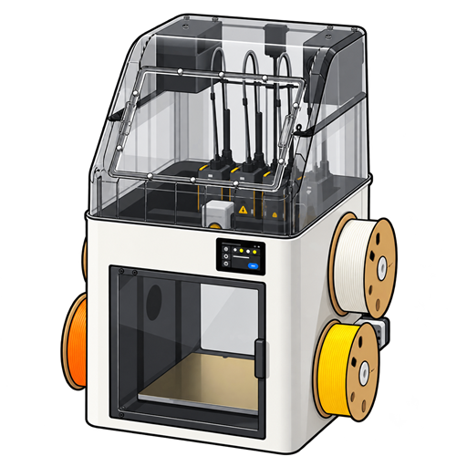

# ioBroker.snapmaker-u1

Английская основная документация: [README.md](/#/adapters/snapmaker-u1) .

Deutscher ioBroker-адаптер для локального использования [Snapmaker U1](https://www.snapmaker.com/) или Moonraker. Вы можете получить статус Druckstatus, ETA, Kameras, AFC-/Spoolman-Metadaten, Druckvorschauen и abgesicherte PAXX12-Steuerungen.

> **Первая версия:** Steuerfunktionen sind nur für den ausdrücklich gewählten Modus **PAXX12** vorgesehen. Оригинальная прошивка недействительна. Друкер был в восторге от хороших результатов.

## Функции

- Lokale Moonraker-Verbindung über configurierbaren Host und Port (Стандарт: `7125`).
- Druckstatus, Dateiname, Filamentverbrauch, Fortschritt, Pausenstatus, Meldungen, Schichten und Dateifortschritt.
- Slicer-Metadaten, Restzeit, Slicer-Restzeit и geschätzte Endzeit unter `printer.job.*`.
- Klipper-Status, Bereitschaft und Verbindungsfehler unter `printer.info.*`.
- Инструмент, регулировка и температура камеры, Sollwerte, Heizleistungen, опережение давления, плавное время, а также Bewegungs- и Flow-Diagnosen.
- Kameraerkennung und Druckvorschau-URL. ETA будет отключено, если вы отключите его.
- Автоматическое управление, регулировка люфта/об/мин и датчик температуры `printer.fans.*` унд `printer.sensors.*`.
- AFC-/Spoolman-Status и Lane-Metadaten über Moonraker; keine direkte Spoolman-Verbindung und keine Schreibvorgänge.
- Abgesicherte Home-, Jog-, Druck-, Toolhead- und Extrusionssteuerung für PAXX12.

## Kameras, Vorschau und Lüfter

Камеры с **камерами, установленными и закрепленными,** были активны, камеры Moonraker были установлены и сохранены; es findet kein Netzwerkscan statt. Дополнительные камеры Ausgewählte Kameras `cameras.<Moonraker UID>` с именем, активным статусом, URL-адресом потока/снимка, Dienst, Drehung und Spiegelung. Адаптер не имеет конфигурации, он отключен от сети и не может быть гарантирован.

`printer.job.previewUrl` введите данные G-Code-Datei. Камера и миниатюра изображения были включены в протокол отладки и создания протоколов и сохранены в памяти Друкера.

Die Deckellüfter werden über `printer.cover.circulation.speed` унд `printer.cover.exhaust.speed` жест. Эйнен Прозентверт 0–100 минут `ack=false` шрайбен. Befehle Sind Serialisiert und Ungültige Werte Werden Abgelehnt.

## PAXX12-Sicherheit

Активируйте **режим** прошивки для **PAXX12-Firmware** setzen. `auto` унд `original` lehnen bewusst alle Home-, Jog- und Drucksteuerungsanfragen ab.

Джеде Анфраге сохранил свой статус «Лунный гонщик» и сохранил его Sicherheitsprüfung. Der Adaptor sendet ausschließlich feste, стажер erzeugte Klipper-Befehle; es gibt keinen frei beschreibbaren G-Code-Datenpunkt.

- `printer.control.home.all`, `.x`, `.y` унд `.z` verwenden `G28` и sind nur im Leerlauf erlaubt.
- Скорость вращения от **0,1–25 мм** до **1–100 мм/с** начинается. Sie verlangen Referenzierte Achsen und Gültige Moonraker-Achsgrenzen.
- `Pause` ist nur beim Drucken, `Resume` nur bei Pause und `Cancel` nur beim Drucken или Bei Pause verfügbar.
- Fehler und abgelehnte Anfragen stehen в `printer.control.lastError`.

Головки инструментов предназначены для адаптера, указанного в качестве объекта для стрижки и безопасного использования. Bei vorhandenen PAXX12-AFC-Lite-Makros werden ausschließlich `CHANGE_TOOL LANE=E0` бис `E3` унд `LANE_UNLOAD LANE=E0` бис `E3` вервендет. При задании температуры и ручной экструзии можно установить постоянную температуру, состояние экструдера и получить желаемый результат. Функция парковки должна быть деактивирована, если вы используете функцию U1-/PAXX12-Parkmakro, и она действительна.

Макрос может быть отключен [от PAXX12-AFC-Lite-Konfiguration](https://github.com/paxx12-snapmaker-u1/SnapmakerU1-Extended-Firmware/blob/main/overlays/firmware-extended/31-feature-afc-lite/root/usr/local/share/firmware-config/tweaks/klipper/afc.cfg) . Die Daten werden über Moonrakers [Printer-Object-Endpunkte](https://moonraker.readthedocs.io/en/latest/external_api/printer/) abgefragt; Температура воздуха в [документации по G-коду](https://www.klipper3d.org/G-Codes.html) Klippers.

## Конфигурация

| Einstellung                   | Bedeutung                                                      |
| ----------------------------- | -------------------------------------------------------------- |
| Хост Moonraker или IP-адрес   | Имя локального хоста или IP-адрес, без `http://` und ohne Pfad. |
| Мунрейкер-Порт                | HTTP-порт Moonraker, стандартный вариант `7125`.               |
| Режимы прошивки               | Автоматическое использование оригинальной прошивки или PAXX12. |
| Anfrage-Timeout               | Максимал Дауэр Эйнер Мунрейкер-Анфраге в Секундене.            |
| Интервал опроса               | Zeit zwischen Statusprüfungen в течение нескольких секунд.     |
| Интеграция Спулмана           | Aktiviert AFC- и Spoolman-Statusabfragen über Moonraker.       |
| Камеры erkennen und auswählen | Самые активные камеры и настройки Auswahl.                     |
| Druckvorschau                 | Активируйте миниатюру URL-адреса актуальных данных G-кода.     |

## Важные группы точек данных

| Группа                                | Инхальт                                                                          |
| ------------------------------------- | -------------------------------------------------------------------------------- |
| `info.connection` /`printer.info.*`   | Verbindung, Hostname, Firmware, Klippy-Status и Fehler.                          |
| `printer.job.*`                       | Datei, Zeiten, ETA, Slicer, Schichten, Meldungen, Fortschritt und Vorschau.      |
| `printer.motion.*`                    | Положение, Bewegungsgrenzen, Geschwindigkeit sowie Коэффициент скорости/расхода. |
| `printer.tools.*` /`printer.bed.*`    | Температурный, Sollwerte, Leistung und erweiterte Extrumerdaten.                 |
| `printer.fans.*` /`printer.sensors.*` | Динамичное управление скоростью вращения/об/мин и датчиками.                     |
| `printer.afc.*` /`printer.spoolman.*` | AFC-Lanes, Fehler und Spoolman-Metadata.                                         |
| `printer.control.*`                   | Abgesicherte PAXX12-Steuerungen und Deren Diagnosen.                             |

## Entwicklung

Erfordert Node.js 22.19.0 или новая версия и ioBroker Admin 7.6.20 или новая версия.

```bash
npm ci
npm run check
npm test
npm run lint
npm run build
```

## Релизы

Выпуск GitHub veröffentlichter ist nur gültig, когда есть тег zur Version in `package.json` passt und auf `main` время. Nach erfolgreichen Prüfungen veröffentlicht GitHub Actions Stabile Releases als npm-Tag `latest` Предварительные релизы также `next`. Bereits veröffentlichte Versionen werden nicht nachträglich verändert.

## Дорожная карта

1. Инструменты, разгрузка полос, температура и ручная экструзия и действительный физический PAXX12-U1.
2. Parksteuerung erst nach dokumentiertem und Physisch validiertem Parkmakro ergänzen.
3. Moonraker-Payloads и einem U1 с оригинальной прошивкой должны быть активированы.
4. Автоматические испытания материалов, материалов и медицинских материалов.

## Haftungsausschlus

Snapmaker и U1 также являются маркировкой ювелирных изделий. Dies ist unabhängiges Community-Projekt und weder mit Snapmaker verbunden noch von Snapmaker unterstützt.

## Änderungsprotokoll

### 0.0.12 (2026-11-15)

- (Негативно) Официальные ioBroker-Release-Workflow доступны и новые версии Release-Hinweise beibehalten.

### 0.0.11 (2026-11-15)

- (Негативно) Для правильной и быстрой установки выполните следующие действия.

### 0.0.10 (2026-11-15)

- (Негаляйн) Получите доступ к тегу Ablauf Tag zu npm zu GitHub-Release wiederhergestellt und korrigiertes Dokumentationspaket veröffentlicht.

### 0.0.9 (2026-11-15)

- (Негален) Английский Haupt-README wiederhergestellt und eigene deutsche README ergänzt.

### 0.0.8 (2026-11-15)

- (Негален) Немецкий README для GitHub и npm.

### 0.0.7 (2026-11-15)

- (Негативно) Полный комплект адаптеров для ETA- и диагностической телеметрии.

### 0.0.6 (2026-11-15)

- (Негаляйн) Druck-ETA, Fertigstellungszeit, Schichten, Meldungen und Diagnose-Telemetrie ergänzt.

Vollständige Release-Hinweise: CHANGELOG.md.

## Лицензия

Авторские права (c) 2026 Negalein <negalein@gmail.com>

Lizenziert unter der [MIT-Lizez](https://github.com/Negalein/ioBroker.snapmaker-u1/blob/main/LICENSE) .