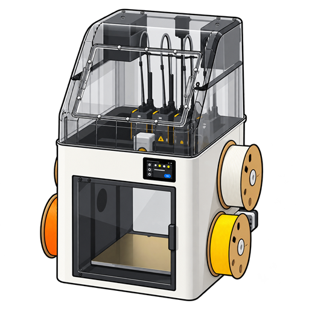

# ioBroker.snapmaker-u1

Документация на немецком языке: [README-German.md](/#/docs/adapterref/iobroker.snapmaker-u1/README-German.md) .

Адаптер ioBroker для мониторинга [Snapmaker U1](https://www.snapmaker.com/) через локальный сервис Moonraker, включающий управление вентилятором верхней крышки, метаданные AFC/Spoolman, обнаружение камер, URL-адреса предварительного просмотра печати и защищенное управление движением, печатью и дополнительной инструментальной головкой PAXX12.

> Это ранняя версия для разработки. Точки управления в версиях v0.0.3/v0.0.4 намеренно ограничены явно выбранным режимом прошивки **PAXX12** . Они не заявляют о совместимости с оригинальной прошивкой Snapmaker, которая не была проверена. Используйте элементы управления принтера только под присмотром к свободному и безопасному принтеру.

## Текущая функциональность

### Фотоаппараты и предварительный просмотр печати

В настройках откройте **раздел «Обнаружение» и выберите камеры** , чтобы получить список включенных камер из Moonraker, затем сохраните множественный выбор. Сначала сохраните имя хоста принтера и оставьте адаптер запущенным для обнаружения. Сканирование сети не выполняется.

Ниже представлены фотографии некоторых камер. `cameras.<namespace-safe ID derived from the Moonraker UID>` Адаптер содержит имя, флаг включения, URL потока, URL снимка, службу, настройки поворота и зеркального отображения. Адаптер считывает только конфигурацию камеры; он не открывает непрерывные видеопотоки и не утверждает, что камера доступна. Для работы WebRTC требуется совместимый просмотрщик. Исторические объекты камер сохраняются после снятия выделения, но больше не обновляются.

`printer.job.previewUrl` Содержит самое большое встроенное миниатюрное изображение текущего файла G-кода. Оно очищается, если файл не выбран или предварительный просмотр отключен. Тот же запрос метаданных файла предоставляет оценку среза, прогноз оставшейся продолжительности и расчетное время завершения; эти значения остаются доступными, даже если предварительный просмотр печати отключен. Сбои камеры/миниатюры регистрируются на уровне отладки и не указывают на отключение принтера. URL-адреса камер должны быть доступны из браузера, отображающего их. Обнаружение камер, их настройки и точки данных были протестированы в установленном экземпляре ioBroker с PAXX12. Настроенная запись камеры не является доказательством доступности потока.

Управление вентилятором через верхнюю крышку: введите числовое значение в процентах (0–100, `ack=false`) к `printer.cover.circulation.speed` или `printer.cover.exhaust.speed` Команды передаются последовательно и подтверждаются последующим запросом состояния принтера. Оба вентилятора были протестированы в реальных условиях с изменением на пять процентных пунктов и восстановлены. Автоматизация прошивки может впоследствии изменить скорость вращения вентиляторов. Недопустимые значения отклоняются.

Включите **интеграцию со Spoolman** для чтения информации о материале дорожки AFC, названии нити, цвете, идентификаторе катушки, флаге загрузки и статусе необработанных данных для дорожек 0–3, а также текущей дорожки AFC и флага ошибки. Статус подключения Spoolman в Moonraker и активный идентификатор катушки отображаются в разделе `printer.spoolman` Эти значения считываются через Moonraker; прямое подключение к Spoolman не настроено. Данный адаптер не создает назначений для спулов и не формирует отчетов о потреблении.

Проверка возможности опроса состояния только для чтения была проведена на PAXX12. `2.0.0-paxx12-24`:

- `printer.job`: состояние, имя файла, прошедшая продолжительность печати (секунды), использованный филамент (мм), прогресс (в процентах) и флаг паузы.
- `printer.job`: имя/версия среза, расчетная продолжительность среза, вычисленная оставшаяся продолжительность, предполагаемая метка времени завершения, слои, сообщения, ход выполнения файла и имя последнего завершенного файла, где Moonraker предоставляет базовые значения.
- `printer.tools.active`: имя активного экструдера.
- `printer.tools.tool0` через `tool3`: фактическая температура, целевая температура, мощность нагревателя, опережение давления, время плавной обработки и состояние инструмента.
- `printer.bed`: фактическая и целевая температура плюс мощность нагревателя.
- `printer.chamber.temperature`: температура камеры.
- `printer.fans.*` и `printer.sensors.*`: динамически обнаруживаемые, доступные только для чтения данные о скорости вращения вентилятора и температуре. Существующие именованные состояния вентилятора остаются неизменными.

Состояния мониторинга доступны только для чтения. Два состояния скорости вращения вентилятора и защищенные состояния управления PAXX12, описанные ниже, доступны для записи. Отсутствующие или недопустимые значения пропускаются. Владелец протестировал версию 0.0.2 в ioBroker, включая данные о принтере в реальном времени, камеры, метаданные AFC/Spoolman и повторное подключение после выключения питания. Совместимость с оригинальной прошивкой остается непроверенной.

- Подключается локально к Moonraker через настраиваемый хост и порт (по умолчанию: `7125`).
- Издает `info.connection` Имя хоста принтера, версия программного обеспечения Klipper, статус и дата последнего успешного обновления. Текущий идентификатор состояния. `printer.info.firmware` сохраняется.
- Поддерживает оригинальную прошивку и PAXX12 в качестве выбираемых режимов конфигурации; специфические для протокола функции будут добавлены после проверки на реальных устройствах.
- Программа считывает метаданные AFC и Spoolman через Moonraker. Прямой доступ к инвентарю Spoolman не реализован.

### Управление движением и печатью (только для PAXX12)

Для активации состояний управления установите **режим прошивки** на **PAXX12** . `auto` и `original` В некоторых режимах намеренно отклоняются все запросы на использование кнопок «Домой», «Прокрутка», «Пауза», «Возобновление» и «Отмена». Это позволяет избежать заявления о поддержке оригинальной прошивки до тех пор, пока она не будет физически проверена.

Каждый новый запрос на управление движением/печатью сначала получает новый статус Moonraker и проходит одну центральную проверку безопасности. Адаптер отправляет только фиксированные, внутренне сгенерированные команды Klipper; он не предоставляет доступ к состоянию G-кода в свободной форме.

- Домашние команды используются `G28` или `G28 X`, `G28 Y`, `G28 Z` и разрешены только тогда, когда `print_stats.state` является `standby`, `complete` или `cancelled`.
- Команды перемещения ограничены диапазоном **0,1–25 мм** при **скорости 1–100 мм/с** . Для их выполнения требуется неактивный принтер, правильно установленная целевая ось, конечные текущие координаты и данные, сообщаемые программой Moonraker. `axis_minimum` /`axis_maximum` Значения, содержащие целевой объект. Сгенерированный скрипт сохраняет и восстанавливает состояние G-кода Klipper.
- `Pause` Разрешается только во время печати; `Resume` только во время паузы; и `Cancel` Только во время печати или приостановки.
- Команды выполняются последовательно, кнопки сбрасываются. `false` После обработки отклоненные/неудачные запросы публикуются в `printer.control.lastError`.

Команды управления и правила безопасности для них прошли модульное тестирование, однако новые пути управления движением и выполнением заданий все еще нуждаются в проверке на физическом устройстве U1, оснащенном модулем PAXX12, прежде чем их можно будет использовать в повседневной работе.

### Управление инструментальной головкой (только для PAXX12 + обнаруженная возможность)

В версии 0.0.4 не предполагается, что у всех принтеров PAXX12 одинаковые макросы. При запуске, периодически и непосредственно перед каждым запросом на подачу инструмента, адаптер запрашивает у Moonraker загруженные объекты Klipper. Он считывает только разобранную конфигурацию экструдера Klipper, чтобы определить безопасные пределы подключенного принтера. Если обнаружение недоступно, команда отклоняется; он никогда не возвращается к предполагаемым именам макросов или произвольному состоянию G-кода.

Текущие исходные коды PAXX12 AFC Lite содержат следующую информацию: `CHANGE_TOOL` и `LANE_UNLOAD` Макросы для дорожек E0–E3. `CHANGE_TOOL` Выполняет собственную автоматическую загрузку в рамках смены инструмента. Адаптер использует только эти макросы, и только когда и макрос, и соответствующий ему макрос `AFC_lane E0` –`E3` Объекты присутствуют. Для смены инструмента или выгрузки также требуется простаивающий принтер и заведомо исправный принтер. `AFC.error_state`.

- `printer.control.toolhead.change.e0` через `.e3` проблема исправлена `CHANGE_TOOL LANE=E0` через `E3` Это кнопки **для смены и загрузки** ; отдельной команды загрузки не существует.
- `printer.control.toolhead.unload.e0` через `.e3` проблема исправлена `LANE_UNLOAD LANE=E0` через `E3` команда.
- В версии 0.0.4 кнопка парковки не отображается. Макрос парковки U1/PAXX12 не был проверен в поддерживаемом исходном коде прошивки, поэтому `printer.control.toolhead.capabilities.parkToolhead` останки `false` вместо того, чтобы отправлять предполагаемую последовательность парковки.
- `printer.control.tools.tool0.target` через `.tool3.target` Установите индивидуальные цели с помощью документированных инструментов Klipper. `SET_HEATER_TEMPERATURE` только если этот объект экструдера и его среда выполнения `max_temp` Сообщается о наличии дефектов. Адаптер сохраняет запас в пять градусов ниже заявленного порогового значения и исключает конфигурацию с неисправной головкой инструмента PAXX12 с почти нулевым отклонением. `max_power`.
- `printer.control.extrusion.extrude` и `.retract` Перемещается только текущий активный, обнаруженный экструдер. Они ограничены диапазоном **0,1–10 мм** при **скорости 0,1–10 мм/с** , требуют простоя принтера, работающего в режиме реального времени. `can_extrude` флаг и температура, равная или превышающая заявленный Klipper минимум (по умолчанию 170 °C). Сгенерированный скрипт использует только относительную экструзию и восстанавливает сохраненное состояние G-кода.

Ниже опубликованы результаты диагностики возможностей и ошибок. `printer.control.toolhead`: обнаруженные имена макросов, являются ли `CHANGE_TOOL` /`LANE_UNLOAD` являются пригодными для использования, текущая доступность команд, удобочитаемая причина и последний отклоненный или неудачный запрос на управление. Существующий мониторинг AFC в рамках `printer.afc` Сохраняется; никакие состояния AFC, Spoolman, камеры, вентилятора или управления v0.0.3 не переименовываются и не удаляются. В режиме PAXX12 состояние AFC запрашивается для проверки безопасности инструментальной головки, даже если дополнительная прямая интеграция со Spoolman отключена; данные Spoolman не записываются.

Поддерживаемые макросы AFC Lite проверяются на соответствие [конфигурации PAXX12 AFC Lite](https://github.com/paxx12-snapmaker-u1/SnapmakerU1-Extended-Firmware/blob/main/overlays/firmware-extended/31-feature-afc-lite/root/usr/local/share/firmware-config/tweaks/klipper/afc.cfg) . Для обнаружения возможностей используется документированный [список объектов принтера Moonraker и конечные точки запросов](https://moonraker.readthedocs.io/en/latest/external_api/printer/) . Для определения целевой температуры и поведения активного экструдера используются документированные Klipper методы. [`SET_HEATER_TEMPERATURE` и команды для нескольких экструдеров](https://www.klipper3d.org/G-Codes.html) . В этом выпуске адаптера есть модульные тесты, но не физическая проверка путей выполнения действий версии 0.0.4: отслеживание посещаемости и проверка поведения макросов на реальном принтере перед началом серийного использования.

## Конфигурация

| Параметр                        | Описание                                                                                                       |
| ------------------------------- | -------------------------------------------------------------------------------------------------------------- |
| Хост или IP-адрес Moonraker     | Имя хоста или локальный IP-адрес принтера. Не указывайте. `http://` или тропа.                                  |
| Порт Мунрейкер                  | Порт HTTP Moonraker; `7125` по умолчанию.                                                                       |
| Режим прошивки                  | Автоматическое определение, оригинальная прошивка или PAXX12.                                                  |
| Истекло время ожидания запроса  | Максимальная продолжительность одного запроса Moonraker, в секундах.                                           |
| Интервал опроса                 | Время между медицинскими осмотрами, в секундах.                                                                |
| Интеграция Spoolman             | Позволяет запрашивать информацию о состоянии полосы AFC и Spoolman через Moonraker.                            |
| Порт и хост Spoolman            | Зарезервировано для будущих прямых запросов по складским запасам; в настоящее время не используется для связи. |
| Найдите и выберите камеры       | Считывает записи о включенных камерах Moonraker и сохраняет выбранные камеры.                                  |
| Предварительный просмотр печати | Включает URL-адрес текущего эскиза G-кода.                                                                     |

## Штаты

| Состояние                                                                                             | Тип                        | Значение                                                                                                                                                     |
| ----------------------------------------------------------------------------------------------------- | -------------------------- | ------------------------------------------------------------------------------------------------------------------------------------------------------------ |
| `info.connection`                                                                                     | логический                 | Удалась ли последняя проверка состояния "Мунрейкера"?                                                                                                        |
| `printer.info.hostname`                                                                               | нить                       | Имя хоста, указанное программой Moonraker.                                                                                                                   |
| `printer.info.firmware`                                                                               | нить                       | Версия программного обеспечения Klipper, возвращаемая конечной точкой информации о принтере Moonraker.                                                       |
| `printer.info.status`                                                                                 | нить                       | Сообщение о состоянии принтера, полученное от Moonraker.                                                                                                     |
| `printer.info.klippyState`/`.ready` /`.lastError`                                                     | строка/логическое значение | Состояние Klipper, готовность и последняя ошибка подключения.                                                                                                |
| `printer.info.lastUpdate`                                                                             | число                      | Временная метка последнего успешного запроса.                                                                                                                |
| `printer.job.filename`, `.duration`, `.totalDuration`, `.message`, `.displayMessage`                  | строка/число               | Текущий файл, прошедшая/общая продолжительность и сообщения принтера.                                                                                        |
| `printer.job.slicer`, `.slicerVersion`, `.slicerEstimatedDuration`                                    | строка/число               | Метаданные слайсера, извлеченные программой Moonraker из файла G-кода.                                                                                       |
| `printer.job.remaining`, `.slicerRemaining`, `.estimatedEnd`, `.estimateAvailable`                    | число/логическое значение  | Прогнозируемое время прибытия в секундах и предполагаемая отметка времени завершения.                                                                        |
| `printer.job.layer.current`, `.total`, `.progress`                                                    | число                      | Текущее и общее количество слоев, а также рассчитанный прогресс слоя.                                                                                        |
| `printer.job.filePosition`, `.fileProgress`, `.lastCompletedFile`                                     | число/строка               | Позиция байта G-кода, ход выполнения файла и последний файл, завершенный в режиме реального времени.                                                         |
| `printer.motion.position.x`, `.y`, `.z`                                                               | число                      | Текущие координаты рабочей головки, сообщаемые программой Moonraker, в мм.                                                                                   |
| `printer.motion.maxVelocity`, `.maxAcceleration`, `.commandedSpeed`, `.speedFactor`, `.flowFactor`    | число                      | Ограничения движения (только для чтения), последняя заданная скорость, коэффициенты скорости и потока.                                                       |
| `printer.tools.tool0` …`.tool3`                                                                       | число/строка               | Включает в себя данные о мощности нагревателя (только для чтения), опережении давления и телеметрии сглаживания времени (если таковые имеются).              |
| `printer.bed.power`                                                                                   | число                      | Выходная мощность нагревателя подложки (только для чтения) в процентах.                                                                                      |
| `printer.fans.*` /`printer.sensors.*`                                                                 | число                      | Динамически обнаруживаемые данные телеметрии вентилятора/оборотов и температуры в режиме только для чтения.                                                  |
| `printer.control.home.all`, `.x`, `.y`, `.z`                                                          | логическая кнопка          | Писать `true` Для возврата всех осей или выбранной оси в исходное положение. Сброс настроек. `false`.                                                         |
| `printer.control.jog.step`                                                                            | число                      | Расстояние бега в мм (0,1–25).                                                                                                                               |
| `printer.control.jog.speed`                                                                           | число                      | Скорость бега трусцой в мм/с (1–100).                                                                                                                        |
| `printer.control.jog.xPositive`, `.xNegative`, `.yPositive`, `.yNegative`, `.zPositive`, `.zNegative` | логическая кнопка          | Писать `true` Перемещение с заданным шагом и скоростью. Сброс настроек. `false`.                                                                              |
| `printer.control.job.pause`, `.resume`, `.cancel`                                                     | логическая кнопка          | Писать `true` Для управления текущей печатью, когда это позволяет текущее состояние. Сбрасывает значение. `false`.                                            |
| `printer.control.safety.enabled`                                                                      | логический                 | `true` только при явном выборе режима PAXX12.                                                                                                                |
| `printer.control.safety.homingAllowed`, `.joggingAllowed`, `.jobControlAllowed`                       | логический                 | Информация о текущей доступности взята из последнего статуса Moonraker. Каждый запрос проверяется еще раз перед отправкой.                                   |
| `printer.control.safety.reason`                                                                       | нить                       | Причина недоступности управления или напоминание о необходимости повторной проверки отдельных запросов.                                                      |
| `printer.control.lastCommand` /`printer.control.lastError`                                            | нить                       | Идентификатор последнего принятого управляющего состояния / причина последнего отклоненного или неудачного запроса.                                          |
| `printer.control.toolhead.change.e0` …`.e3`                                                           | логическая кнопка          | Изменения и загрузка выбранной полосы AFC происходят только при наличии соответствующих условий. `CHANGE_TOOL` Возможность обнаружена.                        |
| `printer.control.toolhead.unload.e0` …`.e3`                                                           | логическая кнопка          | Разгрузка выбранной полосы AFC происходит только при совпадении условий. `LANE_UNLOAD` Возможность обнаружена.                                                |
| `printer.control.tools.tool0.target` …`.tool3.target`                                                 | число                      | Запрошенное целевое значение для одного экструдера; перед отправкой проверяются пределы Klipper во время выполнения.                                         |
| `printer.control.extrusion.distance` /`.speed`                                                        | число                      | Величина экструзии вручную (0,1–10 мм) / скорость (0,1–10 мм/с).                                                                                             |
| `printer.control.extrusion.extrude` /`.retract`                                                       | логическая кнопка          | После успешного прохождения всех проверок безопасности в режиме реального времени, активный нагревательный инструмент выдавливается или втягивается вручную. |
| `printer.control.toolhead.capabilities.*`                                                             | логическое значение/строка | Обнаружены макросы и поддерживаются дополнительные действия; проверено наличие парковочных мест. `false` в версии 0.0.4.                                      |
| `printer.control.toolhead.safety.*` /`.diagnostics.*`                                                 | логическое значение/строка | Текущая доступность команд, причина диагностики и последний неудачный/отклоненный запрос на использование инструментальной головки.                          |

## Разработка

Требуется Node.js версии 22.19.0 или новее и ioBroker Admin версии 7.6.20 или новее. Система непрерывной интеграции (CI) поддерживает Node.js версий 22, 24 и 26.

```bash
npm ci
npm run check
npm test
npm run lint
npm run build
```

Репозиторий был создан с использованием официального программного обеспечения.[`@iobroker/create-adapter`](https://github.com/ioBroker/create-adapter) Использует инструменты разработки, TypeScript, JSON Config, адаптерные тесты и GitHub Actions.

## Релизы

Тег версии принимается только в том случае, если он совпадает с версией в `package.json` и указывает на коммит в `main` После того, как все проверки CI пройдут успешно:

- стабильный тег, например `v0.0.4` опубликовано в npm как `latest` Затем создается обычный релиз GitHub;
- метка предварительного релиза, например `v0.0.5-beta.1` опубликовано в npm как `next` Затем создаётся предварительная версия репозитория GitHub.

Это позволяет сохранить **последнюю** версию с GitHub и npm. `latest` Теги выровнены. Существующие версии, опубликованные до этой автоматизации, не изменяются задним числом.

## Дорожная карта

1. Проверьте работу функций смены инструмента, выгрузки ленты, температуры и траекторий ручной экструзии версии 0.0.4 на физическом устройстве PAXX12 U1, а затем задокументируйте протестированную комбинацию прошивки/макросов.
2. Добавляйте управление парковкой только после того, как будет задокументировано и физически подтверждено наличие макроса парковки U1/PAXX12 и его безопасных условий.
3. Перед включением управления необходимо проверить полезную нагрузку и возможности Moonraker на физическом устройстве U1 с оригинальной прошивкой.
4. Расширьте возможности автоматизированного тестирования данных о печати, материалах и носителях.
5. Проверьте завершение работы и перезапуск в компактном режиме.
6. При необходимости добавьте прямой доступ к инвентарю Spoolman.

## Отказ от ответственности

Snapmaker и U1 являются товарными знаками соответствующих владельцев. Это независимый общественный проект, не связанный с компанией Snapmaker и не получивший от неё поддержки.

## Changelog

### 0.0.13 (2026-11-20)

- (Negalein) Align state roles with the ioBroker role model and add an optional help message for AI agents and script authors.

### 0.0.12 (2026-11-15)

- (Negalein) Use the official ioBroker release workflow and keep the seven newest published release notes.

### 0.0.11 (2026-11-15)

- (Negalein) Fix the invalid acceleration state role and migrate existing installations.

### 0.0.10 (2026-11-15)

- (Negalein) Restore the tested tag-to-npm-to-GitHub-release workflow and publish the corrected documentation package.

### 0.0.9 (2026-11-15)

- (Negalein) Restore the English main README and add a separate German README.

### 0.0.8 (2026-11-15)

- (Negalein) Add the separate German README for GitHub and npm.

### 0.0.7 (2026-11-15)

- (Negalein) Publish the complete compiled adapter bundle for the ETA and diagnostic telemetry update.

Older entries are available in CHANGELOG_OLD.md.

## License

Copyright (c) 2026 Negalein <negalein@gmail.com>

Licensed under the [MIT License](https://github.com/Negalein/ioBroker.snapmaker-u1/blob/main/LICENSE).