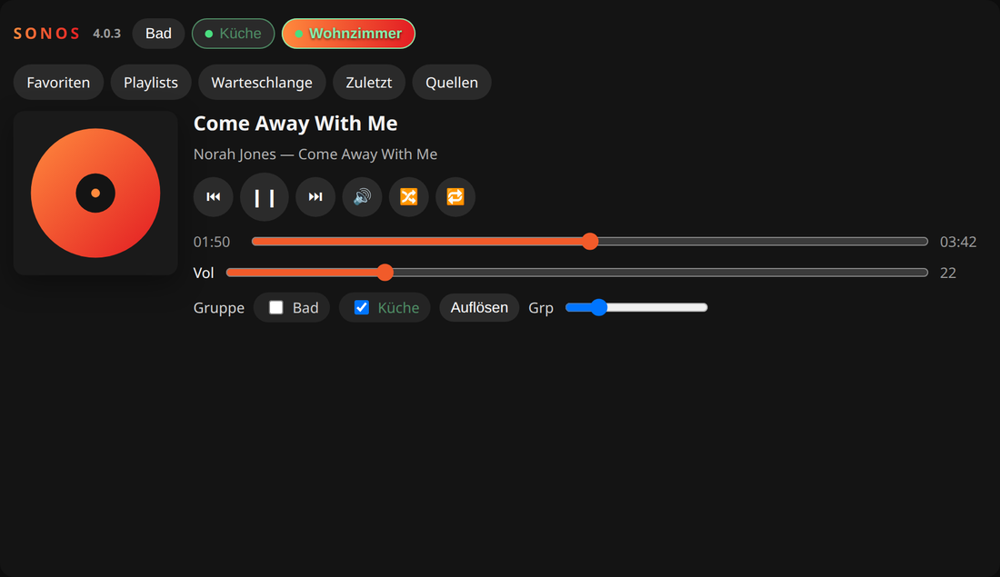
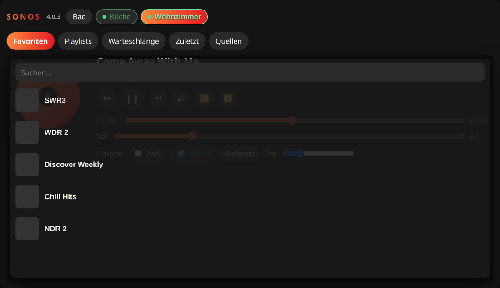
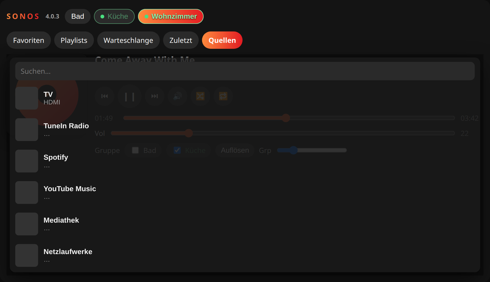
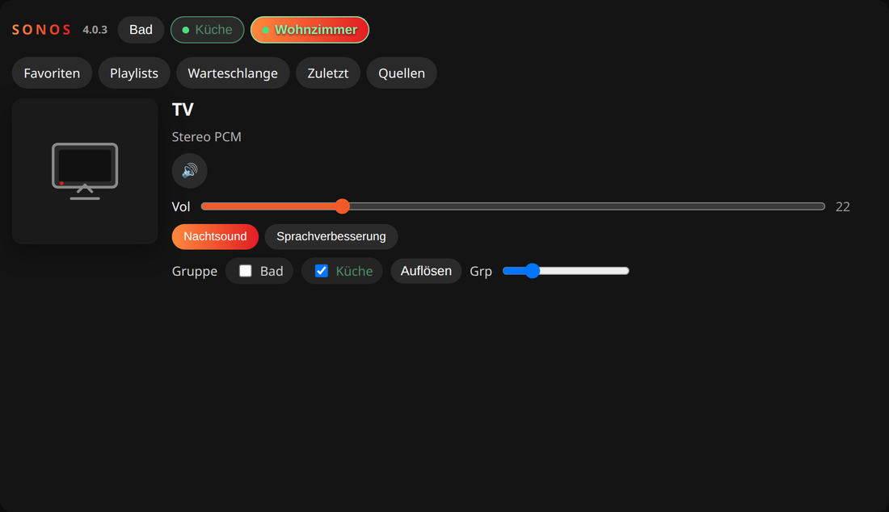

# ioBroker.sonos

Управляйте и контролируйте устройства SONOS с помощью ioBroker.

## Виджеты

Адаптер поставляется с одним виджетом для обоих адаптеров визуализации. Оба устанавливаются вместе с адаптером; **vis** и **vis-2** перезапускаются автоматически, а редактор требует принудительной перезагрузки (Ctrl+F5).

**Sonos Control** позволяет переключать комнаты, управлять воспроизведением, создавать группы и запускать избранные треки, плейлисты, треки в очереди воспроизведения, недавно прослушанные треки и источники. Можно привязать его, например, к конкретному _экземпляру приложения_ . `sonos.0` - не к одному штату, например `play` Виджет самостоятельно обнаруживает каждого говорящего в данном экземпляре.

Все найденные колонки отображаются в виде значка вверху. Членство в группе переключается с помощью флажков. Если комната принадлежит группе, в области воспроизведения отображается трек группы, а не последний локальный трек этой комнаты. Кнопки библиотеки ( **Избранное** , **Плейлисты** , **Очередь** , **Недавние** , **Источники** ) открывают всплывающее окно под ними. В разделе **«Недавние»** отображаются последние треки выбранной комнаты.



_Комнаты, группировка и текущий воспроизводимый контент_



_Кнопки библиотеки открывают страницу под названиями комнат._



_Источники: TuneIn, музыкальная библиотека, сетевые ресурсы, линейный вход и HDMI-вход телевизора._



_HDMI на телевизоре: название ТВ, формат, отключение звука, ночной звук и улучшение речи._

### вис-2 и вис 1

Под одним и тем же идентификатором шаблона существует две реализации **Sonos Control.** `tplSonosControl`: React-версия для vis-2 (`src-widgets`) и оригинальный jQuery-вариант для vis 1 (`widgets/sonos.html`).

Каждый редактор отображает только один из них. Потому что адаптер заявляет `common.visWidgets`, пропуски vis-2 `widgets/sonos.html` полностью загружает виджет React; виджет vis 1 не знает о наборах виджетов React и загружает виджет jQuery. Представления, созданные с помощью виджета vis-1, сохраняют свои `oid` связывание при открытии в vis-2.

vis-2 дополнительно предлагает **Sonos Room** — компактную карту с одной колонкой, обложкой, названием, воспроизведением и громкостью. Последняя кнопка открывает диалоговое окно выбора источника, поэтому с одной карты можно также запустить избранное, плейлист или источник. У vis-1 нет аналога.

В vis-2 каждую часть Sonos Control (комнаты, группы, громкость, библиотека) можно отключить, и виджет может запускаться в конкретной комнате.

### Источники

Поиск **источников** осуществляется через каталог контента колонки: радио TuneIn, музыкальная библиотека, сетевые ресурсы и линейный вход. Музыкальные сервисы отображаются только в том случае, если домохозяйство фактически сообщает о них, а поиск сервисов с каталогом SMAPI (например, Spotify) возможен после однократного входа в систему. Сервисы без такого каталога отображают только то, что уже сохранено в приложении Sonos как избранное или плейлист.

Изображение **с телевизора** отображается только на колонках, имеющих HDMI или оптический вход (Arc, Beam, Playbar, Playbase, Ray, Amp). При подключении к телевизору отсутствуют элементы управления воспроизведением — воспроизведение, пауза, перемотка, следующий и предыдущий треки недоступны; есть функция отключения звука, ночной звук и улучшение речи.

## Виджеты для ioBroker.devices

Помимо виджетов vis, адаптер предоставляет два виджета для панели управления адаптера **ioBroker.devices** . Они добавляются туда с помощью **+ → SONOS player** / **SONOS rooms** , и каждый виджет настраивается с помощью собственного диалога настроек — никаких настроек вручную выбирать не нужно.

**Плеер SONOS** — это одна колонка. В настройках запрашивается экземпляр и колонка; список колонок формируется самим адаптером, поэтому он всегда соответствует устройствам на вкладке _«Устройства SONOS»_ .

| Размер   | Что показано                                                                                                      |
| -------- | ----------------------------------------------------------------------------------------------------------------- |
| 1x1      | Обложка в качестве фона, говорящий, название, художник, состояние игры и ход действия.                            |
| 2x0.5    | Комикс: миниатюра обложки на размытом изображении, говорящий, название, художник, ход работы.                     |
| 2х1, 2х2 | Большая обложка с изображением динамика, состояния воспроизведения, названия, исполнителя и хода воспроизведения. |

Плитки устроены по принципу медиаплеера ioBroker.devices: щелчок открывает полнофункциональный плеер в виде диалогового окна — обложка, название, исполнитель и альбом, ползунок прогресса для перехода между треками, предыдущий / воспроизведение-пауза / следующий, перемешивание, повтор (выкл → все → один трек), отключение звука, громкость и выбор источника.

Кнопки «Обложка», «Прогресс», «Громкость», «Перемешивание/Повтор» и кнопка выбора источника можно отключать по отдельности. На колонке, воспроизводящей звук через телевизионный вход, кнопки управления воспроизведением и индикатор прогресса скрыты, поскольку HDMI-вход не управляется — остаются кнопки отключения звука, регулировки громкости и выбора источника.

Кнопка «Источник» открывает тот же раздел, что и виджет vis — избранное, плейлисты, очередь воспроизведения, недавно воспроизведенные и доступные для просмотра источники динамика — во втором диалоговом окне поверх проигрывателя.

**SONOS Rooms** — это виджет для всей семьи: сколько колонок воспроизводят музыку, что каждая из них воспроизводит и насколько громко. Маленькие размеры отображают счетчик и открывают список в диалоговом окне; 2x1 и 2x2 отображают список напрямую.

В каждой строке также есть кнопка выбора источника, которая открывает меню выбора источника для данного динамика, поэтому можно запустить избранное или плейлист, не покидая общий обзор.

Также происходит формирование групп: кнопка связи на одном динамике помечает его как главный в группе, а кнопка связи на каждом другом динамике затем добавляет его в эту группу или удаляет из нее. Повторное нажатие на главный динамик выходит из этого режима.

## Веб-компоненты

Те же два виджета, а также вкладка «Управление» в настройках экземпляра, существуют в виде веб-компонентов для каждого хоста, который их поддерживает.[`@iobroker/web-components`](https://github.com/ioBroker/web-components) - Aura, vis-2, ioBroker.devices, admin. Адаптер перечисляет их в `common.webComponents` Каждый из них представляет собой отдельный модуль ES с манифестом рядом с ним. `admin/webcomponents/` React поступает от хоста, сам компонент взаимодействует только с сокетом хоста — в адаптере для этого ничего не нужно запускать.

| Элемент               | Имя                    | Что это показывает                                                                                                                                                                                        |
| --------------------- | ---------------------- | --------------------------------------------------------------------------------------------------------------------------------------------------------------------------------------------------------- |
| `<iob-sonos-player>`  | плеер SONOS            | Один динамик: обложка, название, исполнитель, прогресс, предыдущий / воспроизведение-пауза / следующий, перемешивание, повтор, отключение звука, громкость и выбор источника.                             |
| `<iob-sonos-rooms>`   | комнаты SONOS          | Каждый динамик в экземпляре: что воспроизводится, воспроизведение/пауза, громкость, выбор источника и группировка с помощью кнопок связи, как в виджете устройств.                                        |
| `<iob-sonos-control>` | центр управления SONOS | Вкладка «Управление» в настройках экземпляра представлена в виде панели управления: для каждого динамика отображается воспроизводимый контент, а для выбранного — проигрыватель, его группа и библиотека. |

**Плеер SONOS** настроен на канал динамика (`sonos.0.root.<speaker>`) - экземпляр берется из него - и дополнительное название. Обложку, прогресс, перемешивание/повтор, громкость и кнопку источника можно отключить, а две дополнительные строки из плеера vis-2 можно включить: чипы для переключения на другой динамик экземпляра и переключатели групп. Плеер соответствует размеру своего корпуса: части, которые не помещаются, опускаются, вплоть до полосы с динамиком, названием, кнопкой воспроизведения и кнопкой, которая открывает весь плеер в диалоговом окне. На телевизионном входе саундбара вместо транспорта отображается ночной звук и улучшение речи.

**SONOS Rooms** настраивается с помощью этого экземпляра. Громкость, кнопка выбора источника и группировка могут быть отключены, а недоступные колонки могут быть скрыты. В нижнем поле отображается только количество воспроизводимых колонок; щелчок по нему открывает список в диалоговом окне.

**Центр управления SONOS** настраивается с учетом выбранного экземпляра и, при необходимости, первой выбранной колонки. Слева отображается список всех колонок с указанием воспроизводимого контента; справа — плеер выбранной колонки (обложка, название, прогресс, воспроизведение, громкость), ее группа (добавление и удаление колонок, громкость группы) и библиотека — избранное, плейлисты, очередь воспроизведения, недавно воспроизведенные треки, а также источники и музыкальные сервисы для просмотра. Список колонок, группы и библиотеки можно отключить. В узком окне колонки отображаются в виде ряда кнопок сверху, а в узком или низком окне плеер, группа и библиотека отображаются по очереди, выбираемые с помощью вкладок. При остановке экземпляра отображается соответствующее сообщение.

Все они имеют акцентный цвет; все остальное вытекает из тематики хозяина, светлой или темной.

## Вкладка «Управление» в административной панели

В настройках экземпляра есть третья вкладка — **«Управление»** . Это тот же плеер, что и в vis, но внутри административной панели: выберите динамик слева и управляйте им справа — воспроизведение, прогресс, громкость, группировка, а также библиотека с избранными треками, плейлистами, очередью воспроизведения, недавно воспроизведенными треками и источниками.

Эта вкладка предназначена для проверки того, действительно ли недавно добавленный динамик отвечает, не выходя из настроек адаптера. Вкладка взаимодействует с запущенным экземпляром, поэтому она остается пустой, пока экземпляр остановлен.

Для панелей мониторинга доступен тот же интерфейс, что и для веб-компонента **центра управления SONOS** . `<iob-sonos-control>` (см. [веб-компоненты](#web-components) ).

## Страница управления в браузере

Адаптер поставляется со страницей управления для **веб-** адаптера. Она доступна по адресу:

```
http://<ioBroker>:8082/sonos/
```

и предлагает то же самое, что и виджет vis: индикаторы комнат, воспроизводимый контент с привязкой к обложке, управление воспроизведением, прогресс, громкость, флажки группировки и выбор источников с избранными, плейлистами, очередью воспроизведения, недавно воспроизведенными и доступными для просмотра источниками динамика.

Никакого веб-расширения не требуется. `iobroker upload sonos` помещает `www/` Адаптер сохраняет содержимое папки в свое файловое хранилище ioBroker, и веб-адаптер предоставляет его оттуда — его маршрут «всегда» считывает первый сегмент пути URL как имя адаптера. Это тот же механизм, который адаптер уже использует для передачи файла TTS диктору.

Страница взаимодействует с ioBroker через сокет веб-экземпляра, который её обслуживает, поэтому она наследует аутентификацию этого экземпляра и права пользователя. Клиент сокета не входит в комплект поставки: страница запрашивает у веб-адаптера... `socket.io.js` и получает то, что использует данный экземпляр — socket.io или `@iobroker/ws`.

`?instance=sonos.1` закрепляет страницу за одним экземпляром. `?room=Kitchen` Открывает страницу для конкретного говорящего. Без них страница возвращается к экземпляру и говорящему, с которыми она использовалась в последний раз, оба запоминаются в браузере; только когда ничего еще не запомнилось, открывается первый экземпляр и его первый говорящий.

В административной панели страница также отображается в виде плитки в обзоре, рядом с плитками других адаптеров.

## Работа с группами

- Штаты, принимающие решения по работе с группами SONOS:
  - ** `coordinator` ** : установить/получить координатора, то есть устройство SONOS, которое является главным и координирует группу. Для этого требуется IP-адрес (имя канала) устройства SONOS, которое будет координатором, но с подчеркиванием. `_` вместо точки `.`, поэтому используйте, например, `192_168_0_100` для IP-адреса `192.168.0.100` Если устройство не принадлежит ни к одной группе, то значение равно имени собственного канала (IP-адресу).
  - ** `group_volume` ** : объем группы
  - ** `group_muted` ** : статус отключения звука в группе.
  - ** `add_to_group` ** : Добавьте определенное устройство SONOS к устройству SONOS, к которому относится это состояние. Используйте IP-адрес с подчеркиваниями (см. выше).
  - ** `remove_from_group` **: Удалите определенное устройство SONOS из списка устройств SONOS, в которых находится это состояние. Используйте IP-адрес с подчеркиваниями (см. выше).

\*) Эти состояния будут обновлены при внесении изменений в приложение SONOS.

## Стереопары

В приложении SONOS подключены две колонки, объединенные в пару для одной комнаты — одна воспроизводит левый сигнал, другая правый — управление осуществляется только одной из них, SONOS скрывает вторую. Для каждого канала отображается информация о том, входит ли колонка в пару:

- ** `pair_role` ** : `left` или `right` для динамика стереопары, в противном случае пусто.
- ** `pair_partner` ** : другой участник пары, в виде IP-адреса с подчеркиваниями, например `coordinator` например `192_168_1_21`

Канал сопряженного динамика также получает описание в дереве объектов, в котором указывается имя его партнера и сообщается, кто из двух управляет парой. Скрытый динамик не сообщает о воспроизведении и громкости и не принимает команд: используйте канал своего партнера. Ему не нужен собственный канал; если он у него есть, то только `alive` и то, что относится к самому устройству -`led`, `button_lock` Батарея — работает там.

## Батарея

Колонки с аккумулятором — Move и Roam — получают еще два дополнительных состояния сразу после их сообщения:

- ** `battery_level` ** : сумма в процентах
- ** `battery_charging` ** : `true` при этом колонка находится на зарядной базе или питается от USB-порта.

Состояние батареи считывается каждые 5 минут. Динамик, находящийся в спящем режиме, сохраняет последние значения. `alive` показывает, актуальны ли они. Только прошивка S2 отображает состояние батареи таким образом.

## Светодиодный индикатор состояния, блокировка кнопок и таймер сна.

- ** `led` ** : включает или выключает светодиодный индикатор состояния динамика
- ** `button_lock` ** : `true` блокирует кнопки на динамике
- ** `sleep_timer` ** : минут до окончания игры группы. Запишите количество минут, чтобы установить таймер сна. `0` Чтобы отменить это. Оно принадлежит группе, поэтому каждый выступающий в группе показывает одно и то же время, и написание этого для любого из них устанавливает время для всей группы.

`led` и `button_lock` Они создаются, как только устройство сообщает о них, поэтому устройство без кнопок не получает никаких данных. `button_lock` Их читают каждые 5 минут. `sleep_timer` каждую минуту.

Устройство Boost или Bridge не является плеером, поэтому поиск его не находит. Чтобы переключить его светодиодный индикатор состояния, добавьте его IP-адрес в список устройств в настройках; `led` затем появляется под своим каналом.

## Сигнализация

Будильники приложения SONOS находятся ниже. `sonos.0.alarms` на каждый сигнал тревоги приходится один канал, названный по идентификатору, присвоенному ему системой SONOS, например: `sonos.0.alarms.17` Изменения, внесенные в приложение SONOS, отображаются в течение минуты.

Каждый сигнал тревоги имеет эти состояния, все, кроме одного. `next_start` можно записать:

- ** `enabled` ** : включает или выключает сигнализацию
- ** `time` ** : время начала как `hh:mm` по местному времени домохозяйства SONOS.
- ** `recurrence` ** : `ONCE`, `DAILY`, `WEEKDAYS`, `WEEKENDS` или `ON_` Затем следуют дни недели, 0 — воскресенье: `ON_135` Звонки по понедельникам, средам и пятницам.
- ** `duration` ** : как долго играет будильник, `hh:mm`
- ** `volume` ** от 0 до 100
- ** `room` ** : комната, в которой воспроизводится сигнал тревоги; введите имя или IP-адрес другого динамика, чтобы переместить сигнал тревоги туда.
- ** `source` ** : что воспроизводит будильник; напишите название любимой песни SONOS, URI или `SONOS Chime`
- ** `play_mode` ** : `NORMAL`, `REPEAT_ALL`, `SHUFFLE_NOREPEAT` или `SHUFFLE` (Перемешать и повторить)
- ** `include_grouped` ** В комнатах, объединенных в одну группу, также срабатывает сигнализация.
- ** `next_start` ** : когда в следующий раз сработает будильник, в виде временной метки в миллисекундах; `null` пока он отключен
- ** `delete` ** : удаляет тревогу

Для создания будильника напишите JSON-данные. `sonos.0.alarms.create`. Только `room` и `time` являются обязательными, остальные настройки названы так же, как и состояния, указанные выше:

```json
{"room": "Bedroom", "time": "06:45", "recurrence": "WEEKDAYS", "volume": 15, "source": "Radio Bob"}
```

Если какие-либо настройки не указаны, то в начале устанавливается ежедневный режим на один час с уровнем громкости звукового сигнала SONOS 20.

Каждый выступающий также имее&#x442;** `alarm_next` ** : когда сработает следующий включенный будильник в комнате. Скрипт может использовать это, например, для включения светового будильника за десять минут до начала музыки:

```js
let timer;
on({ id: 'sonos.0.root.192_168_1_50.alarm_next' }, obj => {
    clearTimeout(timer);
    if (obj.state.val) {
        timer = setTimeout(() => setState('hue.0.Bedroom.on', true), obj.state.val - 10 * 60000 - Date.now());
    }
});
```

`next_start` и `alarm_next` Расчеты производятся в часовом поясе хоста ioBroker, который должен совпадать с часовым поясом домохозяйства, использующего SONOS.

## Для агентов искусственного интеллекта

`sendTo('sonos.0', 'help', {})` ответы `{ help: '...', commands: [{ command, write }] }`: текст для агента ИИ (например, ioBroker.pi-agent или сервер MCP с `send_to`) которая описывает говорящих и их состояния, группы, избранное и плейлисты, просмотр музыкальной библиотеки и музыкальных сервисов с помощью `media_browse` и `media_play` Объявления, сигналы тревоги и сообщения, а также инструкции по действиям (комнаты вместо каналов, изменения только по запросу, проверка результата). `commands` отображает список сообщений. `write: true` для тех, кто что-то меняет (`send`). Неизвестное сообщение отвечает. `{ error, commands }` со списком всех сообщений; прежде чем ответить самим сообщением.

## Использование с адаптером sayIt.

Для использования [адаптера sayit](https://github.com/ioBroker/ioBroker.sayit) с этим адаптером SONOS убедитесь, что [веб-адаптер](https://github.com/ioBroker/ioBroker.web) также создан и запущен. Веб-адаптер необходим для того, чтобы адаптер SONOS мог считывать сгенерированный адаптером sayit MP3-файл.

sayIt записывает URL-адрес MP3-файла в `sonos.X.root.<speaker>.tts` И динамик загружает его из веб-адаптера. Таким образом, динамик должен иметь возможность получить доступ к этому URL-адресу: веб-адаптер не должен требовать аутентификации, а адрес в URL-адресе должен совпадать с адресом хоста ioBroker в вашей сети.

Если динамик не может воспроизвести файл — например, не может загрузить URL-адрес или не поддерживает формат — адаптер регистрирует ошибку, возвращает динамику громкость и воспроизведение и переходит к следующему объявлению. В более старых версиях громкость оставалась на 0, и последующее объявление не воспроизводилось до перезапуска адаптера.

## Избранное и очередь в VIS

Используйте состояния `favorites_list_html` и `queue_html` Для отображения плейлистов и текущей очереди воспроизведения с помощью простого HTML-виджета в VIS. При нажатии на строку плейлист или трек будут воспроизведены немедленно.

Письмо `favorites_set` или `playlist_set` Запускает избранное или плейлист. Установит&#x44C;** `autoplay` ** говорящего к `false` загрузить только его, не начиная воспроизведение (по умолчанию) `true`).

Для собственного пользовательского интерфейса доступны те же списки в формате JSON: `favorites_list_array`, `playlist_list_array` и `queue_array`. `queue` соединяет дорожки запятой и не может быть надежно разделена обратно, поэтому используйте `queue_array` - он несет один `{ artist, title, album, cover }` для каждой дорожки, а индекс записи — это значение для `current_track_number` Отформатируйте таблицу, используя следующие CSS-классы:

### Избранное

- `sonosFavoriteTable`: весь любимый стол
- `sonosFavoriteRow`: строки с любимой информацией
- `sonosFavoriteNumber` Количество избранных
- `sonosFavoriteCover` Обложка любимого альбома (скопируйте изображение с помощью `.sonosFavoriteCover img`)
- `sonosFavoriteTitle` Имя любимого человека

### Очередь

- `.sonosQueueTable`: вся таблица
- `.sonosQueueRow`: строки, содержащие информацию о треке
- `.currentTrack`: добавлено в строку, содержащую текущий воспроизводимый трек
- `.sonosQueueTrackNumber` Номер или трек
- `.sonosQueueTrackCover` Обложка альбома (скачать изображение с помощью `.sonosQueueTrackCover img`)
- `.sonosQueueTrackArtist` Имя художника
- `.sonosQueueTrackAlbum`: Название альбома (используйте) `display:none` (если не требуется)
- `.sonosQueueTrackTitle` Название должности

Для длинных списков добавьте `overflow:auto;` или `overflow-y:auto;` Для базового HTML-виджета. Обратите внимание: выделение текущего любимого плеера не поддерживается.

### Пример CSS

```
.sonosFavoriteTable {
    color: #bbb;
    font-size: 12px;
}
.sonosFavoriteRow {
    cursor: pointer;
}
.sonosFavoriteNumber {}
.sonosFavoriteCover img {
    width: 30px;
    height: 30px;
}
.sonosFavoriteTitle {}

.sonosQueueTable {
    color: #bbb;
    font-size: 12px;
}
.sonosQueueRow {
    display: table-row;
    cursor: pointer;
}
.sonosQueueRow.currentTrack {
    color: #fff;
    font-weight: bold;
}
.sonosQueueTrackNumber {}
.sonosQueueTrackCover img {
    width: 30px;
    height: 30px;
    display: table-column;
}
.sonosQueueTrackArtist {
    display: table-row;
}
.sonosQueueTrackAlbum {
    display: none;
}
.sonosQueueTrackTitle {
    display: table-row;
}
```

## Разработка

Рядом с адаптером расположены пять интерфейсных модулей, все они созданы с использованием Vite, причем первые три дополнительно используют федерацию модулей:

| Источники            | Результат сборки       | Загружено пользователем                                        |
| -------------------- | ---------------------- | -------------------------------------------------------------- |
| `src-widgets/`       | `widgets/sonos/`       | вис-2                                                          |
| `src-admin/`         | `admin/custom/`        | вкладка **«Управление»** в настройках экземпляра               |
| `src-devices/`       | `admin/dm-widgets/`    | Панель управления ioBroker.devices                             |
| `src-web/`           | `www/`                 | **веб-** адаптер, по адресу `/sonos/`                          |
| `src-webcomponents/` | `admin/webcomponents/` | каждый хост веб-компонентов (Aura, vis-2, устройства, админка) |

```bash
npm run npm            # install the adapter and all five front-ends
npm run build          # all five of them plus the adapter - what CI and npm publish run
npm run build:widgets  # the vis-2 widget set         -> widgets/sonos/
npm run build:web      # the control page             -> www/
npm run build:admin    # the Control tab component    -> admin/custom/
npm run build:devices  # the ioBroker.devices widgets -> admin/dm-widgets/
npm run build:wc       # the web components           -> admin/webcomponents/
npm run build:all      # the same as build, in a single tasks.mts run
```

Все они движимы... `tasks.mts`, который запускается непосредственно из исходного кода со своей собственной процедурой удаления типов — для скрипта сборки нет этапа сборки, но `npm run check:ts` Проверяет тип и отклоняет синтаксис, который не удалось очистить.

`admin/custom/` и `admin/dm-widgets/` внесены изменения, поскольку при холодной сборке модуля федерации предварительно собирается весь общий стек графического интерфейса пользователя, и это занимает несколько минут. `npm run build` восстанавливает их вместе со всем остальным. `npm run build:admin` /`npm run build:devices` Пересоберите только один из них — в любом случае, зафиксируйте результат, когда произойдет что-то ниже. `src-admin/` или `src-devices/` измененный.

`admin/webcomponents/` также внесён свой вклад. Каждый веб-компонент — это отдельная сборка Vite (`vite build --mode player|rooms`), потому что хост импортирует ровно один файл на каждый компонент; сборка также записывает манифест рядом с модулем и завершается с ошибкой, если он не проходит проверку. `@iobroker/web-components` Тексты взяты из файлов интернационализации (i18n). `src-devices` и `src-widgets` имена из виджетов ioBroker.devices в `io-package.json`.

`src-devices` имеет комплект для разработчиков: `cd src-devices && npm start` открывает виджеты на `http://localhost:3000` против реального администратора ioBroker `localhost:8081`, поэтому их можно развивать без перестройки. `ioBroker.devices` каждый раз.

`src-web` имеет то же самое: `cd src-web && npm start` отображает страницу управления на `http://localhost:3000` и передает сокет, клиент сокета и изображения-заглушки на веб-экземпляр. `localhost:8082` Страница распознает свой сервер разработки по этому порту, поэтому его нельзя изменить — и потому что `src-devices` Также слушает на частоте 3000, но одновременно может работать только один из двух жгутов проводов.

## Что нужно сделать

- Делать `@svrooij/sonos` По умолчанию, после того как экспериментальная часть системы докажет свою эффективность в реальных домохозяйствах, будет отменена установка. `sonos-discovery`

## Конфигурация

- Веб-сервер - \[необязательно] Включение или выключение веб-сервера
- Обновление прошедшего времени (мс) — интервал в миллисекундах, определяющий частоту обновления таймера во время воспроизведения игры. (По умолчанию 2000)
- Плавное нарастание (text2speech) — интервал в миллисекундах, в течение которого громкость увеличивается в начале объявления. Значение 0 отключает плавное нарастание. (По умолчанию 0)
- Затухание (text2speech) — интервал в миллисекундах, в течение которого громкость снижается в конце объявления. Значение 0 отключает затухание. (По умолчанию 0)
- Библиотека Sonos — какая клиентская библиотека взаимодействует с колонками, см. ниже.
- Порт событий - только для `@svrooij/sonos`: TCP-порт, на который динамики отправляют свои события. Изменяйте его только в том случае, если другая программа уже его использует. (По умолчанию 6329)

### Динамики с новым IP-адресом

Канал динамика называется по адресу, который он имел на момент добавления. `root.192_168_1_50` При первом обнаружении устройства по указанному адресу канал привязывается к его серийному идентификатору (`RINCON_...` хранящийся в `native.uuid` (канала). Если маршрутизатор позже присвоит динамику другой адрес, он сохранит свой канал и состояние — скрипты и представления продолжат работать — и в журнале будет указан новый адрес один раз. Другой динамик, получивший старый адрес, не займет канал. Поиск в настройках не выдаст перемещенный динамик во второй раз.

Колонка, заменяющая другую — например, новая модель, получающая фиксированный адрес старой, — принимает канал вместе со своими состояниями, как только старая колонка перестает быть частью системы SONOS; удалите ее в приложении SONOS, если она все еще там указана. Пока старая колонка принадлежит системе, также под другим адресом, канал остается за ней, и это один раз отражается в журнале. Чтобы все же передать канал, удалите его. `uuid` в исходном разделе канала (Администрирование → Объекты) и перезапустите экземпляр.

### Библиотека Sonos

Адаптер поставляется с двумя клиентскими библиотеками, и в настройках выбирается одна из них. Ничего больше не меняется: состояния, их названия и значения остаются одинаковыми в любом случае.

| Параметр                        | Библиотека        | Статус                                             |
| ------------------------------- | ----------------- | -------------------------------------------------- |
| `sonos-discovery (default)`     | `sonos-discovery` | Что всегда использовал адаптер                     |
| `@svrooij/sonos (experimental)` | `@svrooij/sonos`  | Замена в рабочем состоянии, проходит тестирование. |

`sonos-discovery` С 2022 года программа не выпускалась, и одна из её зависимостей сломала адаптер при запуске, поэтому готовится замена. Она предлагается здесь для того, чтобы её можно было протестировать в реальных домашних условиях — в CI нет оборудования SONOS, а те части, которые задействуются только реальные колонки, не могут быть охвачены тестами.

Если попробуете, интересные ситуации будут включать группировку динамиков и последующее расформирование группы, объявления поверх воспроизводимого контента, запуск избранного трека или плейлиста, подключение саундбара к телевизионному входу и поиск в музыкальном сервисе. **Если что-то пойдет не так, вернитесь к настройкам по умолчанию** и, пожалуйста, сообщите о своих наблюдениях — эта настройка существует для того, чтобы никому не приходилось понижать версию адаптера для восстановления работоспособности.

<!--
	Placeholder for the next version (at the beginning of the line):
	### **WORK IN PROGRESS**
-->

## Changelog
### 4.7.0 (2026-11-19)
* (@GermanBluefox) Added the short form of the web component manifests (tag, name, icon, size) to `common.webComponents`, so that hosts like Aura can list the components before the adapter is installed; the build writes it with `iob-web-components sync-io-package`
* (@GermanBluefox) Fixed the adapter stopping with "XmlError: Attribute value expected" when a speaker reports `<Cloud queue error>` (a queue of a streaming service started from the SONOS app that cannot be resumed): the value is kept as text and the rest of the event is processed. Reported to the library as [svrooij/node-sonos-ts#235](https://github.com/svrooij/node-sonos-ts/issues/235)
* (@GermanBluefox) Added the message `help`: describes the states, groups, media browsing, announcements, alarms and messages for an AI agent (e.g. ioBroker.pi-agent); an unknown message answers with an error and the list of messages instead of the message itself; declared with `common.supportedMessages.help`

### 4.6.0 (2026-11-09)
* (@GermanBluefox) Added the web components `<iob-sonos-player>` and `<iob-sonos-rooms>` (`common.webComponents`): the SONOS player and SONOS rooms widgets for Aura and every other host of `@iobroker/web-components`
* (@GermanBluefox) Added a SONOS control centre for Aura and other dashboards: all speakers with player, group and library in one place
* (@GermanBluefox) Fixed wrong translations of the vis-2 widgets and the web components, e.g. "Show rooms" read as "showroom" in Italian, Spanish, Ukrainian and Chinese

### 4.5.1 (2026-11-04)
* (@GermanBluefox) Fixed "Cannot process transport-state: Parameter "timeout" needs to be of type "number"": settings saved by the old admin page hold the update interval of the elapsed time as a string, which js-controller rejects. The error aborted every update of the playback, so title, artist and cover stayed at the first track after a restart

### 4.5.0 (2026-11-04)
* (@GermanBluefox) Stereo pairs are marked: `pair_role` (`left`/`right`) and `pair_partner` tell which speakers belong together, and the description of the channel says which of the two SONOS controls the pair through. The hidden speaker of a pair never got values and ignored commands without telling why - a command written to it now names the channel to use instead
* (@GermanBluefox) A speaker that replaces another one at the same IP address takes over its channel once the old speaker is no longer part of the SONOS system. Since 4.4.0 the new speaker got no channel and the old channel stayed empty without a word in the log (#140)

### 4.4.0 (2026-11-04)
* (@GermanBluefox) A speaker that gets a new IP address keeps its channel and states: the channel is bound to the serial id of the speaker the first time it is found, and another speaker that gets the old address does not take it over (#140)
* (@GermanBluefox) Errors of the `sonos-discovery` backend appear in the ioBroker log: the library wrote them to the console, so an event it could not process - which then never reached the states - left no trace (#177)
* (@GermanBluefox) TTS (sayIt): a file the speaker cannot play, no longer leaves the volume at 0 and blocks every further announcement until a restart - the state before TTS is restored and the next announcement is played (#176)
* (@GermanBluefox) A track without a cover of its own shows the cover of what was started - the station logo or the art Alexa sends along with Amazon Music and Sonos Radio. Only real images are cached as cover: an audio file or a stream answered for the cover URL shows the default cover instead of a broken one, and an aborted download no longer stays in the cache (#64)
* (@GermanBluefox) A speaker that leaves a group no longer keeps the playback of the group (`state_simple` stayed `true`, the title of the group was shown): after the topology change its own state is read again (#121)
* (@GermanBluefox) vis-2 player: the tabs of the source selection always fit into the widget - without room for the labels they show the icons only - and the mute button moved into the volume row instead of wrapping into a line of its own

Older changes can be found in CHANGELOG_OLD.md

## License

The MIT License (MIT)

Copyright (c) 2014-2026, bluefox <dogafox@gmail.com>

Permission is hereby granted, free of charge, to any person obtaining a copy
of this software and associated documentation files (the "Software"), to deal
in the Software without restriction, including without limitation the rights
to use, copy, modify, merge, publish, distribute, sublicense, and/or sell
copies of the Software, and to permit persons to whom the Software is
furnished to do so, subject to the following conditions:

The above copyright notice and this permission notice shall be included in
all copies or substantial portions of the Software.

THE SOFTWARE IS PROVIDED "AS IS", WITHOUT WARRANTY OF ANY KIND, EXPRESS OR
IMPLIED, INCLUDING BUT NOT LIMITED TO THE WARRANTIES OF MERCHANTABILITY,
FITNESS FOR A PARTICULAR PURPOSE AND NONINFRINGEMENT. IN NO EVENT SHALL THE
AUTHORS OR COPYRIGHT HOLDERS BE LIABLE FOR ANY CLAIM, DAMAGES OR OTHER
LIABILITY, WHETHER IN AN ACTION OF CONTRACT, TORT OR OTHERWISE, ARISING FROM,
OUT OF OR IN CONNECTION WITH THE SOFTWARE OR THE USE OR OTHER DEALINGS IN
THE SOFTWARE.