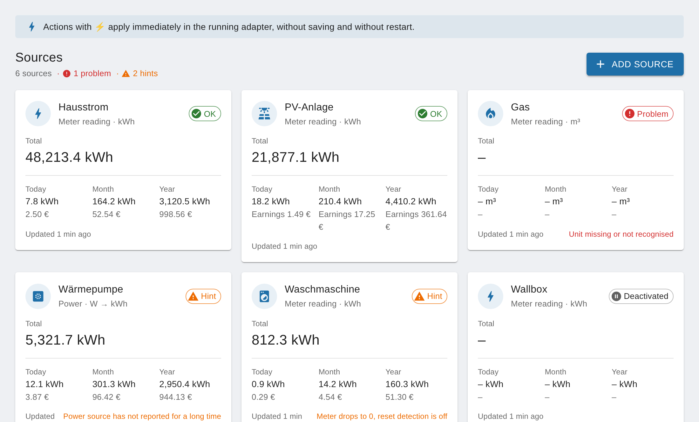
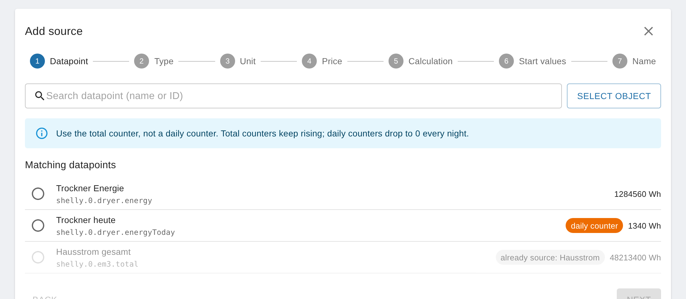
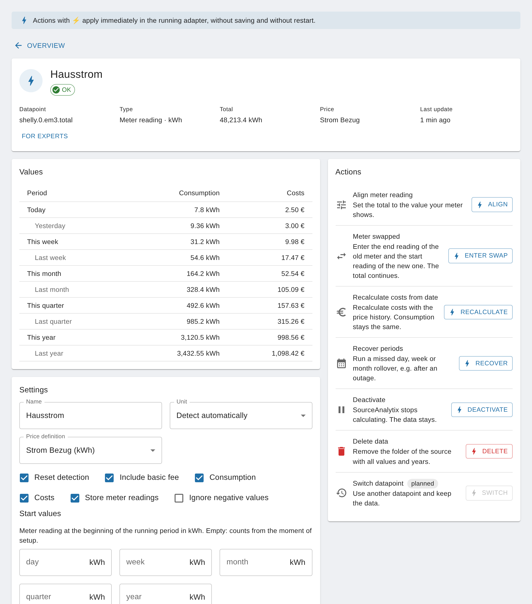
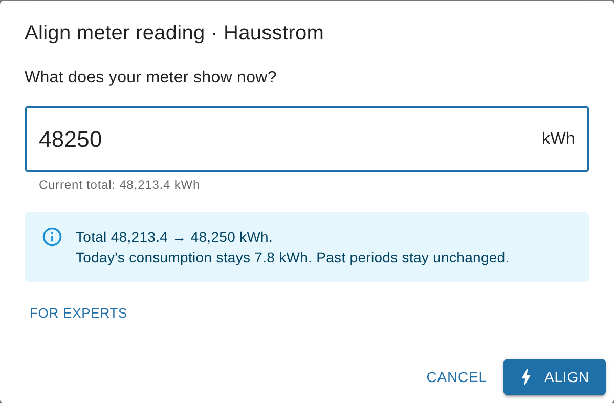
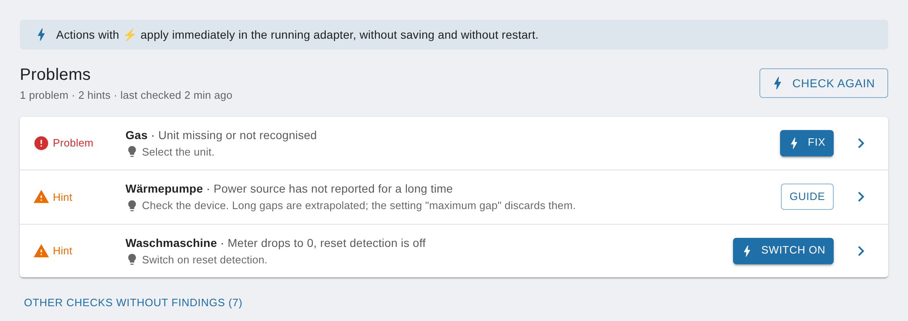

# SourceAnalytix

**SourceAnalytix показывает, что потребляет, производит и за что платит ваш дом** — в день, неделю, месяц, квартал и год — за электроэнергию, газ, воду, отопление или что-либо еще, что вы можете измерить в ioBroker.

## Для чего нужен адаптер?

Большинство приборов показывают только показания счетчика (например). `48213 kWh` от интеллектуального счетчика или Shelly) или текущей мощности (например) `850 W`). Одной этой цифры недостаточно, чтобы ответить на ваши реальные вопросы: _Сколько я использовал сегодня? Во сколько это обошлось в прошлом месяце? Этот год лучше прошлого года? Сколько заработала моя солнечная система?_

SourceAnalytix отвечает на эти запросы. Вы выбираете точку данных и цену, а адаптер автоматически и без использования скриптов ведет полную статистику по ним:

| У вас есть                                    | SourceAnalytix предоставляет вам                                                                                       |
| --------------------------------------------- | ---------------------------------------------------------------------------------------------------------------------- |
| Показания счетчика в кВт·ч, м³, л, кг, …      | Потребление и расходы за сегодня, эту неделю, месяц, квартал и год, а также за вчера, прошлую неделю, прошлый месяц, … |
| значение мощности в Вт или кВт                | Энергия, рассчитанная на её основе, как если бы у вас был измерительный прибор.                                        |
| счетчик импульсов (S0, ESPHome) `pulses/min`) | Потребление в единицах вашей цены, например, 1000 импульсов = 1 кВт·ч.                                                 |
| фотоэлектрический или подающий в сеть счетчик | доставка и доходы вместо потребления и затрат                                                                          |
| любое количество из них                       | по одной папке на каждый источник ниже `sourceanalytix.0` готов к использованию с VIS, Grafana, InfluxDB или скриптами. |

**Пример:** Вы добавляете `shelly.0.em3.total` В качестве "Дома" с вашей ценой на электроэнергию 0,32 €/кВтч. С этого момента `sourceanalytix.0.house` Отображает, среди прочего, «сегодня 7,8 кВт·ч · 2,50 €», «в этом месяце 164,2 кВт·ч · 52,54 €», а позже «в прошлом месяце» и «в прошлом году» — обновляется с каждым новым значением и закрывается в полночь.

## Функции

**Статистика**

- Данные о потреблении, поставках, затратах и доходах за текущий и предыдущий день, неделю, месяц, квартал и год.
- Дополнительные параметры: для каждого дня недели, календарной недели, месяца и квартала, а также архив за каждый год.
- Все значения источника дополнительно находятся в одном JSON-состоянии, что удобно для таблиц в VIS.

**Цены**

- Фиксированная цена, новая цена, действующая с выбранной даты (старые цены остаются неизменными), динамическая цена, основанная на данных из другой точки (например, Tibber, Awattar), или дневной/ночной тариф, переключаемый на основе данных из другой точки.
- Дополнительная ежемесячная базовая плата.
- "Пересчитать затраты с указанной даты", если цена была введена слишком поздно.

**Надежный подсчет**

- SourceAnalytix сохраняет собственные показания счетчика. Он продолжает корректно работать, даже если устройство перезапускается с нуля, счетчик заменяется или какое-либо значение кратковременно падает.
- Источники питания: длительные отключения электроэнергии не учитываются при установке «максимального интервала».
- Если ioBroker был отключен в полночь, пропущенное изменение дня, недели или месяца автоматически компенсируется.

## Страница настроек

Все настройки выполняются в параметрах экземпляра SourceAnalytix — редактирование объектов, JSON-файлы, перезапуск не требуются.

**Обзор** – все источники с указанием их текущих значений и статуса (скриншот выше).

**Добавление источника** — мастер проведет вас через семь шагов: точка данных, тип, единица измерения, цена, расчет, начальные значения и имя. Он предупредит вас, например, если вы выберете дневной счетчик вместо общего счетчика.

**Подробная информация об источнике** — значения за все периоды, все настройки источника и действия по его исправлению.

**Действия** — исправление исходного кода без использования скриптов. Каждое действие показывает, какие изменения будут внесены, прежде чем вы подтвердите их:

- "Выровнять показания счетчика" – установите общую сумму в соответствии с показаниями вашего счетчика.
- «Счетчик заменен» — введите конечные показания старого и начальные показания нового счетчика.
- «Пересчитать затраты с указанной даты», «Периоды восстановления», «Деактивировать» и «Удалить данные».

**Проблемы** – SourceAnalytix проверяет все источники и перечисляет то, что требует внимания, например, отсутствующее устройство, источник, переставший предоставлять данные, или счетчик, обнуляющийся. Большинство проблем можно исправить одним щелчком мыши.

В обозревателе объектов настройки SourceAnalytix для точки данных только включают или выключают ее, поэтому вы все равно можете увидеть, какие точки данных используются.

## Требования и установка

- Admin 8.0.0 или новее, js-controller 6.0.11 или новее и Node.js 22 или новее.
- Текущая версия опубликована в **последнем** (бета) репозитории: выберите репозиторий «Beta (latest)» в системных настройках ioBroker и установите SourceAnalytix на вкладке «Адаптеры». После этапа тестирования она будет перемещена в стабильный репозиторий.
- Затем создайте свои цены на вкладке «Определения цен» и добавьте свой первый источник, используя кнопку «Добавить источник» на вкладке «Обзор».

Пошаговая инструкция: [Установка](/#/docs/adapterref/iobroker.sourceanalytix/docs/en/01.erste-schritte/01.installation.md) и [ваш первый счетчик](/#/docs/adapterref/iobroker.sourceanalytix/docs/en/01.erste-schritte/02.erster-zaehler.md) .

## Документация

Полная документация отвечает на вопросы пользователей, заданные на форуме и в разделе "Проблемы". Она доступна на английском и [немецком языках (Deutsch)](https://github.com/DrozmotiX/ioBroker.sourceanalytix/blob/main/docs/de/README.md) .

- [Начало работы](/#/docs/adapterref/iobroker.sourceanalytix/docs/en/01.erste-schritte/README.md) : установка и ваш первый счетчик
- [Практические руководства](/#/docs/adapterref/iobroker.sourceanalytix/docs/en/02.anleitungen/README.md) : источники и единицы измерения, исправления, цены, оценка, техническое обслуживание.
- [Справочная информация](/#/docs/adapterref/iobroker.sourceanalytix/docs/en/03.referenz/README.md) : все настройки, состояния и сообщения.
- [Устранение неполадок](/#/docs/adapterref/iobroker.sourceanalytix/docs/en/04.fehlerbehebung/README.md) : сообщения в логах и некорректные значения.
- [Предыстория](/#/docs/adapterref/iobroker.sourceanalytix/docs/en/05.hintergrund/README.md) : как адаптер производит расчеты

Обнаружили ошибку или отсутствует функция? Создайте [заявку на GitHub](https://github.com/DrozmotiX/ioBroker.sourceanalytix/issues) , приложив отладочный лог затронутого исходного кода.

## Что такое Sentry.io и какая информация передается на серверы этой компании?

Этот адаптер использует библиотеки Sentry для автоматического сообщения разработчикам об исключениях и ошибках в коде. Более подробную информацию, а также инструкции по отключению отправки сообщений об ошибках см. [в документации Sentry-Plugin](https://github.com/ioBroker/plugin-sentry#plugin-sentry) ! Система отчетности Sentry используется начиная с js-controller 3.0.

При сбое адаптера или возникновении другой ошибки в коде сообщение об ошибке, которое также отображается в журнале ioBroker, отправляется в Sentry. Если вы разрешили ioBroker GmbH собирать диагностические данные, в них будет включен идентификатор вашей установки. Это анонимный идентификатор, не содержащий личной информации, такой как ваше имя или адрес электронной почты. Он позволяет группировать ошибки и показывать, сколько установок затронуто.

## Кредиты

История этого адаптера восходит к публикации на [форуме ioBroker](https://forum.iobroker.net/viewtopic.php?f=21\&t=2262) в 2016 году:

Впоследствии он был усовершенствован. `@hadering` и опубликовано как [homematic\_verbrauchszaehler](https://github.com/hdering/homematic_verbrauchszaehler) .

## Поддержите меня

Если вам нравится мое творчество, пожалуйста, рассмотрите возможность личного пожертвования.

Это персональная ссылка для пожертвований DutchmanNL и не имеет отношения к проекту ioBroker.

<!--
    Placeholder for the next version (at the beginning of the line):
    ### __WORK IN PROGRESS__
-->

## Changelog
### 0.7.1 (2026-11-14)
* The settings page did not start in current Admin versions ("Custom component ... was not started"): its components now declare GUI API generation 2 and ship their module federation manifest.

### 0.7.0 (2026-11-14)
* Price definitions: changing a price without a new "Valid from" date marks the fields with a hint, and the adapter logs a warning with the repair steps, because the new price then replaces the old one retroactively ([#1293](https://github.com/DrozmotiX/ioBroker.sourceanalytix/issues/1293)).
* "Recover periods" on the settings page and in the "Problems" tab only processes the selected source; `sendTo('recoverPeriods', {source})` does the same for scripts, without `source` (and the `info.recoverPeriods` button) all sources are processed as before ([#1292](https://github.com/DrozmotiX/ioBroker.sourceanalytix/issues/1292)).
* The SourceAnalytix custom settings at the datapoint only switch a source on or off and link to the instance settings, where it is configured; enabling there uses the same defaults as the settings page. Existing settings stay unchanged ([#1286](https://github.com/DrozmotiX/ioBroker.sourceanalytix/issues/1286)).
* The source detail of the settings page now contains all source settings: start values (checked like in the wizard), maximum gap and averaging for power sources, pulses per unit, "Each update adds its value" and the technical ID ([#1285](https://github.com/DrozmotiX/ioBroker.sourceanalytix/issues/1285)).
* Power values sent as text with a comma, such as `"1,5"`, are read like meter readings; a value that is not a number is ignored with a warning instead of logging an invalid interval for every value ([#1288](https://github.com/DrozmotiX/ioBroker.sourceanalytix/issues/1288)).
* Settings page: hints name the tab "Price definitions" like the tab itself, "Quarters" is translated as "Quartale", a single comma or dot is always the decimal mark (`1.283` is 1.283 like in the adapter), and the technical ID in the wizard accepts the same characters as the adapter ([#1287](https://github.com/DrozmotiX/ioBroker.sourceanalytix/issues/1287)).
* New instance settings page (requires admin 8): tabs "Overview" and "Problems" with all sources, a wizard to add a source, a detail page per source and actions that work immediately without restart ([#1269](https://github.com/DrozmotiX/ioBroker.sourceanalytix/issues/1269)).
* Action "Align meter reading": set the total to the value the meter shows; today's consumption and closed periods stay unchanged ([#640](https://github.com/DrozmotiX/ioBroker.sourceanalytix/issues/640)).
* Action "Meter swapped": enter the end reading of the old and the start reading of the new meter, the total continues without a jump ([#1269](https://github.com/DrozmotiX/ioBroker.sourceanalytix/issues/1269)).
* Action "Recalculate costs from date" with the price history, for one source or all sources of a price definition ([#947](https://github.com/DrozmotiX/ioBroker.sourceanalytix/issues/947)).
* Action "Delete data" removes the output folder of a source incl. all years ([#1265](https://github.com/DrozmotiX/ioBroker.sourceanalytix/issues/1265)).
* Fix wrong conversion between `km³`, `dm³`, `cm³`, `mm³` and between `µm`, `nm`; unit definitions are now part of the adapter and the unmaintained `iobroker-adapter-helpers` dependency was removed ([#1278](https://github.com/DrozmotiX/ioBroker.sourceanalytix/issues/1278)).
* The unit check in the state settings now accepts the same spellings as the adapter (`m3`, `kwh`, `L`, …), so such sources can be saved with "Detect automatically" ([#1278](https://github.com/DrozmotiX/ioBroker.sourceanalytix/issues/1278)).
* Reject sources whose unit cannot be converted to the unit of the selected price definition (for example `W` with `m³` or `kg` with `kWh`) at start with a clear error instead of calculating wrong values or logging an error for every reading ([#1278](https://github.com/DrozmotiX/ioBroker.sourceanalytix/issues/1278)).
* Meter readings of exactly 0 are written to the meter readings again ([#1253](https://github.com/DrozmotiX/ioBroker.sourceanalytix/issues/1253)).
* Power sources (`W`, `kW`, …): the energy between the last value and midnight is booked to the ending day instead of getting lost at the day change ([#1254](https://github.com/DrozmotiX/ioBroker.sourceanalytix/issues/1254)).
* Meter readings sent as text, such as `"12,5"`, and start values with a comma are accepted; a value that is not a number is ignored with a warning ([#1255](https://github.com/DrozmotiX/ioBroker.sourceanalytix/issues/1255)).
* Week values from 29–31 December and early January are stored in the correct calendar-week year and no longer overwrite week 1 ([#1256](https://github.com/DrozmotiX/ioBroker.sourceanalytix/issues/1256)).
* After the total was corrected by hand or the meter was swapped, the source keeps running and continues from the known total instead of stopping ([#1257](https://github.com/DrozmotiX/ioBroker.sourceanalytix/issues/1257)).
* A device that briefly reports a low value and then returns to its previous reading no longer doubles the total: the detected reset is rolled back ([#1258](https://github.com/DrozmotiX/ioBroker.sourceanalytix/issues/1258)).
* A price with a future "Valid from" date becomes the current price on that date without a restart ([#1259](https://github.com/DrozmotiX/ioBroker.sourceanalytix/issues/1259)).
* If no reading arrives around midnight, the consumption of the gap is split between both days instead of being booked to the new day ([#1260](https://github.com/DrozmotiX/ioBroker.sourceanalytix/issues/1260)).
* Errors are always written to the ioBroker log, Sentry receives them in addition ([#1261](https://github.com/DrozmotiX/ioBroker.sourceanalytix/issues/1261)).
* Falling values of sources without reset detection (for example an oil tank) are only logged on debug level ([#1262](https://github.com/DrozmotiX/ioBroker.sourceanalytix/issues/1262)).
* The unused value `valueAtDeviceInit` is no longer written; existing values are ignored ([#1263](https://github.com/DrozmotiX/ioBroker.sourceanalytix/issues/1263)).
* Units such as `m3` or `kwh` sent by many devices are recognised instead of "No unit defined" ([#1264](https://github.com/DrozmotiX/ioBroker.sourceanalytix/issues/1264)).
* Ignore repeated source-object writes when the SourceAnalytix settings, source name and unit are unchanged, preventing unnecessary output reinitialization and high CPU load ([#1233](https://github.com/DrozmotiX/ioBroker.sourceanalytix/issues/1233)).
* Only write output objects (device, period and memory states) when their definition actually changes, so re-initializing a source updates state values without rewriting the whole object tree ([#1233](https://github.com/DrozmotiX/ioBroker.sourceanalytix/issues/1233)).
* The start values in the state settings are checked before saving: comma and dot are accepted, a start value must not be larger than the current total shown in the dialog, and a period that began earlier cannot have a larger start value than a later one (the week is placed by its start date). Empty fields count from now on. A hint appears when a start value would fit after dividing by 1000 (entered in Wh instead of kWh). Inconsistent start values are also logged at start ([#1267](https://github.com/DrozmotiX/ioBroker.sourceanalytix/issues/1267)).
* All power units (`W`, `kW`, `MW`, …) are handled alike: no start value initialisation from the first reading, and running `kW` intervals are closed at midnight like `W` intervals ([#1267](https://github.com/DrozmotiX/ioBroker.sourceanalytix/issues/1267)).
* New source setting "Maximum gap between power values" for power sources: an interval without a new value that is longer than the setting is not extrapolated with the last power value but counted as 0 and logged, so a device or network outage no longer produces huge consumption and costs. Empty (default) keeps the previous behaviour for devices that only send on change ([#1266](https://github.com/DrozmotiX/ioBroker.sourceanalytix/issues/1266)).
* The state settings show a hint when another source with the same price definition already includes the basic fee, because every such source books the full basic fee; the adapter logs the same hint at start. The calculation is unchanged ([#1268](https://github.com/DrozmotiX/ioBroker.sourceanalytix/issues/1268)).
* New unit `piece` with factor 1 for counters without a physical unit, such as burner starts; the spellings `pcs`, `pc`, `pieces`, `Stk` and `Stück` are recognised, and price definitions can use `piece` ([#304](https://github.com/DrozmotiX/ioBroker.sourceanalytix/issues/304)).
* Pulse counters: a source with unit `piece` (pulse count) or `piece/min` (pulse rate, integrated over time like power, e.g. ESPHome `pulses/min`) is converted into the unit of the price definition with the new source setting "Pulses per unit of the price definition" (for example 1000 for 1000 imp/kWh) ([#74](https://github.com/DrozmotiX/ioBroker.sourceanalytix/issues/74)).
* New source setting "Each update adds its value" for data points that send one update per pulse or a consumption increment instead of a meter reading; every update is added, also an unchanged value such as `0.001` kWh per S0 pulse, and `true` counts as one pulse ([#479](https://github.com/DrozmotiX/ioBroker.sourceanalytix/issues/479)).

### 0.6.1 (2026-11-07)
* (softwarecrash) Apply negative energy deltas from integrated power sources to historical costs instead of mistaking them for cumulative meter resets ([#1242](https://github.com/DrozmotiX/ioBroker.sourceanalytix/issues/1242)).
* (softwarecrash) Prevent a temporary low meter reading followed by a near-return from being counted as a confirmed reset and duplicating consumption; rejected resets are now logged as a warning ([#1227](https://github.com/DrozmotiX/ioBroker.sourceanalytix/issues/1227)).
* (softwarecrash) Keep an existing output tree and restore its effective ID in the source settings when an output-ID change is invalid, unavailable or cannot be migrated; a source without an existing tree is not activated instead of silently starting a new one ([#1228](https://github.com/DrozmotiX/ioBroker.sourceanalytix/issues/1228)).
* (softwarecrash) Never delete pre-existing target objects when an output migration fails before SourceAnalytix writes to the target ([#1228](https://github.com/DrozmotiX/ioBroker.sourceanalytix/issues/1228)).
* (softwarecrash) Add migration, restart recovery, settings write-back and concurrent-disable regression tests for custom output IDs ([#1229](https://github.com/DrozmotiX/ioBroker.sourceanalytix/issues/1229)).

### 0.6.0 (2026-09-26)
* (DutchmanNL) Maintenance: raise Node.js to 22, modernise CI and release tooling, update dependencies, resolve repository checker findings
* (DutchmanNL) The adapter now requires Admin 7.8.23 or newer.
* (DutchmanNL) Tests now also run on Node.js 26 ([#1222](https://github.com/DrozmotiX/ioBroker.sourceanalytix/issues/1222)).
* (softwarecrash) Price definition and unit selection work again with Admin 8, and settings with a missing price definition, unit or output ID can no longer be saved ([#1202](https://github.com/DrozmotiX/ioBroker.sourceanalytix/issues/1202)).
* (softwarecrash) Each source has an editable output ID, pre-filled with its existing ID so nothing changes for current installations. Changing it copies and verifies the complete object tree before the old tree is removed, and reserved, invalid or already used IDs are rejected ([#617](https://github.com/DrozmotiX/ioBroker.sourceanalytix/issues/617), [#1200](https://github.com/DrozmotiX/ioBroker.sourceanalytix/pull/1200)).
* (softwarecrash) A meter decrease larger than the threshold is only accepted as a reset or replacement once the following reading confirms it; a reading back within the threshold of the last accepted value discards it ([#1199](https://github.com/DrozmotiX/ioBroker.sourceanalytix/issues/1199)).
* (softwarecrash) Fixed a crash when a source was reconfigured or disabled while a calculation was running ([#1198](https://github.com/DrozmotiX/ioBroker.sourceanalytix/issues/1198)).
* (softwarecrash) Each source stores its own rounding settings, taken once from the instance defaults, so later changes to the defaults no longer affect existing sources ([#1200](https://github.com/DrozmotiX/ioBroker.sourceanalytix/pull/1200)).

### 0.5.6 (2026-08-02)
* The monthly basic price is booked as a full charge when the tariff first becomes valid and at the beginning of every following calendar month, instead of being spread over the days of a month ([#1193](https://github.com/DrozmotiX/ioBroker.sourceanalytix/pull/1193)).
* **Valid from** now also defines the first month the monthly basic price is charged, while tariffs without a validity date keep starting at the beginning of the current calendar year ([#1193](https://github.com/DrozmotiX/ioBroker.sourceanalytix/pull/1193)).
* Monthly basic prices are recorded in their own `basicPriceHistory` state, so a price change during a month only applies to the next monthly booking and already booked months stay unchanged ([#1193](https://github.com/DrozmotiX/ioBroker.sourceanalytix/pull/1193)).
* **Valid from** is available for every price source, not only for fixed prices, and a selected date becomes effective at local midnight ([#1193](https://github.com/DrozmotiX/ioBroker.sourceanalytix/pull/1193)).

## License
MIT License

Copyright (c) 2022-2026 DrozmotiX Services B.V.

Permission is hereby granted, free of charge, to any person obtaining a copy
of this software and associated documentation files (the "Software"), to deal
in the Software without restriction, including without limitation the rights
to use, copy, modify, merge, publish, distribute, sublicense, and/or sell
copies of the Software, and to permit persons to whom the Software is
furnished to do so, subject to the following conditions:

The above copyright notice and this permission notice shall be included in all
copies or substantial portions of the Software.

THE SOFTWARE IS PROVIDED "AS IS", WITHOUT WARRANTY OF ANY KIND, EXPRESS OR
IMPLIED, INCLUDING BUT NOT LIMITED TO THE WARRANTIES OF MERCHANTABILITY,
FITNESS FOR A PARTICULAR PURPOSE AND NONINFRINGEMENT. IN NO EVENT SHALL THE
AUTHORS OR COPYRIGHT HOLDERS BE LIABLE FOR ANY CLAIM, DAMAGES OR OTHER
LIABILITY, WHETHER IN AN ACTION OF CONTRACT, TORT OR OTHERWISE, ARISING FROM,
OUT OF OR IN CONNECTION WITH THE SOFTWARE OR THE USE OR OTHER DEALINGS IN THE
SOFTWARE.