# ioBroker.sunseeker

[Вернуться к файлу README](https://github.com/iobroker-community-adapters/ioBroker.sunseeker/blob/main/README.md)

Данный адаптер был разработан и протестирован с двумя устройствами Sunseeker S4. Должны быть совместимы и другие модели. Если какие-либо настройки отсутствуют, пожалуйста, создайте заявку или задайте вопрос на форуме.

```:warning:
 ⚠ Please do not run ioBroker and Home Assistant in parallel. If necessary, please disable `xxx.map.livemap_update` and set the interval to 1440.
 ⚠ Faulty points can render the map unusable. Changes to the code could render the mower unusable.
```

# Краткое содержание

- [Настройки экземпляра](#instance-settings)
  - [Настройки адаптера](#adapter-settings)
- [Структура папок](#folder-structure)
- [противокражный](#anti-theft)
- [события](#event-message)
  - [Пример уведомления о событии](#eventnotification)
  - [Пример уведомления о ежедневном событии](#events)
  - [Примеры системных сообщений](#systemmessage)
- [эксперт](#expert)
- [карта](#map)
  - [Граничные свойства](#boundary-properties)
  - [Запретная область](#forbidden-region)
  - [Текущая информация о карте](#current-map-info)
  - [Настройки интерактивной карты](#livemap-settings)
  - [Карты (резервные карты)](#maps-backup-maps)
  - [Препятствия](#obstacles)
  - [Отрывки](#passages)
  - [Шаблон](#pattern)
  - [Безопасные зоны (placed\_blank)](#safe-areas-placed_blank)
  - [Обзор зон](#overview-zones)
    - [Применить пользовательский JSON ко всем зонам](#setallcustomraw)
  - [Зона](#zone)
    - [Баллы](#points)
    - [Множество](#array)
    - [Начало работы над выбранной зоной кошения](#content-start_mowing_selected_area)
  - [Настройки пользовательской зоны](#custom-zone-settings)
    - [Примените пользовательский JSON для настроек зоны.](#setcustomraw)
- [mower\_raw](#all-data-from-the-mower-via-the-cloud-and-mqtt-connection)
- [уведомление](#logs)
- [удаленный](#remote-control)
- [расписание](#schedule)
- [настройки](#settings)
  - [Настройки Многоугольный](#settings-multi-angle)
- [Совместное использование](#sharing)
- [аутентификация](#authorization)
- [rateLimit](#request-limit)
  - [Пример запроса в формате JSON](#json-request)
  - [Пример JSON-файла для перезапуска](#json-restart)

# Настройки экземпляра

### Настройки адаптера

[Краткое содержание](#summary)

| Настройки                                            | Описание                                                                                                                                                                                                                                                                                                                     |
| ---------------------------------------------------- | ---------------------------------------------------------------------------------------------------------------------------------------------------------------------------------------------------------------------------------------------------------------------------------------------------------------------------- |
| `Username / Email`                                   | Имя пользователя                                                                                                                                                                                                                                                                                                             |
| `Password`                                           | Пароль                                                                                                                                                                                                                                                                                                                       |
| `Region`                                             | Выберите регион – ЕС или США                                                                                                                                                                                                                                                                                                 |
| `New if your mower is wireless`                      | Новые модели, такие как S/X/V/V1 и "старая" версия для газонокосилок с ограничительными проводами (см. файл Readme).                                                                                                                                                                                                         |
| `Polling Interval (Minutes)`                         | За исключением настроек уведомлений, все данные также передаются через соединения MQTT. Вы также можете вручную запустить обновление, используя... `notice.update` кнопка. Если, например, переключиться на 5-минутный интервал, адаптеру потребуется примерно 6000 запросов; при 60-минутном интервале — всего 400 запросов. |
| `Language (Known Languages: da, de, fr, fi, pl, en)` | Язык для пользовательского интерфейса и кода обработки событий.                                                                                                                                                                                                                                                              |
| `HTTPS Request Limit (500-10000)`                    | Максимальное количество запросов, которое адаптер может отправлять в день. Защита от изменений API.                                                                                                                                                                                                                          |
| `Adapter restart limit`                              | Максимальное количество перезагрузок адаптера в день. Защита от изменений API.                                                                                                                                                                                                                                               |
| `HTTP request error limit`                           | Максимальное количество запросов к облаку в случае ошибок. Защита от изменений API.                                                                                                                                                                                                                                          |
| `Delete mqtt data`                                   | Удалите учетные данные для подключения к MQTT и создайте новые. Делайте это только в случае возникновения проблем или по запросу разработчика.                                                                                                                                                                               |
| `Delete session data`                                | Удалите учетные данные для доступа к облачному подключению и создайте их заново. Делайте это только в случае возникновения проблем или по запросу разработчика.                                                                                                                                                              |

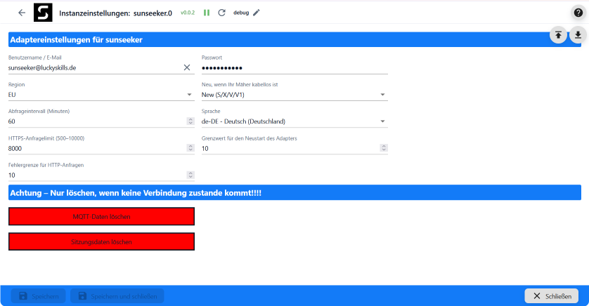

[Краткое содержание](#summary)

### Структура папок

| Идентификатор объекта        | Описание                                                                                                                          |
| ---------------------------- | --------------------------------------------------------------------------------------------------------------------------------- |
| xxx                          | Серийный номер газонокосилки (устройства)                                                                                         |
| xxx.antiTheft                | Защита от кражи (модуль 4G или GPS)                                                                                               |
| xxx.events                   | Журналы событий                                                                                                                   |
| xxx.эксперт                  | Доступно только разработчикам.                                                                                                    |
| xxx.map                      | Настройки зон, карт, областей и шаблонов                                                                                          |
| xxx.mower\_raw               | Все данные поступают из облака и через MQTT-соединение (только для чтения).                                                       |
| xxx.notice                   | Настройки уведомлений                                                                                                             |
| xxx.remote                   | Пульт дистанционного управления                                                                                                   |
| xxx.расписание               | Настройки расписания кошения. Поддерживается только два расписания кошения в день.                                                |
| xxx.settings                 | Общие настройки.                                                                                                                  |
| xxx.Совместное использование | Совместное использование аккаунта                                                                                                 |
| аутентификация               | Учетные данные доступа и статус подключения MQTT.                                                                                 |
| информация                   | Статус подключения к облаку и MQTT. Максимум 3 подключения; если хотя бы одно из них отключится, адаптер загорится желтым цветом. |
| rateLimit                    | Информация об ограничении скорости запросов (ошибки не отображаются).                                                             |

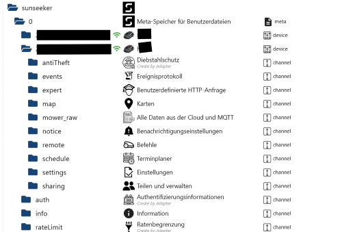

[Краткое содержание](#summary)

### Противоугонная система

| Идентификатор объекта          | Описание                                        |
| ------------------------------ | ----------------------------------------------- |
| xxx.antiTheft.batteryVoltage   | Состояние напряжения батареи                    |
| xxx.antiTheft.bindDeviceSn     | Серийный номер подключенной газонокосилки       |
| xxx.antiTheft.deviceOnlineFlag | Статус модуля                                   |
| xxx.antiTheft.fence            | Размеры цифрового забора (Д/М/В)                |
| xxx.antiTheft.fenceCenterLat   | Широта (центр цифрового забора)                 |
| xxx.antiTheft.fenceCenterLon   | Долгота (центр цифрового забора)                |
| xxx.antiTheft.fence\_digital   | Активировать/деактивировать цифровой забор      |
| xxx.antiTheft.lastOnlineTime   | Время последнего изменения статуса на «онлайн». |
| xxx.antiTheft.lastPositionTime | Время последнего обновления местоположения      |

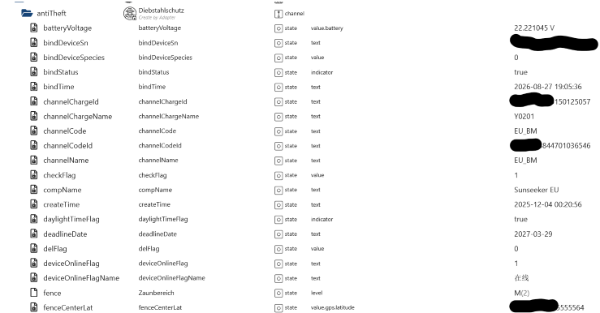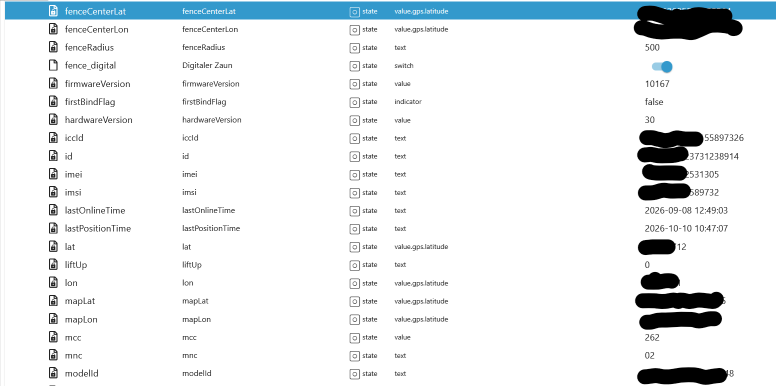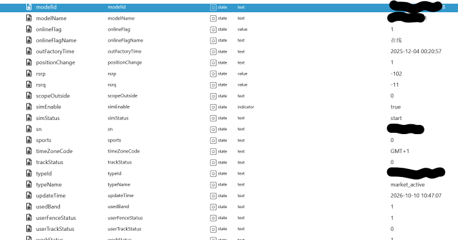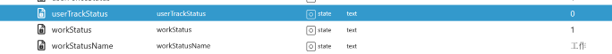

[Краткое содержание](#summary)

### Сообщение о событии

| Идентификатор объекта          | Описание                                     |
| ------------------------------ | -------------------------------------------- |
| xxx.events.eventNotification   | Уведомление о событии                        |
| xxx.events.eventUpdate         | Перезагрузить все события                    |
| xxx.events.events              | Сообщения устройства в формате JSON          |
| xxx.events.makeAllRead         | Отметьте все события как «прочитанные»       |
| xxx.events.systemMessage       | Системные сообщения                          |
| xxx.events.unreadEventMessage  | Количество непрочитанных событий             |
| xxx.events.unreadSystemMessage | Количество непрочитанных системных сообщений |

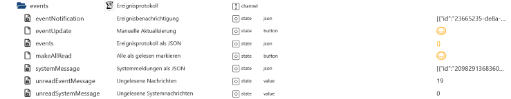

[Краткое содержание](#summary)

### eventNotification

```json
[
    {
        "id": "25046fa6-7766-4ed4-87a0-952f515442ca",
        "sn": null,
        "workRecordId": "0",
        "type": 2,
        "code": "Regen erkannt",
        "poseX": "",
        "poseY": "",
        "time": "1791584104176",
        "timeStr": "2026-10-09 22:15:04",
        "timeZoneId": "Europe/Berlin",
        "count": null,
        "nrtkBase": 0,
        "firmwareVersion": "1.1.28.3103"
    },
    {
        "id": "6f351d8c-9832-4e5b-b4b5-7c306151f1c9",
        "sn": null,
        "workRecordId": "0",
        "type": 2,
        "code": "Regen erkannt",
        "poseX": "",
        "poseY": "",
        "time": "1791403996503",
        "timeStr": "2026-10-07 20:13:16",
        "timeZoneId": "Europe/Berlin",
        "count": null,
        "nrtkBase": 0,
        "firmwareVersion": "1.1.28.3103"
    },
    {
        "id": "917a42c4-edd1-49cc-9f2f-ebebfae9342a",
        "sn": null,
        "workRecordId": "0",
        "type": 2,
        "code": "Der Roboter lädt",
        "poseX": "",
        "poseY": "",
        "time": "1791382963985",
        "timeStr": "2026-10-07 14:22:43",
        "timeZoneId": "Europe/Berlin",
        "count": null,
        "nrtkBase": 0,
        "firmwareVersion": "1.1.28.3103"
    }
]
```

### события

```json
[
    {
        "id": "2114652384020443001",
        "appUserId": null,
        "title": "Robot update successful",
        "content": "xxx:Robot update successful.",
        "readFlag": false,
        "createdAt": "2026-10-26 09:36:31",
        "messageTypeCode": "otaSuccess",
        "feedbackContent": null,
        "sendAt": "1793007391",
        "type": 2,
        "sn": null,
        "userDelFlag": false,
        "messageCode": null,
        "nrtkBase": null
    },
    {
        "id": "2114333791798816000",
        "appUserId": null,
        "title": "Robot lifted",
        "content": "xxx:Click to view the solution.",
        "readFlag": false,
        "createdAt": "2026-10-25 12:30:33",
        "messageTypeCode": "deviceExceptionMessage",
        "feedbackContent": null,
        "sendAt": "1792931433",
        "type": 2,
        "sn": "null",
        "userDelFlag": false,
        "messageCode": "-1",
        "nrtkBase": 0
    },
    {
        "id": "2114333789689335002",
        "appUserId": null,
        "title": "Robot lifted",
        "content": "xxx:Click to view the solution.",
        "readFlag": false,
        "createdAt": "2026-10-25 12:30:32",
        "messageTypeCode": "deviceExceptionMessage",
        "feedbackContent": null,
        "sendAt": "1792931432",
        "type": 2,
        "sn": "null",
        "userDelFlag": false,
        "messageCode": "-1",
        "nrtkBase": 0
    }
]
```

### системное сообщение

```json
[
    {
        "id": "2098292481602727980",
        "appUserId": 12632759,
        "title": "Aktion für 70 Beta-Tester",
        "content": "Gehören Sie zu den Ersten, die unsere neue Technologie erleben, und gestalten Sie mit, was als Nächstes kommt.",
        "readFlag": true,
        "createdAt": "2026-09-11 06:07:59",
        "messageTypeCode": "communityActivityMessage",
        "feedbackContent": null,
        "sendAt": "1789106879",
        "type": 1,
        "sn": null,
        "userDelFlag": false,
        "messageCode": null,
        "nrtkBase": null
    },
    {
        "id": "2084552495081664535",
        "appUserId": 12632759,
        "title": "Gewinnen Sie einen Sunseeker Elite X Gen 2 – Das Gewinnspiel läuft noch!",
        "content": "Teilen Sie Ihr Feedback und gewinnen Sie mit etwas Glück X Gen 2 Mähroboter und Merchandise-Pakete. Gesamtwert der Preise: über 8.000 €.",
        "readFlag": true,
        "createdAt": "2026-08-04 08:10:01",
        "messageTypeCode": "communityActivityMessage",
        "feedbackContent": null,
        "sendAt": "1785831001",
        "type": 1,
        "sn": null,
        "userDelFlag": false,
        "messageCode": null,
        "nrtkBase": null
    },
    {
        "id": "2083090986003931175",
        "appUserId": 12632759,
        "title": "Umfrage-Gewinnspiel – Gewinnen Sie einen Sunseeker Elite X Gen 2!",
        "content": "Teilen Sie Ihr Feedback und gewinnen Sie X Gen 2 Mähroboter sowie Merchandise-Pakete. Gesamtwert der Preise: über 8.000 €.",
        "readFlag": true,
        "createdAt": "2026-07-31 07:22:39",
        "messageTypeCode": "communityActivityMessage",
        "feedbackContent": null,
        "sendAt": "1785482559",
        "type": 1,
        "sn": null,
        "userDelFlag": false,
        "messageCode": null,
        "nrtkBase": null
    }
]
```

[Краткое содержание](#summary)

### Эксперт

`For developers only. Requests can be sent directly to the cloud.`

| Идентификатор объекта | Описание                          |
| --------------------- | --------------------------------- |
| xxx.expert.request    | Собственный запрос в формате JSON |
| xxx.expert.response   | Ответ                             |

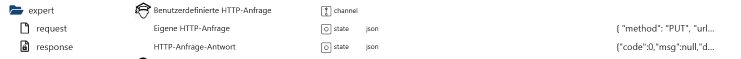

[Краткое содержание](#summary)

### Карта

| Идентификатор объекта   | Описание                                                        |
| ----------------------- | --------------------------------------------------------------- |
| xxx.map.blank           | Свойства ребер                                                  |
| xxx.map.forbidden       | Запретные зоны                                                  |
| xxx.map.info            | Текущая информация о карте                                      |
| xxx.map.map\_settings   | Настройки интерактивной карты                                   |
| xxx.map.maps            | Резервные карты                                                 |
| xxx.map.obstacles       | Препятствия                                                     |
| xxx.map.passages        | Отрывки                                                         |
| xxx.map.pattern         | Шаблон                                                          |
| xxx.map.placed\_blank   | Безопасные зоны                                                 |
| xxx.map.zones           | Зоны                                                            |
| xxx.map.backup          | Резервные копии карт в формате JSON (данные для `xxx.map.maps`) |
| xxx.map.livemap         | Интерактивная карта                                             |
| xxx.map.livemap\_update | Обновление карты в реальном времени во время кошения.           |
| xxx.map.mapData         | Активные картографические данные (все точки)                    |
| xxx.map.net             | Карта покрытия сети                                             |
| xxx.map.pathData        | Данные о траектории скашивания                                  |
| xxx.map.texture         | Текстуры как карта                                              |
| xxx.map.wifi            | Карта покрытия Wi-Fi                                            |

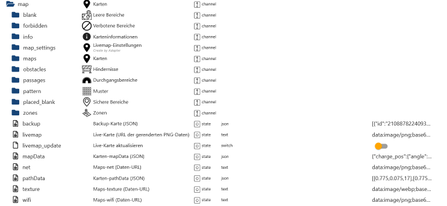

[Краткое содержание](#summary)

### Граничные свойства

| Идентификатор объекта          | Описание                 |
| ------------------------------ | ------------------------ |
| xxx.map.blank.01.delete\_blank | Удалить свойство границы |
| xxx.map.blank.01.id            | ИДЕНТИФИКАТОР            |
| xxx.map.blank.01.points        | Точки пустой области     |
| xxx.map.blank.01.points\_num   | Количество баллов        |

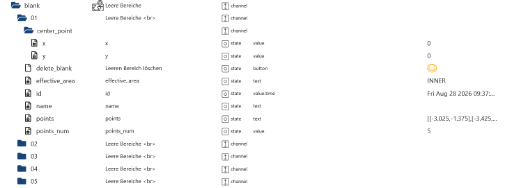

[Краткое содержание](#summary)

### Запретная область

| Идентификатор объекта                  | Описание                                                                                                          |
| -------------------------------------- | ----------------------------------------------------------------------------------------------------------------- |
| xxx.map.forbidden.01.delete\_forbidden | Удалить запрещенную область                                                                                       |
| xxx.map.forbidden.01.effective\_area   | Независимо от того, находится ли территория внутри или за пределами границ.                                       |
| xxx.map.forbidden.01.id                | Отметка времени создания данной территории.                                                                       |
| xxx.map.forbidden.01.name              | Не может быть назначено                                                                                           |
| xxx.map.forbidden.01.points            | Точки, определяющие область.                                                                                      |
| xxx.map.forbidden.01.points\_num       | Количество баллов                                                                                                 |
| xxx.map.forbidden.01.tag               | Метка области (2+темный=ночь, 1+нормальный=стена, 2+нормальный=общий)                                             |
| xxx.map.forbidden.01.type              | Тип местности (общая, ночная или стена)                                                                           |
| xxx.map.forbidden.forbidden\_create    | Создать запретную зону                                                                                            |
| xxx.map.forbidden.forbidden\_map       | Предварительный просмотр карты с точками                                                                          |
| xxx.map.forbidden.forbidden\_points    | Точки в виде массива (например, точки из .01.points). Создание запрещенных зон с помощью VIS пока не реализовано. |
| xxx.map.forbidden.forbidden\_type      | Общий, ночной или стена                                                                                           |

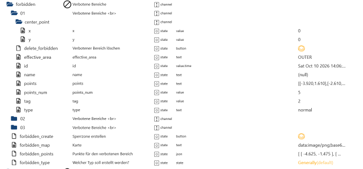

[Краткое содержание](#summary)

### Текущая информация о карте

| Идентификатор объекта        | Описание                                                      |
| ---------------------------- | ------------------------------------------------------------- |
| xxx.map.info.mapModifyTime   | Последнее изменение                                           |
| xxx.map.info.mapPathFileName | Имя файла                                                     |
| xxx.map.info.mapPathFileUrl  | URL-ссылка для загрузки текущих картографических данных       |
| xxx.map.info.realPathFileUlr | URL-ссылка для загрузки текущих данных об истории скашивания. |

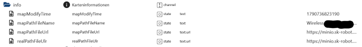

[Краткое содержание](#summary)

### Настройки интерактивной карты

| Идентификатор объекта                                    | Описание                                                                              |
| -------------------------------------------------------- | ------------------------------------------------------------------------------------- |
| xxx.map.map\_settings.charger\_path                      | Изображение пути к зарядной станции                                                   |
| xxx.map.map\_settings.charger\_scale                     | Изображение зарядной станции в масштабе. Чем меньше значение, тем больше изображение. |
| xxx.map.map\_settings.divide\_area\_work\_active         | Отобразить на карте границы рабочей зоны                                              |
| xxx.map.map\_settings.divide\_area\_work\_lineWidth      | ширина строки                                                                         |
| xxx.map.map\_settings.divide\_area\_work\_stroke         | Цвет обводки                                                                          |
| xxx.map.map\_settings.polyline\_color                    | Цвет линии скашивания                                                                 |
| xxx.map.map\_settings.polyline\_lineWidth                | ширина строки                                                                         |
| xxx.map.map\_settings.region\_channel\_active            | Показать отрывки                                                                      |
| xxx.map.map\_settings.region\_channel\_fill              | Цвет заливки                                                                          |
| xxx.map.map\_settings.region\_channel\_lineWidth         | ширина строки                                                                         |
| xxx.map.map\_settings.region\_channel\_stroke            | Цвет обводки                                                                          |
| xxx.map.map\_settings.region\_forbidden\_active          | Показать запрещенные зоны                                                             |
| xxx.map.map\_settings.region\_forbidden\_dark\_fill      | Цвет заливки                                                                          |
| xxx.map.map\_settings.region\_forbidden\_dark\_lineWidth | ширина строки                                                                         |
| xxx.map.map\_settings.region\_forbidden\_dark\_stroke    | Цвет обводки                                                                          |
| xxx.map.map\_settings.region\_forbidden\_fill            | Цвет заливки                                                                          |
| xxx.map.map\_settings.region\_forbidden\_lineWidth       | ширина строки                                                                         |
| xxx.map.map\_settings.region\_forbidden\_stroke          | Цвет обводки                                                                          |
| xxx.map.map\_settings.region\_forbidden\_wall\_fill      | Цвет заливки                                                                          |
| xxx.map.map\_settings.region\_forbidden\_wall\_lineWidth | ширина строки                                                                         |
| xxx.map.map\_settings.region\_forbidden\_wall\_stroke    | Цвет обводки                                                                          |
| xxx.map.map\_settings.region\_obstacle\_active           | Показать препятствия                                                                  |
| xxx.map.map\_settings.region\_obstacle\_fill             | Цвет заливки                                                                          |
| xxx.map.map\_settings.region\_obstacle\_lineWidth        | ширина строки                                                                         |
| xxx.map.map\_settings.region\_obstacle\_stroke           | Цвет обводки                                                                          |
| xxx.map.map\_settings.region\_pattern\_active            | Показать узор                                                                         |
| xxx.map.map\_settings.region\_pattern\_fill              | Цвет заливки                                                                          |
| xxx.map.map\_settings.region\_pattern\_lineWidth         | ширина строки                                                                         |
| xxx.map.map\_settings.region\_pattern\_stroke            | Цвет обводки                                                                          |
| xxx.map.map\_settings.region\_placed\_blank\_active      | Показать безопасные зоны                                                              |
| xxx.map.map\_settings.region\_placed\_blank\_fill        | Цвет заливки                                                                          |
| xxx.map.map\_settings.region\_placed\_blank\_lineWidth   | ширина строки                                                                         |
| xxx.map.map\_settings.region\_placed\_blank\_stroke      | Цвет обводки                                                                          |
| xxx.map.map\_settings.region\_work\_fill                 | Цвет заливки                                                                          |
| xxx.map.map\_settings.region\_work\_lineWidth            | ширина строки                                                                         |
| xxx.map.map\_settings.region\_work\_stroke               | Цвет обводки                                                                          |
| xxx.map.map\_settings.robot\_charger\_scale              | Масштабное изображение газонокосилки. Чем меньше значение, тем больше изображение.    |
| xxx.map.map\_settings.robot\_path                        | Путь к изображению газонокосилки                                                      |

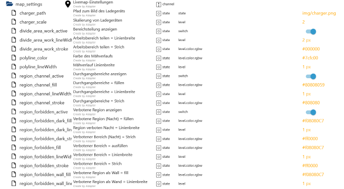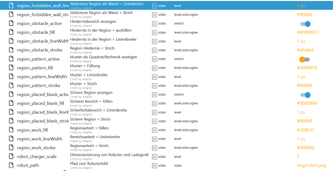

[Краткое содержание](#summary)

### Карты (резервные карты)

| Идентификатор объекта          | Описание                                                                                      |
| ------------------------------ | --------------------------------------------------------------------------------------------- |
| xxx.map.maps.01.createTime     | Отметка времени создания карты                                                                |
| xxx.map.maps.01.delete         | Удалить карту. Необходимо предварительно подтвердить это через `xxx.map.maps.01.delete_select` |
| xxx.map.maps.01.delete\_select | Подтвердить удаление карты (установить значение true)                                         |
| xxx.map.maps.01.id             | ИДЕНТИФИКАТОР                                                                                 |
| xxx.map.maps.01.mapArea        | Площадь карты в м²                                                                            |
| xxx.map.maps.01.mapId          | Идентификатор карты                                                                           |
| xxx.map.maps.01.mapName        | Название карты (редактируемое)                                                                |
| xxx.map.maps.01.mapUrl         | URL карты                                                                                     |
| xxx.map.maps.01.sn             | серийный номер газонокосилки                                                                  |
| xxx.map.maps.01.thumbnailUrl   | URL-адрес миниатюрной карты                                                                   |
| xxx.map.maps.01.updateTime     | Последнее изменение                                                                           |
| xxx.map.maps.01.useThisMap     | Используйте эту карту. Для начала необходимо удалить текущую активную карту.                  |
| xxx.map.maps.01.used           | Карта активна                                                                                 |

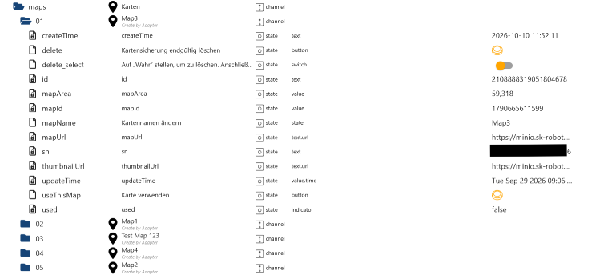

[Краткое содержание](#summary)

### Препятствия

| Идентификатор объекта                 | Описание                                                                   |
| ------------------------------------- | -------------------------------------------------------------------------- |
| xxx.map.obstacles.01.delete\_obstacle | Удалить препятствие                                                        |
| xxx.map.obstacles.01.effective\_area  | Внутри или за пределами этой зоны                                          |
| xxx.map.obstacles.01.id               | ИДЕНТИФИКАТОР                                                              |
| xxx.map.obstacles.01.name             | Нет функции                                                                |
| xxx.map.obstacles.01.points           | Точки препятствий                                                          |
| xxx.map.obstacles.01.points\_num      | Количество баллов                                                          |
| xxx.map.obstacles.obstacle\_create    | Создать препятствие                                                        |
| xxx.map.obstacles.obstacle\_map       | Предварительный просмотр препятствия                                       |
| xxx.map.obstacles.obstacle\_points    | Точки препятствий. Создание препятствий с помощью VIS пока не реализовано. |

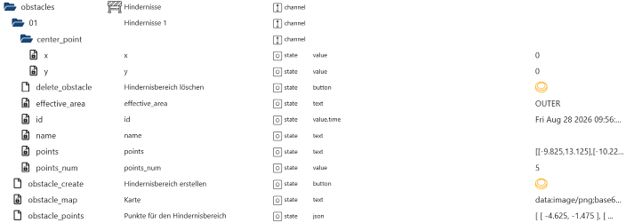

[Краткое содержание](#summary)

### Отрывки

| Идентификатор объекта               | Описание                                                          |
| ----------------------------------- | ----------------------------------------------------------------- |
| xxx.map.passages.01.delete\_passage | Удалить фрагмент                                                  |
| xxx.map.passages.01.effective\_area | Внутри или за пределами этой зоны                                 |
| xxx.map.passages.01.id              | ИДЕНТИФИКАТОР                                                     |
| xxx.map.passages.01.name            | Нет функции                                                       |
| xxx.map.passages.01.points          | Пункты прохода.                                                   |
| xxx.map.passages.01.points\_num     | Количество баллов                                                 |
| xxx.map.passages.01.split\_line     | Разделительная линия                                              |
| xxx.map.passages.passage\_create    | Создать отрывок                                                   |
| xxx.map.passages.passage\_map       | Предварительный просмотр отрывка                                  |
| xxx.map.passages.passage\_points    | Точки перехода. Создание переходов через VIS пока не реализовано. |

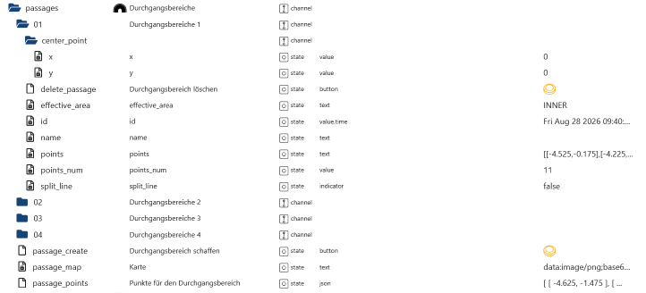

[Краткое содержание](#summary)

### Шаблон

| Идентификатор объекта                | Описание                                                                                                                                                                                                 |
| ------------------------------------ | -------------------------------------------------------------------------------------------------------------------------------------------------------------------------------------------------------- |
| xxx.map.pattern.01.area\_id          | Идентификатор области                                                                                                                                                                                    |
| xxx.map.pattern.01.effective\_area   | Внутри или за пределами этой зоны                                                                                                                                                                        |
| xxx.map.pattern.01.enable            | Включить шаблон                                                                                                                                                                                          |
| xxx.map.pattern.01.expiration\_time  | Дата и время автоматического удаления шаблона.                                                                                                                                                           |
| xxx.map.pattern.01.id                | ИДЕНТИФИКАТОР                                                                                                                                                                                            |
| xxx.map.pattern.01.img\_value        | Изменить шаблон                                                                                                                                                                                          |
| xxx.map.pattern.01.last\_edit\_time  | Отметка времени последнего изменения шаблона                                                                                                                                                             |
| xxx.map.pattern.01.min\_width        | Минимальный размер                                                                                                                                                                                       |
| xxx.map.pattern.01.name              | Нет функции                                                                                                                                                                                              |
| xxx.map.pattern.01.pattern\_delete   | Удалить шаблон                                                                                                                                                                                           |
| xxx.map.pattern.01.points            | Точки узора (квадрат)                                                                                                                                                                                    |
| xxx.map.pattern.01.points\_num       | Количество баллов                                                                                                                                                                                        |
| xxx.map.pattern.create\_pattern      | Создайте шаблон. Сначала настройте его. `delete_automatic`, `points_pattern`, и `selecte_pattern`.                                                                                                       |
| xxx.map.pattern.delete\_all\_pattern | Удалите все шаблоны.                                                                                                                                                                                     |
| xxx.map.pattern.pattern\_map         | Предварительный просмотр.                                                                                                                                                                                |
| xxx.map.pattern.points\_pattern      | Создание узоров через VIS пока не реализовано; точки необходимо вводить здесь. Просто создайте несколько узоров с помощью приложения и скопируйте точки из него. `xxx.map.mapData` ->`region_customize`. |
| xxx.map.pattern.delete\_automatic    | Время, когда следует удалить новый шаблон                                                                                                                                                                |
| xxx.map.pattern.selecte\_pattern     | Выберите шаблон                                                                                                                                                                                          |

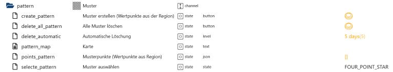

[Краткое содержание](#summary)

### Безопасные зоны (placed\_blank)

| Идентификатор объекта                          | Описание                                                                                     |
| ---------------------------------------------- | -------------------------------------------------------------------------------------------- |
| xxx.map.placed\_blank.01.delete\_placed\_blank | Удалить безопасную зону                                                                      |
| xxx.map.placed\_blank.01.effective\_area       | Внутри или за пределами зоны                                                                 |
| xxx.map.placed\_blank.01.id                    | ИДЕНТИФИКАТОР                                                                                |
| xxx.map.placed\_blank.01.name                  | Нет функции                                                                                  |
| xxx.map.placed\_blank.01.points                | Точки безопасной зоны                                                                        |
| xxx.map.placed\_blank.01.points\_num           | Количество баллов                                                                            |
| xxx.map.placed\_blank.placed\_blank\_create    | Создайте безопасную зону, используя точки из `xxx.map.placed_blank.placed_blank_points`       |
| xxx.map.placed\_blank.placed\_blank\_map       | Предварительный просмотр с использованием точек из `xxx.map.placed_blank.placed_blank_points` |
| xxx.map.placed\_blank.placed\_blank\_points    | Точки безопасной зоны. Создание зон через VIS пока не реализовано.                           |

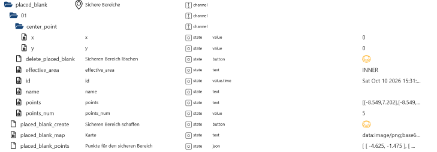

[Краткое содержание](#summary)

### Обзор зон

| Идентификатор объекта                     | Описание                                                                                                                                                    |
| ----------------------------------------- | ----------------------------------------------------------------------------------------------------------------------------------------------------------- |
| xxx.map.zones.change\_active\_map\_name   | Изменить название карты                                                                                                                                     |
| xxx.map.zones.delete\_active\_map         | Удалить активную карту; `xxx.map.zones.delete_active_map_select` необходимо установить значение `true`                                                        |
| xxx.map.zones.delete\_active\_map\_select | Установить на `true` Чтобы подтвердить удаление, нажмите `delete_active_map`                                                                                  |
| xxx.map.zones.merge\_zones                | Объединить зоны, например, \[1, 2], чтобы объединить Зону 1 и Зону 2.                                                                                       |
| xxx.map.zones.setAllCustomRaw             | Вы также можете изменять и отправлять JSON-данные вместо изменения состояний.                                                                               |
| xxx.map.zones.settings\_all\_zones        | Установите значение 0 для настроек по умолчанию (`xxx.settings.multi_angle`) для всех зон или 1 для пользовательских настроек (`xxx.map.zones.01.custom`) |

# setAllCustomRaw

```json
[
    {
        "work_gap": 2,
        "region_size": 10,
        "blade_height": 100,
        "estimate_time": 8,
        "blade_speed": 2800,
        "plan_mode": 4,
        "region_id": 1787902995078,
        "start": 1,
        "finish": 0,
        "work_speed": 2,
        "setting": false
    },
    {
        "work_gap": 2,
        "region_size": 28,
        "blade_height": 100,
        "estimate_time": 22,
        "blade_speed": 2800,
        "plan_mode": 4,
        "region_id": 1787903286041,
        "start": 0,
        "finish": 1,
        "work_speed": 2,
        "setting": false
    },
    {
        "work_gap": 2,
        "region_size": 20,
        "blade_height": 100,
        "estimate_time": 15,
        "blade_speed": 2800,
        "plan_mode": 4,
        "region_id": 1789910964606,
        "start": 0,
        "finish": 1,
        "work_speed": 2,
        "setting": false
    }
]
```

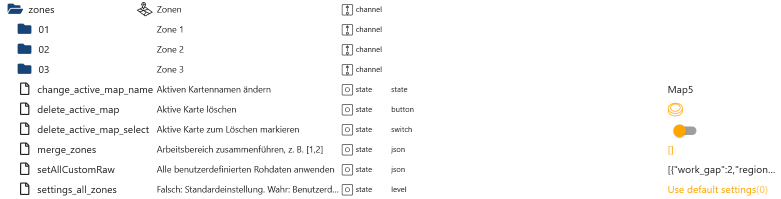

[Краткое содержание](#summary)

### Зона

| Идентификатор объекта                          | Описание                                                                                                                                                                |
| ---------------------------------------------- | ----------------------------------------------------------------------------------------------------------------------------------------------------------------------- |
| xxx.map.zones.01.area\_size                    | Размер зоны                                                                                                                                                             |
| xxx.map.zones.01.effective\_area               | Эффективная площадь                                                                                                                                                     |
| xxx.map.zones.01.id                            | ИДЕНТИФИКАТОР                                                                                                                                                           |
| xxx.map.zones.01.mapId                         | Идентификатор карты                                                                                                                                                     |
| xxx.map.zones.01.name                          | Название зоны (редактируемое)                                                                                                                                           |
| xxx.map.zones.01.points                        | Данные GPS зоны                                                                                                                                                         |
| xxx.map.zones.01.points\_num                   | Количество точек GPS                                                                                                                                                    |
| xxx.map.zones.01.split\_zones                  | Разделите эту зону, используя данные GPS. Разделение по визуальному признаку пока не реализовано.                                                                       |
| xxx.map.zones.01.start\_mowing\_selected\_area | Создание участков с помощью VIS пока не реализовано. Маршрут для скашивания можно получить из... `xxx.map.pathData` Скопируйте нужные точки в массив и вставьте их сюда. |
| xxx.map.zones.01.time\_balanced                | Сбалансированный по времени (только для чтения)                                                                                                                         |
| xxx.map.zones.01.time\_fine\_tune              | Точная настройка времени (только для чтения)                                                                                                                            |
| xxx.map.zones.01.time\_high\_efficiency        | Устойчиво высокая эффективность (только для чтения)                                                                                                                     |

# Баллы

```json
[-0.3, 0.112, 11]
```

# Множество

```json
[]
```

# Начало работы над выбранной зоной кошения

```json
[[-0.3, 0.112, 11]]
```

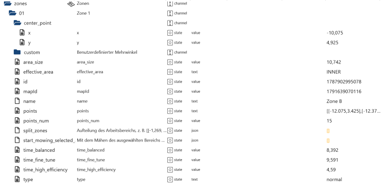

[Краткое содержание](#summary)

### Настройки пользовательской зоны

| Идентификатор объекта                              | Описание                                                                                                                                                                                      |
| -------------------------------------------------- | --------------------------------------------------------------------------------------------------------------------------------------------------------------------------------------------- |
| xxx.map.zones.01.custom.multi\_angle.01            | Поддерживается максимум три угла.                                                                                                                                                             |
| xxx.map.zones.01.custom.multi\_angle.01.active     | Активировать/деактивировать угол                                                                                                                                                              |
| xxx.map.zones.01.custom.multi\_angle.01.angle      | Изменение угла от 0° до 180°                                                                                                                                                                  |
| xxx.map.zones.01.custom.multi\_angle.angle         | Введите новый угол в диапазоне от 0° до 180°.                                                                                                                                                 |
| xxx.map.zones.01.custom.multi\_angle.angle\_active | Активировать/деактивировать новый угол                                                                                                                                                        |
| xxx.map.zones.01.custom.multi\_angle.angle\_create | Создайте новый ракурс                                                                                                                                                                         |
| xxx.map.zones.01.custom.multi\_angle.delete\_angle | Удалите ракурс                                                                                                                                                                                |
| xxx.map.zones.01.custom.currentCustomRaw           | Текущий JSON-файл пользовательских настроек из облака                                                                                                                                         |
| xxx.map.zones.01.custom.plan\_mode                 | Направление резки                                                                                                                                                                             |
| xxx.map.zones.01.custom.region\_id                 | Идентификатор зоны                                                                                                                                                                            |
| xxx.map.zones.01.custom.setCustomRaw               | Вместо изменения отдельных состояний вы также можете отправить JSON-объект. Используйте и изменяйте JSON из `currentCustomRaw`<br> Если используются углы, здесь необходимо выбрать вариант 4. |
| xxx.map.zones.01.custom.setCustomZoneSettings      | Отправлять `currentCustomRaw`                                                                                                                                                                  |
| xxx.map.zones.01.custom.setting                    | Использовать настройки по умолчанию из `xxx.settings.multi_angle`                                                                                                                              |
| xxx.map.zones.01.custom.start                      | Вносите изменения немедленно или во время следующей стрижки газона.                                                                                                                           |
| xxx.map.zones.01.custom.work\_gap                  | Расстояние разреза                                                                                                                                                                            |
| xxx.map.zones.01.custom.work\_speed                | Скорость кошения                                                                                                                                                                              |

# setCustomRaw

```json
{
    "work_gap": 3,
    "region_size": 54,
    "blade_height": 40,
    "estimate_time": 30,
    "multi_zigzag_angles": [
        {
            "active": true,
            "angle": 74
        },
        {
            "active": true,
            "angle": 68
        },
        {
            "active": true,
            "angle": 117
        }
    ],
    "blade_speed": 2800,
    "plan_mode": 0,
    "region_id": 1789399960596,
    "start": 0,
    "finish": 1,
    "work_speed": 1,
    "setting": true
}
```

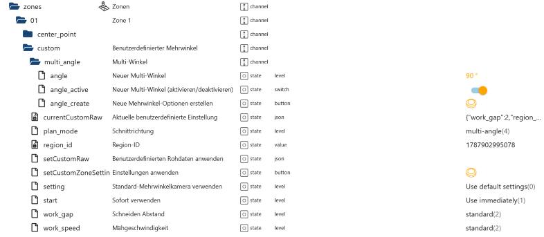

[Краткое содержание](#summary)

### Все данные с газонокосилки передаются через облако и MQTT-соединение.

`Only some of the objects are described here`

| Идентификатор объекта                    | Описание                                                               |
| ---------------------------------------- | ---------------------------------------------------------------------- |
| xxx.mower\_raw\.blade                    | Настройки блейда (MQTT)                                                |
| xxx.mower\_raw\.charge\_pos              | Положение зарядной станции (MQTT)                                      |
| xxx.mower\_raw\.consumable\_items        | Расходные материалы (MQTT)                                             |
| xxx.mower\_raw\.file\_17                 | Загружен новый файл с путем (MQTT)                                     |
| xxx.mower\_raw\.file\_7                  | Загружен новый файл карты (MQTT)                                       |
| xxx.mower\_raw\.current\_work\_param     | Текущие рабочие параметры (MQTT)                                       |
| xxx.mower\_raw\.mcu\_ver                 | Микроконтроллерный блок (MQTT)                                         |
| xxx.mower\_raw\.mow\_efficiency          | Эффективность кошения (MQTT)                                           |
| xxx.mower\_raw\.current\_file            | Текущий путь к файлу (MQTT)                                            |
| xxx.mower\_raw\.path\_info               | Текущее количество точек в истории скашивания (MQTT+GPS)               |
| xxx.mower\_raw\.notice                   | Последнее сообщение (MQTT)                                             |
| xxx.mower\_raw\.rain                     | Настройка времени дождя (MQTT)                                         |
| xxx.mower\_raw\.robot\_pos               | Положение косилки (MQTT)                                               |
| xxx.mower\_raw\.rtk\_pos                 | Кинематическое позиционирование в реальном времени (MQTT)              |
| xxx.mower\_raw\.schedule\_info           | Время последнего изменения (MQTT)                                      |
| xxx.mower\_raw\.support\_custom\_pattern | Все возможные шаблоны (MQTT)                                           |
| xxx.mower\_raw\.appUserId                | ID пользователя                                                        |
| xxx.mower\_raw\.auto\_upgrade            | Автоматическое обновление прошивки включено/выключено                  |
| xxx.mower\_raw\.backup\_map\_amount      | Количество резервных карт                                              |
| xxx.mower\_raw\.base\_sn                 | Серийный номер зарядной станции                                        |
| xxx.mower\_raw\.bindAntiTheftId          | Идентификатор модуля 4G или GPS                                        |
| xxx.mower\_raw\.bladeHeight              | высота лезвия                                                          |
| xxx.mower\_raw\.bladeSpeed               | Скорость лезвия                                                        |
| xxx.mower\_raw\.camera\_sn               | серийный номер камеры                                                  |
| xxx.mower\_raw\.camera\_temp             | Температура камеры                                                     |
| xxx.mower\_raw\.code                     | Ответ облачной системы: 0 = OK; значения больше 0 указывают на ошибку. |
| xxx.mower\_raw\.dev\_model               | модель газонокосилки                                                   |
| xxx.mower\_raw\.dev\_name                | Название газонокосилки                                                 |
| xxx.mower\_raw\.deviceId                 | Идентификатор газонокосилки                                            |
| xxx.mower\_raw\.deviceSn                 | серийный номер газонокосилки                                           |
| xxx.mower\_raw\.elec                     | Уровень заряда батареи                                                 |
| xxx.mower\_raw\.event\_code              | Последнее событие                                                      |
| xxx.mower\_raw\.id                       | Идентификатор для сопоставления сообщений MQTT                         |
| xxx.mower\_raw\.key                      | Ключ для сопоставления сообщений MQTT                                  |
| xxx.mower\_raw\.net\_4g\_sig             | уровень сигнала 4G                                                     |
| xxx.mower\_raw\.path                     | Текущий путь (необходим для отображения карты в реальном времени)      |
| xxx.mower\_raw\.sid                      | Идентификатор приложения (SID) для интерактивной карты                 |
| xxx.mower\_raw\.soc\_temp                | температура батареи                                                    |
| xxx.mower\_raw\.status                   | Состояние газонокосилки                                                |
| xxx.mower\_raw\.fault                    | Ошибка газонокосилки                                                   |
| xxx.mower\_raw\.faultHelpDetails         | Подробности неисправности                                              |
| xxx.mower\_raw\.faultHelp                | Подробности ошибки загрузки                                            |

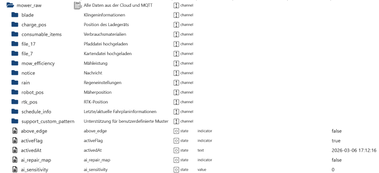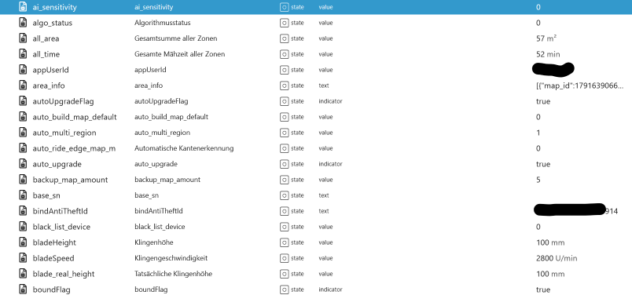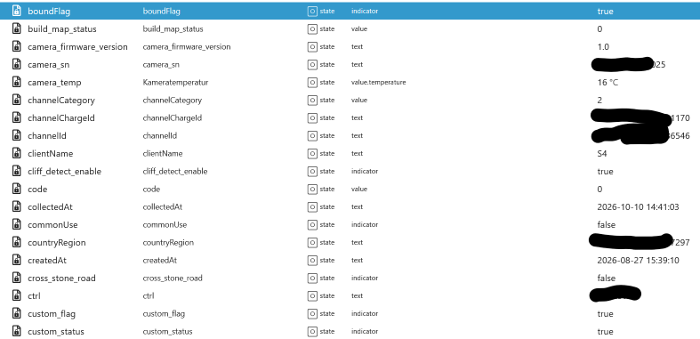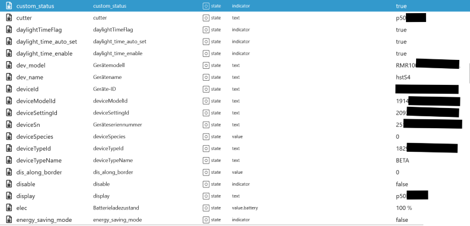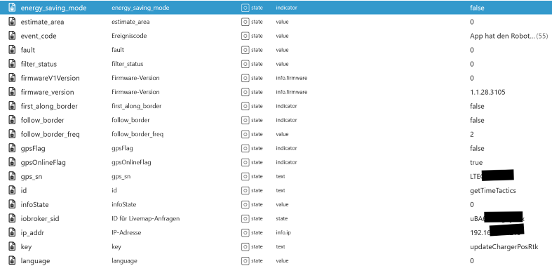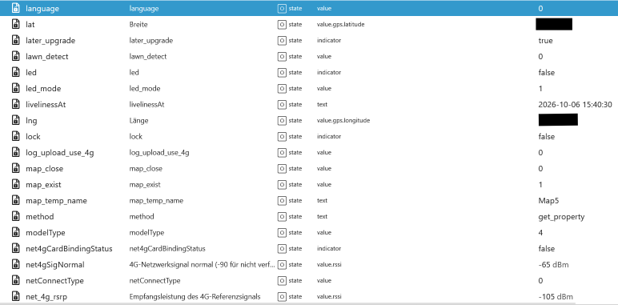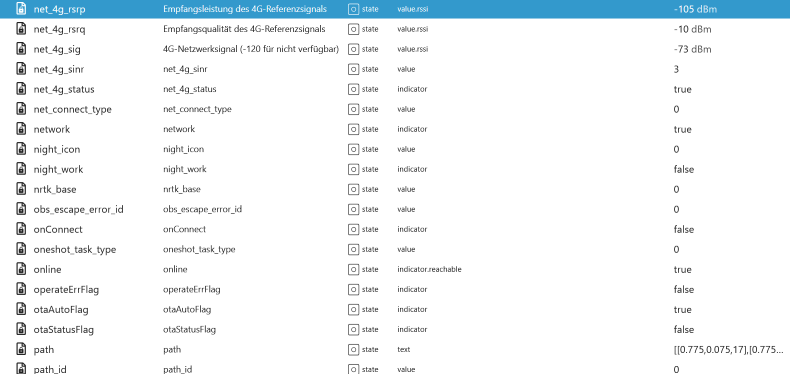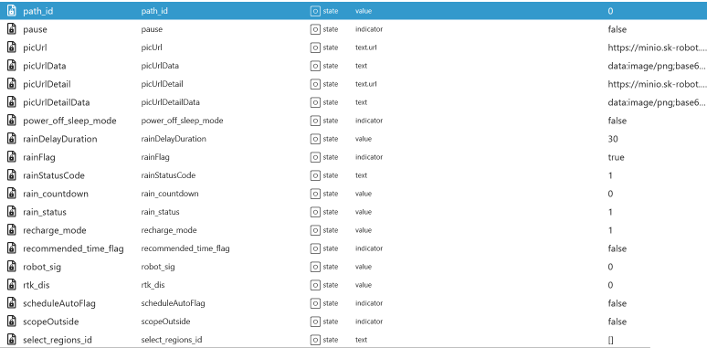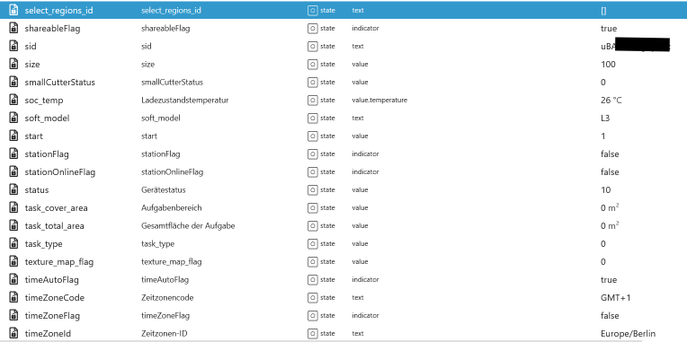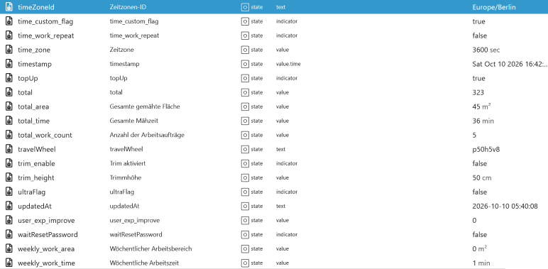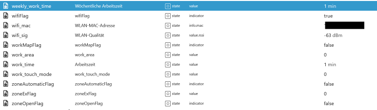

[Краткое содержание](#summary)

### Журналы

| Идентификатор объекта                | Описание                             |
| ------------------------------------ | ------------------------------------ |
| xxx.notice.commonMesgage             | Общие уведомления                    |
| xxx.notice.communityActivityMessage  | Рекомендуемые мероприятия            |
| xxx.notice.deadLineWarnMessageBlade  | Замените лезвие                      |
| xxx.notice.deadLineWarnMessageCutter | Очистка небольшой деки газонокосилки |
| xxx.notice.deadLineWarnTrimmerRope   | Замените леску триммера              |
| xxx.notice.deviceExceptionMessage    | Операционные нарушения               |
| xxx.notice.taskStatus                | Статус задачи                        |
| xxx.notice.trackWarningMessage       | Отслеживание                         |
| xxx.notice.update                    | Перезагрузить настройки              |

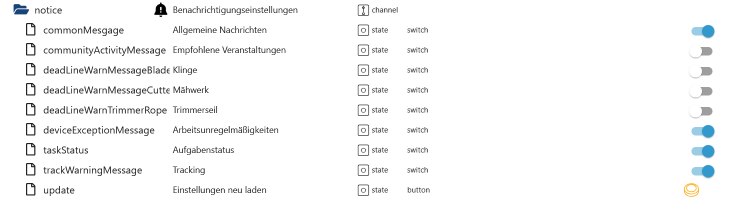

[Краткое содержание](#summary)

### Пульт дистанционного управления

| Идентификатор объекта            | Описание                                              |
| -------------------------------- | ----------------------------------------------------- |
| xxx.remote.dock                  | Вернуться на зарядную станцию                         |
| xxx.remote.pause                 | Пауза                                                 |
| xxx.remote.refresh               | Статус обновления                                     |
| xxx.remote.refresh\_property     | Обновить свойства                                     |
| xxx.remote.set\_border\_distance | Расстояние резки кромки (модель V1)                   |
| xxx.remote.set\_border\_first    | Сначала обрежьте край (модель V1)                     |
| xxx.remote.set\_return\_path     | Режим стыковки (модель V1)                            |
| xxx.remote.set\_screen\_duration | Автоматическое отключение экрана (модель V1)          |
| xxx.remote.start                 | Начните косить                                        |
| xxx.remote.startZones            | Скосить выбранные зоны, например, \[zoneId1, zoneId2] |
| xxx.remote.stop                  | Останавливаться                                       |
| xxx.remote.stop\_find\_charger   | Отмените возврат на зарядную станцию.                 |
| xxx.remote.border                | Обрезка кромок (модели V: режим 5 с `value:true`)     |

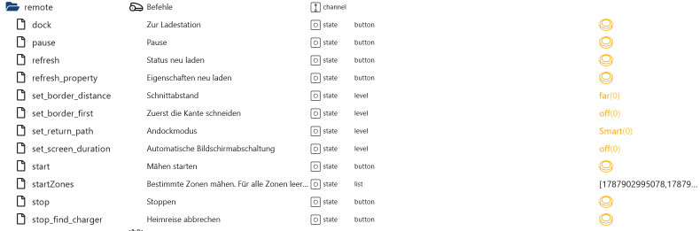

[Краткое содержание](#summary)

### Расписание

| Идентификатор объекта                          | Описание                                                                           |
| ---------------------------------------------- | ---------------------------------------------------------------------------------- |
| xxx.schedule.getSchedule                       | Перезагрузите расписание из облака.                                                |
| xxx.schedule.pauseSchedule                     | Приостановить расписание                                                           |
| xxx.schedule.schedule\_mode                    | Активация/деактивация расписания; пользовательский или рекомендуемый режим         |
| xxx.schedule.schedule\_time\_work\_repeat      | Теперь на всё запланированное рабочее время                                        |
| xxx.schedule.schedule\_time\_zone              | Часовой пояс                                                                       |
| xxx.schedule.setSchedule                       | Все изменения отправляются в облако.                                               |
| xxx.schedule.zones\_available                  | Доступные зоны, например `0_sunday_1.zones`                                         |
| xxx.schedule.0\_sunday\_1.active               | Всегда оставляйте значение true.                                                   |
| xxx.schedule.0\_sunday\_1.end                  | Время окончания в формате ЧЧ:мм                                                    |
| xxx.schedule.0\_sunday\_1.need\_follow\_border | Неизвестный                                                                        |
| xxx.schedule.0\_sunday\_1.start                | Время начала в формате ЧЧ:мм                                                       |
| xxx.schedule.0\_sunday\_1.unlock               | Всегда оставляйте значение true.                                                   |
| xxx.schedule.0\_sunday\_1.work\_order          | Пользовательская последовательность. Необходимо указать зону. 0 = Вкл. / 1 = Выкл. |
| xxx.schedule.0\_sunday\_1.zones                | Зона(ы), подлежащая(ие) скашиванию; если зона(ы) пуста, скашиваются все зоны.      |

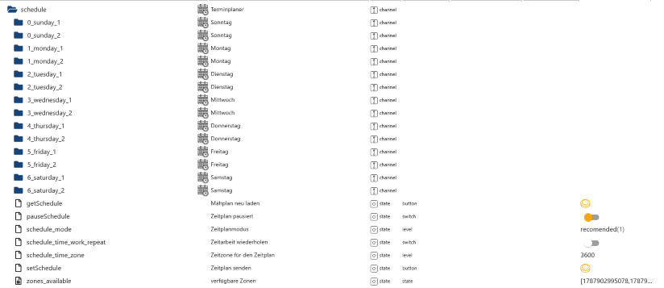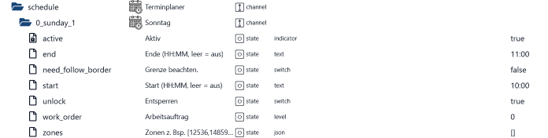

[Краткое содержание](#summary)

### Настройки

| Состояние                       | Описание                                                                                                                                                                                  | Диапазон                                                                               | Единица | Примечания            |
| ------------------------------- | ----------------------------------------------------------------------------------------------------------------------------------------------------------------------------------------- | -------------------------------------------------------------------------------------- | ------- | --------------------- |
| `bladeSpeed`                    | Скорость лезвия                                                                                                                                                                           | 2800 – 3000 (шаг 100)                                                                  | об/мин  | Только для нового API |
| `bladeHeight`                   | высота лезвия                                                                                                                                                                             | 20 – 100 (шаг 5)                                                                       | мм      | Только для нового API |
| `rainFlag`                      | Включить/отключить задержку из-за дождя                                                                                                                                                   | логический                                                                             | —       | Старый + Новый API    |
| `rainDelayDuration`             | Продолжительность задержки из-за дождя (мин)                                                                                                                                              | 0 – 720 (шаг 1)                                                                        | мин     | Старый + Новый API    |
| `night_work`                    | Включить/отключить ночную работу                                                                                                                                                          | логический                                                                             | —       | Только для нового API |
| `recharge_mode`                 | Путь стыковки                                                                                                                                                                             | 0 = прямой путь<br> 1 = умный<br> 2 = вдоль края                                       | —       | Только для нового API |
| `work_touch_mode`               | стратегия избегания препятствий                                                                                                                                                           | 0 = не прикасаться<br> 1 = медленное касание                                           | —       | Только для нового API |
| `auto_ride_edge_map_m`          | Автоматическое отображение с следованием по ребрам                                                                                                                                        | 0 = не включено<br> 1 = включено                                                       | —       | Только для нового API |
| `dis_along_border`              | Расстояние до края                                                                                                                                                                        | 0 = закрыть<br> 1 = далеко                                                             | —       | Только для нового API |
| `first_along_border`            | Предпочтения при скашивании                                                                                                                                                               | логический                                                                             | —       | Только для нового API |
| `follow_border_freq`            | частота резки кромки                                                                                                                                                                      | 1 = каждый раз<br> 2 = каждый второй раз<br> 3 = каждый третий раз                     | —       | Только для нового API |
| `follow_border_laps`            | Круглые косилки для обрезки краев газона                                                                                                                                                  | 1 = каждый раз<br> 2 = каждый второй раз<br> 3 = каждый третий раз                     | —       | Только для нового API |
| `plan_mode`                     | Направление резки. Угол необходимо установить на 4.                                                                                                                                       | 0 = значение по умолчанию<br> 1 = без следов<br> 3 = эффективный<br> 4 = многоугольный | —       | Только для нового API |
| `gap`                           | Расстояние между режущими инструментами                                                                                                                                                   | 1 = узкий<br> 2 = стандарт<br> 3 = широкий                                             | —       | Только для нового API |
| `workSpeed`                     | Скорость кошения                                                                                                                                                                          | 1 = медленно<br> 2 = стандарт<br> 3 = быстро                                           | —       | Только для нового API |
| `ai_sensitivity`                | чувствительность ИИ                                                                                                                                                                       | 0 = низкий<br> 1 = высокий                                                             | —       | Только для нового API |
| `dev_name`                      | Изменить имя устройства                                                                                                                                                                   | нить                                                                                   | —       | Только для нового API |
| `energy_saving_mode`            | Энергосберегающий режим                                                                                                                                                                   | логический                                                                             | —       | Только для нового API |
| `pin_old`                       | Введите старый ПИН-код                                                                                                                                                                    | число                                                                                  | —       | Только для нового API |
| `pin_new`                       | Чтобы изменить PIN-код, введите новый PIN-код здесь.<br> старый PIN-код под `pin_old`                                                                                                      | число                                                                                  | —       | Только для нового API |
| `custom_flag`                   | Неизвестный                                                                                                                                                                               | логический                                                                             | —       | Только для нового API |
| `auto_upgrade`                  | Включить/отключить автоматическое обновление прошивки                                                                                                                                     | логический                                                                             | —       | Только для нового API |
| `reset_bladeplate`              | Сбросить счетчик пластины лезвия                                                                                                                                                          | логический                                                                             | —       | Только для нового API |
| `reset_blade`                   | Сбросить счетчик лезвий                                                                                                                                                                   | логический                                                                             | —       | Только для нового API |
| `reset_small_bladeplate`        | Сброс счетчика пластины малого лезвия                                                                                                                                                     | логический                                                                             | —       | Новый API только X    |
| `reset_small_blade`             | Сбросить счетчик маленьких лезвий                                                                                                                                                         | логический                                                                             | —       | Новый API только X    |
| `firmware_available`            | В настоящее время доступна следующая версия прошивки.                                                                                                                                     | нить                                                                                   | —       | Только для нового API |
| `firmware_description`          | Описание текущей прошивки                                                                                                                                                                 | нить                                                                                   | —       | Только для нового API |
| `firmware_update_available`     | Доступно ли обновление? true = да, false = нет                                                                                                                                            | логический                                                                             | —       | Только для нового API |
| `firmware_update_check_manual`  | Проверки проводятся каждые 24 часа после включения адаптера.<br> Используйте эту функцию, чтобы вручную проверить наличие обновлений.                                                     | логический                                                                             | —       | Только для нового API |
| `firmware_update_start`         | Начать обновление прошивки                                                                                                                                                                | логический                                                                             | —       | Только для нового API |
| `topUp`                         | Отображается только при использовании более одной газонокосилки в приложении. Выберите устройства для отображения на главной странице приложения. `mower_raw.topUp` Состояние не меняется. | логический                                                                             | —       | Только для нового API |
| `topUp_array`                   | Отображается только при использовании более одной газонокосилки в приложении. Сортировка устройств для отображения в приложении.                                                          | логический                                                                             | —       | Только для нового API |
| `settings.power_off_sleep_mode` | Включение/отключение режима сна при выключении питания                                                                                                                                    | логический                                                                             | -       | Только для нового API |

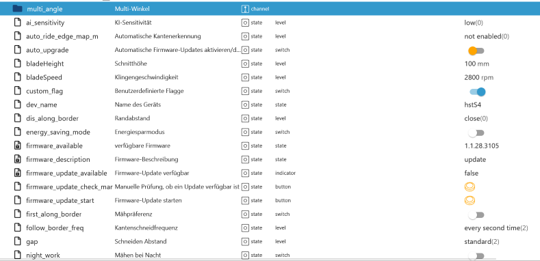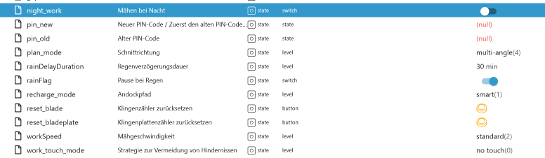

[Краткое содержание](#summary)

### Настройки Многоугольный

| Идентификатор объекта                   | Описание                                      |
| --------------------------------------- | --------------------------------------------- |
| xxx.settings.multi\_angle.01            | Можно настроить до трех углов.                |
| xxx.settings.multi\_angle.01.active     | Активировать/деактивировать угол              |
| xxx.settings.multi\_angle.01.angle      | Изменение угла от 0° до 180°                  |
| xxx.settings.multi\_angle.angle         | Введите новый угол в диапазоне от 0° до 180°. |
| xxx.settings.multi\_angle.angle\_active | Активировать/деактивировать новый угол        |
| xxx.settings.multi\_angle.angle\_create | Создайте новый ракурс                         |
| xxx.settings.multi\_angle.delete\_angle | Удалите ракурс                                |

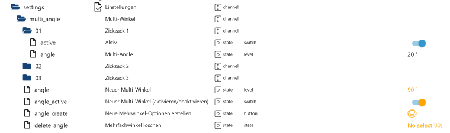

[Краткое содержание](#summary)

### Совместное использование

| Идентификатор объекта                  | Описание                                                                                     |
| -------------------------------------- | -------------------------------------------------------------------------------------------- |
| xxx.sharing.share\_user                | Информация и настройки для всех связей учетных записей и личной учетной записи пользователя. |
| xxx.sharing.share\_user.xxx            | Идентификатор и данные для привязки учетной записи                                           |
| xxx.sharing.share\_user.xxx.deviceUser | Информация об устройстве, связанном с данной ссылкой.                                        |
| xxx.sharing.share\_user.xxx.user       | Информация о пользователе, связанном с данной ссылкой.                                       |

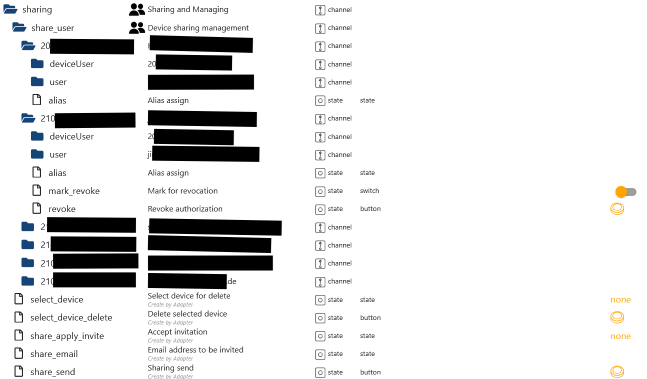

| Идентификатор объекта                    | Описание                                                                                          |
| ---------------------------------------- | ------------------------------------------------------------------------------------------------- |
| xxx.sharing.share\_user.xxx.alias        | Присвоить псевдоним.                                                                              |
| xxx.sharing.share\_user.xxx.mark\_revoke | Пометить учетную запись для удаления                                                              |
| xxx.sharing.share\_user.xxx.revoke       | Удалить отмеченный аккаунт навсегда                                                               |
| xxx.sharing.share\_apply\_invite         | Объект создаётся только при получении запроса.<br> Разрешить запросы на привязку учетных записей. |
| xxx.sharing.share\_email                 | Адрес электронной почты учетной записи, с которой вы хотите поделиться своей учетной записью.     |
| xxx.sharing.share\_send                  | Отправить запрос.                                                                                 |
| xxx.sharing.select\_device               | Выберите газонокосилку, чтобы удалить ее из приложения.                                           |
| xxx.sharing.select\_device\_delete       | Удалить выбранную газонокосилку                                                                   |

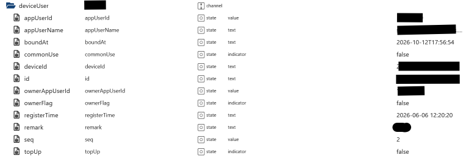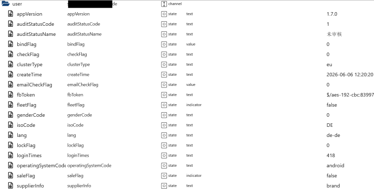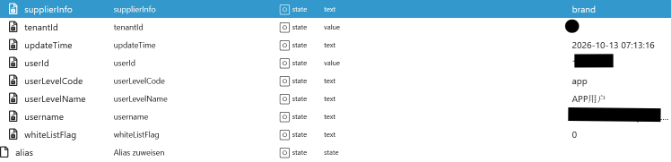

[Краткое содержание](#summary)

### Авторизация

| Идентификатор объекта     | Описание                                                                    |
| ------------------------- | --------------------------------------------------------------------------- |
| auth.app\_id              | Создается адаптером и необходим для выполнения некоторых запросов к облаку. |
| auth.mqtt\_connected      | Статус подключения MQTT для моделей S/X/V                                   |
| auth.mqtt\_connected\_V1  | Статус подключения MQTT для модели V1                                       |
| auth.mqtt\_connected\_old | Статус подключения MQTT для проводных газонокосилок                         |
| auth.mqtt\_connection     | Учетные данные для доступа к MQTT-соединению                                |
| auth.mqtt\_count          | Подсчет повторных подключений MQTT после перезагрузки адаптера.             |
| auth.session              | Учетные данные для доступа к облачному подключению.                         |

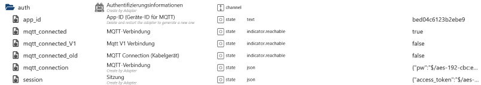

[Краткое содержание](#summary)

### Ограничение на количество запросов

| Идентификатор объекта | Описание                                                                               |
| --------------------- | -------------------------------------------------------------------------------------- |
| rateLimit.request     | Отображает запросы, отправленные в облако. Защита от некорректных скриптов.            |
| rateLimit.restart     | Подсчитывает количество перезагрузок адаптера в день. Защита от некорректных скриптов. |

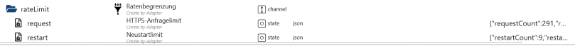

### JSON-запрос

```json
{
    "requestCount": 291,
    "requestLast": 1791627513938,
    "requestTime": "2026-10-10T10:18:33.938Z",
    "requestBlock": false,
    "day": "41-6",
    "request": [
        {
            "count": 291,
            "method": "GET",
            "urlPath": "/wireless_map/wireless_device/get?deviceSn=123",
            "timestamp": 1791657143977,
            "time": "2026-10-10T18:32:23.977Z"
        },
        {
            "count": 290,
            "method": "POST",
            "urlPath": "/ota/firmware-large/wireless/check",
            "data": "{\"deviceSn\":\"123\",\"deviceSpecies\":0,\"deviceType\":0,\"version\":\"1.1.28.3105\"}",
            "timestamp": 1791657088209,
            "time": "2026-10-10T18:31:28.209Z"
        }
    ]
}
```

### JSON Restart

```json
{
    "restartCount": 9,
    "restartLast": 1791627513938,
    "restartTime": "2026-10-10T10:18:33.938Z",
    "day": "41-6"
}
```

[Краткое содержание](#summary)

## Changelog

<!--
    Placeholder for the next version (at the beginning of the line):
    ### **WORK IN PROGRESS**
-->

### **WORK IN PROGRESS**

- (copilot) Adapter requires node.js >= 22.19.0 now
- (Lucky-ESA) Adaptation for the S5-Gen-2 mower
- (Lucky-ESA) Mirroring of App version 1.9.0 regarding new mqtt url, AppId register, Topic and clientId
- (Lucky-ESA) Added Power-off Sleep setting
- (Lucky-ESA) Added fault states

### 0.0.5 (2026-10-24)

- (Lucky-ESA) MQTT reconnected fixed

### 0.0.4 (2026-10-18)

- (Lucky-ESA) Added account sharing
- (Lucky-ESA) Added device sorting

### 0.0.3 (2026-10-11)

- (Lucky-ESA) Settings added
- (Lucky-ESA) Refresh properties button added
- (Lucky-ESA) Multi-angle added
- (Lucky-ESA) Custom Multi-angle added
- (Lucky-ESA) Mirroring of App version 1.7.0 regarding login, header, and MQTT password.
- (Lucky-ESA) Pattern, anti-theft added

### 0.0.2 (2026-05-29)

- (ioBroker-Bot) Adapter requires admin >= 7.8.23 now.
- (Lucky-ESA) Added event log

### 0.0.1 (2026-05-15)

- (TA2k) initial release

## License

MIT License

Copyright (c) 2026 iobroker-community-adapters <iobroker-community-adapters@gmx.de>  
Copyright (c) 2026 TA2k <tombox2020@gmail.com>

Permission is hereby granted, free of charge, to any person obtaining a copy
of this software and associated documentation files (the "Software"), to deal
in the Software without restriction, including without limitation the rights
to use, copy, modify, merge, publish, distribute, sublicense, and/or sell
copies of the Software, and to permit persons to whom the Software is
furnished to do so, subject to the following conditions:

The above copyright notice and this permission notice shall be included in all
copies or substantial portions of the Software.

THE SOFTWARE IS PROVIDED "AS IS", WITHOUT WARRANTY OF ANY KIND, EXPRESS OR
IMPLIED, INCLUDING BUT NOT LIMITED TO THE WARRANTIES OF MERCHANTABILITY,
FITNESS FOR A PARTICULAR PURPOSE AND NONINFRINGEMENT. IN NO EVENT SHALL THE
AUTHORS OR COPYRIGHT HOLDERS BE LIABLE FOR ANY CLAIM, DAMAGES OR OTHER
LIABILITY, WHETHER IN AN ACTION OF CONTRACT, TORT OR OTHERWISE, ARISING FROM,
OUT OF OR IN CONNECTION WITH THE SOFTWARE OR THE USE OR OTHER DEALINGS IN THE
SOFTWARE.