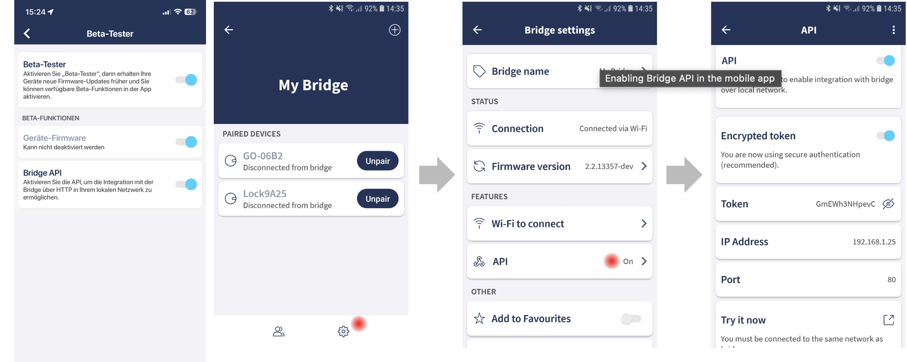

# IoBroker.tedee
**Этот адаптер использует библиотеки Sentry для автоматического сообщения разработчикам об исключениях и ошибках в коде.** Для получения более подробной информации и сведений о том, как отключить отправку сообщений об ошибках, см. [Документация по плагину Sentry](https://github.com/ioBroker/plugin-sentry#plugin-sentry)! Отправка сообщений Sentry используется начиная с js-controller 3.0.

## Для чего нужен этот адаптер?
Он подключает ваш **умный замок Tedee** (Lock PRO, Lock GO) к ioBroker. Адаптер взаимодействует напрямую с **мостом Tedee** в вашей домашней сети, облачное хранилище не требуется.

- Проверьте, заперта ли дверь и насколько заряжена батарея.
- Блокировка, разблокировка и открытие двери с помощью ioBroker, VIS, скриптов, Alexa или HomeKit.
- узнать, кто и как открыл дверь (приложение, PIN-код клавиатуры, отпечаток пальца, кнопка, ручная регулировка).
- Дополнительно: управление PIN-кодами клавиатуры Tedee.

Изменения в блокировке поступают в ioBroker в течение секунды.

## Настраивать
Вам потребуется замок Tedee, устройство Tedee Bridge и приложение Tedee.

1. В приложении Tedee: выберите мост → **Настройки** → **API** и включите API. Запишите отображаемый там IP-адрес и токен. (Если меню API отсутствует: сначала включите **бета-тестирование** в своем профиле пользователя.)
2. **ioBroker:** установите адаптер, откройте настройки экземпляра и введите **IP-адрес моста** и **токен моста**. Сохраните.
3. Готово. Ваш замок отображается в разделе **Объекты** → `tedee.0` с именем из приложения Tedee.



Все остальные настройки необходимы только в особых случаях, см. [Поиск неисправностей](#troubleshooting).

## Ежедневное использование
Замените `12345` на номер вашего замка (см. объекты в разделе `tedee.0`).

| Вы хотите… | Точка данных | Значение |
| -------------------------- | ---------------------------- | ------------------------------------------------ |
| Заприте дверь | `tedee.0.12345.remote.open` | `false` |
| открыть дверь (потянуть за защелку) | `tedee.0.12345.remote.pull` | `true` |
| Узнать, заперта ли дверь | `tedee.0.12345.remote.open` | `false` = заперта, `true` = открыта |
| Смотрите точное состояние блокировки | `tedee.0.12345.state` | Например, 6 = Заблокировано, 2 = Разблокировано, 7 = Снято |
| см. батарею | `tedee.0.12345.batteryLevel` | процент |
| посмотреть, кто открыл дверь | `tedee.0.12345.lastAction.*` | посмотреть [Кто открыл дверь?](#who-opened-the-door) |
| посмотреть, кто открыл дверь | `tedee.0.12345.lastAction.*` | посмотреть [Кто открыл дверь?](#who-opened-the-door) |

**Пример** (адаптер JavaScript): запирать дверь каждый вечер в 21:00.

```js
schedule('0 21 * * *', () => setState('tedee.0.12345.remote.open', false));
```

В Blockly используйте блок **control** с точкой данных `remote.open` и значением `false`.

**Alexa, HomeKit, Material:** замок автоматически определяется как замок (адаптер устройства / детектор типа).

### Изменения в версии 1.0.0
В версии 1.0.0 `remote.lock` заменено на `remote.open`. **Значение обратное:** `remote.open` = `false` блокирует дверь. `remote.lock` удаляется при первом запуске, о чем напоминает предупреждение в журнале. Пожалуйста, измените ваши скрипты и представления VIS. Подробнее в [технический справочник](#technical-reference).

Кто открыл дверь?
В канале `tedee.0.12345.lastAction` отображается последняя операция:

- `action`: `lock`, `unlock` или `pull`. Используйте этот параметр в качестве триггера в скриптах.
- `sourceName`: как, например, `Keypad`, `Fingerprint`, `App / cloud API`, `Button`, `Manual (turned by hand)`
- `pinAlias`: имя PIN-кода, использовавшегося при вводе PIN-кода на клавиатуре, например, `Guest`.

## Управление PIN-кодом (опционально)
С помощью клавиатуры Tedee вы можете просмотреть PIN-коды вашего замка в ioBroker, а также создавать, изменять и удалять их, например, гостевой PIN-код, который работает только по выходным.

1. Настройки экземпляра → вкладка **ПИН-коды** → **Включить управление ПИН-кодами**.
2. Каждый PIN-код отображается в папке `tedee.0.12345.pins` с указанием его имени и срока действия. Кнопка `delete` удаляет PIN-код из замка.
3. Новые PIN-коды создаются с помощью скрипта (`sendTo`), см. примеры ниже.

Сами PIN-коды никогда не сохраняются в ioBroker и не записываются в лог. Любой, кто может записывать данные или запускать скрипты в вашем ioBroker, может изменить PIN-код вашей двери.

<подробности> <краткое описание>Подробности: точки данных, команды и примеры для управления PIN-кодом</краткое описание>

#### Штаты
| Состояние | Содержание |
| --------------------------- | --------------------------------------------------------------------- |
| `pins.count` | количество PIN-кодов |
| `pins.listVersion` | версия списка PIN-кодов на замке, увеличивается с каждым изменением |
| `pins.refresh` | кнопка: перезагрузить PIN-коды замка |
| `pins.<pinId>.alias` | имя PIN-кода |
| `pins.<pinId>.active` | `true` если PIN-код можно использовать прямо сейчас (дата, день недели, временной интервал) |
| `pins.<pinId>.validFrom` | начало действия (временная метка, `null` = неограниченное) |
| `pins.<pinId>.validTo` | конец срока действия (временная метка, `null` = неограниченный) |
| `pins.<pinId>.dayStart` | начало ежедневного окна `HH:MM` (пусто = весь день) |
| `pins.<pinId>.dayEnd` | окончание ежедневного окна `HH:MM` (пусто = весь день) |
| `pins.<pinId>.weekdays` | дни недели в виде битовой маски: 1 = Пн, 2 = Вт, 4 = Ср … 64 = Вс, 127 = все |
| `pins.<pinId>.weekdaysText` | дни недели в виде текста, например, `Sat,Sun` или `every day` |
| `pins.<pinId>.delete` | кнопка: удалить этот PIN-код из замка |
| `pins.<pinId>.delete` | кнопка: удалить этот PIN-код из замка |

Список загружается при запуске адаптера, после каждого изменения, внесенного адаптером, и каждые 15 минут (изменения, внесенные в приложение Tedee). Используйте `pins.refresh` для немедленной загрузки. `active` рассчитывается с учетом часового пояса хоста ioBroker.

#### Команды (sendTo)
Все команды возвращают `{ error: '...' }`, если что-то пошло не так. `lockId` можно опустить, если подключен только один замок.

| Команда | Параметры | Результат |
| ------------- | ---------------------------------------------------------------------- | ------------------------- |
| `getPins` | `lockId` | `{ lockId, pins: [...] }` |
| `createPin` | `lockId`, `pin`, `alias`, необязательно: поля проверки действительности (см. ниже) | `{ lockId, pinId }` |
| `updatePin` | `lockId`, `pinId`, только поля для изменения | `{ lockId, pinId }` |
| `deletePin` | `lockId`, `pinId` | `{ lockId, pinId }` |
| `refreshPins` | `lockId` | `{ lockId, pins: [...] }` |
| `refreshPins` | `lockId` | `{ lockId, pins: [...] }` |

Поля для `createPin` / `updatePin`:

| Поле | Формат |
| -------------- | --------------------------------------------------------------------------------------------- |
| `pin` | строка из 5-8 цифр, например, `'048213'` (используйте строку, иначе ведущие нули будут потеряны) |
| `startDate` | `'2026-11-01'`, `'2026-11-01T08:00'`, метка времени в мс или с; `null` = неограниченный |
| `endDate` | как `startDate`; простая дата означает конец этого дня (23:59:59) |
| `dayStartTime` | `'08:00'` или секунд от полуночи; `null` = весь день |
| `dayEndTime` | `'16:30'` или секунд от полуночи; `null` = весь день |
| `weekdays` | `['Sat', 'Sun']` (также немецкий `['Sa', 'So']`), номера дней `[6, 7]` (1 = понедельник) или битовая маска `96` |
| `weekdays` | `['Sat', 'Sun']` (также немецкое `['Sa', 'So']`), номера дней `[6, 7]` (1 = Mon) или битовая маска `96` |

`updatePin` сохраняет все поля, которые не указаны, включая PIN-код.

`help` (без параметров, также без управления PIN-кодом) отвечает на `{ help, commands }`: описание всех команд и точек данных для агентов ИИ (например, pi-agent) и авторов скриптов; `commands` перечисляет каждую команду, а `write: true` указывает, если она что-то изменяет.

#### Примеры (адаптер JavaScript)
```js
// list all PINs
sendTo('tedee.0', 'getPins', {}, (res) => log(JSON.stringify(res)));

// guest PIN: November, weekends, 10:00 - 18:00
sendTo(
  'tedee.0',
  'createPin',
  {
    pin: '482913',
    alias: 'Guest',
    startDate: '2026-11-01',
    endDate: '2026-11-30',
    weekdays: ['Sat', 'Sun'],
    dayStartTime: '10:00',
    dayEndTime: '18:00',
  },
  (res) => (res.error ? log(res.error, 'warn') : log(`created PIN ${res.pinId}`)),
);

// extend the guest PIN until end of December, everything else stays
sendTo('tedee.0', 'updatePin', { pinId: 5, endDate: '2026-12-31' }, (res) => log(JSON.stringify(res)));

// delete a PIN
sendTo('tedee.0', 'deletePin', { pinId: 5 }, (res) => log(JSON.stringify(res)));
```

#### Пример (Blockly)
Используйте блок **sendTo** (категория _Sendto_), задайте экземпляр `tedee.0` и команду, а также добавьте по одному параметру на каждое поле со значком шестеренки. PIN-код должен быть текстовым, иначе ведущие нули будут потеряны. Дни недели можно указать текстом, например, `Sa,So` или `Sat,Sun`. Не устанавливайте уровень логирования для этого блока, иначе параметры, включая PIN-код, будут записаны в лог. Адаптер сам записывает результат (`PIN "Guest" created (id 5)` или ошибку).

Чтобы импортировать пример: редактор Blockly → **Импорт блоков** (значок в правом верхнем углу) → вставьте XML-код. Измените значения перед запуском, пример создаст реальный PIN-код для вашего замка.

<details> <summary>Blockly XML: создание гостевого PIN-кода и удаление PIN-кода</summary>

```xml
<xml xmlns="https://developers.google.com/blockly/xml">
  <block type="sendto_custom" x="20" y="20">
    <mutation xmlns="http://www.w3.org/1999/xhtml" items="pin,alias,startDate,endDate,weekdays,dayStartTime,dayEndTime"></mutation>
    <field name="INSTANCE">tedee.0</field>
    <field name="COMMAND">createPin</field>
    <field name="LOG"></field>
    <field name="WITH_STATEMENT">FALSE</field>
    <value name="ARG0"><shadow type="text"><field name="TEXT">482913</field></shadow></value>
    <value name="ARG1"><shadow type="text"><field name="TEXT">Guest</field></shadow></value>
    <value name="ARG2"><shadow type="text"><field name="TEXT">2026-11-01</field></shadow></value>
    <value name="ARG3"><shadow type="text"><field name="TEXT">2026-11-30</field></shadow></value>
    <value name="ARG4"><shadow type="text"><field name="TEXT">Sa,So</field></shadow></value>
    <value name="ARG5"><shadow type="text"><field name="TEXT">10:00</field></shadow></value>
    <value name="ARG6"><shadow type="text"><field name="TEXT">18:00</field></shadow></value>
  </block>
  <block type="sendto_custom" x="20" y="300">
    <mutation xmlns="http://www.w3.org/1999/xhtml" items="pinId"></mutation>
    <field name="INSTANCE">tedee.0</field>
    <field name="COMMAND">deletePin</field>
    <field name="LOG"></field>
    <field name="WITH_STATEMENT">FALSE</field>
    <value name="ARG0"><shadow type="math_number"><field name="NUM">5</field></shadow></value>
  </block>
</xml>
```

</details>

Эти блоки генерируют тот же код, что и приведенный выше пример на JavaScript, например, `sendTo('tedee.0', 'createPin', { 'pin': '482913', 'alias': 'Guest', ... });`. Подключите их к триггеру (например, к состоянию кнопки VIS) или запустите скрипт один раз.

#### Примечания
- Пока мост считывает список PIN-кодов, он не может обрабатывать другие запросы (примерно 1 секунда на каждые 5 PIN-кодов, плюс один запрос на каждый PIN-код для получения подробной информации).
- Если приложение Tedee одновременно меняет PIN-код, мост отвечает: «Идет другая операция ввода PIN-кода» - просто попробуйте еще раз.
- При включенном управлении PIN-кодами **Загрузка имен PIN-кодов для lastAction** не требуется, `lastAction.pinAlias` использует тот же список.
- Если управление PIN-кодами отключено, каналы `pins` удаляются при следующем запуске.

</details>

## Поиск неисправностей
**Статус блокировки в ioBroker не меняется.**

Мост отправляет каждое изменение в ioBroker (порт 29170). Проверьте:

- Мост должен иметь возможность связаться с компьютером ioBroker через порт 29170, то есть разрешить его доступ через брандмауэр, если мост находится в отдельной (IoT) сети.
- При использовании **Docker** или нескольких сетевых карт: в настройках экземпляра (вкладка «Подключение» → «Дополнительно») введите IP-адрес компьютера ioBroker, к которому имеет доступ мост, в качестве **хоста обратного вызова**.

Другие системы, использующие этот мост (например, Home Assistant), продолжают работать, адаптер удаляет только свои собственные регистрации.

**В журнале указано: «Мост недоступен»**

Обычно маршрутизатор присваивает мосту новый IP-адрес, а адаптер продолжает использовать старый.

- Найдите текущий IP-адрес моста в списке устройств вашего маршрутизатора и введите его в настройках экземпляра.
- Чтобы это больше не повторилось: присвойте мосту фиксированный IP-адрес в настройках вашего маршрутизатора (FRITZ!Box: Домашняя сеть → Сеть → редактировать мост → «Всегда назначать этому сетевому устройству один и тот же IPv4-адрес»).
- Мост должен быть подключен к источнику питания и сети Wi-Fi, а локальный API должен быть включен в приложении Tedee.

Адаптер продолжает попытки. Как только мост снова отвечает, он повторно регистрирует веб-перехватчик и самостоятельно перезагружает данные.

**В логе отображается сообщение «Мост отклоняет токен API»**

Скопируйте токен еще раз из приложения Tedee (мост → Настройки → API) в настройки экземпляра ("Токен моста"). Один отклоненный запрос сразу после перезапуска моста (например, обновления прошивки) является нормальным явлением и не отображается в отчете.

**В журнале отображается сообщение «Мост занят»**

Мост обрабатывает только один запрос за раз. Это сообщение безвредно, следующее обновление последует автоматически.

## Техническая справочная информация
<подробности> <краткое описание>Все данные, роли и режимы разблокировки</краткое описание>

Каждый замок представляет собой устройство `tedee.0.<lockId>`. Роли соответствуют [роли состояния ioBroker](https://github.com/ioBroker/ioBroker.docs/blob/master/docs/en/dev/stateroles.md).

| Государство | Роль | Содержание |
| ----------------------------------------- | --------------------- | ----------------------------------------------------------------------------- |
| `state` | `value.lock` | состояние блокировки, см. ниже |
| `isCharging` | `indicator` | батарея заряжается |
| `isConnected` | `indicator.reachable` | блокировка подключена к мосту |
| `jammed` | `indicator.error` | блокировка заблокирована |
| `rssi` | `value.rssi` | уровень сигнала в дБм |
| `doorState` | `value` | датчик двери: 0 не сопряжен, 1 отключен, 2 открыт, 3 закрыт, 4 не откалиброван |
| `version`, `serialNumber`, `name`, `type` | `info.*` / `value` | прошивка, серийный номер, имя, тип устройства |
| `deviceSettings.*` | `indicator` / `value` | настройки блокировки (только для чтения, изменить их можно в приложении Tedee) |
| `deviceSettings.*` | `индикатор` / `значение` | настройки блокировки (только для чтения, изменить их можно в приложении Tedee) |

Состояния блокировки (`state`): 0 Некалибровано, 1 Калибровка, 2 Разблокировано, 3 Частично заблокировано, 4 Разблокировка, 5 Блокировка, 6 Заблокировано, 7 Вытащено, 8 Вытащено, 9 Неизвестно, 18 Обновление, 255 Вытащено

Мостом является устройство `tedee.0.bridge` (`isConnected` = подключено к облаку Tedee). Клавиатуры отображаются как устройства с первым событием (например, уровнем заряда батареи). `info.connection` показывает, доступен ли мост.

Команды в `tedee.0.<lockId>.remote`:

| Штат | Роль | Писать |
| --------- | ------------------ | ----------------------------------------------------------- |
| `open` | `switch.lock` | `true` = разблокировать, `false` = заблокировать. Отображает текущее положение |
| `pull` | `button.open.door` | `true` = потяните за защелку (откройте дверь) |
| `refresh` | `button` | `true` = прочитать данные блокировки сейчас |
| `обновить` | `кнопка` | `true` = прочитать данные блокировки сейчас |

Разблокировать режимы (`remote.unlock`):

- 0 - Нормальный режим. В закрытом положении: только разблокировка или разблокировка с автоматическим открыванием, если включена. В открытом положении: ничего.
- 2 - Сила. Приложите усилие до тех пор, пока замок не упрется в сопротивление.
- 3 - Без автоматического вытягивания. В закрытом положении: только разблокировка без автоматического вытягивания. В открытом положении: ничего.
- 4 - Разблокировать или потянуть. Из закрытого положения: только разблокировка или разблокировка с автоматическим потягиванием, если включена. Из открытого положения: потянуть.

`lastAction`:

| Состояние | Содержание |
| ------------ | --------------------------------------------------------------------------- |
| `action` | `unlock`, `lock` или `pull`. Пишется последним, используйте его в качестве триггера в скриптах |
| `sourceName` | текст `source` |
| `userId` | Идентификатор пользователя Tedee (приложение), PIN-код (клавиатура) или отпечаток пальца; пусто, если неизвестно |
| `pinAlias` | имя PIN-кода для действий на клавиатуре (Bridge API 1.19+, загружается из замка) |
| `pinAlias` | имя PIN-кода для действий на клавиатуре (Bridge API 1.19+, загружается из замка) |

| `source` | Значение |
| -------- | ----------------------------------------------------------- |
| 0 | поворачивается вручную (ручкой или ключом) |
| 2 | Приложение Tedee (`userId` = пользователь Tedee) |
| 2 | Приложение Tedee (`userId` = пользователь Tedee) |
| 10 | клавиатура (`userId` = идентификатор PIN-кода, пусто = кнопка блокировки без PIN-кода) |
| 18 | локальный API моста, например, ioBroker `remote.*` |
| 18 | локальный API моста, например, ioBroker `remote.*` |
| 20 | автоматическое натяжение пружины после локальной команды Bridge API |
| 23 | отпечаток пальца (`userId` = идентификатор пальца) |
| 23 | отпечаток пальца (`userId` = идентификатор пальца) |
| 24 | автоматическое вытягивание пружины после отпечатка пальца |

Значения `source` не документированы компанией Tedee и были определены с помощью Lock PRO и Keypad PRO. Неизвестные значения отображаются как `Unknown (n)`, пожалуйста, сообщите о них. Имена PIN-кодов для `pinAlias` считываются из замка при запуске (примерно 1 секунда на каждые 5 PIN-кодов, в это время мост блокируется). Отключите **Загрузка имен PIN-кодов для последнего действия** (вкладка PIN-коды), если они вам не нужны.

Изменения в версии 1.0.0:

| До (0.4.x) | Сейчас |
| ----------------------------------------------------------------------- | ----------------------------------------------------------------- |
| `remote.lock` `true` = блокировка | `remote.open` `false` = блокировка, `true` = разблокировка (стандарт ioBroker) |
| `remote.pull`, `remote.refresh` переключатель | кнопки, только `true` триггеры |
| `isConnected`, `jammed`, `isCharging`, `deviceSettings.*Enabled` как 0/1 | `true` / `false` |
| корневые состояния `source`, `user_id` (сырой веб-хук) | удалены, используйте канал `lastAction` |
| корневые состояния `source`, `user_id` (сырой веб-хук) | удалено, используйте канал `lastAction` |

Веб-хуки: адаптер запускает небольшой веб-сервер (порт 29170 или следующий свободный порт) и регистрирует его в мосте. Без **хоста обратного вызова** используется первый IPv4-адрес системы ioBroker. **Интервал обновления** дополнительно считывает блокировку в качестве резервной копии.

</details>

## Отказ от ответственности
Tedee - товарный знак компании Tedee. Я никоим образом не являюсь представителем или аффилированным лицом компании Tedee, а также любых связанных с ней дочерних компаний, логотипов или товарных знаков.

## Changelog

<!--
    Placeholder for the next version (at the beginning of the line):
    ### **WORK IN PROGRESS**
-->

### **WORK IN PROGRESS**

- (@GermanBluefox) Added the message "help": a description of all messages for AI agents (e.g. pi-agent), and common.supportedMessages.help
- (Schimi1983) Fix: lock and unlock are repeated when the busy bridge resets the connection (Bridge API 1.20)
- (Schimi1983) Firmware version and other bridge data are updated after a restart of the bridge (e.g. firmware update) and every hour
- (Schimi1983) A rejected API token right after a restart of the bridge is no longer reported; a wrong token gets a clear message
### 1.0.3 (2026-11-14)

- (Schimi1983) Clear message if the bridge cannot be reached (e.g. new IP address), instead of many warnings; the adapter registers the webhook again and reloads the data by itself when the bridge is back

### 1.0.2 (2026-11-08)

- (Schimi1983) Fix: requests to the bridge are sent one after another (the bridge rejects parallel connections), lock commands are served first
- (Schimi1983) Fix: lock commands and PIN changes are repeated when the bridge is busy (503), so they are no longer lost

### 1.0.1 (2026-10-31)

- (Schimi1983) README and instance settings rewritten for beginners: setup in 3 steps, daily use, troubleshooting; technical details collapsed, smaller logo

### 1.0.0 (2026-10-30)

- (Schimi1983) Breaking: `remote.lock` replaced by `remote.open` with the ioBroker role `switch.lock` (`true` = unlock, `false` = lock), see "Changes in 1.0.0"
- (Schimi1983) All states get ioBroker roles, units and names (battery, signal strength, reachable, jammed, firmware ...), 0/1 values are booleans now
- (Schimi1983) Locks, keypads and the bridge are devices, the lock is detected by the type-detector (Alexa, HomeKit, Material)
- (Schimi1983) `remote.pull` and `remote.refresh` are buttons, `info.connection` shows whether the bridge is reachable
- (Schimi1983) json2iob removed, states are only written when they change

### 0.4.2 (2026-10-30)

- (Schimi1983) Fix: lock commands logged an empty line `""`, now `Command lock sent to lock <id>`
- (Schimi1983) `lastAction.source` 18 = command via the local Bridge API (e.g. ioBroker), 20 = auto pull after such a command
- (Schimi1983) `lastAction` also shows locks, unlocks and pulls by hand (source 0), source 1 is now "Button" only

### 0.4.1 (2026-10-29)

- (Schimi1983) Repository checker findings fixed: Node.js 24 for lint and deploy, placeholder translation, Dependabot added [#52]
- (Schimi1983) Webhook server uses the built-in Node.js HTTP server, express and body-parser removed (52 packages less)
- (Schimi1983) Dependencies updated (security fix for node-forge)

### 0.4.0 (2026-10-29)

- (Schimi1983) New: PIN management for keypad PINs (show, create, change, delete), see section "PIN management" [#49]
- (Schimi1983) New: channel `lastAction` shows who and how the lock was operated, incl. the PIN name [#13]
- (Schimi1983) New: optional setting "Callback host" for webhooks (Docker, several network interfaces, IPv6)
- (Schimi1983) Instance settings reworked: tabs, help texts, translations
- (Schimi1983) Fix: webhooks are registered with the IP address instead of the host name
- (Schimi1983) Fix: webhooks of other systems (e.g. Home Assistant) are no longer deleted
- (Schimi1983) Fix: lock commands are no longer repeated on errors and no longer fail with ECONNRESET
- (Schimi1983) Fix: unlock mode is validated, polling waits for the previous request
- (Schimi1983) Fix: lock states 3 (partially open) and 255 (unpulling)
- (Schimi1983) Fix: clean shutdown, the adapter was killed on stop
- (Schimi1983, ioBroker-Bot) Node.js >= 22, js-controller >= 6.0.11 and admin >= 7.8.23 required
- (Schimi1983) Dependencies updated, ESLint 9, tests for Node.js 22, 24 and 26

### 0.3.2 (2024-04-10)

- add retry when request fails

### 0.3.1 (2023-12-16)

- (TA2k) initial release

## License

MIT License

Copyright (c) 2024-2026 TA2k <tombox2020@gmail.com>

Permission is hereby granted, free of charge, to any person obtaining a copy
of this software and associated documentation files (the "Software"), to deal
in the Software without restriction, including without limitation the rights
to use, copy, modify, merge, publish, distribute, sublicense, and/or sell
copies of the Software, and to permit persons to whom the Software is
furnished to do so, subject to the following conditions:

The above copyright notice and this permission notice shall be included in all
copies or substantial portions of the Software.

THE SOFTWARE IS PROVIDED "AS IS", WITHOUT WARRANTY OF ANY KIND, EXPRESS OR
IMPLIED, INCLUDING BUT NOT LIMITED TO THE WARRANTIES OF MERCHANTABILITY,
FITNESS FOR A PARTICULAR PURPOSE AND NONINFRINGEMENT. IN NO EVENT SHALL THE
AUTHORS OR COPYRIGHT HOLDERS BE LIABLE FOR ANY CLAIM, DAMAGES OR OTHER
LIABILITY, WHETHER IN AN ACTION OF CONTRACT, TORT OR OTHERWISE, ARISING FROM,
OUT OF OR IN CONNECTION WITH THE SOFTWARE OR THE USE OR OTHER DEALINGS IN THE
SOFTWARE.