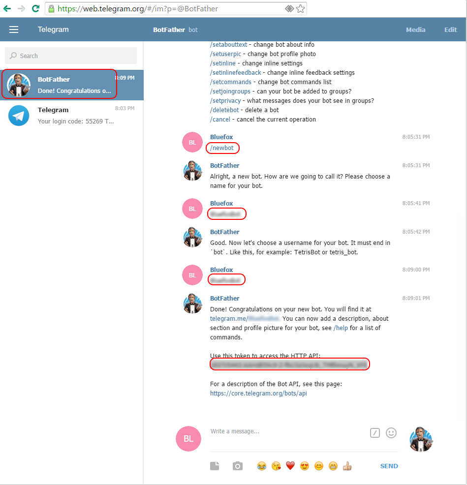

# ioBroker.telegram

## Конфигурация

Попросите [@BotFather](https://telegram.me/botfather) создать нового бота. `/newbot`.

Вам будет предложено ввести имя бота, а затем имя пользователя. После этого вы получите токен.



В диалоговом окне настроек необходимо установить пароль для связи. После этого запустите адаптер.

Для начала диалога с вашим ботом необходимо аутентифицировать пользователя. `/password phrase`, гд&#x435;** `phrase` ** — это ваш настроенный пароль. Поэтому откройте новый диалог с созданным вами ботом в Telegram, и вам нужно будет ввести пароль в качестве первой команды.

**Примечание:** можно использовать сокращенную форму. `/p phrase`.

Чтобы добавить красивую аватарку, введите `/setuserpic` В чате **BotFather** загрузите ему нужное изображение (512x512 пикселей), например, вот этот [логотип](https://github.com/iobroker-community-adapters/ioBroker.telegram/blob/master/docs/en/img/logo.png) .

Вы можете отправить сообщение всем авторизованным пользователям через окно сообщения (messageBox). `sendTo('telegram', 'Test message')` или конкретному пользователю `sendTo('telegram', '@userName Test message')` Пользователь должен пройти аутентификацию перед этим.

Таким же образом можно указать и пользователя:

```javascript
sendTo('telegram', {user: 'UserName', text: 'Test message'}, function (res) {
    console.log('Sent to ' + res + ' users');
});
```

Если вы используете приведенный выше пример, имейте в виду, что вам необходимо заменить «UserName» либо на имя, либо на публичное имя пользователя Telegram, которому вы хотите отправить сообщение. (Это зависит от того, включена ли опция «Сохранять имя пользователя, а не имя» в настройках адаптера). Если эта опция включена, и пользователь не указал публичное имя пользователя в своем аккаунте Telegram, адаптер продолжит использовать имя пользователя. Имейте в виду, что если пользователь позже укажет публичное имя пользователя (после аутентификации в вашем боте), сохраненное имя будет заменено именем пользователя при следующей отправке сообщения боту.

Можно указать более одного получателя (просто разделите имена пользователей запятой). Например, получатель: "User1,User4,User5"

Вы также можете отправлять сообщения через состояние, просто установите состояние _"telegram.INSTANCE.communicate.response"_ со значением _"@userName Test message"_ или с помощью объекта JSON:

```json
{
    "text": "Test message"
}
```

Синтаксис JSON также позволяет добавлять параметры из [API ботов Telegram](https://core.telegram.org/bots/api) , а также задавать имя пользователя или идентификатор чата:

```json
{
    "text": "Test message, but with *bold*",
    "parse_mode": "Markdown",
    "chatId": "1234567890",
    "user": "UserName"
}
```

Вы можете установить `parse_mode` В тексте тоже:

```
sendTo('telegram', {user: 'UserName', text: '<MarkdownV2>Test message, but with *bold*</MarkdownV2>'}, function (res) {
   console.log('Sent to ' + res + ' users');
});
```

или

```
setState('telegram.0.communicate.response', '<MarkdownV2>Test message, but with *bold*</MarkdownV2>');
```

Для отправки сообщений в группы необходимо пригласить бота в ту группу, в которую вы хотите, чтобы бот отправлял сообщения. Для этого необходимо указать... `chat_id` В полезную нагрузку JSON-сообщения вы можете фактически отправлять сообщения этим группам.

Чтобы выяснить `chat_id` Вам необходимо установить уровень логирования адаптера на `debug` Затем вы можете просто отправить пинг своему боту в те группы, которым вы хотите, чтобы бот отправлял сообщения. Убедитесь, что вы указали `/` Перед сообщением укажите идентификатор чата, чтобы бот его увидел ( [если включена защита конфиденциальности бота](#How-to-receive-messages-in-group-chats-using-telegram-adapter) ). В логах iobroker отобразится идентификатор чата.

## Использование

Вы можете использовать Telegram с адаптером [text2command](https://github.com/ioBroker/ioBroker.text2command) . Существует предопределенная схема связи, и вы можете отдавать команды на свой домашний экран в текстовом формате.

Вместо `text2command` Вы можете выбрать экземпляр [помощника](https://github.com/ioBroker/ioBroker.assistant) («экземпляр помощника» в настройках). Сообщения, которым не подошло ни одно правило или команда этого адаптера, попадают туда, а ответ на них отправляется обратно в чат:

- Вопрос в **тексте** .
- **Голосовые сообщения** распознаются голосовым помощником (для этого требуется включенная функция голосового управления, механизм распознавания речи и ffmpeg); ответ начинается с распознанного текста (🎤 …).
- **Фотографии** передаются по порядку, подпись — это вопрос (без подписи ассистент описывает картинку). Фотографии в альбоме задаются как один вопрос, максимум 4 штуки. Ассистенту нужна облачная модель, которая может распознавать изображения.
- **Видеофайлы** не передаются: они хранятся в папке. `assistant` В данном случае сохраняются 20 самых новых экземпляров, и помощник узнает, где именно находится каталог данных — с js-controller 8.0+ (`iobroker-data/telegram_0/assistant`) как `iobdisk://` URL-адрес, который ассистент считывает с любого хоста, используя более старый js-контроллер в файловом хранилище. Пока он не считывает видео. Telegram позволяет ботам загружать файлы размером до 20 МБ.

Отключить отправку фотографий и видео можно с помощью функции «Отправлять фотографии и видео помощнику». У помощника есть 2 минуты на ответ; после этого пользователю сообщается, что он не ответил вовремя.

### Голосовые сообщения в виде текста (голоса)

При использовании [голосового](https://github.com/ioBroker/ioBroker.voice) экземпляра («Экземпляр распознавания речи» в настройках) голосовые сообщения преобразуются в текст локально, и этот текст обрабатывается как набранное сообщение: он отправляется на `communicate.request` а также команды этого адаптера. `text2command` и помощник его получает. Распознанный текст также записывается для `communicate.requestVoiceText`.

- При включенной опции "Показывать распознанный текст в чате" (по умолчанию: включено) бот сначала отвечает тем, что он понял (🎤…).
- Точка или восклицательный знак в конце распознанного текста удаляются, так что, например, "Включить свет" соответствует команде.
- Названия команд этого адаптера следуют следующим образом: `prompt`, чтобы они записывались в соответствии с настройками (если эта функция включена в голосовом режиме).
- Для OGG/Opus требуется ffmpeg (его можно скачать на вкладке **«Распознавание** голоса»).
- Распознавание речи занимает 90 секунд. В случае неудачи пользователь получает сообщение «Голосовое сообщение не удалось распознать».
- Если также выбран экземпляр голосового помощника, система распознает голосовое сообщение, и помощник получает текст.
- Как и прежде, на голосовое сообщение с подписью отвечает та же самая подпись.

Чтобы отправить фотографию, вместо текста или URL-адреса укажите путь к файлу: `sendTo('telegram', 'absolute/path/file.png')` или `sendTo('telegram', 'https://telegram.org/img/t_logo.png')`.

Пример отправки скриншота с веб-камеры в Telegram:

```javascript
function sendImage() {
    httpGet('https://raw.githubusercontent.com/ioBroker/ioBroker.javascript/master/admin/javascript.png', { responseType: 'arraybuffer' }, async (err, response) => {
        if (err) {
            console.error(err);
        } else {
            const tempFilePath = createTempFile('telegram-image.png', response.data);

            sendTo('telegram.0', 'send', {
                text: tempFilePath,
                caption: 'A wonderful adapter',
                user: 'yourUserName1,yourUserName2',
            });
        }
    });
}

on('0_userdata.0.someState', (obj) => {
    if (obj.state.val) {
        // send 4 images: immediately, in 5, 15 and 30 seconds
        sendImage();
        setTimeout(sendImage, 5000);
        setTimeout(sendImage, 15000);
        setTimeout(sendImage, 30000);
    }
});
```

Следующие сообщения предназначены для действий:

- _набор текста_ - для текстовых сообщений,
- _upload\_photo_ - для фотографий,
- _upload\_video_ - для видео,
- _record\_video_ - для видео,
- _record\_audio_ - для аудио,
- _upload\_audio_ - для аудио,
- _upload\_document_ - для документов,
- _find\_location_ - для получения данных о местоположении

В этом случае будет отправлена команда действия.

Описание API Telegram можно найти [здесь](https://core.telegram.org/bots/api) , и вы можете использовать все параметры, определенные в этом API, просто добавив их в объект отправки. Например:

```javascript
sendTo('telegram.0', 'send', {
    text:                   '/tmp/snap.jpg',
    caption:                'Snapshot',
    disable_notification:   true
});
```

**Возможные варианты** :

- _disable\_notification_ : Отправляет сообщение без звука. Пользователи iOS не получат уведомление, пользователи Android получат уведомление без звука. (для всех типов)
- _parse\_mode_ : Отправляйте Markdown или HTML, если хотите, чтобы приложения Telegram отображали жирный, курсивный текст фиксированной ширины или встроенные URL-адреса в сообщениях вашего бота. Возможные значения: "Markdown", "MarkdownV2", "HTML" (message)
- _disable\_web\_page\_preview_ : Отключает предварительный просмотр ссылок в этом сообщении (message).
- _caption_ : Подпись к документу, фото или видео, 0-200 символов (видео, аудио, фото, документ)
- _duration_ : Длительность отправленного видео или аудио в секундах (аудио, видео)
- _Исполнитель_ : Исполнитель аудиофайла (аудио)
- _Заголовок_ : Название трека аудиофайла (аудио)
- _ширина_ : ширина видео (видео)
- _высота_ : Высота видео (видео)

Адаптер пытается определить тип сообщения (фото, видео, аудио, документ, стикер, действие, местоположение) в зависимости от текста в сообщении. Если текст представляет собой путь к существующему файлу, сообщение будет отправлено в соответствии с его типом.

Местоположение будет определяться по атрибутам широты и долготы:

```javascript
sendTo('telegram.0', 'send', {
    latitude:               52.522430,
    longitude:              13.372234,
    disable_notification:   true
});
```

Место проведения будет определено по атрибутам широта, долгота, название и адрес:

```javascript
sendTo('telegram.0', 'send', {
    latitude:               52.51630462381893,
    longitude:              13.37770039691943,
    title:                  'Brandenburger Tor',
    address:                'Pariser Platz 8, 10117 Berlin',
});
```

### Явные типы сообщений

У вас есть возможность дополнительно указать тип сообщения, если вы хотите отправлять данные в виде буфера.

Возможны следующие типы: _наклейка_ , _видео_ , _документ_ , _аудио_ , _фотография_ .

```javascript
sendTo('telegram.0', 'send', {
    text: fs.readFileSync('/opt/path/picture.png'),
    type: 'photo'
});
```

### Отправка файлов из файлового хранилища ioBroker или из состояний (URI iob://)

Помимо пути к локальному файлу или веб-URL, `text` Это может быть **URI ioBroker** . Адаптер обрабатывает URI, считывает содержимое и отправляет его с автоматически определенным типом медиафайла (фото, видео, аудио, документ и т. д.). Это особенно полезно, когда файл хранится в файловом хранилище ioBroker за Redis/jsonl, где он **отсутствует** в локальной файловой системе, поэтому обычный путь не подойдет.

Поддерживаются следующие схемы:

- `iobfile://<adapter.instance>/<path>` — файл из файлового хранилища ioBroker.
- `iobstate://<state.id>` — значение состояния (см. ниже, как интерпретируется это значение).
- `iobobject://<object.id>/<path>` — значение, вложенное в объект ioBroker (`path` перемещается к объекту посредством `/`).

```javascript
// send a snapshot that another adapter has written into the file storage
sendTo('telegram.0', 'send', {
    user: 'UserName',
    text: 'iobfile://cameras.0/snapshots/front_door.jpg',
    caption: 'Someone is at the front door',
});

// send a file whose full path is stored in a state
sendTo('telegram.0', 'send', {
    text: 'iobstate://0_userdata.0.lastReport',
});

// take a value out of an object
sendTo('telegram.0', 'send', {
    text: 'iobobject://0_userdata.0.myObject/native/document',
});
```

Тип носителя определяется расширением файла (`.jpg` /`.png` → фото, `.mp4` → видео, `.mp3` /`.ogg` /`.wav` → аудио, `.gif` → анимация, `.webp` → наклейка, `.pdf` /`.csv` /`.docx` /... → документ). Если расширение неизвестно, тип берется из сохраненного MIME-типа; в качестве резервного варианта содержимое отправляется как документ. Вы все еще можете явно переопределить его с помощью `type` вариант.

**Как интерпретируется значение состояния/объекта** (`iobstate://` и `iobobject://`):

- **URL-адрес данных** (`data:image/png;base64,...`) декодируется и отправляется как соответствующий тип носителя;
- значение, которое само по себе является `iob*://` URI или `http(s)://` URL-адрес обрабатывается дополнительно (до 5 уровней вложенности);
- Любая другая строка рассматривается как путь к файлу / URL-адрес;
- Числа, логические значения и объекты передаются в текстовом формате (объекты преобразуются в JSON-строки).

### Клавиатура

Вы можете отобразить разметку клавиатуры **(ReplyKeyboardMarkup)** на стороне клиента:

```javascript
sendTo('telegram.0', 'send', {
    text: 'Press button',
    reply_markup: {
        keyboard: [
            ['Line 1, Button 1', 'Line 1, Button 2'],
            ['Line 2, Button 3', 'Line 2, Button 4']
        ],
        resize_keyboard:   true,
        one_time_keyboard: true
    }
});
```

Подробнее можно прочитать [здесь](https://core.telegram.org/bots/api#replykeyboardmarkup) и [здесь](https://core.telegram.org/bots#keyboards) .

Вы можете отображать **встроенную разметку** клавиатуры (InlineKeyboardMarkup) на стороне клиента:

```javascript
sendTo('telegram', 'send', {
    user: 'my_username;username2', // optional. Separator could be ";" or "," or space
    text: 'Click the button',
    reply_markup: {
        inline_keyboard: [
            [{ text: 'Button 1_1', callback_data: '1_1' }],
            [{ text: 'Button 1_2', callback_data: '1_2' }]
        ]
    }
});
```

Подробнее можно прочитать [здесь](https://core.telegram.org/bots/api#inlinekeyboardmarkup) и [здесь](https://core.telegram.org/bots#inline-keyboards-and-on-the-fly-updating) .

**ПРИМЕЧАНИЕ:** _После того, как пользователь нажмет кнопку обратного вызова, клиенты Telegram будут отображать индикатор выполнения до тех пор, пока вы не вызовете функцию answerCallbackQuery. Поэтому необходимо реагировать, вызывая answerCallbackQuery, даже если уведомление пользователю не требуется (например, без указания каких-либо необязательных параметров)._

### answerCallbackQuery

Этот метод используется для отправки ответов на запросы обратного вызова, отправленные с помощью встроенных клавиатур. Ответ будет отображен пользователю в виде уведомления в верхней части экрана чата или в виде всплывающего окна. В случае успеха возвращается _значение True_ .

```javascript
if (command === '1_2') {
    sendTo('telegram', 'send', {
     user: 'my_username username2', // optional. Separator could be ";" or "," or space 
        answerCallbackQuery: {
            text: 'Pressed!',
            showAlert: false, // Optional parameter
        },
   });
}                      
```

Подробнее можно прочитать [здесь](https://core.telegram.org/bots/api#answercallbackquery) .

### Вопрос

Вы можете отправить сообщение в Telegram, и следующий ответ будет возвращен в функции обратного вызова. Время ожидания ответа можно установить в конфигурации экземпляра (по умолчанию 60 секунд). Если пользователь не ответит вовремя, вызывается функция обратного вызова со **строкой** `'__timeout__'` (так `msg.data` является `undefined`).

```javascript
sendTo('telegram.0', 'ask', {
    user: user, // optional
    text: 'Are you sure?',
    reply_markup: {
        inline_keyboard: [
            // two buttons could be on one line too, but here they are on different
            [{ text: 'Yes!',  callback_data: '1' }], // first line
            [{ text: 'No...', callback_data: '0' }]  // second line
        ]
    }
}, msg => {
    if (msg === '__timeout__') {
        console.log('no answer within the configured timeout');
    } else if (msg.data === '1') {
        console.log('user pressed Yes');
    } else {
        console.log('user pressed No');
    }
});
```

**Важно – у звонящего есть свой `sendTo` таймаут:** адаптер, который отправляет `ask` (например, адаптер JavaScript) применяет **собственный** тайм-аут к `sendTo` Функция обратного вызова, в JavaScript-адаптере по умолчанию установленная на **20 секунд** . Если заданное вами время ожидания ответа превышает это значение, функция обратного _вызова_ срабатывает раньше с результатом превышения времени ожидания – что выглядит так, как будто пользователь ответил «Нет». Увеличьте время ожидания вызывающего объекта так, чтобы оно было **больше** времени ожидания ответа, например, в JavaScript-адаптере, передав его в качестве последнего аргумента:

```javascript
sendTo('telegram.0', 'ask', {
    text: 'Are you sure?',
    reply_markup: { inline_keyboard: [[{ text: 'Yes!', callback_data: '1' }], [{ text: 'No...', callback_data: '0' }]] }
}, msg => {
    // ... handle msg (see above)
}, { timeout: 65000 }); // must be > the configured answer timeout (here 60 s)
```

## Идентификатор чата

Начиная с версии 0.4.0, вы можете использовать идентификатор чата для отправки сообщений в чат.

```javascript
sendTo('telegram.0', 'send', {
    text: 'Message to chat',
    chatId: 'SOME-CHAT-ID-123'
});
```

## Идентификатор потока

Также можно задать идентификатор потока для супергрупп.

```javascript
sendTo('telegram.0', 'send', {
    text: 'Message to chat',
    chatId: 'SOME-CHAT-ID-123',
    message_thread_id: 7,
});
```

В блоке Blockly «телеграмма» также есть необязательный параметр ввода «Тема (идентификатор темы)».

## Идентификаторы отправленных сообщений

Обратный вызов `send` Получает количество получателей. Чтобы отредактировать или удалить сообщение позже, запросите вместо этого идентификаторы с помощью `returnMessageIds: true` Затем функция обратного вызова получает объект. `chat id => message id`, и `error` (`chat id => reason`) если получатель не выполнил условия.

```javascript
sendTo('telegram.0', 'send', { text: 'Washing machine is done', chatId: 12345678, returnMessageIds: true }, ids => {
    // ids = { '12345678': 4711 }
    setTimeout(() => sendTo('telegram.0', 'send', {
        deleteMessage: { options: { chat_id: 12345678, message_id: ids['12345678'] } },
    }), 3600000);
});
```

## Получение местоположения

Когда пользователь делится местоположением с ботом (скрепка → местоположение) или отправляет адрес места проведения мероприятия, координаты записываются в состояние. `telegram.INSTANCE.communicate.requestLocation` как `latitude;longitude` строка (роль) `value.gps` Метаданные указывают (`requestChatId`, `requestMessageId`, `requestUserId`) также обновляются, так что вы будете знать, кто это отправил.

```javascript
on({ id: 'telegram.0.communicate.requestLocation', change: 'any' }, obj => {
    const [latitude, longitude] = obj.state.val.split(';').map(parseFloat);
    const user = getState('telegram.0.communicate.requestUserId').val;
    console.log(`User ${user} is at ${latitude}, ${longitude}`);
    // e.g. forward the coordinates to a map widget
});
```

Поддерживается также отображение местоположения в реальном времени (скрепка → местоположение → "Поделиться моим местоположением в реальном времени"): Telegram предоставляет все обновления местоположения и `requestLocation` Обновляется каждый раз. Три дополнительных состояния описывают последнее полученное местоположение:

- `communicate.requestLocationLive` -`true` В то время как местоположение является активным и продолжает передаваться, Telegram отправляет окончательное обновление без флага "активное", когда передача прекращается или истекает, поэтому состояние возвращается к исходному. `false` В этот момент. Для обычного (статичного) места или площадки это `false`.
- `communicate.requestLocationHeading` - Направление движения в градусах (1-360). Доступно только для активных местоположений в режиме реального времени и только если устройство сообщает об этом, в противном случае — нет. `null`.
- `communicate.requestLocationAccuracy` - радиус неопределенности положения в метрах (0-1500), если указан, в противном случае. `null`.

```javascript
on({ id: 'telegram.0.communicate.requestLocationLive', change: 'ne' }, obj => {
    if (!obj.state.val) {
        console.log('Live location sharing has ended');
    }
});
```

## Приём сообщений канала

Если бот является администратором канала, сообщения, опубликованные в этом канале, также принимаются и записываются в него. `telegram.INSTANCE.communicate.request` в форме `[channel title]text` (вместе с `communicate.requestChatId` и `communicate.requestMessageId` Сообщения в канале анонимны (у них нет отправителя), поэтому аутентификация/обработка команд к ним не применяются — они отображаются только в виде запроса. Все прикрепленные медиафайлы сохраняются как для обычных сообщений, а канал добавляется в `communicate.chats`.

## Известные чаты и группы

Каждое сообщение, полученное ботом из чата или группы, запоминается в состоянии. `telegram.INSTANCE.communicate.chats` в виде JSON-объекта `id => { title, type }` (где `type` является одним из `private`, `group`, `supergroup` или `channel` Это удобно для поиска идентификатора группового чата (например, чтобы другой адаптер мог выбрать группу для отправки сообщения). Добавьте бота в группу и отправьте одно сообщение, чтобы группа появилась.

```json
{
    "1234567": { "title": "John Doe", "type": "private" },
    "-1001234567890": { "title": "My smart home group", "type": "supergroup" }
}
```

Список сохраняется, поэтому он остаётся активным после перезагрузки адаптера. Используйте идентификатор чата в качестве... `chatId` при отправке:

```javascript
sendTo('telegram.0', 'send', { text: 'Hello group', chatId: '-1001234567890' });
```

## Обновление сообщений

Следующие методы позволяют изменять существующее сообщение в истории сообщений вместо отправки нового сообщения с результатом действия. Это наиболее полезно для сообщений с использованием _встроенных клавиатур и_ запросов обратного вызова, но также может помочь уменьшить загромождение в диалогах с обычными чат-ботами.

### editMessageText

Этот метод используется для редактирования текста, отправленного ботом или через бота (для встроенных ботов). В случае успеха, если бот отправил отредактированное сообщение, возвращается отредактированное сообщение; в противном случае возвращается _значение True_ .

```javascript
if (command === '1_2') {
    sendTo('telegram', {
        user: user,
        text: 'New text before buttons',
        editMessageText: {
            options: {
                chat_id: getState('telegram.0.communicate.requestChatId').val,
                message_id: getState('telegram.0.communicate.requestMessageId').val,
                reply_markup: {
                    inline_keyboard: [
                        [{ text: 'Button 1', callback_data: '2_1' }],
                        [{ text: 'Button 2', callback_data: '2_2' }]
                    ],
                }
            }
        }
    });
}
```

_или новый текст для последнего сообщения:_

```javascript
if (command === '1_2') {
    sendTo('telegram', {
        user: user,
        text: 'New text message',
        editMessageText: {
            options: {
                chat_id: getState('telegram.0.communicate.requestChatId').val,
                message_id: getState('telegram.0.communicate.requestMessageId').val,
            }
        }
    });
}
```

Подробнее можно прочитать [здесь](https://core.telegram.org/bots/api#editmessagetext) .

### editMessageCaption

Этот метод используется для редактирования заголовка сообщения, отправленного ботом или через бота (для встроенных ботов). В случае успеха, если отредактированное сообщение отправлено ботом, возвращается отредактированное сообщение; в противном случае возвращается _значение True_ .

```javascript
if (command === '1_2') {
    sendTo('telegram', {
        user, // optional
        text: 'New caption',
        editMessageCaption: {
            options: {
                chat_id: getState('telegram.0.communicate.requestChatId').val,
                message_id: getState('telegram.0.communicate.requestMessageId').val
            }
        }
    });
}
```

Подробнее можно прочитать [здесь](https://core.telegram.org/bots/api#editmessagecaption) .

### editMessageMedia

Этот метод используется для редактирования изображения сообщения, отправленного ботом или через бота (для встроенных ботов). В случае успеха, если отредактированное сообщение отправлено ботом, возвращается отредактированное сообщение; в противном случае возвращается _значение True_ .

```javascript
if (command === '1_2') {
    sendTo('telegram', {
        user, // optional
        text: 'picture.jpg',
        editMessageMedia: {
            options: {
                chat_id: (await getStateAsync('telegram.0.communicate.botSendChatId')).val,
                message_id: (await getStateAsync('telegram.0.communicate.botSendMessageId')).val
            }
        }
    });
}
```

Поддерживаются следующие типы носителей: `photo`, `animation`, `audio`, `document`, `video`.

Подробнее можно прочитать [здесь](https://core.telegram.org/bots/api#editmessagemedia) .

### editMessageReplyMarkup

Этот метод позволяет редактировать только разметку ответа сообщений, отправленных ботом или через бота (для встроенных ботов). В случае успеха, если отредактированное сообщение отправлено ботом, возвращается отредактированное сообщение; в противном случае возвращается _значение True_ .

```javascript
if (command === '1_2') {
    sendTo('telegram', {
        user: user,
        text: 'New text before buttons',
        editMessageReplyMarkup: {
            options: {
                chat_id: (await getStateAsync('telegram.0.communicate.botSendChatId')).val,
                message_id: (await getStateAsync('telegram.0.communicate.botSendMessageId')).val,
                reply_markup: {
                    inline_keyboard: [
                        [{ text: 'Button 1', callback_data: '2_1' }],
                        [{ text: 'Button 2', callback_data: '2_2' }]
                    ],
                }
            }
        }
    });
}
```

Подробнее можно прочитать [здесь](https://core.telegram.org/bots/api#editmessagereplymarkup) .

### удалить сообщение

Этот метод позволяет удалить сообщение, включая служебные сообщения, со следующими ограничениями:

- Удалить сообщение можно только в том случае, если оно было отправлено менее 48 часов назад. В случае успеха возвращает _True_ .

```javascript
if (command === 'delete') {
    sendTo('telegram', {
        user: user,
        deleteMessage: {
            options: {
                chat_id: getState('telegram.0.communicate.requestChatId').val,
                message_id: getState('telegram.0.communicate.requestMessageId').val
            }
        }
    });
}
```

Подробнее можно прочитать [здесь](https://core.telegram.org/bots/api#deletemessage) .

## Реагирование на ответы/сообщения пользователей

Предположим, вы используете только JavaScript без `text2command` Вы уже отправляли сообщение/вопрос пользователю, используя `sendTo()` Как описано выше. Пользователь отвечает на это, нажимая кнопку или отправляя сообщение. Вы можете извлечь команду и предоставить обратную связь пользователю, выполнить команды или изменить состояние в iobroker.

- telegram.0 — это ваш экземпляр Telegram-сервера iobroker, который вы хотите использовать.
- Пользователь — это пользователь, зарегистрированный в вашем TelegramBot, который отправил сообщение.
- команда — это команда, полученная вашим Telegram-ботом.

```javascript
on({id: 'telegram.0.communicate.request', change: 'any'}, function (obj) {
    var stateval = getState('telegram.0.communicate.request').val;              // save Statevalue received from your Bot
    var user = stateval.substring(1,stateval.indexOf(']'));                 // extract user from the message
    var command = stateval.substring(stateval.indexOf(']') + 1,stateval.length);   // extract command/text from the message

    switch (command) {
        case '1_2':
            //... see example above ...
            break;
        case 'delete':
            //... see example above
            break;
        //.... and so on ...
    }
});

```

## Специальные команды

### /state stateName - чтение значения состояния

Вы можете запросить значение состояния, если знаете его идентификатор:

```
/state system.adapter.admin.0.memHeapTotal
> 56.45
```

### /state stateName value - установить значение состояния

Вы можете установить значение состояния, если знаете его идентификатор:

```
/state hm-rpc.0.JEQ0ABCDE.3.STOP true
> Done
```

## Прокси

Если хост ioBroker не может напрямую связаться с серверами Telegram, включите параметр **«Использовать прокси»** в основных настройках и укажите тип прокси (HTTP(S) или SOCKS5), хост, порт и — если прокси требует аутентификации — логин и пароль. Все запросы к Telegram (вызовы API, а также загрузка медиафайлов) будут маршрутизироваться через прокси. HTTPS-прокси можно настроить, указав хост с его схемой, например: `https://proxy.example.com` Обратите внимание, что поддержка SOCKS5 базовым HTTP-клиентом (undici) по-прежнему помечена как экспериментальная; Node.js выводит соответствующее предупреждение при запуске.

## Режим опроса или серверный режим

При использовании режима опроса адаптер поддерживает постоянный запрос к серверу Telegram (до 30 секунд на запрос, затем он обновляется). Обновления доставляются немедленно, и практически не генерируется трафик, пока ничего не происходит, поэтому интервал опроса не требуется настраивать. Опрос работает за NAT/брандмауэрами без переадресации портов.

Для использования серверного режима ваш экземпляр ioBroker должен быть доступен из интернета (например, через `noip.com` динамическая служба DNS).

Telegram может работать только с HTTPS-серверами, но вы можете использовать сертификаты **Let's Encrypt** .

Для серверного режима необходимо указать следующие параметры:

- URL - в формате <https://yourdomain.com:8443> .
- IP — IP-адрес, к которому будет привязан сервер. По умолчанию 0.0.0.0. Не меняйте его, если не уверены.
- На самом деле Telegram поддерживает только порты 443, 80, 88, 8443, но вы можете перенаправлять порты на любой сервер через свой роутер.
- Открытый сертификат — необходим, если **Let's Encrypt** отключен.
- Закрытый ключ — обязателен, если **Let's Encrypt** отключен.
- Сертификат цепочки поставок (необязательно)
- Параметры Let's Encrypt — Настроить сертификаты **Let's Encrypt** очень просто. Подробнее об этом можно прочитать [здесь](https://github.com/ioBroker/ioBroker.admin#lets-encrypt-certificates) .

## Расширенная безопасность

Аутентификацию пользователей можно отключить. Таким образом, никто новый не сможет пройти аутентификацию.

Чтобы создать список доверенных пользователей, сначала отключите параметр «Не аутентифицировать новых пользователей» и аутентифицируйте всех пользователей, которые должны быть в списке доверенных, отправив им соответствующий запрос. `/password <PASSWORD>` сообщение.

Пользователи, отправившие действительный пароль, будут добавлены в список доверенных пользователей.

После этого можно было активировать опцию «Не аутентифицировать новых пользователей», и аутентификация новых пользователей стала невозможна.

Для использования этой опции необходимо активировать параметр "Запоминать авторизованных пользователей".

## Звонки через телеграмму

Благодаря API [Callmebot](https://www.callmebot.com/) вы можете позвонить на свой Telegram-аккаунт, и текст будет озвучен с помощью синтезатора речи.

Для этого из JavaScript-адаптера просто вызовите:

```javascript
sendTo('telegram.0', 'call', 'Some text');
```

или

```javascript
sendTo('telegram.0', 'call', {
    text: 'Some text',
    user: '@Username', // optional: without user and users every user in telegram.0.communicate.users with a username is called
    lang: 'de-DE-Standard-A', // optional and the system language will be taken
    repeats: 0, // number of repeats 
});
```

или

```javascript
sendTo('telegram.0', 'call', {
    text: 'Some text',
    users: ['@Username1', '+49xxxx'] // Array of `users' or telephone numbers.
});
```

или

```javascript
sendTo('telegram.0', 'call', {
    file: 'url of mp3 file that is accessible from internet',
    users: ['@Username1', '@Username2'] // Array of `users' or telephone numbers.
});
```

При использовании функции обратного вызова адаптер отвечает, когда все вызовы завершены: `{ called: <number of successful calls>, error?: <the reasons of the failed calls> }`.

Возможные значения для языка:

- `ar-XA-Standard-A` - Арабский (женский голос)
- `ar-XA-Standard-B` - Арабский (мужской голос)
- `ar-XA-Standard-C` - Арабский (мужской голос 2)
- `cs-CZ-Standard-A` - Чешский (Чехия) (женский голос)
- `da-DK-Standard-A` - Датский (Дания) (женский голос)
- `nl-NL-Standard-A` - Голландский (Нидерланды) (Женский голос - будет использоваться, если язык системы - голландский, а язык не указан)
- `nl-NL-Standard-B` - Голландский (Нидерланды) (мужской голос)
- `nl-NL-Standard-C` - Голландский (Нидерланды) (мужской голос 2)
- `nl-NL-Standard-D` - Голландский (Нидерланды) (Женский голос 2)
- `nl-NL-Standard-E` - Голландский (Нидерланды) (Женский голос, 3 голоса)
- `en-AU-Standard-A` - Английский (Австралия) (женский голос)
- `en-AU-Standard-B` - Английский (Австралия) (мужской голос)
- `en-AU-Standard-C` - Английский (Австралия) (Женский голос 2)
- `en-AU-Standard-D` - Английский (Австралия) (мужской голос 2)
- `en-IN-Standard-A` - Английский (Индия) (женский голос)
- `en-IN-Standard-B` - Английский (Индия) (мужской голос)
- `en-IN-Standard-C` - Английский (Индия) (мужской голос 2)
- `en-GB-Standard-A` - Английский (Великобритания) (Женский голос - будет использоваться, если язык системы английский и не указан)
- `en-GB-Standard-B` - Английский (Великобритания) (мужской голос)
- `en-GB-Standard-C` - Английский (Великобритания) (Женский голос 2)
- `en-GB-Standard-D` - Английский (Великобритания) (мужской голос 2)
- `en-US-Standard-B` - Английский (США) (мужской голос)
- `en-US-Standard-C` - Английский (США) (женский голос)
- `en-US-Standard-D` - Английский (США) (мужской голос 2)
- `en-US-Standard-E` - Английский (США) (Женский голос 2)
- `fil-PH-Standard-A` - Филиппинский (Филиппины) (женский голос)
- `fi-FI-Standard-A` - Финский (Финляндия) (женский голос)
- `fr-CA-Standard-A` - Французский (Канада) (женский голос)
- `fr-CA-Standard-B` - Французский (Канада) (мужской голос)
- `fr-CA-Standard-C` - Французский (Канада) (Женский голос 2)
- `fr-CA-Standard-D`- Французский (Канада) (мужской голос 2)
- `fr-FR-Standard-A` - Французский (Франция) (Женский голос - будет использоваться, если язык системы - французский, а язык не был указан)
- `fr-FR-Standard-B` - Французский (Франция) (мужской голос)
- `fr-FR-Standard-C` - Французский (Франция) (Женский голос 2)
- `fr-FR-Standard-D` - Французский (Франция) (мужской голос 2)
- `de-DE-Standard-A` - Немецкий (Германия) (Женский голос - будет использоваться, если язык системы DE и не указан)
- `de-DE-Standard-B` - Немецкий (Германия) (мужской голос)
- `el-GR-Standard-A` - Греческий (Греция) (Женский голос)
- `hi-IN-Standard-A` - Хинди (Индия) (женский голос)
- `hi-IN-Standard-B` - Хинди (Индия) (мужской голос)
- `hi-IN-Standard-C` - Хинди (Индия) (мужской 2 голоса)
- `hu-HU-Standard-A` - Венгерский (Венгрия) (женский голос)
- `id-ID-Standard-A` - Индонезийский (Индонезия) (женский голос)
- `id-ID-Standard-B` - Индонезийский (Индонезия) (мужской голос)
- `id-ID-Standard-C` - Индонезийский (Индонезия) (мужской голос 2)
- `it-IT-Standard-A` - Итальянский (Италия) (Женский голос - будет использоваться, если язык системы - IT и не указан)
- `it-IT-Standard-B` - Итальянский (Италия) (Женский голос 2)
- `it-IT-Standard-C` - Итальянский (Италия) (мужской голос)
- `it-IT-Standard-D` - Итальянский (Италия) (мужской голос 2)
- `ja-JP-Standard-A` - Японский (Япония) (Женский голос)
- `ja-JP-Standard-B` - Японский (Япония) (Женский голос 2)
- `ja-JP-Standard-C` - Японский (Япония) (мужской голос)
- `ja-JP-Standard-D` - Японский (Япония) (мужской голос 2)
- `ko-KR-Standard-A` - Корейский (Южная Корея) (женский голос)
- `ko-KR-Standard-B` - Корейский (Южная Корея) (Женский голос 2)
- `ko-KR-Standard-C` - Корейский (Южная Корея) (мужской голос)
- `ko-KR-Standard-D` - Корейский (Южная Корея) (мужской голос 2)
- `cmn-CN-Standard-A` - Китайский (мандарин) (женский голос)
- `cmn-CN-Standard-B` - Китайский (мужской голос)
- `cmn-CN-Standard-C` - Китайский (мужской голос 2)
- `nb-NO-Standard-A` - Норвежский (Норвегия) (женский голос)
- `nb-NO-Standard-B` - Норвежский (Норвегия) (мужской голос)
- `nb-NO-Standard-C` - Норвежский (Норвегия) (Женский голос 2)
- `nb-NO-Standard-D` - Норвежский (Норвегия) (мужской голос 2)
- `nb-no-Standard-E` - Норвежский (Норвегия) (женский голос, 3 голоса)
- `pl-PL-Standard-A` - Польский (Польша) (Женский голос - будет использоваться, если язык системы - PL и язык не указан)
- `pl-PL-Standard-B` - Польский (Польша) (мужской голос)
- `pl-PL-Standard-C` - Польский (Польша) (мужской голос 2)
- `pl-PL-Standard-D` - Польский (Польша) (Женский голос 2)
- `pl-PL-Standard-E` - Польский (Польша) (Женский голос, 3 голоса)
- `pt-BR-Standard-A` - Португальский (Бразилия) (Женский голос - будет использоваться, если язык системы - португальский, а язык не указан)
- `pt-PT-Standard-A` - Португальский (Португалия) (женский голос)
- `pt-PT-Standard-B` - Португальский (Португалия) (мужской голос)
- `pt-PT-Standard-C` - Португальский (Португалия) (мужской голос 2)
- `pt-PT-Standard-D` - Португальский (Португалия) (Женский голос 2)
- `ru-RU-Standard-A` - Русский (Россия) (Женский голос - будет использоваться, если язык системы RU и не указан)
- `ru-RU-Standard-B` - Русский (Россия) (мужской голос)
- `ru-RU-Standard-C` - Русский (Россия) (Женский голос 2)
- `ru-RU-Standard-D` - Русский (Россия) (мужской голос 2)
- `sk-SK-Standard-A` - Словацкий (Словакия) (женский голос)
- `es-ES-Standard-A` - Испанский (Испания) (Женский голос - будет использоваться, если язык системы - испанский, а язык не указан)
- `sv-SE-Standard-A` - Шведский (Швеция) (женский голос)
- `tr-TR-Standard-A` - Турецкий (Турция) (женский голос)
- `tr-TR-Standard-B` - Турецкий (Турция) (мужской голос)
- `tr-TR-Standard-C` - Турецкий (Турция) (Женский голос 2)
- `tr-TR-Standard-D` - Турецкий (Турция) (Женский голос, 3 голоса)
- `tr-TR-Standard-E` - Турецкий (Турция) (мужской голос)
- `uk-UA-Standard-A` - Украинский (Украина) (женский голос)
- `vi-VN-Standard-A` - Вьетнамский (Вьетнам) (женский голос)
- `vi-VN-Standard-B` - Вьетнамский (Вьетнам) (мужской голос)
- `vi-VN-Standard-C` - Вьетнамский (Вьетнам) (Женский голос 2)
- `vi-VN-Standard-D` - Вьетнамский (Вьетнам) (мужской голос 2)

TODO:

- место проведения

## Автоматическое встраивание клавиатуры на основе настроек в административной панели (Easy-Keyboard)

Для каждого штата можно было включить дополнительные настройки:


Вводя `/cmds` В Telegram отобразится следующая клавиатура:


`/cmds` Его можно заменить любым текстом (например, "?") в диалоговом окне настроек адаптера Telegram.

Если в диалоговом окне настроек Telegram-адаптера включена опция **«Использовать комнаты в командах клавиатуры»** , то на первом шаге будет показан список комнат. _**Пока не реализовано.**_

### Настройки в состоянии

Во-первых, необходимо включить эту конфигурацию.

#### Псевдоним

Название устройства. Если поле имени пустое, имя будет взято из объекта. При вводе "Дверная лампа" отобразится следующее меню для логического состояния.

Вы можете включить устройство, выключить устройство или запросить его состояние. Если вы нажмете... `Door lamp ?` вы получите `Door lamp  => switched off`.

### Только для чтения

Если активирована функция, кнопки ВКЛ/ВЫКЛ не будут отображаться, будет только... `Door lamp ?`.

### Сообщить об изменениях

Если состояние устройства изменилось (например, кто-то физически включил лампу), новое состояние будет передано в Telegram. Например: `Door lamp  => switched on`.

### Кнопки в ряд

Сколько кнопок должно отображаться в строке для одного устройства? Из-за длинного названия, возможно, лучше отображать только 2 (или даже одну) кнопку в строке.


### Только для записи

Если активировано, запрос статуса (`Door lamp ?` Кнопка ) не будет отображаться.

### ВКЛ. Команда

Какой текст будет отображен на `ON` кнопка. Вот здесь:

В результате будет создана следующая клавиатура:

### ВКЛ Текст

Текст, который будет показан в государственном отчете. Например: `Door lamp => activated` если состояние устройства изменилось на true и **текст "ВКЛ"** равен `activated`

Текстовые сообщения «ВКЛ/ВЫКЛ» будут отображаться только в том случае, если активирована **функция «Отчеты об изменениях»** .

### Команда ВЫКЛ.

Аналогично **команде ON** , но для команды OFF.

### ВЫКЛ. Текст

Аналогично **тексту «ВКЛ»** , но для режима «ВЫКЛ». Например: `Door lamp => deactivated` если состояние устройства изменилось на false, а **текст OFF** равен `deactivated`

### Только правда

Например, у кнопок нет состояния "ВЫКЛ". В этом случае кнопка "ВЫКЛ" не будет отображаться.


## Как получать сообщения в групповых чатах с помощью адаптера Telegram

Если Telegram-бот получает сообщения, отправленные пользователем в личных чатах, но не получает сообщения, отправленные пользователем в групповых чатах, в этом случае вам следует поговорить с... `@botfather` и отключите режим конфиденциальности.

Чат BotFather:

```
You: /setprivacy

BotFather: Choose a bot to change group messages settings.

You: @your_name_bot

BotFather: 'Enable' - your bot will only receive messages that either start with the '/' symbol or mention the bot by username.

'Disable' - your bot will receive all messages that people send to groups.

Current status is: ENABLED

You: Disable

BotFather: Success! The new status is: DISABLED. /help
```

## Как отправлять сообщения через Node-RED

Для отправки простых текстовых сообщений всем пользователям достаточно поместить текст в полезную нагрузку сообщения и отправить его в состояние ioBroker. `telegram.INSTANCE.communicate.response`.

Если вы хотите задать дополнительные параметры, заполните полезную нагрузку JSON-объектом, например:

```javascript
msg.payload = {
    // text is the only mandatory field here
    "text": "*bold _italic bold ~italic bold strikethrough~ __underline italic bold___ bold*",
    // optional chatId or user, the recipient of the message
    "chatId": "1234567890",
    // optional settings from the telegram bots API
    "parse_mode": "MarkdownV2"
}
```

Перед отправкой `telegram.INSTANCE.communicate.responseJson you need to stringify the object!`

## Changelog
<!--
	Placeholder for the next version (at the beginning of the line):
	### **WORK IN PROGRESS**
-->
### **WORK IN PROGRESS**
- (@GermanBluefox) Fixed: the message `call` now answers when the calls are done: `{called, error?}`
- (@GermanBluefox) The speech recognition instance is now selected from the `voice` adapter instead of `ai-parakeet`

### 6.5.0 (2026-11-19)
- (@GermanBluefox) Added the message `help`: a description of all messages for AI agents (e.g. pi-agent), and `common.supportedMessages.help`

### 6.4.0 (2026-11-09)
- (@GermanBluefox) Voice messages can be converted to text by an `ai-parakeet` instance (new setting "Speech recognition instance"); the text is then processed like a typed message (`communicate.request`, commands, `text2command`, assistant) and also written to the new state `communicate.requestVoiceText`. "Show the recognised text in the chat" answers with what was understood (🎤 …)

### 6.3.0 (2026-11-07)
- (@GermanBluefox) Added "Delete received files after (days)": saved voice messages, photos, videos, audio files and documents older than that are deleted, in the file system or in the file storage, checked every hour. 0 (default) keeps them as before

### 6.2.1 (2026-11-07)
- (@GermanBluefox) Videos for the `assistant` instance are stored in the data directory of the instance (`iobroker-data/telegram_0/assistant`, the newest 20) and go along as `iobdisk://` URL, which the assistant reads from any host (js-controller 8.0+). With an older js-controller they still go to the file storage

### 6.2.0 (2026-11-04)
- (@GermanBluefox) Questions to the `assistant` instance (text and voice) wait at most 2 minutes for the answer; after that the user gets "The assistant did not answer in time." instead of no reply at all (e.g. when the assistant restarted meanwhile)
- (@GermanBluefox) Photos and videos are forwarded to the `assistant` instance too: photos (an album as one question, at most 4) with their caption as the question, videos are stored in the file storage of the instance (folder `assistant`, the newest 20) and only their place goes along. Can be switched off with "Photos and videos to the assistant"
- (@GermanBluefox) Added the state `communicate.pathFileUrl`: the `iobdisk://` URL of the last received file (e.g. `iobdisk://pi4/telegram.0/video/2026-11-04_10-00-00.mp4`), which instances on other hosts can read with `readDiskFile(url)` - the path in `communicate.pathFile` is only valid on the host of telegram. Needs js-controller 8.0 and `saveFilesTo: filesystem`, otherwise the state stays empty

## License

The MIT License (MIT)

Copyright (c) 2024-2026 iobroker-community-adapters <iobroker-community-adapters@gmx.de>  
Copyright (c) 2016-2023, bluefox <dogafox@gmail.com>

Permission is hereby granted, free of charge, to any person obtaining a copy
of this software and associated documentation files (the "Software"), to deal
in the Software without restriction, including without limitation the rights
to use, copy, modify, merge, publish, distribute, sublicense, and/or sell
copies of the Software, and to permit persons to whom the Software is
furnished to do so, subject to the following conditions:

The above copyright notice and this permission notice shall be included in
all copies or substantial portions of the Software.

THE SOFTWARE IS PROVIDED "AS IS", WITHOUT WARRANTY OF ANY KIND, EXPRESS OR
IMPLIED, INCLUDING BUT NOT LIMITED TO THE WARRANTIES OF MERCHANTABILITY,
FITNESS FOR A PARTICULAR PURPOSE AND NONINFRINGEMENT. IN NO EVENT SHALL THE
AUTHORS OR COPYRIGHT HOLDERS BE LIABLE FOR ANY CLAIM, DAMAGES OR OTHER
LIABILITY, WHETHER IN AN ACTION OF CONTRACT, TORT OR OTHERWISE, ARISING FROM,
OUT OF OR IN CONNECTION WITH THE SOFTWARE OR THE USE OR OTHER DEALINGS IN
THE SOFTWARE.