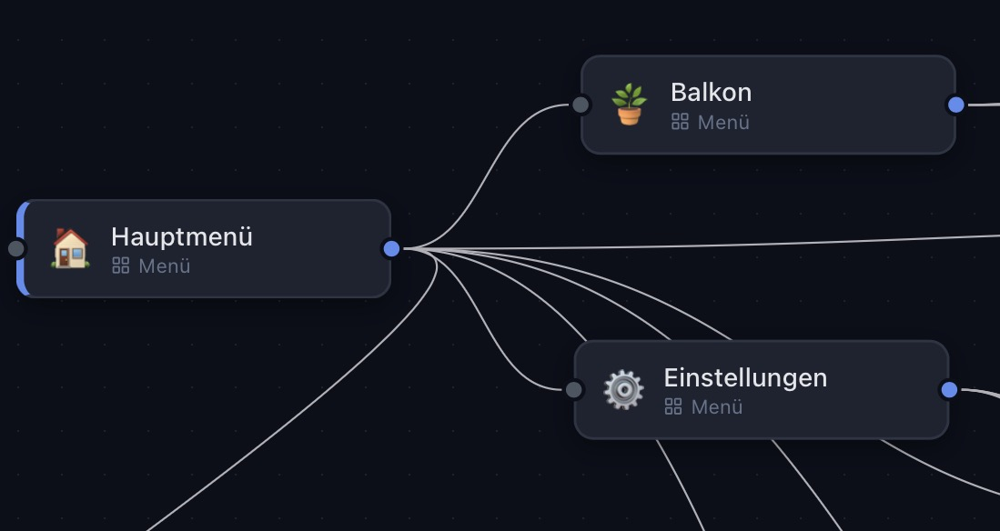
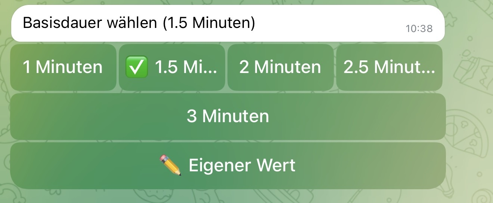
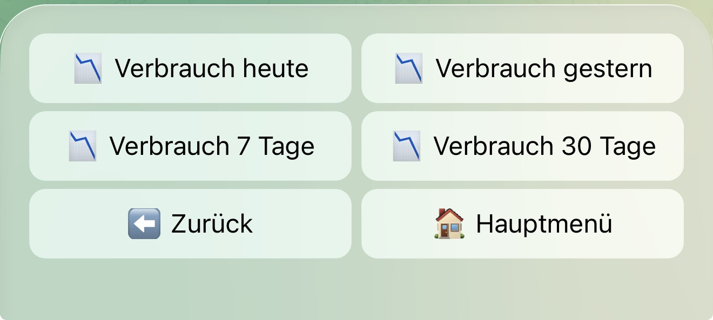
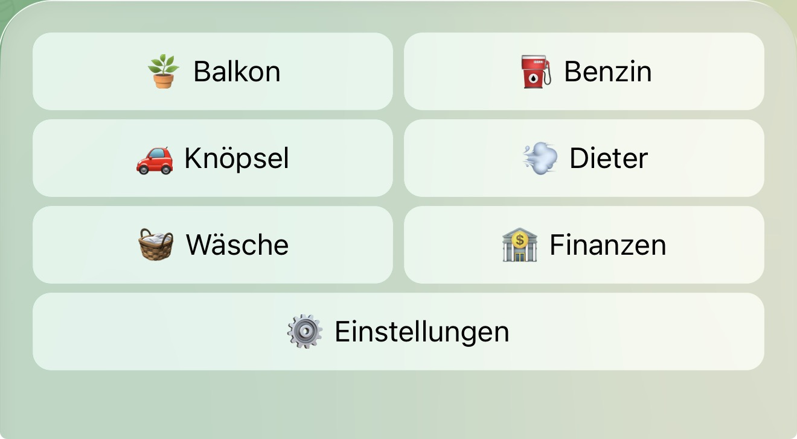

# ioBroker.telegrammenu2

Автономный адаптер Telegram-бота для ioBroker, созданный на основе **визуального редактора меню без необходимости написания кода** . Создавайте меню, кнопки и уведомления для своего бота, перетаскивая узлы на холст — в большинстве случаев написание скриптов не требуется.



## Почему это существует

Создание Telegram-бота для вашего умного дома обычно подразумевает написание (и поддержку) множества скриптов. `sendTo()` Вызовы, раскладки клавиатуры и логика маршрутизации команд — все это делается вручную. Этот адаптер преобразует все это в визуальный граф: меню — это узлы, кнопки — их дочерние элементы, а все дерево экспортируется непосредственно в реестр адаптера. Измените что-нибудь в редакторе, нажмите «Сохранить» — готово.

## Функции

- **Визуальный редактор узлов** — полноценный редактор графов [React Flow,](https://reactflow.dev/) работающий как отдельная вкладка в административной панели ioBroker. Создавайте древовидное меню, подключайте кнопки, соединяйтесь с работающим экземпляром ioBroker для загрузки/сохранения или экспортируйте/импортируйте в формате JSON.

- **Шесть типов кнопок** , все они подключаются в редакторе без написания кода:
  - **Меню** — контейнер кнопок, опционально с динамическим заголовком (из скрипта или данных в реальном времени), изображением или требованием наличия разрешений.
  - **Переключатель / Числовой / Текстовый ввод** — привязан непосредственно к точке данных (вкл/выкл, фиксированное значение, цифровая клавиатура или ввод свободного текста).
  - **Действия** - стандартные кнопки навигации "Назад" / "Главное меню" / "Отмена".
  - **Команда** - вызывает скрипт (через `onMessage`) или отправляет HTTP-запрос с необязательной базовой аутентификацией.
  - **Многостатусная кнопка** — это кнопка, которая переключается между более чем двумя состояниями, каждое из которых имеет свой собственный эмодзи, метку и целевую точку данных/значение.

- **Автоматически генерируемые меню** — управление пользователями, настройки уведомлений и приостановка уведомлений — встроены и обновляются автоматически; не требуется ручное подключение кнопок.

- **Выбор значений в процентах/диапазоне чисел** — выберите значение с помощью встроенной клавиатуры (текущее значение отмечено знаком ✅) или нажмите «пользовательское значение», чтобы ввести его с помощью настоящей цифровой клавиатуры, включая десятичные знаки.

  

- **Шаблоны сообщений** -`{{datapoint.id}}` Заполнители преобразуются в динамические значения в любом месте текста кнопки или сообщения подтверждения, включая встроенные математические выражения. `{{datapoint.id / 60}}`) и автоматическое логическое форматирование/форматирование даты

- **Значки, зависящие от статуса** — эмодзи меню или кнопки могут меняться в зависимости от текущего значения/правил точки данных, включая операторы сравнения (см. ниже).

- **Система разрешений** — разрешения для каждой кнопки/пункта меню, контрольная точка для новых пользователей Telegram и административное меню для управления ролями и правами (см. раздел «Пользователи и разрешения» ниже).

- **Система уведомлений** -`sendTo('telegrammenu2.0', 'notify', { area, type, text })` с возможностью настройки пользовательских предпочтений для каждой области/типа, группировкой быстрых уведомлений, функцией отложенного/приостановленного отображения для каждой области, а также с возможностью отключения форматирования HTML или предварительного просмотра ссылок.

- **Обработчики событий** — отслеживают любую точку данных и автоматически отправляют интерактивное меню каждому авторизованному пользователю при совпадении условия (значение, оператор сравнения, необязательно). `ack` проверять)

- **Скриптовый мост** - любой `javascript.0` скрипт может зарегистрировать `onMessage` обработчик и возврат `{ text, html, noPreview, menuKey, awaitReply }` ответить на нажатие кнопки, задать уточняющий вопрос или перейти в другое меню.

## Глобальные настройки

Некоторые настройки применяются ко всему адаптеру и отображаются в виде обычных полей.** `main` ** меню (то, которое содержит) `menuKey: "main"`) - установите их через раздел "Глобальные настройки" на этом узле в редакторе:

| Поле                            | По умолчанию                     | Эффект                                                                                                                              |
| ------------------------------- | -------------------------------- | ----------------------------------------------------------------------------------------------------------------------------------- |
| `buttonsPerRow`                 | `2`                              | Сколько кнопок в ряду для автоматически переносимых клавиатур (обычные меню и автоматические меню, например, список пользователей)? |
| `groupingEnabled`               | `true`                           | Будут ли быстрые уведомления одного типа объединяться в одно сообщение?                                                             |
| `groupableExcludeTypes`         | `['warn', 'error']`              | Типы уведомлений, которые всегда отправляются немедленно, никогда не объединяются в пакеты.                                         |
| `boolTranslateEnabled`          | `true`                           | Ли `true` /`false` значения, полученные с помощью `{{datapoint.id}}` получить перевод                                                 |
| `boolTrueText` /`boolFalseText` | `✅ an` /`⛔ aus`                  | Переведённый текст для `true` / `false`                                                                                              |
| `dateTranslateEnabled`          | `true`                           | Разрешаются ли значения даты/времени ISO с помощью `{{datapoint.id}}` переформатировать                                              |
| `dateFormat` /`dateTimeFormat`  | `DD.MM.YYYY` /`DD.MM.YYYY HH:mm` | Формат вывода для значений, содержащих только дату, и для значений, содержащих дату и время.                                        |

## Пользователи и разрешения

Каждый пользователь Telegram, отправивший сообщение боту, автоматически регистрируется при первом контакте с присвоением роли. `guest` и `approved: false` — Они видят сообщение «ожидание одобрения» и ничего больше, пока администратор не одобрит их (с помощью встроенной кнопки, которая автоматически появляется в чате администраторов). После одобрения права доступа представляют собой логические флаги для каждого пользователя. `users.<key>.permissions.<name>`), проверяется на соответствие строке, которую вы указываете в меню или на кнопке. `perm` поле:

```javascript
{ text: '🔥 Heating', cmd: 'TG:NAV:HEATING', nextMenu: 'heating_main', perm: 'heating' }
```

Названия разрешений и областей могут содержать любые символы (например, умлауты); идентификаторы объектов используют версию ASCII (`Wäsche` →`users.<key>.permissions.Waesche`).

Пользователь видит/может использовать это только в том случае, если `users.<theirKey>.permissions.heating` является `true` Особая ценность `perm: 'admin'` вместо этого проверяет пользователя `role` поле напрямую (`users.<key>.role === 'admin'`) вместо именованного разрешения. Администраторы получают встроенное автоматическое меню "👤 Пользователи" (`source: 'users'`) для переключения индивидуальных разрешений и ролей любого пользователя без ручного изменения состояний.

## Расширенные примеры

**Настраиваемый текст подтверждения** в меню с шагом в процентах/диапазоном чисел (`confirmMessage` (поле, отдельное от обычного вступительного текста меню) -`{value}` и `{unit}` заменяются тем, что было только что установлено:

```
🌡️ Target temperature set to {value}{unit}.
```

**Отправка уведомления в формате HTML без предварительного просмотра ссылки:**

```javascript
sendTo('telegrammenu2.0', 'notify', {
  area: 'Heating',
  type: 'info',
  text: '<b>Boiler restarted</b>\nSee https://your-dashboard.example for details.',
  extra: 'html,nopreview',
});
```

**Автоматическое открытие меню при пересечении точкой данных порогового значения** (`trigger` поле в любом меню):

```javascript
trigger: { datapoint: '0_userdata.0.Heating.error', value: 'true', ackOnly: true }
```

Отображает это меню каждому пользователю, имеющему на него разрешение, в момент получения данных. `true` с `ack: true`. `value` поддерживает также операторы сравнения (`>25`, `<=10` (и т. д.) - используется аналогично для значков, зависящих от статуса:

```javascript
icon: {
  datapoint: '0_userdata.0.Car.batterySoc',
  rules: [{ value: '<25', emoji: '⚡️' }],
  fallback: '🚗',
}
```

## Как это работает

```
Telegram ⇄ ioBroker.telegram ⇄ telegrammenu2 (this adapter) ⇄ your scripts/datapoints
```

Адаптер подключается к вашей существующей сети. `telegram.x` Состояние входящего сообщения экземпляра соответствует тексту или `callback_data` выберите пункт меню, открытое в данный момент для этого чата, и один из следующих вариантов:

- **обрабатывает это напрямую** (записывает в точку данных, отображает подменю, выполняет HTTP-запрос) или
- **вызовы скрипта, который** вы зарегистрировали через `onMessage` и отправляет обратно любой текст/меню, которое она возвращает.

Меню хранятся в виде простых JSON-объектов, по одному на каждый ключ, в собственном интерфейсе адаптера. `registry.*` утверждается — именно это визуальный редактор читает и записывает. Вы также можете редактировать этот JSON вручную или импортировать его напрямую (см. `registryExample.json`).

## Быстрый старт

1. Установите адаптер, укажите в качестве источника существующий экземпляр адаптера Telegram (`native.telegramInstance`, по умолчанию `telegram.0`).
2. Откройте вкладку **«Редактор меню»** в административной панели ioBroker. При первом запуске автоматически импортируется минимальный реестр по умолчанию (главное меню, ведущее в «Настройки» → «Пользователи» / «Уведомления»).
3. Добавьте узел **Menu** , подключите к нему несколько кнопок **Toggle** / **Command** и нажмите **"Сохранить в ioBroker"** .
4. Отправьте сообщение своему боту с помощью `/start`.

Видеть `registryExample.json` Чтобы посмотреть пример (кнопка погоды с шаблоном сообщения, подменю с элементами управления, привязанными к точкам данных, и значок, зависящий от статуса), импортируйте его с помощью кнопки «Импорт JSON» в редакторе и попробуйте.

Подменю — доступно через главное меню, в конце которого находится комбинированная кнопка «Назад»/«Главное меню»:



...доступен из главного меню, подобного этому:



## Создание собственных кнопок с поддержкой скриптов

Любой `Command` Кнопка определенного типа может вызывать скрипт вместо (или в дополнение к) прямой записи точки данных:

```javascript
// in a javascript.0 script
onMessage('TG:WEATHER:SHOW', (data, callback) => {
  const temp = getState('0_userdata.0.Weather.temperature').val;
  callback({ text: `🌤️ It's currently ${temp}°C outside.` });
});
```

Регистрация не требуется — просто укажите идентификатор скрипта и строку команды на кнопке в редакторе. Функция обратного вызова также может возвращать `html: true`, `noPreview: true`, `awaitReply: true` (чтобы задать уточняющий вопрос), или `menuKey` (чтобы сразу перейти в другое меню).

## Требования

- Node.js >= 22 (использует встроенную функцию) `fetch` (для кнопок HTTP-запросов)
- ioBroker Admin >= 8 (редактор представляет собой вкладку JSON с пользовательским компонентом)
- js-controller >= 6.0.11
- существующий, сконфигурированный `iobroker.telegram` пример

## Разработка

Исходный код редактора находится в `src-admin`. `npm run build` встраивает это в `admin/custom`.

## Changelog

### 0.3.2
- Removed: instance field in the editor (the adapter is a singleton)
- Changed: updated icon library (lucide-react 1)

### 0.3.1
- Fixed: admin tab type is now `json`
- Changed: Dependabot also checks `src-admin`

### 0.3.0
- New: object browser for datapoint fields and placeholders in the editor
- Changed: editor is built from source (`src-admin`) as a JSON tab with a custom component, requires Admin 8
- Changed: editor follows the Admin theme
- Fixed: objects with `common.custom` settings are no longer deleted (menu reset/delete, user deny, ID migration); the migration carries the settings over to the new ID
- Fixed: registry changes made by the adapter itself no longer trigger a redundant trigger rescan
- Changed: updated `@iobroker/testing` to 6.3.2

### 0.2.5

- New: `info.connection` mirrors the telegram instance connection
- New: light and dark theme in the editor, calmer look
- Changed: object ids are ASCII only and unique regardless of case, existing objects are migrated on start
- Changed: notification types are shown translated
- Changed: message type detection uses English keywords, `[type]` and `::notify::type::` markers still work
- Changed: `{status}` gets a space before it
- Changed: `common.singleton` is set, code moved from `core/` to `lib/`
- Fixed: remaining German texts in bot and editor (11 languages), back/main menu language
- Removed: unused plugin loader

### 0.2.3

- Repository maintenance: npm Trusted Publishing (OIDC) configured, no functional changes

### 0.2.2

- Repository maintenance: official ioBroker CI setup (linting, unit/integration/package tests), consistent versioning across package.json/io-package.json/git tags, corrected admin config schema, and release-script configuration

### 0.2.0

- Added percent-step/number-range value pickers (inline keyboard with the current value marked, plus a numeric-keypad "custom value" option supporting decimals)
- Added event listeners: automatically push a menu to authorized users when a datapoint condition matches
- Added HTTP-request buttons (with optional Basic Auth)
- Added multi-status buttons (more than two states, each with its own emoji/label/target)
- Added an adjustable "buttons per row" global setting
- Fixed status-dependent icons on menus not supporting comparison operators (e.g. `<25`) the way button icons already did
- Public-release cleanup: removed the legacy JS-adapter compatibility bridge and demo/example content, generic example registry, English README
- Fixed a compact-mode safety issue where event-trigger state was stored at module scope instead of per adapter instance

### 0.1.0

- Initial version: visual node editor, menu/button system, notification engine with permissions, and script bridge

Older entries: see CHANGELOG_OLD.md.

## License

MIT License

Copyright (c) 2026 backfisch88 <henrik.schoenhofen@icloud.com>

Permission is hereby granted, free of charge, to any person obtaining a copy
of this software and associated documentation files (the "Software"), to deal
in the Software without restriction, including without limitation the rights
to use, copy, modify, merge, publish, distribute, sublicense, and/or sell
copies of the Software, and to permit persons to whom the Software is
furnished to do so, subject to the following conditions:

The above copyright notice and this permission notice shall be included in all
copies or substantial portions of the Software.

THE SOFTWARE IS PROVIDED "AS IS", WITHOUT WARRANTY OF ANY KIND, EXPRESS OR
IMPLIED, INCLUDING BUT NOT LIMITED TO THE WARRANTIES OF MERCHANTABILITY,
FITNESS FOR A PARTICULAR PURPOSE AND NONINFRINGEMENT. IN NO EVENT SHALL THE
AUTHORS OR COPYRIGHT HOLDERS BE LIABLE FOR ANY CLAIM, DAMAGES OR OTHER
LIABILITY, WHETHER IN AN ACTION OF CONTRACT, TORT OR OTHERWISE, ARISING FROM,
OUT OF OR IN CONNECTION WITH THE SOFTWARE OR THE USE OR OTHER DEALINGS IN THE
SOFTWARE.