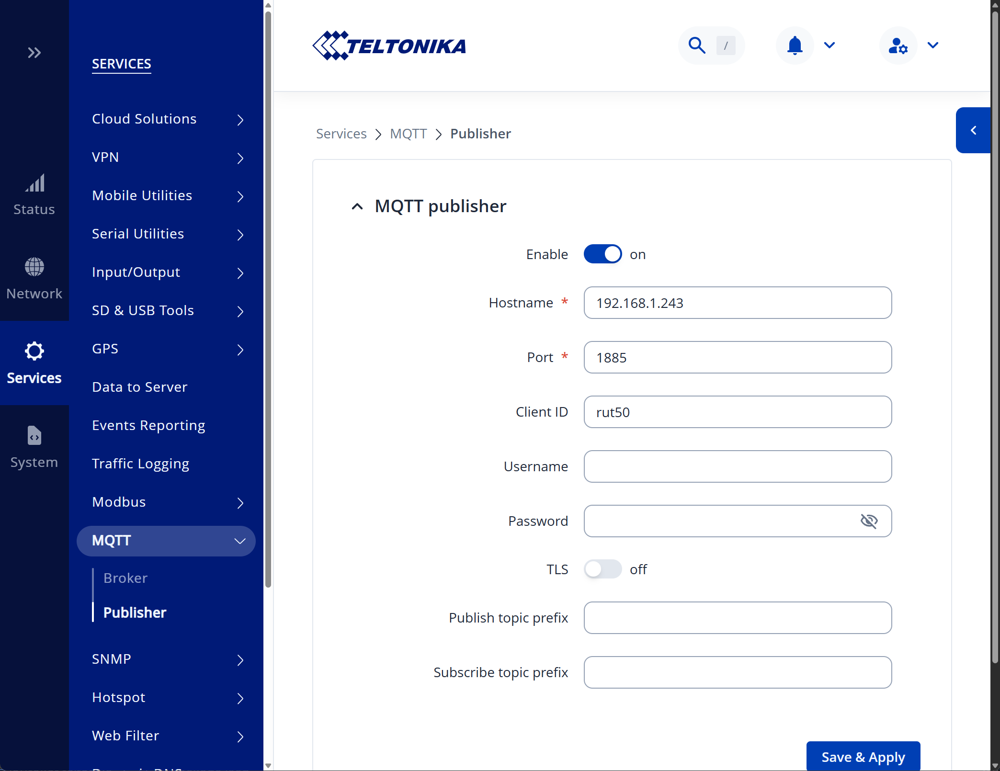

# ioBroker Teltonika

**Этот адаптер использует библиотеки Sentry для автоматического сообщения разработчикам об исключениях и ошибках в коде.** Более подробную информацию, а также инструкции по отключению отправки сообщений об ошибках см. [в документации Sentry-Plugin](https://github.com/ioBroker/plugin-sentry#plugin-sentry) ! Система отчетности Sentry используется начиная с js-controller 3.0.

Этот адаптер считывает данные с маршрутизаторов Teltonika через MQTT и с устройств Teltonika через SNMP.

Маршрутизаторы подключаются к адаптеру самостоятельно по протоколу MQTT. Устройства без издателя MQTT — например, управляемые коммутаторы TSW — опрашиваются по протоколу SNMP; их можно ввести на вкладке SNMP или позволить сканированию сети найти их. Маршрутизатор, предлагающий оба протокола, считывается только один раз, по протоколу SNMP.

По протоколу MQTT можно считывать следующую информацию:

- температура («RUT2», «RUT9», «RUTX», «RUT3», «RUT1», «TRB2», «TRB5», «OTD», «RUTM», «RUTC»)
- уровень сигнала
- мобильный оператор
- состояние сети
- Тип подключения (2G/3G/4G/5G)
- IP-адрес WAN
- время безотказной работы
- имя
- цифровой вход 1 ('RUT9')
- цифровой вход 2 («RUT9»)
- аналоговый вход ('RUT9', 'TRB2', 'TRB141')
- Состояние контакта 2 ('TRB2')
- статус контакта 3 ('RUT1', 'RUT2', 'RUT9', 'RUTX', 'RUT3', 'TRB1', 'TRB2', 'TRB5', 'RUTM')
- статус контакта 4 ('RUT1', 'RUT2', 'RUT9', 'RUTX', 'RUT3', 'TRB1', 'TRB2', 'TRB5', 'RUTM')

## Использование

Шаги:

- Сначала запустите экземпляр.
- Зайдите в настройки маршрутизатора и откройте раздел MQTT.
  - Включить издателя MQTT
  - Установите адрес MQTT-брокера равным адресу вашего экземпляра ioBroker.
  - Укажите порт MQTT-брокера. Важно: порт по умолчанию для этого адаптера — 1885, чтобы избежать конфликтов с другими MQTT-адаптерами.
  - Сохраните настройки
  - Для применения настроек некоторым маршрутизаторам требуется перезагрузка.
- Через некоторое время точки данных будут созданы в экземпляре адаптера.

**Примечание** : тестирование проводилось только с `RUTC` и `TSW202` устройства.

### SNMP

Устройства, не поддерживающие MQTT-издатель, считывают данные по протоколу SNMP:

- Включите агент SNMP на устройстве в разделе _«Службы» → «SNMP» → «Настройки SNMP»_ и установите сообщество только для чтения.
- В настройках адаптера откройте вкладку _SNMP_ , введите диапазон адресов и нажмите _«Сканировать»_ , или добавьте устройство вручную.
- Сегодня поддерживаются следующие `RUTC` и `TSW2` семейства. Другие модели используют значения, общие для всех устройств Teltonika (серийный номер, имя, время работы, процессор); чтобы прочитать их полностью, загрузите MIB с устройства в _разделе «Сводка по системе SNMP»_ и перетащите его в `MIBs/` и бежать `npm run generate-oids`

Помимо перечисленных выше значений, SNMP также предоставляет статистику по каждому порту коммутаторов (канал связи, скорость, дуплекс, переданные байты и скорость передачи данных), а также по именованным цифровым входам и выходам маршрутизатора.

Он также считывает IPv4-адреса каждого устройства, как маршрутизаторов, так и коммутаторов, из стандартной IP-MIB:

- `<device>.lan` — адрес в локальной сети, рядом с `wan`, который всегда содержит только адрес модема. Это адрес моста локальной сети (LAN-моста). `br-lan` на роутере, `br0.1` (на коммутаторе TSW).
- `<device>.addresses.<interface>` — Одно состояние на каждый интерфейс, режим обратной связи исключен. На маршрутизаторе с проводным WAN-соединением это единственное место, где отображается его адрес. `addresses.wan`), модем отображается как `qmimux0` или что-то подобное.

IPv6 таким образом недоступен: устройства оставляют таблицу IP-MIB, которая должна была бы его содержать, пустой.

Доступны еще четыре ветви, но они по умолчанию **отключены** , поскольку раскрывают местоположение устройства и идентифицируемых клиентов, а также потому, что они меняются при каждом опросе:

- _GPS-координаты_ — широта, долгота, точность, спутники и время определения местоположения.
- _Wi-Fi-радиостанции и сети_ — состояние радио и канал, а также для каждого SSID — шифрование, режим и количество клиентов.
- _Информация о сессиях точки доступа_ — IP-адрес, пользовательское состояние и авторизация каждой сессии.
- _Список клиентов Wi-Fi_ —`<device>.wifiClients.count` и `<device>.wifiClients.list` Последний содержит MAC-адрес и SSID каждой подключенной станции в формате JSON.

Только количество и одно состояние JSON: канал на каждый MAC-адрес оставит все телефоны, когда-либо подключавшиеся к сети, в дереве объектов. Для важных устройств используйте параметр присутствия ниже — ветка не требуется.

### Присутствие

Каждая строка вкладки « _Присутствие»_ представляет собой человека — как и адаптер fb-checkpresence — с одним или несколькими MAC-адресами, разделенными запятыми (телефон и часы, или адреса, которые один телефон использует в двух сетях), и необязательной группой. Человек присутствует, пока один из опрашиваемых маршрутизаторов сообщает об одном из своих адресов как о связанном с его Wi-Fi. Дерево объектов такое же, как в ioBroker.tr-064, поэтому виджеты обоих адаптеров читают его одинаково:

```
teltonika.<n>.presence.persons.<name>.present                    boolean
teltonika.<n>.presence.persons.<name>.lastArrival / lastDeparture number  — ms, 0 = not known yet
teltonika.<n>.presence.persons.<name>.presentSince / absentSince number  — minutes, 0 in the other state
teltonika.<n>.presence.persons.<name>.presentToday / absentToday number  — minutes since midnight
teltonika.<n>.presence.persons.<name>.history                    json    — last comings and goings, newest first
teltonika.<n>.presence.persons.<name>.devices                    string  — the addresses seen within the grace period
teltonika.<n>.presence.persons.<name>.lastSeen / router / ssid           — the last sighting
teltonika.<n>.presence.present / allPresent                      boolean — anybody / everybody at home
teltonika.<n>.presence.presentCount / absentCount / presentNames / absentNames / json
teltonika.<n>.presence.groups.<group>.*                                  — the same for the persons of one group
teltonika.<n>.presence.guests.present / count / names / json             — stations of the *Guest SSIDs*
teltonika.<n>.presence.unknown.present / count / names / json            — stations nobody watches (option)
```

Отъезд — это последнее наблюдение, а не конец льготного периода. Первое показание после установки не является событием: `lastArrival` и `lastDeparture` Значение остается равным 0 до тех пор, пока человек не придет или не уйдет в первый раз. Время, суммы и история сохраняются после перезапуска. Для более длительной истории включите отдельный экземпляр истории (history, sql, influxdb). `present` - виджеты считывают события оттуда.

Только настроенные пользователи получают собственные состояния; гости и неизвестные станции представляют собой только количество и один JSON-список, поэтому дерево не хранит адреса всех посетителей — именно поэтому функция присутствия работает без включения _списка Wi-Fi-клиентов_ .

Адреса вводить необязательно: **функция чтения подключенных устройств** запрашивает у каждого настроенного SNMP-устройства список его ассоциаций и добавляет те, которые еще не указаны в списке, в виде неактивных строк с соответствующими именами. `client_<last three octets>` В журнале каждой станции присваивается её SSID, и указывается, является ли её адрес случайным — так же, как телефон получает адрес от принтера, поскольку iOS и Android используют _локально администрируемый_ адрес для каждой сети, в то время как принтер или телевизор отвечают адресом, встроенным в них. Переименуйте важные строки, отметьте _«Активно»_ , удалите остальные. Кнопка взаимодействует с запущенным экземпляром, поэтому сначала запустите его.

Три вещи, которые нужно знать, прежде чем создавать на его основе автоматизации:

- **Введите MAC-адрес, отображаемый маршрутизатором** , в разделе _«Статус» → «Беспроводная связь»_ , а не тот, который напечатан на телефоне. Телефоны используют отдельный случайный адрес для каждой сети. Он остается стабильным, пока сеть известна пользователям, и снова меняется, как только сеть удаляется и снова подключается.
- Телефон выпадает из списка ассоциаций, пока находится в спящем режиме, и появляется снова через несколько секунд. Таким образом, обнаружение телефона учитывается в течение **льготного периода** (180 секунд по умолчанию или на строку), поэтому его уход замечается с задержкой, а прибытие происходит немедленно. Примерно через минуту состояния начинают мерцать.
- Данные считываются **только по протоколу SNMP** . Издатель MQTT маршрутизатора отвечает фиксированным набором параметров, который не включает его клиентов, поэтому маршрутизатор, подключающийся только по MQTT, не сообщает о своем присутствии.

### Коммутационные порты

_Укажите сообщество_ для устройства, и его порты станут переключаемыми. `<device>.ports.<name>.enabled` Если поле оставить пустым, адаптер будет только считывать данные, и состояние будет создано без флага записи.

Переключатель работает `ifAdminStatus` стандартного IF-MIB, поскольку MIB Teltonika вообще не предоставляет возможности записи.

Порт становится переключаемым только тогда, когда его имя точно совпадает с именем одного интерфейса. На TSW202 это относится ко всем портам, поскольку в обеих таблицах указано следующее: `port1` …`port8`. RUTC сообщает о четырех названных портах. `LAN` против интерфейсов `lan1` …`lan4`, который невозможно с уверенностью сопоставить, поэтому только его `WAN` Порт переключаемый.

### Названия портов

Канал порта именуется в соответствии с описанием, заданным на устройстве ( _Настройки порта → Описание_ на коммутаторе TSW), поэтому `ports.port1` Считывает "Мачта камеры" в дереве объектов и в виджетах. Передаёт данные по протоколу SNMP. `ifAlias`), вход через веб-интерфейс не требуется, и канал обновляется при изменении описания на устройстве; если удалить такое описание, канал вернется к имени порта. Имя, указанное в ioBroker, никогда не перезаписывается. Как и в случае с переключением, для этого необходимо, чтобы порт соответствовал своему интерфейсу, поэтому RUTC присваивает ему имя. `WAN` Только порт.

### Коммутация PoE

SNMP не может связаться с PoE: устройства отвечают отсутствием объектов в POWER-ETHERNET-MIB. Вместо этого используется **веб-API** устройства, для работы которого требуется авторизация через веб-интерфейс — укажите _пароль для веб-_ интерфейса (и имя _пользователя веб-интерфейса_ , если оно отсутствует). `admin`) для устройства. Каждый порт с PoE получает три состояния, которые считываются при каждом опросе:

- `<device>.ports.<name>.poe` — выход PoE, переключаемый
- `<device>.ports.<name>.poeActive` — устройство потребляет энергию. `false` пока `poe` «Включено» означает, что ничего не подключено, например, устройство с питанием по PoE, например, восходящий канал.
- `<device>.ports.<name>.poePower` — потребляемая мощность, в Вт

Без пароля обращение к веб-API не происходит, и состояние PoE не создается. В SFP-корпусах нет PoE, и они к ним не подключаются.

- Адаптер обменивается данными с устройством по протоколу HTTPS и принимает его самоподписанный сертификат, поскольку устройство создает этот сертификат самостоятельно.
- Веб-API доступен начиная с прошивки TSW версии 1.4. Используйте учетную запись с правами для изменения настроек порта.
- Ошибка ввода пароля или недоступность веб-интерфейса регистрируются один раз; значения SNMP устройства при этом не затрагиваются.

### Виджеты для диспетчера устройств

Для адаптера _устройства_ зарегистрированы два компонента:

- **Устройства Teltonika** — каждый маршрутизатор и коммутатор экземпляра в виде отдельной ячейки: доступность, полоса, показывающая состояние соединения каждого порта, а для маршрутизатора — оператор, тип соединения и сигнал. При нажатии открывается полная информация, включая лицевую панель, цифровые входы и выходы, а также WAN-адреса.
- **Порты Teltonika** — это лицевая панель отдельного устройства на отдельной плитке, отображающая параметры соединения, скорость, дуплекс и количество переданных байтов для каждого порта. Порты отображаются так, как они указаны на оборудовании: нечетные числа в верхнем ряду, четные — в нижнем, оптоволоконные кабели — в отдельной группе. Устройство выбирается из выпадающего списка, который заполняет адаптер, и щелчок по плитке открывает диалоговое окно с подробными сведениями для этого конкретного устройства.

Маршрутизатор дополнительно отображает свои **WAN-интерфейсы** , поскольку mwan3 отслеживает их: имя, статус переключения при сбое (`online`, `standby`, `notracking`), включен ли интерфейс и как долго он активен. Обратите внимание, что столбец «Адрес» в веб-интерфейсе здесь не имеет аналога — по протоколу SNMP mwan3 сообщает хосты, которые он пингует для оценки соединения, а не адрес, который содержит интерфейс. Сами адреса находятся в `<device>.addresses` назван в честь сетевого устройства (`wan`, `qmimux0`) а не интерфейс mwan3 (`wan`, `mob1s1a1`).

При настройке сообщества записи переключение порта можно осуществлять с панели. Порт, у которого включен PoE-выход, отображается желтым значком, который становится тусклым, когда питание не потребляется, а во всплывающей подсказке указывается потребляемая мощность; для этого требуется вход через веб-интерфейс (см. _Переключение PoE_ ), поскольку SNMP сообщает об отсутствии PoE вообще. Затем в подробном описании отображаются PoE-порты с их описанием и мощностью, каждый с переключателем — в виджете _портов Teltonika_ только там, где переключение разрешено в его настройках, как и сами порты. На плитке и в подробном описании отображается адрес локальной сети рядом с адресом глобальной сети, а для интерфейса глобальной сети — собственный адрес, где сетевое устройство имеет то же имя. `wan`).

Виджеты обнаруживают устройства из дерева объектов, а не из конфигурации адаптера, поскольку маршрутизаторы MQTT объявляют о своем появлении, и устройства SNMP отображаются при первом опросе.

### Виджеты для vis-2

Те же два представления доступны в виде набора виджетов для **vis-2** (набор _Teltonika_ ):

- **Устройства Teltonika** — все устройства экземпляра, отображаемые в виде сводки (устройства в сети, полосы портов), в виде отдельной плитки для каждого устройства или с полной информацией о каждом устройстве прямо внутри виджета. Щелчок по сводке или плитке открывает диалоговое окно с подробной информацией.
- **Порты Teltonika** — передняя панель одного устройства, выбранная из списка устройств экземпляра, или ее полная информация внутри виджета.

Переключение портов и PoE с помощью виджетов по умолчанию отключено и должно быть включено в настройках виджета.

### Веб-компоненты

Четыре виджета vis-2 также существуют в виде веб-компонентов (`@iobroker/web-components`), указан в `common.webComponents` для таких хостов, как Aura, vis-2, admin и ioBroker.devices: `<iob-teltonika-devices>`, `<iob-teltonika-ports>`, `<iob-teltonika-person>` и `<iob-teltonika-presence>` Каждый из них представляет собой отдельный модуль в `admin/webcomponents/` Рядом с манифестом находится React, который предоставляется хостом. Он берет цвета темы хоста, подгоняет контент под предоставленный ему блок и ничего не пишет, пока хост находится в режиме редактирования. Человек выбирается в качестве канала. `teltonika.<n>.presence.persons.<name>`, а щелчок по нему отображает изменения в диалоговом окне хоста. Источники находятся в `src-webcomponents/` (`npm run build:wc`).

### Ловушки

Адаптер может принимать SNMP-ловушки. Включите эту функцию на вкладке _SNMP_ и укажите устройству этот хост в разделе _«Службы» → «SNMP» → «Настройки ловушек»_ . Обратите внимание, что порт 162 является привилегированным в Linux, поэтому может потребоваться более высокий порт.

Каждое уведомление отображается следующим образом `<device>.traps.<name>` сохраняя время своего последнего прибытия, и `<device>.traps.last` указывает на самое последнее уведомление. Большинство уведомлений Teltonika не содержат информации о полезной нагрузке — из семи, определенных RUTC, только `signalChangeNotification` Устройство передаёт любые данные — поэтому записывается сообщение об ошибке, которое затем немедленно запускает опрос этого устройства, откуда и берутся фактические значения. TSW202 вообще не определяет никаких сообщений об ошибках.

<!--
	Placeholder for the next version (at the beginning of the line):
	### **WORK IN PROGRESS**
-->

## Changelog

### **WORK IN PROGRESS**
* (@GermanBluefox) Added the short form of the web component manifests (tag, name, icon, size) to `common.webComponents`, so that hosts like Aura can list the components before the adapter is installed; the build writes it with `iob-web-components sync-io-package`

### 1.3.0 (2026-11-08)
* (@GermanBluefox) Added the web components `<iob-teltonika-devices>`, `<iob-teltonika-ports>`, `<iob-teltonika-person>` and `<iob-teltonika-presence>` (`@iobroker/web-components`) for Aura, vis-2, admin and other hosts

### 1.2.0 (2026-11-02)
* (@GermanBluefox) Added the LAN address of every SNMP device as `<device>.lan`, and all its IPv4 addresses per interface under `<device>.addresses`, read from the IP-MIB
* (@GermanBluefox) Added switching PoE per port (`<device>.ports.<name>.poe`) over the Web API of the device, with whether a device draws power (`poeActive`) and how much (`poePower`), for devices with a web password configured (the user defaults to `admin`)
* (@GermanBluefox) Port channels are named after the description set on the device (`ifAlias`), unless renamed in ioBroker
* (@GermanBluefox) The widgets show the LAN address, the address of a WAN interface, the port descriptions and a bolt on ports with PoE on; the device detail lists the PoE ports with a switch each

### 1.1.2 (2026-10-14)
* (@GermanBluefox) The occupied ports - MQTT (TCP) and, if enabled, the SNMP trap receiver (UDP) - are reported to js-controller 8 (`registerUsedResource`)

### 1.1.1 (2026-10-14)
* (@GermanBluefox) Added presence detection like fb-checkpresence: a person with the MAC addresses of its devices and an optional group becomes `presence.persons.<name>` with present, last arrival and departure, since when, the sums of the day and the last comings and goings; groups, guests (by SSID) and unknown stations are summarised
* (@GermanBluefox) Added the widgets "Person" (one person, chosen by name, with free icons, pictures, texts and colours, last arrival and departure and the comings and goings) and "Presence" (list of the persons) for vis-2, and "Teltonika person" for ioBroker.devices
* (@GermanBluefox) Added the optional Wi-Fi client list, with the MAC address and SSID of every associated station as JSON
* (@GermanBluefox) Added a button that fills the presence table from the devices currently connected to the routers, named after the host name the router knows or the manufacturer of the MAC address
* (@GermanBluefox) Fixed the log being flooded with `received pubrel ... for unknown messageId`: a QoS 2 release is now always answered, which is what stops the router from repeating it
* (@GermanBluefox) Removed the `retransmitInterval` and `retransmitCount` settings, which were read and never used, and gave an unreleased QoS 2 message an expiry instead of keeping it for the life of the connection
* (@GermanBluefox) Fixed the build: the type declarations of net-snmp were missing, so 1.1.0 was never published

### 1.0.1 (2026-09-23)
* (iobroker-bot) Adapter requires node.js >= 22 now.
* (@GermanBluefox) Added vis-2 widgets: overview of all devices and front panel of one device
* (@GermanBluefox) Fixed the device manager widgets failing to load now and then with React error #527

## License

The MIT License (MIT)

Copyright (c) 2025-2026, bluefox <dogafox@gmail.com>

Permission is hereby granted, free of charge, to any person obtaining a copy
of this software and associated documentation files (the "Software"), to deal
in the Software without restriction, including without limitation the rights
to use, copy, modify, merge, publish, distribute, sublicense, and/or sell
copies of the Software, and to permit persons to whom the Software is
furnished to do so, subject to the following conditions:

The above copyright notice and this permission notice shall be included in
all copies or substantial portions of the Software.

THE SOFTWARE IS PROVIDED "AS IS", WITHOUT WARRANTY OF ANY KIND, EXPRESS OR
IMPLIED, INCLUDING BUT NOT LIMITED TO THE WARRANTIES OF MERCHANTABILITY,
FITNESS FOR A PARTICULAR PURPOSE AND NONINFRINGEMENT. IN NO EVENT SHALL THE
AUTHORS OR COPYRIGHT HOLDERS BE LIABLE FOR ANY CLAIM, DAMAGES OR OTHER
LIABILITY, WHETHER IN AN ACTION OF CONTRACT, TORT OR OTHERWISE, ARISING FROM,
OUT OF OR IN CONNECTION WITH THE SOFTWARE OR THE USE OR OTHER DEALINGS IN
THE SOFTWARE.