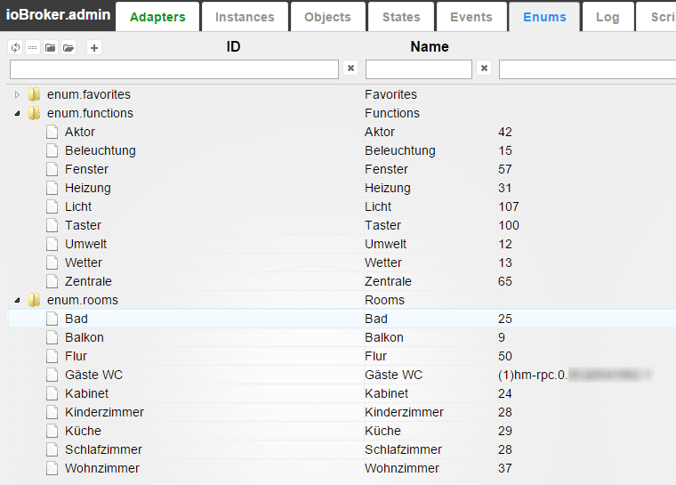

# ioBroker.text2command

**Этот адаптер использует библиотеки Sentry для автоматического сообщения разработчикам об исключениях и ошибках в коде.** Более подробную информацию, а также сведения о том, как отключить отправку сообщений об ошибках, см. [в документации Sentry-Plugin](https://github.com/ioBroker/plugin-sentry#plugin-sentry) ! Система отчетности Sentry используется начиная с js-controller 3.0.

## Описание

Этот адаптер может преобразовывать обычные предложения, например: `Switch light in kitchen on` для выполнения конкретной команды и устанавливает состояние. `adapter.0.device.kitchenLight` к `true`.

Этот адаптер не имеет смысла активировать автономно. Его следует использовать с другими адаптерами, такими как Telegram или приложение для Android.** `iobroker.vis` ** .

## Использование

Для выполнения команды запишите состояние.** `text2command.<INSTANCE>.text` ** с предложением. Вы всегда получите ответ в `text2command.<INSTANCE>.response`.

Если вы зададите параметр **«Ответ по ID»** , ответ также будет записан в этот ID. Это необходимо, например, для реализации голосового подтверждения.

Вы можете отправить сообщение через `sendTo` от `javascript` Ответ придёт в ответном сообщении:

```js
sendTo('text2command', 'Switch light in kitchen on', function (err, response) {
    console.log('Response is: ' + response);
});
```

Можно использовать регулярные выражения, например: `/^light\son|^lamp\son/` Регулярные выражения всегда нечувствительны к регистру.

Для использования функции «Включение/выключение по функции» необходимо указать соответствующие функции.

Ключевые слова работают следующим образом:

- пространство разделяет ключевые слова
- Для срабатывания правила все ключевые слова должны присутствовать в предложении: например, ключевое слово: `light on` сработает `switch light on`, `make light on everywhere` и не срабатывают при `switch on`, `make light`.
- Одно ключевое слово может иметь множество форм. Варианты ключевого слова необходимо разделять символом "/". Например, ключевые слова: `switch/make/do light on/true` сработает при: `do light true`, `make please light on`.
- Если ключевое слово может встречаться во многих падежах (именный, родительный, винительный, множественное число и т. д.), то все они должны быть перечислены как варианты, например: `switch light/lights on`.

Следующие функции будут интерпретироваться как

`enum.functions`:

** `enum.functions.light` ** (Свет | Свет):

- роли -`level.dimmer`
- роли -`switch.light`

** `enum.functions.backlight` **(Beleuchtung | Подсветка):

- роли -`level.backlight`
- роли -`switch.backlight`

** `enum.functions.blinds/shutter` **(Rollladen | Жалюзи/окна)

- роли -`level.blind`
- роли -`switch.blind`

** `enum.functions.curtain` **(Vorhänge | Шторы)

- роли -`level.curtain`
- роли -`switch.curtain`

** `enum.functions.heating` **(Heizung | Отопление/Подогрев)

- роли -`level.temperature`
- роли -`switch.temperature`

** `enum.functions.music` **(Музыка | Музыка)

- роли -`button.play`
- роли -`button.stop` /`button.pause`

** `enum.functions.alarm/security` **(Alarmanlage / Сигнализация | Охрана)

- роли -`switch.security`

** `enum.functions.lock` **(Замок / Замок | Замок)

- роли -`switch.open`
- роли -`switch.lock`

Поддерживаются следующие типы помещений:

| ключевое слово в фразе        | Возможный вариант перечисления комнат на английском языке. | на немецком              | на русском        |
| ----------------------------- | ---------------------------------------------------------- | ------------------------ | ----------------- |
| повсюду                       | повсюду                                                    | -                        | -                 |
| жизнь                         | гостиная                                                   | wohnzimmer               | йо                |
| спальня                       | спальня/спальная комната                                   | schlafzimmer             | езда              |
| ванна                         | ванная комната/ванна                                       | badezimmer/bad           | .                 |
| работа/офис                   | офис                                                       | рабочая комната          | Йе́р              |
| дети/детский сад              | питомник                                                   | детская комната          | он                |
| гостевой туалет/гостевой шкаф | guestwc                                                    | гестевк                  | Гостевой туалет   |
| туалет/гардеробная            | Туалет                                                     | Туалет                   | оба               |
| этаж/вход                     | пол                                                        | диэле/ганг/флур          | коридор/прихожая  |
| кухня                         | кухня                                                      | küche/kueche             | кухня             |
| балкон/терраса/патио          | терраса                                                    | балкон/терраса           | ирландский/балкон |
| обед                          | столовая                                                   | эссиммер                 | столовая          |
| гараж                         | гараж                                                      | гараж                    | Числа             |
| лестница                      | лестница                                                   | трепе/треппенхаус        | лестница          |
| сад                           | сад                                                        | сад                      | лей               |
| двор/площадка                 | суд                                                        | хоф                      | двор              |
| гостевой номер                | гостевой номер                                             | гестезмер                | гостевая          |
| чердак                        | чердак                                                     | Шпайхер                  | кладовка          |
| крыша                         | крыша                                                      | дахштуль                 | низ               |
| Терминал                      | Терминал                                                   | аншлюсраум               | сени              |
| туалетная комната             | туалет                                                     | вашраум                  | прачевая          |
| тепловая комната              | тепловая комната                                           | heatingroom/heizungsraum | коальная          |
| лачуга                        | лачуга                                                     | schuppen/scheune         | сарай             |
| летний дом                    | летний домик                                               | садовый дом              | окто              |

В разделах благодарностей можно использовать шаблоны:

- `%s`: ценить
- `%u`: единица
- `%n`: имя (планируется!)
- `{objectId}` Здесь будет указано состояние этого objectID. Фактически, будут поддерживаться те же самые привязки, что и в [iobroker.vis](https://github.com/ioBroker/ioBroker.vis#bindings-of-objects) , за исключением специальных привязок.
- `\n` Символ ":" будет заменен переносом строки (например, полезно для Telegram). Например: `Line 1\nLine 2`.

Поддерживаются следующие команды:

### Который сейчас час?

Ответ: 14:56 (текущее время)

### Как вас зовут?

Ответ можно настроить. По умолчанию: `My name is Alpha`

### Какова температура воздуха на улице?

Пользователь должен указать идентификатор штата, из которого следует считывать наружную температуру. Ответ можно настроить. По умолчанию: `Outside temperature is %s %u` ** `%s` ** будет заменено значением температуры, округленным до целого числа.** `%u` ** будут заменены аналогичными устройствами или устройствами измерения системной температуры.

### Какова температура внутри помещения?

Пользователь должен указать идентификатор состояния, из которого следует считывать внутреннюю температуру. Ответ можно настроить. По умолчанию: `Inside temperature is %s %u` ** `%s` ** будет заменено значением температуры, округленным до целого числа.** `%u` ** будут заменены аналогичными устройствами или устройствами измерения системной температуры.

### Включение/выключение по функциям

Эта команда считывает информацию из перечислений. Она использует `enum.functions` определить тип устройства (например, свет, сигнализация, музыка) и `enum.rooms` для определения названия комнаты.

Пример на немецком языке:

Ключевые слова для включения: _включить_ , например. `switch rear light in bath on`

Ключевые слова для выключения: _выключить_ , например. `switch light in living room off`

Ответ будет сгенерирован автоматически, если это необходимо: `Switch off %function% in %room%`, где `%function%` и `%room%` будет заменено на тип и местоположение найденного устройства.

Команда также принимает числовое значение. Она имеет приоритет, например, в команде. `switch light off in living room on 15%` Уровень яркости будет установлен на 15%, а не _выключен_ .

Вы можете указать комнату по умолчанию в квадратных скобках \[]. Например: `switch the light on[sleepingroom]`

### Открытие/закрытие жалюзи

Эта команда считывает информацию из перечислений. Она используе&#x442;** `enum.functions.blind` ** чтобы найти жалюзи или ставни &#x438;** `enum.rooms` ** для определения названия комнаты.

Ключевые слова для поднятия жалюзи: _жалюзи вверх_ , например. `set blinds up in sleeping room`

Ключевые слова для опускания жалюзи: _опускание жалюзи_ , например. `move blinds down in office`

Вы можете указать точное положение жалюзи в процентах, например: `move blinds to 40 percent in office`

Ответ будет сгенерирован автоматически, если это необходимо: ` in %room%` где %room% будет заменено найденным типом устройства и его местоположением.

### Включить/выключить что-либо

Пользователь должен указать идентификатор состояния устройства, которым необходимо управлять, и значение, которое необходимо записать.

Для каждой позиции следует создать правило (например, для `on` и для `off`).

Ответ можно настроить. По умолчанию: `Switched on`

Например:

- `Deactivate alarm` Идентификатор объекта: `hm-rpc.0.alarm`, Ценить: `false`, Отвечать: `Alarm is deactivated/Deactivated` В этом случае ответ будет случайным образом выбираться между _вариантами «Сигнал тревоги отключен»_ и _«Отключен»_ .
- `Activate alarm` Идентификатор объекта: `hm-rpc.0.alarm`, Ценить: `true`, Отвечать: `Alarm is activated/Activated/Done` В этом случае ответ будет случайным образом выбираться из двух вариантов: _«Сигнал тревоги активирован»_ , _«Активирован»_ и _«Выполнено»_ .

Пункт _«Деактивировать»_ должен быть первым в списке, потому что он длиннее.

В командах управления можно использовать значения с плавающей запятой. Если в тексте содержится числовое значение, оно будет использоваться в качестве управляющего значения, а предопределенное значение будет проигнорировано.

Например, правило:

- `Set light level` Идентификатор объекта: `hm-rpc.0.light.STATE`, Ценить: `10`, Отвечать: `Level set to %s%`.

Если команда выглядит так: `Set light level to 50%`, поэтому в `hm-rpc.0.light.STATE` будет написано 50, и ответ будет `Level set to 50%`.

Если команда выглядит так: `Set light level`, поэтому в `hm-rpc.0.light.STATE` будет написано 10, и ответ будет `Level set to 10%`.

### Спросите о чём-нибудь

Пользователь должен указать идентификатор состояния устройства, значение которого будет считано. Этот шаблон ответит информацией из какого-либо состояния.

Например:

- `windows opened` Идентификатор объекта: `javascript.0.countOpenedWindows`, Сознавать: `Actual %s windows opened`
- `temperature sleeping room` Идентификатор объекта: `hm-rpc.0.sleepingRoomSensor.TEMPERATURE`, Сознавать: `Actual temperature in sleeping room is %s %u/%s %u` В этом случае ответ будет случайным образом выбран между _вариантами «Фактическая температура в спальне составляет %s %u»_ и _«%s %u»_ .

### Отправить текст в штат

В состояние можно записать текст. Для записи текста пользователь должен указать идентификатор состояния.

Например, правило: `email [to] wife` Идентификатор объекта: `javascript.0.emailToWife`, Сознавать: `Email sent` Текст: `Send email to my wife: I will be late` Адаптер ищет последнее слово в ключевых словах (в данном случае) `wife`), извлекает текст из следующего слова (в данном случае) `I will be late` и записывает этот текст в `javascript.0.emailToWife`. Слово `to` Для срабатывания правила это не обязательно, но оно будет удалено из текста.

### Ты молодец (просто ради забавы)

Ответ можно настроить. По умолчанию: `Thank you` или `You are welcome`

### Спасибо (просто ради забавы)

Ответ можно настроить. По умолчанию: `No problem` или `You are welcome`

### Создать ответ

Вы можете сгенерировать ответ с привязкой {objectId} в подтверждении. Используется для Alexa.

Например:

- `windows opened`, Сознавать: `Actual {javascript.0.countOpenedWindows} windows opened`
- `temperature sleeping room`, Сознавать: `Actual temperature in sleeping room is {t: hm-rpc.0.sleepingRoomSensor.TEMPERATURE; Math.round(t)}/{hm-rpc.0.sleepingRoomSensor.TEMPERATURE; round(1)} degree` В этом случае ответ будет случайным образом выбран из числа _фактических значений температуры в спальне.<VALUE>_ &#x438;_<VALUE>_ .

Подробнее о привязках можно прочитать здесь: (Привязки объектов)\[ <https://github.com/ioBroker/ioBroker.vis#bindings-of-objects> ]

Кроме того, вы можете получить время, оставшееся до настоящего момента, благодаря `{hm-rpc.0.light.STATE.lc;dateinterval}` (2 минуты и 12 секунд) или `{hm-rpc.0.light.STATE.lc;dateinterval(true)}` (2 минуты и 12 секунд **назад** )

## Внешние правила с `javascript`

Существует возможность использовать `javascript` двигатель для обработки команд в `text2command` Для этого необходимо указать состояние в поле "Идентификатор состояния обработчика" (Расширенные настройки) и отслеживать это состояние в каком-либо скрипте JavaScript или Blockly. Вы можете создать состояние вручную в админке или в скрипте. Скрипт обработки может выглядеть примерно так:

```js
createState("textProcessor", '', function () {
    // text2command writes the value with ack=false. Change "any" is important too, to process repeated commands.
    on({id: "javascript.0.textProcessor", ack: false, change: 'any'}, function (obj) {
         var task = JSON.parse(obj.state.val);
         // value looks like
         // {
         //     "command":      "text to process", // command that was received by text2command
         //     "language":     "en",              // language in command or system language
         //     "withLanguage": false              // indicator if language was defined in command (true) or used default language (false)
         // }
         // response to text2command with ack=true
         if (task.command === 'switch light on') {
            setState("hm-rpc.0.light", true);
            setState("javascript.0.textProcessor", 'light is on', true);
         } else {
            // let it process with predefined rules
            setState("javascript.0.textProcessor", '', true);
         }
    });
});
```

Настраивается в параметрах `text2command` **Идентификатор состояния процессора** ка&#x43A;_ `javascript.0.textProcessor` _ чтобы этот пример заработал.

Во-первых, команда будет обработана с вашим участием. `javascript` и если `javascript` Если команда отвечает с кавычками или не отвечает в течение заданного времени (по умолчанию 1 секунда), она будет обработана правилами.

### Вариант: Записывать в ответ каждую команду

Если это активируется каждой командой (независимо от того, поступил ли запрос через состояние или sendTo), то `text2command.X.response` будет написано вместе с ответом.

## Список дел

- На русском языке представлены ответы мужчин и женщин.

<!--
	Placeholder for the next version (at the beginning of the line):
	### **WORK IN PROGRESS**
-->

## Changelog
### 5.0.2 (2026-11-21)
* (@GermanBluefox) Allowed new line (\n) in the answer texts of rules (#220)

### 5.0.1 (2026-10-14)
* (iobroker-bot) Adapter requires node.js >= 22 now.
* (@GermanBluefox) Admin 7.6.20+ is required. Added Ukrainian translations. Older changelog entries are moved to CHANGELOG_OLD.md

### 5.0.0 (2026-08-07)
* (@GermanBluefox) Minimal nodejs version is 22.x
* (@GermanBluefox) Migrated to React 19

### 4.0.0 (2025-11-03)
* (bluefox) GUI was updated to vite
* (bluefox) Minimal nodejs version is 20.x

### 3.0.3 (2023-12-18)
* (bluefox) Corrected GUI

## License

The MIT License (MIT)

Copyright (c) 2014-2026, bluefox <dogafox@gmail.com>

Permission is hereby granted, free of charge, to any person obtaining a copy
of this software and associated documentation files (the "Software"), to deal
in the Software without restriction, including without limitation the rights
to use, copy, modify, merge, publish, distribute, sublicense, and/or sell
copies of the Software, and to permit persons to whom the Software is
furnished to do so, subject to the following conditions:

The above copyright notice and this permission notice shall be included in
all copies or substantial portions of the Software.

THE SOFTWARE IS PROVIDED "AS IS", WITHOUT WARRANTY OF ANY KIND, EXPRESS OR
IMPLIED, INCLUDING BUT NOT LIMITED TO THE WARRANTIES OF MERCHANTABILITY,
FITNESS FOR A PARTICULAR PURPOSE AND NONINFRINGEMENT. IN NO EVENT SHALL THE
AUTHORS OR COPYRIGHT HOLDERS BE LIABLE FOR ANY CLAIM, DAMAGES OR OTHER
LIABILITY, WHETHER IN AN ACTION OF CONTRACT, TORT OR OTHERWISE, ARISING FROM,
OUT OF OR IN CONNECTION WITH THE SOFTWARE OR THE USE OR OTHER DEALINGS IN
THE SOFTWARE.