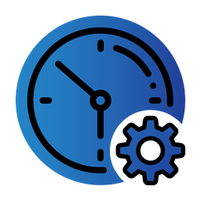

# ioBroker.time-tracker

Система учета рабочего времени для ioBroker. Сотрудники отмечают время прихода и ухода, адаптер рассчитывает целевое время и баланс, ведется учет отсутствий и отпусков, а ежемесячная выписка загружается в формате PDF или Excel. Все работает в браузере — приложение можно установить на телефон — а общий планшет в мастерской или на входе позволяет отмечать время с помощью бейджа или PIN-кода. Все данные остаются на вашем собственном сервере ioBroker: никакого облака, никакой подписки.

## Функции

- **Отмечайте время прихода и ухода** в веб-приложении (телефон, планшет, ПК); приложение можно установить как PWA, и оно сохраняет данные о времени прихода и ухода даже в автономном режиме.
- **Терминал для всех** : бейдж (RFID/NFC) или PIN-код на общем планшете, а также табло, показывающее, кто находится на работе.
- **Рабочее время** : целевое время, исходя из количества рабочих часов в неделю, уровня занятости и количества рабочих дней; перерывы (отмечаются в отметке или по ступенчатой системе), модели оплаты сверхурочных, перенос неиспользованных часов, отпуск и государственные праздники.
- **Отсутствия и отпуска** : запросы и утверждения, неполные дни, предварительный просмотр уже запланированных дней — и путь назад: сотрудник самостоятельно отзывает открытый запрос, просит отменить утвержденное отсутствие, а администрация изменяет, удаляет или отклоняет его.
- **Внесение изменений** администрацией (изменение, удаление, добавление отметки времени или целого дня) — каждое изменение имеет свою причину, и история отметок времени остается доступной для чтения; администрация открывает день прямо в месячном представлении сотрудника.
- **Ежедневные записи** : сотрудник не меняет свое рабочее время самостоятельно — он оставляет записку для администрации («забыл отметить время прихода или ухода»), которую офис регистрирует и отмечает как выполненную.
- **Ежемесячные отчеты** в форматах PDF и Excel, как для личного счета, так и — при наличии права доступа — для каждого сотрудника; статистика и данные о выплатах включены.
- **Роли** : администратор, менеджер, сотрудник; каждое решение проверяется на сервере.
- **Автоматизация** : агрегированные данные, события в реальном времени и команды в виде состояний ioBroker.
- **Резервное копирование** : создание, загрузка, выгрузка, восстановление при следующем запуске, удаление — с указанием периода хранения.
- **11 языков** ; каждый сотрудник выбирает свой собственный.

## Требования

- ioBroker с js-controller >= 6.0.11 и **Node.js >= 22** (требуется встроенным драйвером SQLite)
- Для работы приложения на телефоне (сервис-воркеру это необходимо) рекомендуется использовать HTTPS — рекомендуется обратный прокси-сервер с Let's Encrypt.
- Поддерживается **компактный режим** : экземпляр может совместно использовать процесс с другими адаптерами (компактной группой). `1` или выше). Работа с базой данных синхронная, поэтому на слабом хосте (например, Raspberry Pi) или при большом количестве сотрудников выберите компактную группу. `0` В настройках экземпляра адаптер, как и прежде, запускается в собственном процессе.

## Установка

1. Установите адаптер в административной панели ioBroker: **Адаптеры** → отфильтровать по _time-tracker_ → установить. На компьютере без административной панели тот же пакет можно установить из реестра. `iobroker install iobroker.time-tracker`. **Пример `time-tracker.0` создается автоматически** —`iobroker add time-tracker` Это необходимо только в том случае, если вы хотите использовать экземпляр в автономном режиме.
2. Запустите экземпляр и откройте веб-приложение на порту, указанном в настройках экземпляра (по умолчанию **8092** ): `http://<ioBroker host>:8092/`. Плитка экземпляра в административной панели отображается так же, как и символ (см. [ссылку в списке экземпляров](#the-link-in-the-instance-list) ), поэтому хост и порт вводить не нужно.
3. Войдите в систему, используя пароль для входа (см. [раздел «Первый запуск](#first-start) »), и создайте учетную запись своих сотрудников.

### Ссылка в списке экземпляров

Адаптер самостоятельно передает данные в веб-интерфейс. `common.localLinks`), и администратор отображает из него символ: плитку `time-tracker.0` В **разделе «Экземпляры»** предлагается _открыть приложение для отслеживания времени_ , страница обзора делает то же самое — одним щелчком появляется экран входа в систему, без необходимости вводить хост и порт.

Адрес **не** записывается в адаптер; администратор формирует его из настроек экземпляра — адрес привязки указывает хост, порт — порт. При использовании настроек по умолчанию `127.0.0.1` Ссылка ведет непосредственно к серверу ioBroker (именно там приложение отвечает), и `0.0.0.0` Она использует адрес, с которого вы связались с администратором, поэтому телефон и компьютер используют одну и ту же ссылку. Правило обратного прокси для `time-tracker.0` Заменяет ссылку собственным путем.

## Первый старт

При первом запуске создается база данных, роли и настройки, а также **одна учетная запись администратора** , поскольку иначе никто не сможет войти в систему:

| Настройка экземпляра                    | Значение                                                                                     |
| --------------------------------------- | -------------------------------------------------------------------------------------------- |
| Вход первого администратора             | вход в эту учетную запись, по умолчанию `admin`                                               |
| Начальный пароль первого администратора | пароль этой учетной записи; пусто = случайный пароль записывается в журнал адаптера один раз |

Учетная запись начинается с команды «изменить пароль», поэтому начальный пароль открывает доступ ровно один раз, и приложение сразу же запрашивает новый пароль. Учетные записи, созданные позже в административной панели, запускаются аналогичным образом.

**В журнале ioBroker пароль для запуска появляется один раз** : open `Logs` В административной панели найдите эту строку. `administrator "admin" created with the start password "…" - change it at the first login` В настройках экземпляра отображается та же подсказка — введите там свой пароль, и ничего искать не придётся.

**Ввод пароля позже также работает.** Пока учетная запись сохраняет свой неизмененный пароль запуска (принудительная смена пароля так и не была завершена), адаптер применяет настроенный пароль запуска при **каждом** запуске. Таким образом, значение, заполненное после первого запуска — или после восстановления базы данных — работает сразу. При каждом запуске в журнале указывается, какой из этих четырех случаев имеет место:

- `administrator "admin" created with the start password "Zf-…" - change it at the first login` — Администратор отсутствовал, и поле было пустым; это сгенерированный пароль.
- `administrator "admin" created with the configured start password - it has to be changed at the first login` — Администратор отсутствовал, использовались значения настроек экземпляра.
- `administrator "admin" exists already and still has its start password - it was set from the instance settings now`— Учетная запись существовала, и настроенный пароль запуска взял на себя управление (запись в журнале аудита выглядит следующим образом): `start password from the instance settings`).
- `the configured start password is not used: administrator "admin" changed his password already` — Если учетная запись сменила пароль в приложении, эта настройка больше не действует: очистите поле (пароль относится к странице профиля этой учетной записи) или восстановите базу данных, в которой по-прежнему хранится начальный пароль.

После этого обычно последовательность действий следующая: создание сотрудников ( **Администрирование → Сотрудники** ), установка их рабочего времени (кнопка **«Профиль сотрудника»** в строке: уровень занятости, количество рабочих часов в неделю, рабочие дни, модель сверхурочной работы, отпуск, перенос остатка, оплачиваемые минуты перерыва, собственные правила перерывов) и — если используется планшет — создание терминала и включение киоска (см. [Терминал](#terminal-kiosk) ).

## Конфигурация

Адаптер настраивается в **параметрах экземпляра** в административной панели ioBroker:

| Параметр                                                       | Значение                                                                                                                                                  |
| -------------------------------------------------------------- | --------------------------------------------------------------------------------------------------------------------------------------------------------- |
| Порт                                                           | порт HTTP-сервера (веб-приложение, API, терминал)                                                                                                         |
| Адрес привязки                                                 | Интерфейс для прослушивания, выбираемый из локальных адресов (`0.0.0.0` = все)                                                                            |
| Часовой пояс экземпляра                                        | резервный часовой пояс (название IANA), например `Europe/Berlin`                                                                                           |
| Язык по умолчанию для новых пользователей                      | один из 11 поддерживаемых языков                                                                                                                          |
| Страна отдыха                                                  | Страна, используемая для генерации государственных праздников (по умолчанию) `DE`)                                                                        |
| Файл базы данных                                               | необязательный путь; пусто = каталог данных адаптера                                                                                                      |
| Включить киоск-терминал                                        | включает общий терминал для ввода PIN-кода/пропуска                                                                                                       |
| Используйте HTTPS                                              | Адаптер отвечает по протоколу HTTPS; затем выберите открытый сертификат, закрытый ключ и, если он у вас есть, цепочку из коллекции сертификатов ioBroker. |
| Доверьтесь обратному прокси-серверу                            | использовать `X-Forwarded-*` прокси-сервера (адрес клиента, HTTPS)                                                                                         |
| Секретная сессия                                               | Секрет для токенов CSRF (шифруется в состоянии покоя; пусто = генерируется один раз)                                                                      |
| Секретный ключ для привязки значка (HMAC)                      | секретный ключ для подписанных бейджей/NFC-меток (зашифрован в состоянии покоя); пусто = генерируется при первом запуске и хранится рядом с базой данных. |
| Время жизни сессии в минутах                                   | Сколько времени длится вход в систему?                                                                                                                    |
| Дни, когда офлайн-очередь принимает заказы самостоятельно.     | Насколько далеко в начало очереди принимаются отметки о прохождении офлайн-прохождения без решения администрации                                          |
| Сведите быстрые удары к минутам.                               | округление быстрого пробойника (0 = выключено)                                                                                                            |
| Учитывайте количество отсутствий только до сегодняшнего дня.   | Будущие отсутствия не сокращают целевой период.                                                                                                           |
| Вычтите рабочее время из отсутствий.                           | Пусть отпуск перерастет в сверхурочную работу.                                                                                                            |
| Храните резервные копии базы данных в течение нескольких дней. | сохранение резервных копий                                                                                                                                |

Эти настройки имеют приоритет над значениями, хранящимися в базе данных, и применяются при каждом запуске.

### Настройки внутри приложения

Дополнительные настройки редактируются в веб-приложении ( **Администрирование → Настройки** , справа). `settings.edit`):

| Параметр                                            | Значение                                                                                                                                                                                                                                                                  |
| --------------------------------------------------- | ------------------------------------------------------------------------------------------------------------------------------------------------------------------------------------------------------------------------------------------------------------------------- |
| Правило паузы (`auto` /`punched` /`staffel`)       | Как определяется перерыв в течение дня: отметка о перерыве (`auto` (по умолчанию) или только ступенчатые правила                                                                                                                                                          |
| Правила постепенного прерывания (Pausenstaffel)     | «С … по … минут, продолжительность блока → столько минут вычтено»; пауза в течение дня **без** отмеченного перерыва. Рабочий профиль сотрудника может содержать **собственные правила** : правило с тем же «с минут» заменяет правило компании только для этого человека. |
| Оплачиваемые минуты перерыва (на одного сотрудника) | Какова сумма оплачиваемого перерыва: `0` = не оплачено, `15` = четверть часа, `1440` = любая длина (профиль работы)                                                                                                                                                          |
| Фирменный стиль компании                            | Логотип, фоновое изображение и цвет фона для экрана входа в систему, заголовка и экранов киоска — цвет также определяет оттенок изображения.                                                                                                                              |
| Шрифт Unicode для PDF-документов                    | `report_font_path` необходимо для `ru`, `uk`, `zh-cn` и поляков, в противном случае экспорт будет отклонен с четким сигналом.                                                                                                                                              |

Пауза в один день отображается в месячном режиме приложения и в ежемесячной выписке — рядом с ней указывается оплаченная часть.

## Роли

| Роль       | Может                                                                                                                                             |
| ---------- | ------------------------------------------------------------------------------------------------------------------------------------------------- |
| `employee` | отметка времени, просмотр месяца и года, запрос на отсутствие, оставление записки для администрации в течение одного дня.                         |
| `manager`  | Всё, что может делать сотрудник, включая отметку времени прихода и ухода, составление отчетов и внесение исправлений в работу других сотрудников. |
| `admin`    | Всё, кроме отметки времени прихода и ухода: сотрудники, роли, терминалы, настройки, резервные копии.                                              |

Учетная запись **администратора** создается при установке и никому не принадлежит: она управляет сотрудниками, а не работает с ними, поэтому не регистрирует время прихода и ухода (у этой роли нет учетной записи администратора). `time.punch` Тот, кто также работает, получает свою долю обратно через... `employee` Роль — разрешения представляют собой объединение ролей учетной записи. `manager` Пробивает и исправляет ошибки.

**Всегда остается один активный администратор:** деактивация или удаление `admin` Роль, не принадлежащая _последнему_ активному администратору, отклонена (проблема) `last_administrator`, 409) — без этой роли никто больше не сможет администрировать установку, и единственным выходом будет перезапуск экземпляра со свободным доступом. `adminLogin` Веб-приложение сообщает об этом перед внесением изменений: переключение **собственной** учетной записи объясняет, почему учетная запись не может быть деактивирована самостоятельно. `PATCH` и `DELETE /users/:id` (отказаться от этого и на сервере), а в диалоговом окне выбора роли указывается имя последнего администратора, и сохранение остается заблокированным, в то время как роль уже будет удалена.

**Окно редактирования** (`edit_window_days` (по умолчанию 7 дней) определяет, насколько далеко назад в **офлайн-очереди** может быть самостоятельно сдан отметка времени: более старая отметка времени из очереди поступает как конфликтная. `too_old` и отсчет начинается после того, как администрация его утвердит. От настроек больше ничего не зависит — сотрудник никак не меняет свое рабочее время, и администрация не связана никакими временными рамками.

### Время, исправления и примечания

Отметка о прохождении теста — это то, что делает сотрудник. `POST /punch` (быстрая отметка времени, офлайн-очередь). Отметка времени, сделанная **от руки** , является исправлением административной записи (`time.edit_other`) и имеет обоснование в журнале аудита — месячный обзор сотрудника предоставляет именно это: карандаш рядом с днем добавляет забытую отметку, исправляет время или удаляет его. `time.delete`).

Сотрудник, заметивший забытую отметку о времени, **не** меняет время: он открывает день в режиме просмотра месяца и оставляет **записку** для офиса. `PUT /api/day-notes` собственные дни с `time.edit_own` Администрация просматривает запись в строке дня и в день работы сотрудника, регистрирует день и отмечает запись как **обработанную** . `POST /api/day-notes/handled`) — это останется видимым для протокола.

## Веб-приложение, терминал и API

Все данные передаются через порт настроек экземпляра:

| Путь                       | Содержание                                                                                                                 |
| -------------------------- | -------------------------------------------------------------------------------------------------------------------------- |
| `/` (и все остальные пути) | веб-приложение от `www/` — экран ввода данных, отчет за месяц, год, отсутствия, профиль                                     |
| `/api/...`                 | REST API (JSON; ошибки, как указано выше) `application/problem+json`)                                                      |
| `/api/stream`              | Благодаря возможности просмотра событий в режиме реального времени, приложение обновляется автоматически без перезагрузки. |
| `/terminal/<token>/`       | Экран киоска (бейдж и PIN-код)                                                                                             |
| `/presence/<token>/`       | совет директоров, «который сейчас находится за работой»                                                                    |

На доске отображается информация о состоянии дел каждого сотрудника за день. Рядом с ней указано **отработанное за сегодня время** . `1:23`, `0:00` (до первой отметки времени в течение дня) как только это позволяет **рабочий профиль** сотрудника ( _рабочее время на карточке присутствия_ , по умолчанию отключено): доска отображается до ввода PIN-кода, поэтому администрация решает это для каждого сотрудника отдельно — API отправляет минуты только для тех сотрудников, которые дали на это согласие.

### Терминал (киоск)

Включите функцию **«Включить киоск-терминал»** , затем создайте устройство в **разделе «Администрирование» → «Терминалы»** и скопируйте токен устройства — он отображается **только один раз** , поскольку хранится только его хеш. Рядом с ним находится готовый адрес планшета:

```
http://<ioBroker host>:<port>/terminal/<device token>/
```

Токен находится в пути, поэтому планшет сохраняет его при добавлении страницы на главный экран (iOS сохраняет начальный адрес установленного приложения без запроса). Более старые ссылки имеют вид `/terminal?token=…` и `/presence?token=…` Они по-прежнему работают: адаптер отправляет их на новый адрес.

На экране отображается поле для ввода данных с бейджа (сканирование или ввод, ввод отметок времени), список сотрудников с именем и PIN-кодом, часы и — после каждой отметки времени — имя, адрес и данные за день в течение нескольких секунд. Доступ к устройству можно ограничить только для сотрудников, работающих в данном месте; без назначения отображаются все сотрудники. Для переключения между режимами «бейдж и PIN-код» и «только бейдж» **сотрудникам необходим PIN-код** . Токен остается в браузере планшета, поэтому URL-адрес требуется только для первого запуска.

## Штаты

Данные о проставлении отметок остаются в базе данных; адаптер публикует сводные данные и элементы управления:

| Состояние                                                                                   | Тип        | Цель                                                                    |
| ------------------------------------------------------------------------------------------- | ---------- | ----------------------------------------------------------------------- |
| `time-tracker.0.info.connection`                                                            | логический | адаптер/готов к обслуживанию                                            |
| `time-tracker.0.info.lastBackup`                                                            | число      | момент создания самой новой резервной копии базы данных                 |
| `time-tracker.0.info.lastRemoteBackup`                                                      | нить       | файл последней копии на внешнем сервере                                 |
| `time-tracker.0.info.remoteBackupError`                                                     | нить       | Ошибка при последней копии на внешнем сервере (пусто = ок)              |
| `time-tracker.0.info.version` /`info.schemaVersion` /`info.dbSizeBytes` /`info.lastError`   | —          | информация об экземпляре                                                |
| `time-tracker.0.users.<id>.displayName`                                                     | нить       | имя сотрудника                                                          |
| `time-tracker.0.users.<id>.hasOpenEntry`                                                    | логический | сотрудник отметился на рабочем месте                                    |
| `time-tracker.0.users.<id>.lastPunch`                                                       | число      | мгновение последнего удара сегодняшнего дня                             |
| `time-tracker.0.users.<id>.todayWorkedMinutes`                                              | число      | минут отработано сегодня                                                |
| `time-tracker.0.users.<id>.todayBalanceMinutes`                                             | число      | Остаток на сегодня в минутах                                            |
| `time-tracker.0.users.<id>.openConflicts`                                                   | число      | удары в ожидании решения                                                |
| `time-tracker.0.commands.punchUserId`                                                       | число      | к сотруднику применяются команды по отметке времени (`0` (единственный) |
| `time-tracker.0.commands.punch`                                                             | логический | кнопка для ввода или вывода                                             |
| `time-tracker.0.commands.quickPunch`                                                        | логический | пробойник с настроенным быстрым закруглением                            |
| `time-tracker.0.commands.closeMonth`                                                        | нить       | закрыть месяц, значение `YYYY-MM`                                       |
| `time-tracker.0.commands.recalc`                                                            | нить       | пересчитать период, `YYYY-MM` или `YYYY`                                 |
| `time-tracker.0.commands.backup`                                                            | логический | Создать резервную копию базы данных (кнопка)                            |
| `time-tracker.0.users.<id>.monthWorkedMinutes` /`monthBalanceMinutes` /`yearBalanceMinutes` | число      | месячные и годовые показатели                                           |
| `time-tracker.0.company.presentCount`                                                       | число      | сотрудники, отметившие время начала работы прямо сейчас                 |
| `time-tracker.0.company.present`                                                            | нить       | их имена, разделенные запятой                                           |
| `time-tracker.0.company.openConflicts` /`company.lastPunch`                                 | число      | удары в ожидании решения, последний удар                                |
| `time-tracker.0.events.lastAt` /`lastType` /`lastUser` /`lastDirection` /`lastSource`       | —          | последнее событие экземпляра                                            |
| `time-tracker.0.calendar.feedFile`                                                          | нить       | тот `.ics` **путь** к файлу (для `ical`)                                 |
| `time-tracker.0.calendar.feedUrl`                                                           | нить       | ссылка для подписки на корпоративный календарь                          |
| `time-tracker.0.calendar.absences`                                                          | нить       | Отсутствие окна в формате JSON                                          |
| `time-tracker.0.calendar.updatedAt`                                                         | число      | когда был составлен календарь                                           |

### Команды (состояния)

Скрипт, блок Blockly, панель управления или другой адаптер управляет состоянием экземпляра — без HTTP-запросов и авторизации. Адаптер записывает такие действия в журнал аудита как _системные_ (`actorId: 0`) и в кратком описании говорится о том, что произошло.

| Состояние                      | Ценить                                                  | Эффект                                                                               |
| ------------------------------ | ------------------------------------------------------- | ------------------------------------------------------------------------------------ |
| `commands.punchUserId`         | идентификационный номер сотрудника, `0` = автоматический | сотруднику, к которому применяются две кнопки для отметки времени.                   |
| `commands.punch`               | `true`                                                  | Удары внутрь или наружу — направление определяется ударами дня.                      |
| `commands.quickPunch`          | `true`                                                  | То же самое, но мгновение округляется _быстрыми ударами в течение нескольких минут._ |
| `commands.closeMonth`          | `YYYY-MM`                                               | Завершает месяц (в лог-строке отражен баланс и сверхурочные работы).                 |
| `commands.recalc`              | `YYYY-MM` или `YYYY`                                     | пересчитывает совокупные показатели за этот период                                   |
| `commands.backup`              | `true`                                                  | записывает резервную копию базы данных                                               |
| `commands.rotateCalendarToken` | `true`                                                  | создает или обновляет ссылку на календарь компании.                                  |

```js
setState("time-tracker.0.commands.punchUserId", 3); // target employee (0 = the only one)
setState("time-tracker.0.commands.punch", true); // punch in or out
setState("time-tracker.0.commands.quickPunch", true); // punch with quick rounding
setState("time-tracker.0.commands.recalc", "2026-08"); // a month, or "2026" for a year
setState("time-tracker.0.commands.closeMonth", "2026-08"); // closing needs YYYY-MM
setState("time-tracker.0.commands.backup", true); // write a backup now
```

Две вещи, которые нужно знать:

- **Кнопки не имеют состояния:** только `true` запускает их (все остальные значения игнорируются), а адаптер возвращает их обратно в исходное состояние. `false` немедленно — поэтому никогда не пишите `false` чтобы «отметить о завершении работы», используйте `punch` А направление движения пусть определяет адаптер.
- **Какой сотрудник?** Команды учета рабочего времени используют имя сотрудника, указанное в учетной записи. `commands.punchUserId` Адаптер при каждом обновлении отображает текущий выбор обратно в это состояние, и `0` Это означает «единственный сотрудник». При наличии нескольких сотрудников и отсутствии выбора, командование вместо того, чтобы гадать, отказывает — в журнале затем появляется запись: `several employees exist - set command_punch_user_id or write users.<id> commands`.

На каждого сотрудника, без каких-либо целевых показателей: написать `users.<id>.present` (`true` = отметка времени, `false` = завершение синхронизации, идемпотентный — см. _Первый запуск_ ) или отправить сообщение (см. _Сообщения (`sendTo`)_ ниже).

Каждая команда завершается обновлением дерева состояний. `users.*`, `company.*`, `events.*`), поэтому панель мониторинга отслеживает ситуацию. Неправильный период, неизвестный или деактивированный сотрудник сопровождаются предупреждением в журнале адаптера — никогда не с сообщением о неисправном экземпляре.

### Календарь для ioBroker (лента и состояния)

Отсутствие данных по всей компании попадает в ioBroker двумя путями — файл без сессии и без токена, ссылка с токеном экземпляра:

| Что        | Где                                                                                                                                     | Кто им пользуется?                                                               |
| ---------- | --------------------------------------------------------------------------------------------------------------------------------------- | -------------------------------------------------------------------------------- |
| **Файл**   | `<iobroker-data>/files/time-tracker.<n>/storage/calendar.ics` Переписывается при каждом изменении и каждые 5 минут.                     | тот `ical` Адаптер в виде **локального файла** — без URL, без токена, без сети.   |
| **URL**    | `calendar.feedUrl` (`http://<host>:<port>/api/calendar.ics?token=…`)                                                                   | приложение-календарь или скрипт, который передает ссылку `ical.0.iCalReadTrigger` |
| **Данные** | `calendar.absences` — в те же дни, что и JSON (`login`, `name`, `from`, `to`, `code`, `type`, `portion`, `approval`, `status`, `note`) | скрипты, Blockly, VIS                                                            |
| **Когда**  | `calendar.updatedAt`                                                                                                                    | чтобы проверить, насколько актуальны три вышеупомянутых пункта.                  |

Файл находится ниже. `files/time-tracker.<n>/storage/`, потому что папка экземпляра, расположенная рядом, может быть прочитана только самим адаптером. `storage` **точка монтирования** : объект типа `meta` Файл зависает, и идентификатор, который API файла ioBroker записывает ниже, становится известен только через этот объект. Файловый менеджер знает о папке — само пространство имен экземпляра не является точкой монтирования, и запись ниже него отклоняется (фон находится в ячейке D11). Объект создается при каждом запуске, поэтому папка отображается с первого запуска, еще до записи первого календаря. `ical` адаптер указывает на **путь** от `calendar.feedFile` Файловый менеджер административного интерфейса (`Objects` →`files`) показывает папку `time-tracker.<n>` с `storage` внутри и загружает файл — это подтверждается на реальной установке (тест-драйв **T28** в[`docs/en/test-plan.md`](/#/docs/adapterref/iobroker.time-tracker/docs/en/test-plan.md) , сдал с результатом 0.7.12).

Файловый сервер `web` Этот экземпляр также предоставляет доступ к файлу — ниже **точки монтирования** ссылка работает. `http://<host>:8081/files/time-tracker.0/storage/calendar.ics` Проверено на реальной установке: загрузка предоставляет `VCALENDAR` файл). Предыдущий путь без `storage` (`…/files/time-tracker/calendar.ics`) отвечает пустым архивом и, следовательно, не обращается к этому файлу. Таким образом, браузер, календарное приложение или скрипт используют либо `calendar.feedUrl` (ссылка с токеном экземпляра) или ссылка на файловый сервер выше — фон находится в ячейке D11.[`docs/en/decisions.md`](/#/docs/adapterref/iobroker.time-tracker/docs/en/decisions.md) .

Период действия предложения — с прошлого года до конца следующего. Ссылка на **компанию** появилась только после того, как кто-то попросил об этом: напишите. `true` к `commands.rotateCalendarToken` Первый вызов создает токен, каждый последующий заменяет его — старая ссылка сразу перестает работать. Эта ссылка открывает информацию об отсутствии **всех** сотрудников, поэтому относитесь к ней как к паролю. Персональная ссылка сотрудника остается неизменной. `POST /calendar/token` (В приложении есть кнопка для этого), и отображается только этот сотрудник.

```js
setState("time-tracker.0.commands.rotateCalendarToken", true); // create or renew the link of the company
log(getState("time-tracker.0.calendar.feedUrl").val); // paste it into a calendar app
setState("ical.0.iCalReadTrigger", "read " + getState("time-tracker.0.calendar.feedUrl").val);
```

`calendar.absences` Это JSON, поэтому любой скрипт может его прочитать — список полей приведен в таблице выше. T21 в[`docs/en/test-plan.md`](/#/docs/adapterref/iobroker.time-tracker/docs/en/test-plan.md) содержит небольшой фрагмент, в котором регистрируются пропуски тренировок.

### Действия (правила запуска)

В ioBroker подключение оборудования осуществляется через состояние: сканер отпечатков пальцев, кнопка, дверной контакт или панель управления записывают его, а адаптер делает все остальное. Правило поддерживается в **разделе «Администрирование» → «Действия»** :

| Поле                    | Значение                                                                                                                                                                                                     |
| ----------------------- | ------------------------------------------------------------------------------------------------------------------------------------------------------------------------------------------------------------ |
| Состояние               | состояние другого адаптера, например `fingerprint.0.lastMatch.name`                                                                                                                                           |
| Курок                   | _Состояние (State) содержит значение_ : значение должно равняться _Value_ — или _Value — это сотрудник_ , где значение обозначает сотрудника (идентификатор, логин или отображаемое имя).                    |
| Ценить                  | Значение, запускающее правило ( _состояние режима содержит это значение_ ) —`toggle` (или `*`) срабатывает при **каждом** изменении, поэтому переключатель, который включается и выключается, тоже подойдет. |
| Сотрудник               | Кто получил удар ( _состояние режима передает значение_ )                                                                                                                                                    |
| Действие                | Ввод или вывод текста, ввод текста с быстрым округлением, отображение текущего состояния, отображение отсутствующего состояния                                                                               |
| Остывать                | секунды, которые должны пройти до того, как правило может сработать снова.                                                                                                                                   |
| Огонь при каждой записи | Правило также срабатывает, когда значение остается тем **же** , что и раньше. По умолчанию включено для _значения "Сотрудник"_ , выключено для фиксированного значения.                                      |
| Ценность → сотрудник    | (В режиме _значение указывает на сотрудника_ ), к которому относится значение; пусто = само значение указывает на сотрудника.                                                                                |

По умолчанию правило срабатывает только при **изменении значения** , поэтому панель мониторинга, которая обновляет состояние самостоятельно, безвредна, а таймер ожидания контролирует быстро мигающее состояние. Для считывателя, сообщающего **о том, кто** к нему прикасался, требуется другое поведение: он снова записывает то же имя, когда тот же человек сканирует снова, и это новая отметка — поэтому _срабатывание при каждой записи_ включено по умолчанию для _значения, которое является сотрудником_ (таймер ожидания и защита от дубликатов в 30 секунд остаются в силе). Каждая отметка отображается в журнале аудита с примечанием. `trigger.<id>` Таким образом, его происхождение остается отслеживаемым.

**С `fingerprint` адаптер.** Используйте состояние. `fingerprint.0.lastMatch.name` В режиме _значением \`mode\` указывается сотрудник_ , а в качестве имени зарегистрированного пользователя может использоваться **отображаемое имя или логин** сотрудника. `lastMatch.id` Это _слот_ пальца (1–200), а не идентификатор сотрудника: берите его только вместе со **значением карты** (слот 3 → Анна). Значение, отсутствующее в карте, ничего не активирует. `lastMatch.matched` пребывание `true` для каждого матча, поэтому это не соответствует правилу, которое срабатывает при изменении — при _срабатывании при каждом изменении_ это бы сработало, но не указано, кто это был.

**Обратная связь с читателем.** Адаптер не взаимодействует с устройством, но каждый пробитый символ линейки отображается сразу же. `time-tracker.0.events.*`: `lastUser` (ВОЗ), `lastDirection` (`in` или `out`), `lastSource` (`trigger.<id>`) и `lastAt` Небольшой скрипт может отобразить это на экране считывателя, дисплее или динамике – например. `on({ id: 'time-tracker.0.events.lastAt', change: 'any' }, () => sendTo('telegram.0', getState('time-tracker.0.events.lastUser').val + ' ' + getState('time-tracker.0.events.lastDirection').val))` Сканирование, которое не завершилось успешно (период ожидания, защита от дублирования в течение 30 секунд, сотрудник без записи на карте), оставляет запись в журнале на уровне `debug` и ничего в `events.*`.

Адаптер запоминает в памяти только последнее значение отслеживаемого состояния. После перезапуска первая запись запускает правило, которое срабатывает при изменении, даже если значение осталось тем же, что и до перезапуска; правило, срабатывающее при каждой записи, остается неизменным.

### Правила (автоматические)

Адаптер также может работать автономно — соответствующая таблица находится в **разделе «Администрирование» → «Настройки»** .

| Добрый                           | Что это делает                                                                                                                                                                                               |
| -------------------------------- | ------------------------------------------------------------------------------------------------------------------------------------------------------------------------------------------------------------ |
| Автоматический выход из системы  | В установленное местное время сотрудника рабочий день закрывается отметкой времени (примечание). `auto.clockOut`)                                                                                            |
| Сообщить о пропавшем перфораторе | Тот же самый момент, но ничего не записано — в отчете лишь сообщается о нем.                                                                                                                                 |
| Напоминание о перерыве           | Напоминает сотруднику, чей рабочий блок достиг заданной длины.                                                                                                                                               |
| Срок действия                    | Необязательные поля «действительно с» и «действительно до» в качестве дат: правило не действует за их пределами, оба конца относятся к периоду, пустое поле означает «с настоящего момента» или «без конца». |

Каждое правило выполняется **не более одного раза для каждого сотрудника и локальной даты** ; `automation_runs` Этот файл содержит информацию о принятом решении и одновременно служит журналом таблицы — каждая строка указывает на свой **последний запуск** , поэтому правило, которое перестало работать, отображается с первого взгляда. Таблица сохраняется **целиком** , о чем говорится в подсказке рядом с кнопкой «Сохранить правила»: редактирование правила изменяет список, запись в него производит только кнопка. **Срок действия** сравнивается с местным календарным днем сотрудника, как и дни недели, поэтому замена праздника может завершиться сама собой. События `automation.clockOut`, `automation.missingPunch` и `automation.breakReminder` появляются в `events.*` Также, чтобы адаптер уведомлений мог их распознать.

### Сообщения (`sendTo`)

Для управления экземпляром без использования HTTP используется скрипт, блок Blockly или другой адаптер.

```js
sendTo("time-tracker.0", "punch", { user: "anna", quick: true }, answer => log(answer.message));
sendTo("time-tracker.0", "present", { user: 2, present: false });
sendTo("time-tracker.0", "status", { user: "anna" }, answer => log(JSON.stringify(answer.data)));
sendTo("time-tracker.0", "report", { user: "anna", period: "2026-09", format: "pdf" }, answer =>
	writeFile("statement.pdf", Buffer.from(answer.data.base64, "base64")),
);
sendTo("time-tracker.0", "backup");
```

`user` Это идентификатор пользователя, логин или отображаемое имя. `report` Ответы содержат имя файла, MIME-тип и сам файл в формате base64 (PDF или Excel), что позволяет отправлять их по электронной почте или через мессенджер.

## Отчеты

В месячном и годовом отчетах приложения представлены выписки за соответствующий период в форматах **PDF** и **Excel** . `.xlsx`) — с расписанием рабочего дня, данными за месяц, информацией об отсутствии и двумя строками для подписи в формате PDF. Файл генерируется на языке и в часовом поясе сотрудника; администрация может выбрать другого сотрудника и загрузить для него аналогичную выписку.

Рядом с двумя кнопками находится третья: **исходные данные в формате CSV** . Она содержит одну строку на каждое нажатие (`date`, `time`, `direction`, `source`, `note`), разделенные точкой с запятой и в кодировке UTF-8 с меткой порядка байтов — поэтому электронная таблица открывает его напрямую, а программа для расчета заработной платы может прочитать его без запроса. Заголовок на английском языке намеренно, поскольку файл предназначен для машинного чтения.

Для `ru`, `uk`, `zh-cn` Для польской версии PDF-файла необходим шрифт Unicode: установите `report_font_path` в настройках приложения для `.ttf` /`.otf` Файл, содержащий скрипт. Без него экспорт останавливается с понятным сообщением (`report_font_missing`) вместо того, чтобы рисовать пустые квадраты.

## Резервные копии

**Администрирование → Резервное копирование** создает копию базы данных одним щелчком мыши и отображает список существующих файлов:

| Действие       | Что происходит                                                                            |
| -------------- | ----------------------------------------------------------------------------------------- |
| Создать сейчас | пишет копию (`VACUUM INTO`) в папку резервного копирования                               |
| Скачать        | передает файл браузеру                                                                    |
| Загрузить      | Принимает загруженный файл обратно, проверяет его и ставит в очередь на следующий запуск. |
| Восстановить   | ставит один из перечисленных файлов в очередь на следующий запуск (с указанием причины).  |
| Удалить        | Удаляет один файл после подтверждения.                                                    |

Для восстановления требуется закрытая база данных, поэтому она применяется **во время запуска адаптера** — приложение сообщает об этом, и предыдущая база данных сохраняется рядом с ней. `<database>.before-restore-<time>` Резервные копии, созданные после истечения срока хранения настроек экземпляра, удаляются автоматически; самая новая копия всегда сохраняется.

### Копирование на внешний сервер (SFTP)

Резервная копия, расположенная рядом с базой данных, теряется вместе с хостом. Поэтому вкладка **«Миграция и резервное копирование»** настроек экземпляра может скопировать **каждую** резервную копию на другой компьютер (например, Synology NAS) по протоколу SFTP — без монтирования и без резервного копирования. `sudo` нужный:

| Параметр                                             | Значение                                                                                                                                                                                                 |
| ---------------------------------------------------- | -------------------------------------------------------------------------------------------------------------------------------------------------------------------------------------------------------- |
| Копирование резервных копий на внешний сервер (SFTP) | включает копирование                                                                                                                                                                                     |
| Адрес сервера / SSH-порт                             | сервер, порт 22 по умолчанию                                                                                                                                                                             |
| Имя пользователя / пароль                            | Учетная запись на сервере (пароль хранится в зашифрованном виде); используйте пользователя, который может только записывать данные в целевой каталог.                                                    |
| Каталог на сервере                                   | создано при отсутствии, например `/backups/time-tracker`                                                                                                                                                  |
| Отпечаток сервера                                    | `SHA256:…` Ключ хоста — рекомендуется скопировать его из ответа на запрос **проверки соединения** или из журнала после первого резервного копирования; пустое значение означает, что сервер не проверен. |
| Копии для хранения на сервере.                       | Самые старые экземпляры, помимо указанного номера, удаляются. `0` = сохранить все                                                                                                                         |

Копирование выполняется после каждого резервного копирования, независимо от способа его создания (приложение, `commands.backup`, `sendTo` (ежедневное расписание). Файл загружается под временным именем, проверяется его размер, и только после этого он переименовывается, поэтому файл, находящийся в процессе загрузки, никогда не будет выглядеть как резервная копия. Только файлы, названные как резервная копия этого адаптера (`time-tracker-<time>.sqlite`) всегда удаляются с сервера, а остатки прерванной загрузки (`….sqlite.part` Всё остальное в каталоге остаётся неизменным. Неудачное копирование никогда не влияет на локальную резервную копию: оно регистрируется в журнале, заносится в журнал аудита и отображается в `info.remoteBackupError`; последний исправный экземпляр находится в `info.lastRemoteBackup` **Проверка соединения** проверяет значения формы без их сохранения (пустое поле пароля использует сохраненный пароль, но только для того же сервера, пользователя и порта) и отображает отпечаток пальца для ввода.

## HTTPS и обратный прокси

Для работы приложения на телефоне требуется **HTTPS** — сервис-воркер работает только на защищенном сервере. Есть два способа.

**HTTPS в самом адаптере.** В настройках экземпляра включите параметр **«Использовать HTTPS»** и выберите открытый сертификат, закрытый ключ и, если он у вас есть, цепочку сертификатов. Сертификаты берутся из коллекции сертификатов ioBroker ( **Администрирование > Настройки > Сертификаты** ; соответствующие записи). `defaultPublic` /`defaultPrivate` Это самоподписанная пара, которую ioBroker создает сам (сертификат Let's Encrypt работает аналогично). Затем приложение отвечает по адресу `https://<host>:<port>/` сессионный cookie — это `Secure` и ссылка в списке экземпляров и ссылка календаря переключаются на `https` Они работают самостоятельно. Если сертификат отсутствует или не может быть прочитан, веб-интерфейс **не** переключается на обычный HTTP: он остается недоступным, и в журнале указывается причина. Самоподписанный сертификат вызывает предупреждение браузера один раз; телефон устанавливает приложение только тогда, когда доверяет сертификату (установите сертификат на телефоне или используйте сертификат реального центра сертификации). Изменение настройки перезапускает экземпляр.

**Перед адаптером должен быть установлен обратный прокси-сервер.** Установите nginx или caddy перед адаптером и включите параметр **«Доверять обратному прокси»** : после этого адаптер будет получать адрес клиента из... `x-forwarded-for` для лимитов скорости и журнала аудита, и `x-forwarded-proto: https` создает сессионный cookie `Secure` Без этого параметра оба заголовка игнорируются, поскольку любой клиент может их отправить.

## Поиск неисправностей

| Проблема                                         | Причина и устранение                                                                                                              |
| ------------------------------------------------ | --------------------------------------------------------------------------------------------------------------------------------- |
| `/` ответы `404 not_found`                        | Веб-приложение отсутствует: переустановите адаптер — пакет содержит встроенное веб-приложение. `www/`                              |
| Не устанавливается как приложение на телефон.    | Страница недоступна по протоколу HTTPS — см. выше.                                                                                |
| PDF-файл отклоняется или отображает пустые поля. | `report_font_path` отсутствует — см. [Отчеты](#reports)                                                                           |
| Восстановление, похоже, ничего не даёт.          | Это применяется при следующем запуске: перезапуске экземпляра.                                                                    |
| Сотрудник не может войти в систему.              | Пароль для запуска необходимо изменить при первом использовании; администратор может установить новый пароль.                     |
| Отсутствует пуансон.                             | Оно может находиться в очереди в автономном режиме или быть помечено как конфликтное (см. _раздел «Синхронизация»_ в приложении). |

## Языки

Административный интерфейс, приложение и отчеты доступны на **11 языках** . `en` (базовый и резервный варианты), `de`, `ru`, `pt`, `nl`, `fr`, `it`, `es`, `pl`, `uk`, `zh-cn` — и каждый сотрудник выбирает сам. Даты, числа и единицы измерения форматируются следующим образом: `Intl` Дальнейшие переводы приветствуются:[`docs/en/i18n.md`](/#/docs/adapterref/iobroker.time-tracker/docs/en/i18n.md) .

## Заголовки безопасности

Веб-приложение поставляется в комплекте с `Content-Security-Policy` (Только собственные скрипты, без встроенных скриптов, без встраивания в фреймы других страниц), `X-Frame-Options: DENY`, `Referrer-Policy: no-referrer`, `X-Content-Type-Options: nosniff` и а `Permissions-Policy` Без камеры, микрофона и определения местоположения. При **использовании HTTPS** адаптер также отправляет данные. `Strict-Transport-Security` (полгода, только для этого хоста); за обратным прокси-сервером, который выполняет TLS, именно прокси-сервер отправляет протокол. Прямая трансляция приложения отклоняет рукопожатие браузера от страницы другого хоста (`Origin`).

## Конфиденциальность

Всё работает на вашем собственном хосте ioBroker: никаких облачных сервисов, никакой телеметрии. Данные о посещениях и личные данные хранятся в локальном файле SQLite, доступ осуществляется на основе ролей, и каждое исправление записывается в журнал аудита.

## Отказ от ответственности

**Отказ от ответственности.** Данное программное обеспечение предоставляется бесплатно и «как есть», без каких-либо гарантий и без заверений в пригодности для конкретной цели. Оно не является юридической, налоговой или трудовой консультацией и не является официально утвержденной или сертифицированной системой учета рабочего времени. В той мере, в которой это разрешено законом, ответственность исключается; ответственность за умышленное причинение вреда и грубую неосторожность, за причинение вреда жизни, здоровью или телесным повреждениям, а также в соответствии с обязательным законодательством остается неизменной. Вы несете ответственность за:

- для проверки правильности зарегистрированного времени, отсутствий, остатков и отчетов, а также для сверки результатов (например, с вашей ведомостью заработной платы или с вашим отделом расчета заработной платы).
- соблюдение применимых к вам правил (например, рабочее время и трудовое законодательство, права производственного совета, информирование и согласие сотрудников, сроки хранения данных, GDPR).
- Регулярное резервное копирование – в том числе вне адаптера – и проверка возможности их восстановления.

Немецкая версия данного уведомления находится в[`docs/de/haftungsausschluss.md`](https://github.com/sadam6752-tech/ioBroker.time-tracker/blob/main/docs/de/haftungsausschluss.md) .

Одно и то же краткое уведомление отображается на странице входа в систему и в профиле веб-приложения на всех 11 языках.

## Документация

Документация на английском языке.[`docs/en/`](https://github.com/sadam6752-tech/ioBroker.time-tracker/blob/main/docs/en/) Оригиналы на немецком языке находятся в[`docs/de/`](https://github.com/sadam6752-tech/ioBroker.time-tracker/blob/main/docs/de/) .

| Документ                                                                                            | Содержание                                                                                                     |
| --------------------------------------------------------------------------------------------------- | -------------------------------------------------------------------------------------------------------------- |
| [`docs/en/getting-started.md`](/#/docs/adapterref/iobroker.time-tracker/docs/en/getting-started.md) | пошаговое руководство по первоначальной настройке                                                              |
| [`docs/en/test-plan.md`](/#/docs/adapterref/iobroker.time-tracker/docs/en/test-plan.md)             | Приемочные испытания и что еще осталось открытым                                                               |
| [`docs/en/decisions.md`](/#/docs/adapterref/iobroker.time-tracker/docs/en/decisions.md)             | решения, лежащие в основе дизайна                                                                              |
| [`docs/en/technical.md`](/#/docs/adapterref/iobroker.time-tracker/docs/en/technical.md)             | Внутреннее устройство: HTTP-интерфейс, сессии, события в реальном времени, база данных.                        |
| [`docs/en/development.md`](/#/docs/adapterref/iobroker.time-tracker/docs/en/development.md)         | сборка, тестирование, релиз                                                                                    |
| [`docs/en/i18n.md`](/#/docs/adapterref/iobroker.time-tracker/docs/en/i18n.md)                       | как обеспечивается полнота 11 языков                                                                           |
| [`docs/en/adapter-check.md`](/#/docs/adapterref/iobroker.time-tracker/docs/en/adapter-check.md)     | локальная предварительная проверка правил адаптера ioBroker                                                    |
| [`CONTRIBUTING.md`](/#/docs/adapterref/iobroker.time-tracker/CONTRIBUTING.md)                       | Правила внесения вклада (чистое помещение) и процедура выпуска.                                                |
| [`docs/de/`](https://github.com/sadam6752-tech/ioBroker.time-tracker/blob/main/docs/de/)            | Немецкие оригиналы вышеуказанных документов, немецкое резюме и немецкое заявление об отказе от ответственности |

## Ссылки

- Репозиторий: <https://github.com/sadam6752-tech/ioBroker.time-tracker>
- Проблемы: <https://github.com/sadam6752-tech/ioBroker.time-tracker/issues>
- Форум ioBroker: <https://forum.iobroker.net/>

## Происхождение

Этот проект представляет собой независимую реализацию отслеживания времени, описанного во внутренней спецификации. Поведение, правила вычислений и форматы данных соответствуют этой спецификации; **исходный код не** был заимствован из других проектов. Записи о проверке хранятся вне этого репозитория.

## Changelog

### **WORK IN PROGRESS**

### 0.8.2 (2026-11-20)

- (Alex) change: the adapter supports the **compact mode** (`common.compact: true`, decision D2); compact group `0`
  keeps it in a process of its own.
- (Alex) chore: `@iobroker/testing` 6.3.2, the changelog links to `CHANGELOG_OLD.md` (repository checker).

### 0.8.1 (2026-11-14)

- (Alex) fix: the address of the kiosk terminal and of the presence board carries the device token in its path
  (`/terminal/<token>/`, `/presence/<token>/`). iOS saves a page to the home screen without its query, so a tablet
  started from the home screen came up without its token; the app with its manifest now lives below the path of the
  token. Older links with `?token=` are sent to the new address.

### 0.8.0 (2026-10-18)

- (Alex) chore: the request bodies of the REST API are checked with zod (D22); the messages are worded as before, and
  every invalid field of a request is now listed in `errors[]`.

### 0.7.27 (2026-10-18)

- (Alex) fix: the names of the holiday countries in the instance settings are translated (note of the review).
- (Alex) chore: the REST API and its tests are split into one module per area (`src/lib/web/routes/`); the routes,
  their order and their behaviour are unchanged.

### 0.7.26 (2026-10-13)

- (Alex) fix: the instance receives `sendTo` messages (`common.messagebox` was missing): **Test connection**
  of the external backup answers, and the messages for scripts (`punch`, …) reach the adapter.
- (Alex) docs: the help of the field _Server fingerprint_ says what to do: copy the fingerprint from the answer of
  **Test connection** or from the log after the first backup.

Older changes are listed in CHANGELOG_OLD.md.

## License

MIT License

Copyright (c) 2026 Alex <sadam6752@gmail.com>

Permission is hereby granted, free of charge, to any person obtaining a copy
of this software and associated documentation files (the "Software"), to deal
in the Software without restriction, including without limitation the rights
to use, copy, modify, merge, publish, distribute, sublicense, and/or sell
copies of the Software, and to permit persons to whom the Software is
furnished to do so, subject to the following conditions:

The above copyright notice and this permission notice shall be included in all
copies or substantial portions of the Software.

THE SOFTWARE IS PROVIDED "AS IS", WITHOUT WARRANTY OF ANY KIND, EXPRESS OR
IMPLIED, INCLUDING BUT NOT LIMITED TO THE WARRANTIES OF MERCHANTABILITY,
FITNESS FOR A PARTICULAR PURPOSE AND NONINFRINGEMENT. IN NO EVENT SHALL THE
AUTHORS OR COPYRIGHT HOLDERS BE LIABLE FOR ANY CLAIM, DAMAGES OR OTHER
LIABILITY, WHETHER IN AN ACTION OF CONTRACT, TORT OR OTHERWISE, ARISING FROM,
OUT OF OR IN CONNECTION WITH THE SOFTWARE OR THE USE OR OTHER DEALINGS IN THE
SOFTWARE.