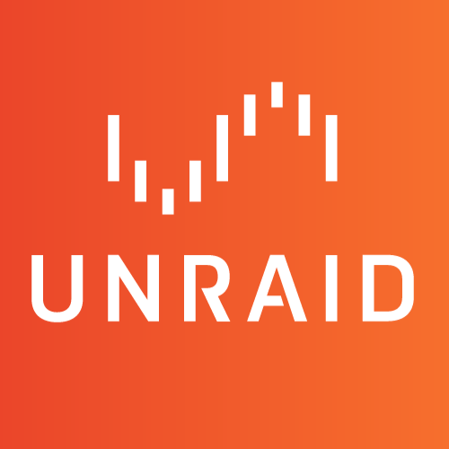
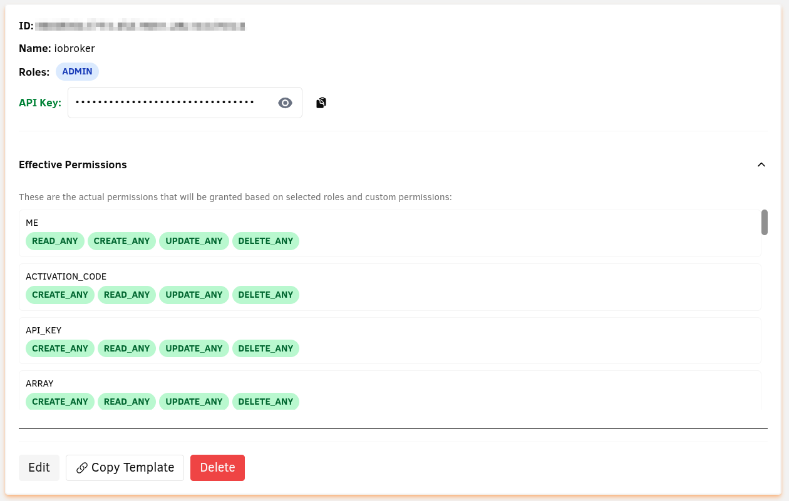
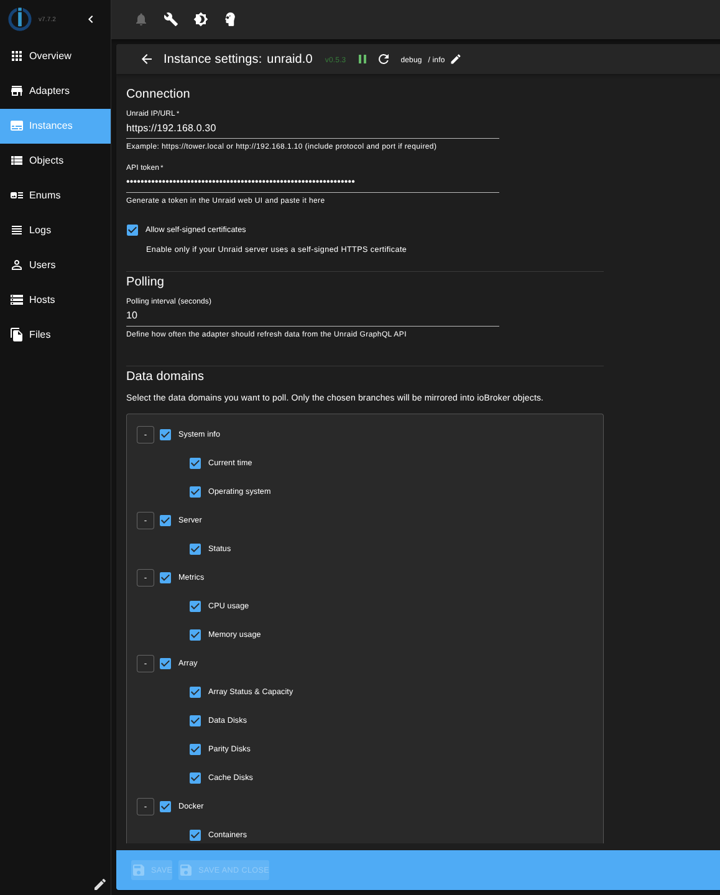
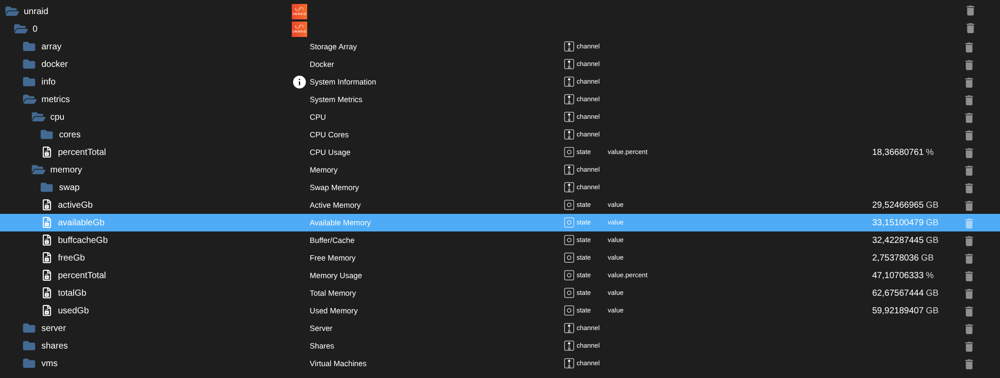
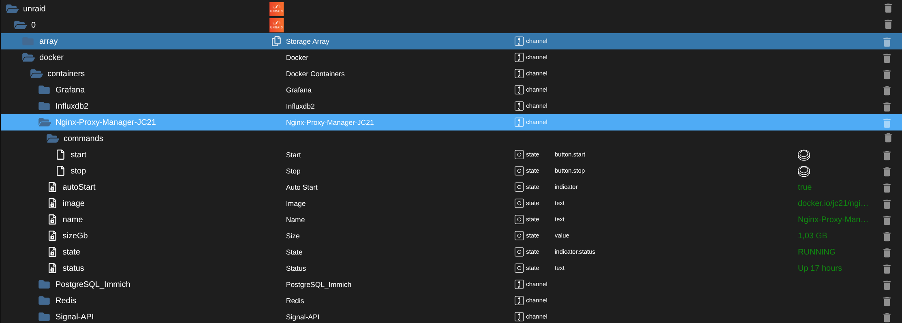
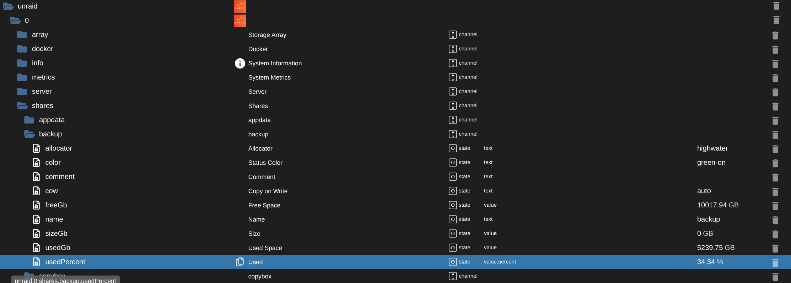

# ioBroker.unraid

> **⚠️ Разработка продолжается** : Данный адаптер находится в стадии активной разработки. В будущих релизах планируется добавить дополнительные данные и функции.

## Адаптер Unraid для ioBroker

Этот адаптер подключает ioBroker к серверам Unraid через API GraphQL для мониторинга системных метрик и состояния.

## Функции

- Отслеживание использования ЦП и памяти (включая статистику по каждому ядру).
- Отслеживание показаний датчиков температуры материнской платы (чипсет, температура окружающей среды и т. д.) — требуется Unraid 7.2+
- Отслеживание состояния сервера и сетевой информации.
- Мониторинг и управление контейнерами Docker (запуск/остановка/перезапуск/пауза/возобновление/обновление, обновление всех) — для паузы/возобновления/обновления требуется Unraid 7.2+
- Обнаружение обновлений Docker для каждого контейнера и в сводном виде — требуется Unraid 7.2+
- Просмотр состояния дисков массива (данные, контрольная сумма, кэш) с информацией о их работоспособности.
- Проведите проверку четности (статус, ход выполнения, ошибки).
- Подсчет непрочитанных уведомлений Unraid (оповещений, предупреждений, информации) — например, для пересылки их на ваш телефон.
- Мониторинг сетевых ресурсов (использование, конфигурация, сведения о файловой системе)
- Мониторинг и управление виртуальными машинами (запуск/остановка/пауза/возобновление/перезагрузка).
- Настраиваемый интервал опроса

## Конфигурация

### Генерация API-токена в Unraid

#### Для версий Unraid до 7.2:

1. Установите **плагин "Unraid Connect"** из магазина приложений Unraid Community.
2. После установки перейдите в: **Настройки → Управление доступом → Ключи API**

#### Для Unraid 7.2 и более поздних версий:

- Функциональность API встроена, перейдите непосредственно по пути: **Настройки → Управление доступом → Ключи API**

#### Создание токена:

1. Нажмите **«Добавить ключ API».**

2. Настройте права доступа:

   - **Базовая роль** : выберите **«Просмотрщик»** (предоставляет доступ на чтение к информации о системе, метрикам, дискам и т. д.)
   - **Дополнительные разрешения** (необходимые для функций управления):
     - **Docker Manager** : позволяет запускать и останавливать контейнеры Docker.
     - **Диспетчер виртуальных машин** : позволяет запускать, останавливать и приостанавливать работу виртуальных машин.

   **Альтернативный способ быстрой настройки** : скопируйте эту строку шаблона и вставьте ее в поле **«Ключи API» → «Создать из шаблона»** :

   ```
   ?name=ioBroker+unraid+adapter+key&scopes=role%3Aviewer%2Cdocker%2Bvms%3Acreate_any%2Bdelete_any%2Bread_any%2Bupdate_any%2Carray%2Bdashboard%2Bdisk%2Binfo%2Blogs%2Bnetwork%3Aread_any
   ```

3. Присвойте токену описательное имя (например, "ioBroker")

4. Скопируйте сгенерированный токен (ключ API) — он понадобится вам для настройки адаптера.



### Настройки адаптера

1. **Базовый URL** : Введите адрес вашего сервера Unraid (например, `https://192.168.1.10` или `https://tower.local`)
2. **API-токен** : Вставьте сгенерированный вами в Unraid токен администратора.
3. **Интервал опроса** : установите частоту получения данных (по умолчанию: 60 секунд, минимум: 10 секунд).
4. **Самоподписанные сертификаты** : включите эту опцию, если ваш сервер Unraid использует самоподписанный HTTPS-сертификат.
5. **Области данных** : выберите категории данных для мониторинга (информация о системе, состояние сервера, метрики и т. д.).

### Интерфейс конфигурации



### Созданные объекты

Адаптер создает структурированное дерево объектов для отслеживаемых данных:

<br>

<br>



## Требования

- Сервер Unraid (рекомендуется версия 7.0.0+)
  - Для версий до 7.2: установите плагин "Unraid Connect" из раздела "Приложения сообщества".
  - Для версий 7.2 и выше: поддержка API встроена.
- API-токен с ролью "Просмотрщик" (плюс Docker/VM Manager для управления функциями)
- Сетевой доступ от ioBroker к серверу Unraid

## Changelog

<!--
  Placeholder for the next version (at the beginning of the line):
  ### **WORK IN PROGRESS**
-->
### 0.11.0 (2026-11-21)

- (Schimi1983) New: a restart button for every Docker container, plus a button to update all containers at once (`docker.commands.updateAll`)
- (Schimi1983) New data area "Parity check": status, progress, errors, speed, date and duration of the running or last parity check
- (Schimi1983) New data area "Unread notifications": number of unread Unraid alerts, warnings and information messages
- (Schimi1983) New state `info.os.bootTime`: when the server was started
- (ingel81) **Existing instances:** the two new data areas have to be ticked in the adapter settings; only new instances get them automatically
- (Schimi1983) New state `info.connection`: the instance now shows whether the Unraid server answers
- (Schimi1983) Detection of Unraid features works again on current Unraid versions; the warning at startup is gone
- (Schimi1983) Clear log messages for a wrong API key, an unreachable server or a timeout. Each problem is logged once, not on every poll
- (Schimi1983) The adapter no longer stalls when Unraid stops answering: requests are given up after 30 seconds and never pile up
- (Schimi1983) Noticeably less load on ioBroker: objects and values are only written when they actually change
- (ingel81) Security fixes in the network libraries (`undici`, `ws`)
- (ingel81) Now also tested with Node.js 26

### 0.10.0 (2026-08-21)

- (ingel81) Security fixes in the network libraries (`ws`, `undici`)
- (ingel81) **Node.js 22.19.0 or higher is required** — this has been the case since 0.8.0, the adapter just declared 22.0.0 by mistake
- (ingel81) Completed the settings translations for all languages (Ukrainian was mostly missing)
- (ingel81) Updated Apollo Client, graphql-ws and the ioBroker adapter core

### 0.9.0 (2026-05-03)

- (ingel81) New mainboard temperature sensors (chipset, ambient, ...) as an optional data domain
- (ingel81) New update indicator per Docker container plus a summary (`docker.updates.hasUpdates` / `availableCount`)
- (ingel81) New Pause, Resume and Update buttons for Docker containers
- (ingel81) Requires Unraid 7.2 or newer for the new features (tested on 7.2.4). Older Unraid versions keep working as before — new states are silently omitted and existing data is preserved.

### 0.8.0 (2026-04-19)

- (ingel81) **Node.js 22 or higher is now required** (Node 20 reached end-of-life on 2026-03-24)
- (ingel81) Requires ioBroker admin 7.6.20 or newer
- (ingel81) Updated runtime dependencies (graphql, undici, ws, @apollo/client)
- (ingel81) Internal: CI migrated to Node 22/24, dev dependencies refreshed

### 0.7.2 (2026-01-04)

- (ingel81) Updated dependencies and admin UI (React 19)

## License

MIT License

Copyright (c) 2025-2026 ingel81 <ingel81@sgeht.net>

Permission is hereby granted, free of charge, to any person obtaining a copy
of this software and associated documentation files (the "Software"), to deal
in the Software without restriction, including without limitation the rights
to use, copy, modify, merge, publish, distribute, sublicense, and/or sell
copies of the Software, and to permit persons to whom the Software is
furnished to do so, subject to the following conditions:

The above copyright notice and this permission notice shall be included in all
copies or substantial portions of the Software.

THE SOFTWARE IS PROVIDED "AS IS", WITHOUT WARRANTY OF ANY KIND, EXPRESS OR
IMPLIED, INCLUDING BUT NOT LIMITED TO THE WARRANTIES OF MERCHANTABILITY,
FITNESS FOR A PARTICULAR PURPOSE AND NONINFRINGEMENT. IN NO EVENT SHALL THE
AUTHORS OR COPYRIGHT HOLDERS BE LIABLE FOR ANY CLAIM, DAMAGES OR OTHER
LIABILITY, WHETHER IN AN ACTION OF CONTRACT, TORT OR OTHERWISE, ARISING FROM,
OUT OF OR IN CONNECTION WITH THE SOFTWARE OR THE USE OR OTHER DEALINGS IN THE
SOFTWARE.