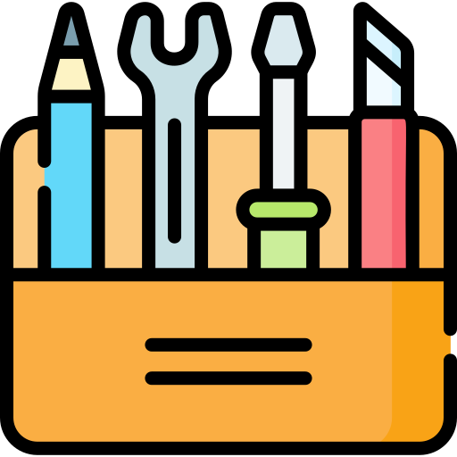

# Набор виджетов для ioBroker.vis 2.0

<h2 align="center">Widgets for ioBroker.vis 2.0</h2>

📖 **[Дополнительная документация на GitHub Wiki](https://github.com/Steiger04/ioBroker.vis-2-widgets-collection/wiki)**

## Виджеты

### Состояние

### ButtonGroup

### Ползунок

### Вход

### Выключатель

### Флажок

### Диалог

### Выбирать

### РадиоГруппа

### Измерять

### Свет

### JsonTable

### ECharts

---

## Примечания

### ИИ-помощник

Искусственный интеллект-помощник редактора vis-2 (и внешних клиентов MCP, таких как Claude Desktop) может создавать представления с виджетами коллекций и изменять их тему; присваивать имя набору. `vis-2-widgets-collection` по вашему запросу. Сама коллекция не содержит ИИ. Доступ, примеры подсказок, шаблоны и ограничения: [помощник ИИ в вики](https://github.com/Steiger04/ioBroker.vis-2-widgets-collection/wiki/En-AI-Assistant) ( [Deutsch](https://github.com/Steiger04/ioBroker.vis-2-widgets-collection/wiki/De-AI-Assistant) ).

### ECharts: значения из строк

Теперь графики с состояниями, представленными строковыми значениями, отображаются корректно: `'23.5'`, `'23.5 °C'`, `'23,5'` и `'true'` /`'false'` Все данные считываются как числа на одном и том же устройстве ввода, используемом всеми источниками значений (запись, серии JSON, столбцы таблиц, разделительные линии). Текст, не содержащий чисел, отображается как пробел, а не как имитированная нулевая строка. Одно замечание для ввода в немецком стиле: если строка содержит точку, она считывается как точечно-десятичный разделитель — разделитель тысяч, как в `'1.234,5'` Не будет поездки туда и обратно.

**Агрегация истории по строковым состояниям** : агрегаты на стороне сервера (`average`, `max` Возможно, строковые значения не сохраняются. До подтверждения работоспособности на реальном сервере настраивайте строковые OID с помощью... `none` или `onchange` агрегация, благодаря которой исходные строки попадают в диаграмму — система обработки данных считывает их оттуда.

---

## Changelog

### 3.3.1 (2026-11-17)

- (steiger04) Same content as 3.3.0, whose release build failed before it reached npm

### 3.3.0 (2026-11-17)

- (steiger04) Theme Studio: the new "Widget frame" section sets the frame of all widgets at once
- (steiger04) Attribute panel: frame settings show the value they inherit from the theme
- (steiger04) Existing widgets keep their frame settings and look unchanged
- (steiger04) The vis-2 AI assistant can set the widget frame of all widgets with the theme
- (steiger04) A widget without card no longer shows a shadow

### 3.2.0 (2026-11-15)

- (steiger04) Node.js 22 or newer is required
- (steiger04) Light: new light type `dimmer` for lamps that only dim (#22)

### 3.1.0 (2026-11-15)

- (steiger04) The vis-2 AI assistant can now build pages with these widgets
- (steiger04) The vis-2 AI assistant can now also change the theme if you name the set `vis-2-widgets-collection`
- (steiger04) Every widget shows a short tooltip in the palette
- (steiger04) Grid layout: widgets keep the height of their grid rows
- (steiger04) The theme now accepts only hex, `rgb()` and `hsl()` colors
- (steiger04) An open theme studio without unsaved changes now follows theme changes made elsewhere
- (steiger04) Many fixes across all widgets

### 3.0.2 (2026-11-11)

- (steiger04) Same content as 3.0.0; the release builds of 3.0.0 and 3.0.1 failed before they reached npm

## License

The MIT License (MIT)

Copyright (c) 2026 Steiger04 <steiger04@posteo.de>

Permission is hereby granted, free of charge, to any person obtaining a copy
of this software and associated documentation files (the "Software"), to deal
in the Software without restriction, including without limitation the rights
to use, copy, modify, merge, publish, distribute, sublicense, and/or sell
copies of the Software, and to permit persons to whom the Software is
furnished to do so, subject to the following conditions:

The above copyright notice and this permission notice shall be included in
all copies or substantial portions of the Software.

THE SOFTWARE IS PROVIDED "AS IS", WITHOUT WARRANTY OF ANY KIND, EXPRESS OR
IMPLIED, INCLUDING BUT NOT LIMITED TO THE WARRANTIES OF MERCHANTABILITY,
FITNESS FOR A PARTICULAR PURPOSE AND NONINFRINGEMENT. IN NO EVENT SHALL THE
AUTHORS OR COPYRIGHT HOLDERS BE LIABLE FOR ANY CLAIM, DAMAGES OR OTHER
LIABILITY, WHETHER IN AN ACTION OF CONTRACT, TORT OR OTHERWISE, ARISING FROM,
OUT OF OR IN CONNECTION WITH THE SOFTWARE OR THE USE OR OTHER DEALINGS IN
THE SOFTWARE.