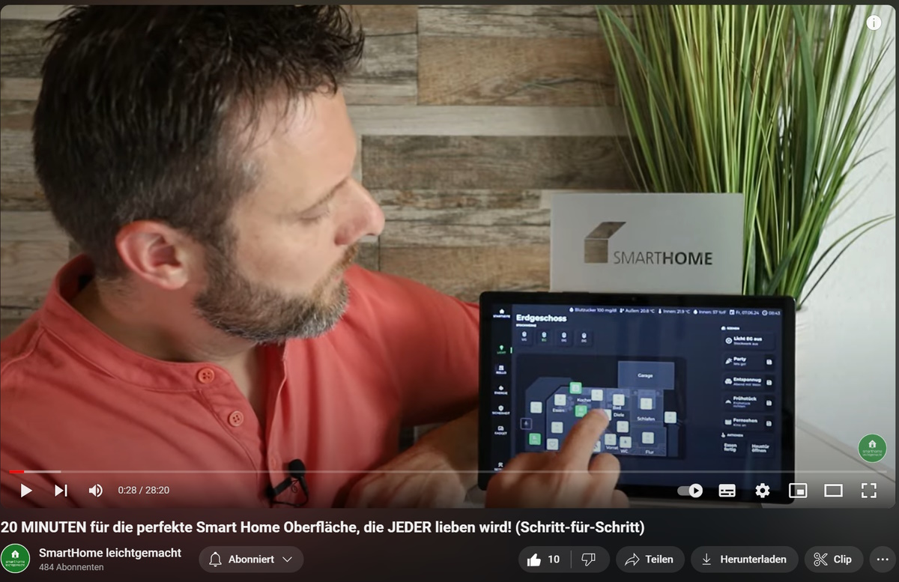
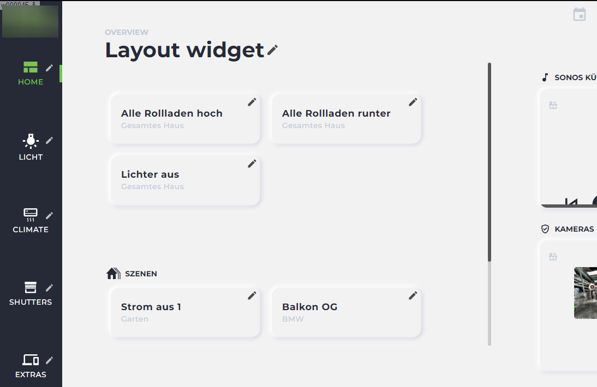
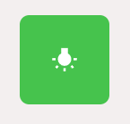
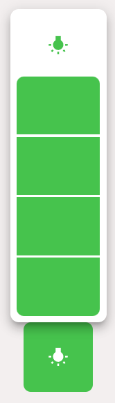
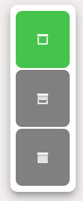
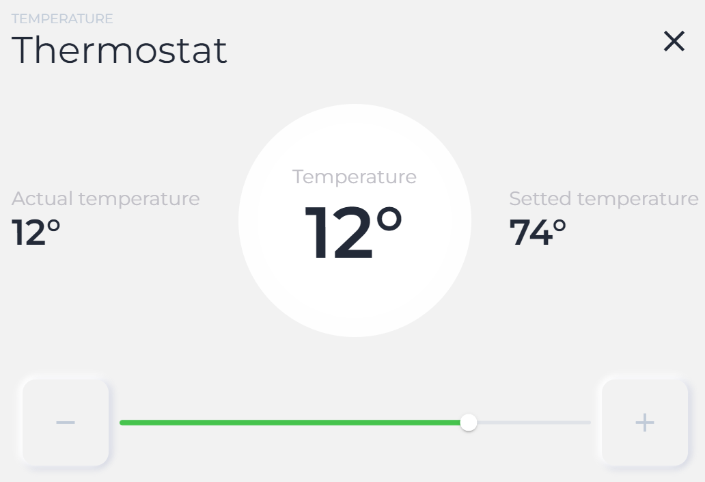
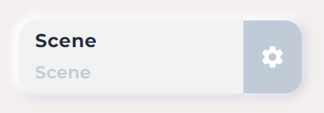
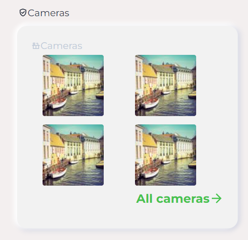
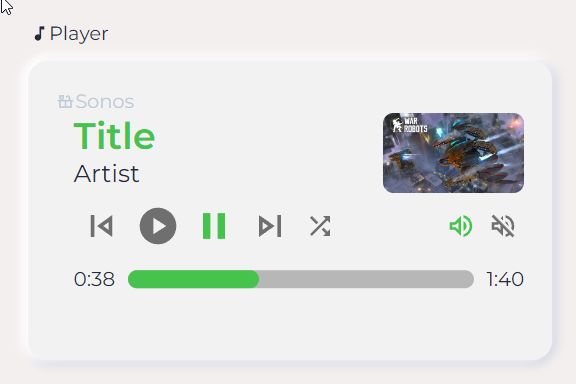

# Специальные виджеты Jaeger Design для ioBroker.vis 2.0

Видеоинструкции по использованию виджетов можно найти [здесь](https://www.youtube.com/playlist?list=PLddhldeLVrtl5Bhj6AAbkLabuIuyV0bVe) (на немецком языке).

Видео с виджетами benutzt werden können, kann man [hier](https://www.youtube.com/playlist?list=PLddhldeLVrtl5Bhj6AAbkLabuIuyV0bVe) finden.

Für deutsche Version вот [здесь](/#/docs/adapterref/iobroker.vis-2-widgets-jaeger-design/docs/README_de.md)

## Коммерческое использование

Обратите внимание, что бесплатной версии этого адаптера нет. Для использования этих виджетов необходимо приобрести лицензию (текущая цена: 50 евро, включая НДС).\
&#x20;Однако вы можете установить их и попробовать в редакторе совершенно бесплатно.

## Обзор процесса создания интерфейса «умного дома» с помощью адаптера дизайна «VIS-2 JAEGER».

### Требования

- Система ioBroker
- Адаптер JAEGER Design (примерно 50 евро)
- Базовые знания по использованию ioBroker.

### Введение

Адаптер JAEGER Design основан на адаптере vis-2 и позволяет создавать интерфейс с помощью перетаскивания элементов. Можно добавлять и настраивать различные виджеты для управления устройствами умного дома.

### Базовая структура интерфейса

Интерфейс состоит из нескольких областей:

- **Главное меню** : слева находится столбец с пунктами главного меню, который легко создать.
- **Строка состояния** : Вверху можно добавить различные важные индикаторы состояния.
- **Центральная область** : Здесь можно отображать сценарии, действия и уведомления. Правая часть свободно настраивается и может отображать такую информацию, как безопасность, погода, бытовая техника и энергопотребление.

### Освещение

В главном меню можно выбрать разные этажи. На плане первого этажа отображаются все светильники, представленные значками. Некоторые значки можно только включать или выключать, а другие регулируются по яркости. При нажатии и удержании значка открывается всплывающее окно с ползунком для регулировки яркости. Сценарии освещения, расположенные справа, легко доступны, а также можно сохранять настройки освещения:

### Жалюзи

В меню «Жалюзи» можно увидеть состояние затенения. Значки указывают положение жалюзи, а щелчок по значку открывает всплывающее окно для регулировки высоты и угла наклона ламелей.

### Энергия

В меню «Энергия» вы можете увидеть температуру в каждой комнате. Значки отображают фактическую и целевую температуру, а также состояние отопления и окон. При нажатии на значок открывается всплывающее окно, в котором можно изменить целевую температуру и управлять другими действиями, такими как кондиционирование воздуха или системы обогрева.

### Безопасность

В меню «Безопасность» можно просмотреть состояние окон. Открытые окна отображаются красным цветом.

### Дополнительные функции

Вы также можете создавать произвольно определяемые интерфейсы, например, отображение потребления на адаптере «потребление» или отображение данных Nightscout для диабетиков. В меню «Настройки» можно выполнить различные параметры.

### Видеоуроки на YouTube

Для получения подробных инструкций и дополнительной информации рекомендуется посмотреть видеоуроки на YouTube, ссылки на которые приведены ниже.

## Виджеты

Адаптер добавляет девять виджетов в палитру vis-2 в наборе **дизайна Jaeger** . При наведении курсора на виджет в палитре под его предварительным просмотром отображается краткое описание.

Все виджеты используют одну цветовую тему. Только виджет компоновки полностью использует эту тему; все остальные виджеты либо заимствуют цвета из него ( _Палитра → Из виджета_ ), либо определяют свои собственные. Встроено пять тем: `green`, `blue`, `green-dark`, `blue-dark` и `aurora` (ночной синий с мятным оттенком).

### Макет

Рамка, окружающая все остальное. Она отображает полный интерфейс: главное меню слева, строку состояния вверху, селектор этажей, домашнюю страницу со сценами и действиями, свободно настраиваемую правую колонку и — на телефоне или планшете — выдвижную панель с возможностью свайпа вместо колонки меню.

У него есть единственный атрибут, **«Настройки»** , который открывает редактор, в котором описан весь интерфейс: пункты меню, этажи и их виды, сцены, действия, информационные группы и цвета. Используйте ровно один виджет макета на каждый вид; по умолчанию он полностью заполняет вид.

### Состояние

Квадратная кнопка-значок для одного объекта — основного элемента планировки помещений. Нажатие переключает значение; при _нажатии «Записать конкретное значение»_ вместо этого записывается фиксированное значение, а _при нажатии «Указать, задано ли значение»_ кнопка подсвечивается, пока это значение активно.

- **Количество значений** — несколько значений, каждое со своим значком, цветом, цветом фона и всплывающей подсказкой.
- **Показать диалоговое окно управления** — вместо переключения открывается диалоговое окно со всеми значениями.
- **Управление отсутствует** — только дисплей, кнопку нажать нельзя.
- Прежде чем что-либо будет написано, **запросите подтверждение** , прислав свой собственный текст.
- Дополнительная подпись над или под значком.

### Диммер

Регулировка яркости для диммируемого освещения. Сам виджет отображает текущий уровень в виде вертикальной полосы; нажатие и удержание ( _длительность нажатия_ ) открывает всплывающее окно с ползунком, разделенным на заданное количество **секций** .

- **Кнопки памяти** — кнопки для установки фиксированных значений яркости, расположенные под ползунком, каждая со своим значком и текстом. Значение либо берется из объекта, либо записывается напрямую.
- **Идентификатор объекта для включения/выключения** и **значение для включения/выключения** для светильников, переключатель включения/выключения которых является отдельным объектом.
- При желании можно отобразить значение в виджете, повернуть значок и закрыть всплывающее окно после установки значения.

### Затвор

Аналогичный принцип применяется к рольставням и жалюзи. Значок показывает текущее положение, при этом задан значок рольставни, жалюзи или тени. **Идентификатор рольставни Shadow** добавляет второй объект для угла наклона ламелей, поэтому высота и положение ламелей задаются в одном всплывающем окне.

Поскольку приводы расходятся во мнениях относительно значения 0%, значение и отображение можно инвертировать независимо друг от друга — отдельно для высоты и для ламелей. Кнопки памяти сохраняют высоту и угол наклона ламелей вместе.

### Термостат

Целевая температура отображается в виде регулятора. В диалоговом окне рядом с целевым значением отображаются фактическая температура, влажность и положение клапана, а также предлагаются кнопки «минус»/«плюс» и ползунок. Можно настроить минимальное, максимальное значение, шаг и единицу измерения, а в качестве десятичного разделителя можно использовать запятую.

Ниже предусмотрено место для дополнительных **кнопок** — ускорение, отключение, кондиционирование воздуха, любые функции отопления. Каждая кнопка имеет свой объект, значение, значок, метку и стиль.

### Сцена

Широкая кнопка с заголовком и подзаголовком, запускающая сцену. `scenes` Адаптер или просто записывает значение. **Функция «Сохранить»** добавляет вторую кнопку справа (шестерёнка на картинке): она сохраняет текущее состояние всех элементов обратно в сцену.

Дополнительные параметры: нет активного состояния, запись `false` вместо `true` Запросите подтверждение, отправив собственное текстовое сообщение, и укажите время последнего изменения.

### Камеры

Карта памяти с сеткой изображений с камер. Каждая камера либо взята из... `cameras` адаптер или с бесплатного URL-адреса, который также может быть прочитан из объекта и имеет собственный интервал обновления.

_Функция «Разрешить полноэкранный режим» открывает один большой экран_ камеры с отдельным URL-адресом и интервалом обновления для полноэкранного изображения — таким образом, миниатюры остаются маленькими. Кнопка «Показать больше» ведет к другому виджету или другой странице.

### Актуальные новости

Карточка с RSS-лентой: изображение, заголовок и краткое описание для каждой записи, с возможностью прокрутки. URL-адрес ленты вводится напрямую или считывается из объекта, поэтому его можно изменить во время выполнения. Интервал обновления настраивается, а кнопка «Подробнее» ведет к виджету или странице.

### Игрок

Карточка медиаплеера: название, исполнитель, обложка, воспроизведение/пауза, предыдущий/следующий трек, перемешивание, отключение звука, ползунок громкости и полоса прошедшего/общего времени. Каждый элемент привязан к своему собственному объекту, поэтому виджет работает с любым адаптером плеера — Sonos, Squeezebox, Alexa и так далее. Элементы, объект которых оставлен пустым, не отображаются.

<!--
    Placeholder for the next version (at the beginning of the line):
    ### **WORK IN PROGRESS**
-->

## Changelog
### 1.5.9 (2026-11-11)
* (bluefox) Info entries can show a symbol in front of the name or instead of it

### 1.5.8 (2026-11-10)
* (bluefox) The background of a floor or page view now reaches to the end when the view is scrolled
* (bluefox) Scenes and actions with "No active state" are shown pressed for a moment after a click
* (bluefox) Redesigned the layout editor: grouped navigation, lists with search, drag & drop, duplicate and delete, fields in cards, theme previews, undo/redo (Ctrl+Z/Ctrl+Y) and animated icons
* (bluefox) Added the dark theme "Aurora" (night blue with mint)
* (bluefox) Dark themes: popovers of dimmer and shutter, the thermostat mode menu and the player sliders take the theme colors; a custom theme with a dark background is detected as dark

### 1.5.7 (2026-11-04)
* (bluefox) Copying a submenu gives its items new IDs, so the copied pages no longer take the settings (e.g., included or excluded scenes) of the original pages
* (bluefox) Menu items with the same ID are repaired when the layout settings are opened or imported from JSON

### 1.5.6 (2026-11-03)
* (bluefox) Scene widgets placed in a page no longer get a too big font and save button on mobile phones

### 1.5.5 (2026-11-03)
* (bluefox) Dimmer: the popup shows the value in percent on the bar (can be hidden in the widget settings)
* (bluefox) Pages with "Include scenes" or "Include actions" show only the scenes and actions of the current floor, the same as with "Exclude"
* (bluefox) Menu settings: "Include scenes/actions" offers only the items assigned to floors and shows which ones are visible on every floor
* (bluefox) Updated packages

Older changes can be found in CHANGELOG_OLD.md

## License
Copyright (c) 2022-2026 bluefox <dogafox@gmail.com>
All rights reserved.

This is a commercial adapter. Use requires a license, see https://www.iobroker.com/productoverview.
The full license text can be found in the [LICENSE](https://github.com/ioBroker/ioBroker.vis-2-widgets-jaeger-design/blob/master/LICENSE) file.