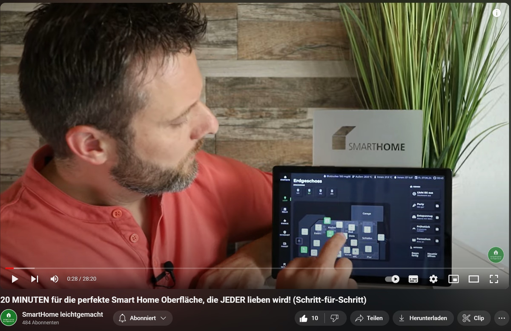
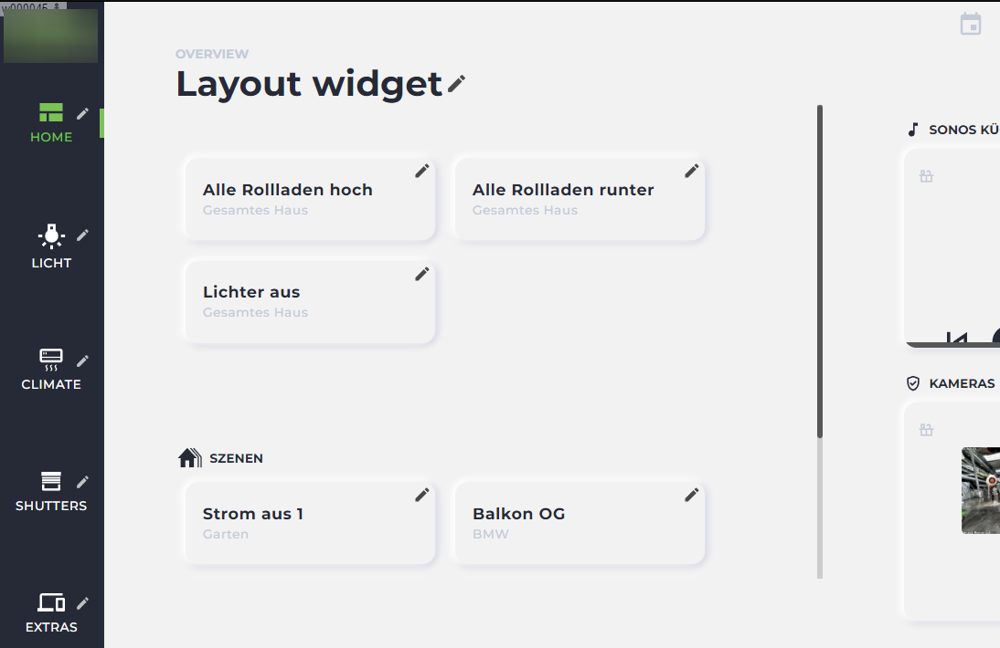
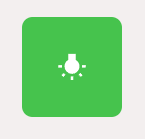
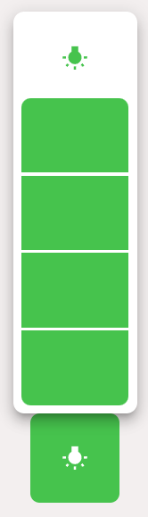
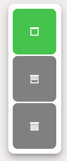
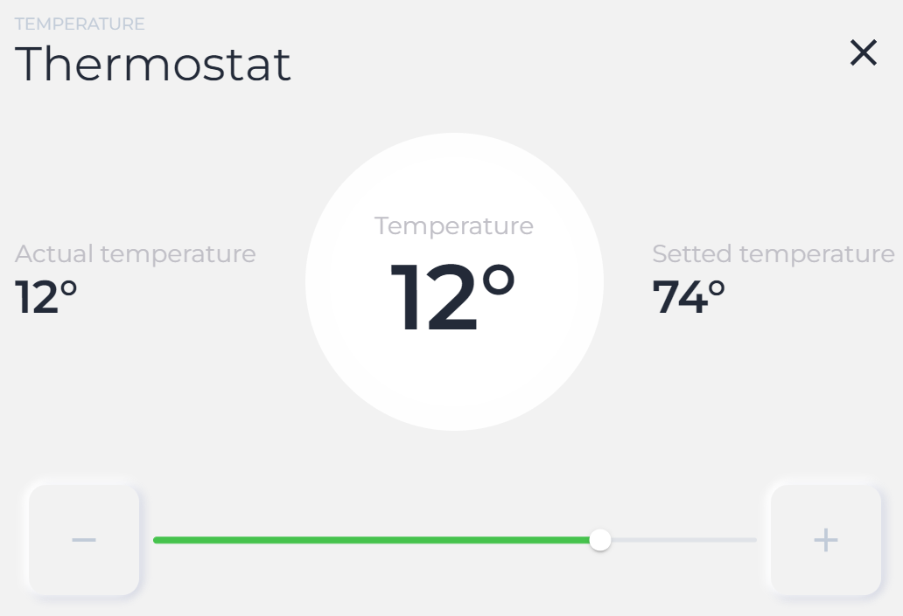
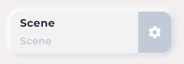
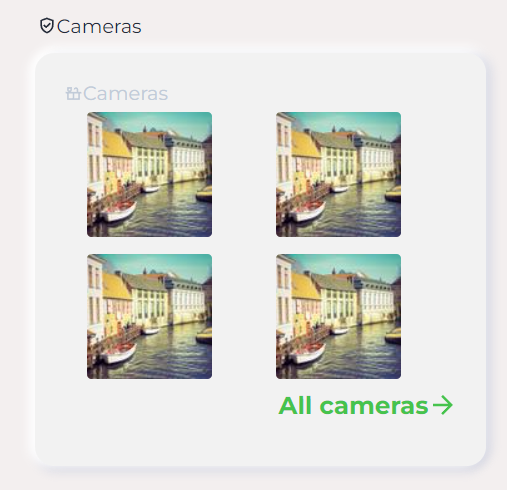
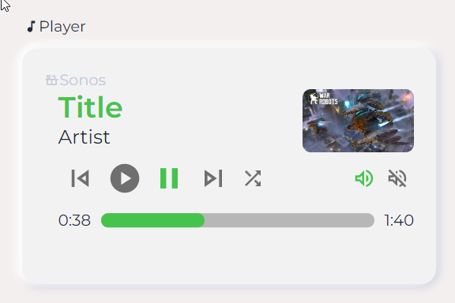

# Специальные виджеты Jaeger Design для ioBroker.vis 2.0

Видеоинструкции по использованию виджетов можно найти [здесь](https://www.youtube.com/playlist?list=PLddhldeLVrtl5Bhj6AAbkLabuIuyV0bVe) (на немецком языке).

Видео с виджетами benutzt werden können, kann man [hier](https://www.youtube.com/playlist?list=PLddhldeLVrtl5Bhj6AAbkLabuIuyV0bVe) finden.

## Kommerzielle Nutzung

Используйте этот переходник для более дорогой версии. Для настройки виджетов требуется дополнительная лицензия (действительная цена: 50 евро, включая MwSt.). Установка и тестирование в редакторе могут оказаться очень полезными.

## Übersicht zur Erstellung einer Smart Home Oberfläche mit dem "VIS-2 JAEGER Design Adaptor"

### Voraussetzungen

- Система Ein ioBroker
- Адаптер Der Jäger Design (около 50 евро)
- Grundkenntnisse im Umgang mit ioBroker

### Введение

Адаптер Jäger Design лежит в основе адаптера vis-2 и является удобным для использования, если вы хотите установить его с помощью щелчка и падения. Дополнительные виджеты можно использовать и использовать для создания умного дома.

### Grundaufbau der Oberfläche

Die Oberfläche besteht aus mehreren Bereichen:

- **Главное меню** : Ссылки находятся в том месте, где находится главное меню, и вы можете видеть, как это происходит.
- **Statusleiste** : Oben können verschiedene wichtige Statusanzeigen hinzugefügt werden.
- **Mittlerer Bereich** : Hier können Szenen, Aktionen und Hinweise angezeigt werden. Die rechte Seite - это свободный гештальтбар и канн Informationen wie Sicherheit, Wetter, Hausgeräte und Energieverbrauch anzeigen.

### Белеухтунг

Im Hauptmenü können verschiedene Stockwerke ausgewählt werden. Der Grundriss des Erdgeschosses zeigt alle Lichter, die durch Icons dargestellt werden. Некоторые значки могут отображаться только в том случае, если они используются, где и когда они затемнены. Нажмите на значок, чтобы открыть всплывающее окно с слайдером для отображения значка. Beleuchtungsszenen auf der rechten Seite können einfach abgerufen und auch Lichteinstellungen Gespeichert werden:

### Ролллен

В меню «Rollladen» можно включить функцию Beschattung gesehen werden. Значки отображаются в высоком разрешении и при нажатии на значок открываются всплывающие окна для изменения высоты и рамок.

### Энергия

В меню «Энергия» указана температура окружающей среды. Значки Zeigen die Ist- und Solltemperaturen sowie den Zustand der Heizung und Fenster an. Нажмите на значок, чтобы открыть всплывающее окно для изменения температуры и настройки температуры, чтобы активировать климатические условия или теплые условия.

### Безопасность

В меню «Sicherheit» можно нажать кнопку «Зустанд дер Фенстер». Geöffnete Fenster werden rot dargestellt.

### Дополнительные функции

Es können auch frei definierte Oberflächen erstellt werden, wie zB die Verbrauchsdarstellung des Adapters "consumer" or die Darstellung von Nightscout for Diabetes. В меню «Настройки» можно увидеть различные варианты выбора.

### Видеоуроки на YouTube

Для получения подробной информации и получения дополнительной информации см. ссылки на обучающие материалы YouTube.

## Die Widgets

Адаптер стал новым виджетом в двухцветной палитре в **дизайне Satz Jaeger** . Когда человек в дер Palette über ein Widget fährt, seht unter der der Vorschau eine kurze Beschreibung.

Все виджеты доступны в Farbschema. Nur das Layout-Widget перейдет к желаемой схеме; jedes andere Widget übernimmt die Farben entweder von ihm ( _Палитра → Vom Widget_ ) или legt eigene fest. Любимые темы и их особенности: `green`, `blue`, `green-dark`, `blue-dark` унд `aurora` (Nachtblau mit Mint).

### Макет

Der Rahmen um alles andere. Это полное описание: ссылки главного меню, статусный документ, этагенаусваль, стартовая страница с показаниями и действиями, свободный доступ к разделу и — на Handy или Tablet — eine wschbare Schublade statt der Menuspalte.

Это ваши собственные атрибуты, **Einstellungen** , das den Editor öffnet, в dem die ganze Oberfläche beschrieben wird: Menupunkte, Etagen und ihre Views, Szenen, Aktionen, Info-Gruppen und die Farben. Pro View доступен в Layout-Widget; Standardmäßig Füllt es die View vollständig aus.

### Состояние

Квадратный символ вкуса для вашего объекта — der Baustein der Grundrisse. Ein Klick schaltet den Wert um; mit _Bestimmten Wert schreiben_ wird stattdessen ein Fester Wert Geschrieben, und _Anzeigen, ob Wert gesetzt ist_ hebt die Taste hervor, solange dieser Wert aktiv ist.

- **Anzahl der Werte** — mehrere Werte, jeder mit eigenem Symbol, eigener Farbe, Hintergrundfarbe und Tooltip.
- **Steuerungsdialog anzeigen** — statt umzuschalten öffnet sich ein Dialog mit allen Werten.
- **Keine Kontrolle** — nur Anzeige, die Taste lässt sich nicht drücken.
- **Nachfragen** vor dem Schreiben, mit eigenem Text.
- Wahlweise eine Beschriftung über или unter dem Symbol.

### Диммер

Helligkeitssteuerung für eine dimmbare Leuchte. Das Widget seigt den aktuellen Stand als senkrechten Balken; языки Drücken ( _Drückendauer für Popup_ ) öffnet das Popup mit dem Regler, aufgeteilt in die eingestellte Zahl von **Abschnitten** .

- **Speichertasten** — Попробуйте праздничный праздник Helligkeitswerte unter dem Regler, jede mit собственнго символа и текста. Der Wert kommt entweder aus einem Objekt или Wird Direct Geschrieben.
- **Идентификатор объекта для EIN/AUS** и **Wert für EIN** для Leuchten, deren Ein-/Ausschalter ein eigenes Objekt ist.
- Wahlweise den Wert im Widget anzeigen, das Symbol Drehen и das Popup nach dem Setzen schließen.

### Затвор

Dasselbe Prinzip für Rollladen und Jalousien. Этот символ соответствует актуальному положению, а также символу Rollladen-, Jalousien- или Beschattungssymbol. Mit **Schattenverschluss-ID** прикрепляется к объекту для ламинирования, газированные напитки Höhe und Lamellen в отдельных всплывающих окнах.

Если актер не был в безопасности, было 0 %, и он был не в состоянии сделать это и получить доступ к ламелям. Speichertasten legen Höhe und Lamellenwinkel gemeinsam ab.

### Термостат

Die Wunschtemperatur als Drehanzeige. Диалог, в котором указаны Ist-Temperatur, Luftfeuchtigkeit и Ventilstellung, не может быть использован в режиме «Sollwert» и «Minus-/Plus-Tasten» и «Einen Regler». Минимум, Максимум, Schrittweite и Einheit sind einstellbar, а также Dezimaltrennzeichen kann ein Komma verwendet werden.

Darunter ist Platz für zusätzliche **Tasten** — Boost, Abwesend, Klimaanlage — был die Heizung eben hergibt. Jede Hat ein eigenes Objekt, einen eigenen Wert, ein Symbol, eine Beschriftung und einen eigenen Stil.

### Сцена

Eine breite Taste mit Titel und Untertitel, die eine Szene des `scenes` -Адаптеры начинаются или исчезают. Mit **Speichern** kommt rechts eine zweite Taste dazu (das Zahnrad im Bild): Sie schreibt die aktuellen Zustände aller Mitglieder zurück in die Szene.

Возможные варианты: kein aktiver Zustand, `false` статт `true` schreiben, Nachfrage mit eigenem Text und die Anzeige der letzten Änderungszeit.

### Камеры

Eine Karte mit einem Raster von Kamerabildern. Джеде Камера присоединяется к ним `cameras` -Адаптер или свободный URL-адрес, а также ваш объект, который может быть установлен, и его собственные актуальные интервалы.

_Vollbild zulassen_ öffnet eine einzelne Kamera Groß, с собственным URL и собственным интервалом для Vollbild — так что können die Vorschaubilder klein bleiben. «Mehr anzeigen» verlinkt auf ein anderes Widget или eine andere Seite.

### Актуальные новости

Eine Karte mit einem RSS-Feed: Bild, Überschrift und Anriss pro Eintrag, полоса прокрутки. URL-адрес Feed-URL будет доступен напрямую или для вашего желаемого объекта, а также для вашего удобства. Интервал актуализации — это панель, и «Mehr» доступна на виджете или на вашем сайте.

### Игрок

Eine Medienspieler-Karte: Title, Interpret, Cover, Play/Pause, vorheriger/nächster Titel, Zufallswiedergabe, Stummschaltung, ein Lautstärkeregler und der Balken mit abgelaufener und Gesamter Spielzeit. Jedes Element содержит собственный объект, который позволяет использовать виджет с помощью адаптера проигрывателя — Sonos, Squeezebox, Alexa и других. Элементы, на которых объект не виден, не имеют значения.