# Материальные виджеты для ioBroker.vis 2.0

## Виджеты

### Кнопки и переключатели

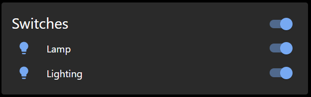

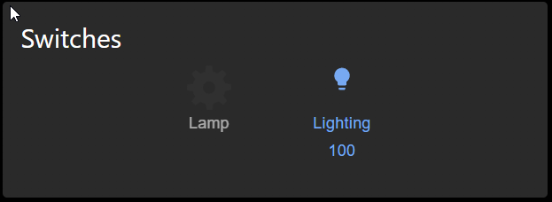

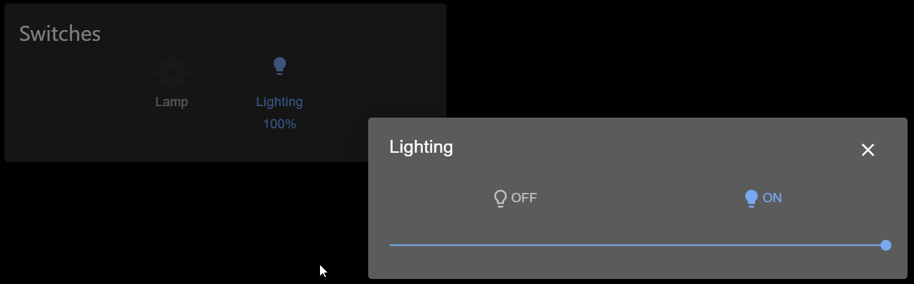

### Часы

- Аналоговый

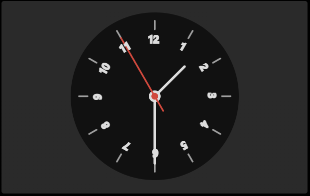

- Аналоговый вариант

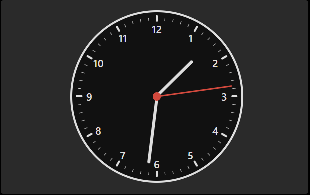

- Цифровой

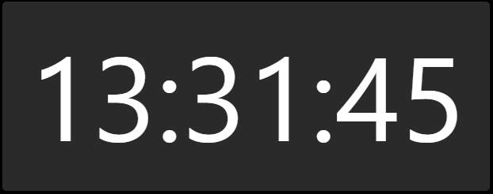

- Digital2 (SVG Текст)

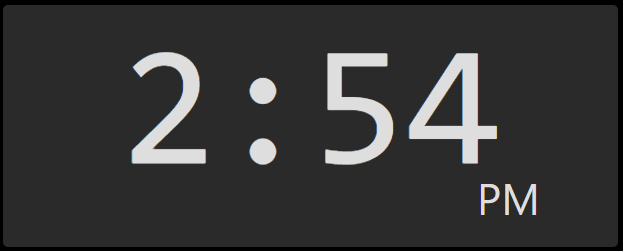

### Простое состояние

С помощью этого виджета вы можете управлять одним устройством. Логическое значение или число.

- Число

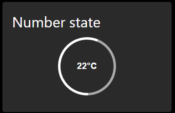

- Контроль

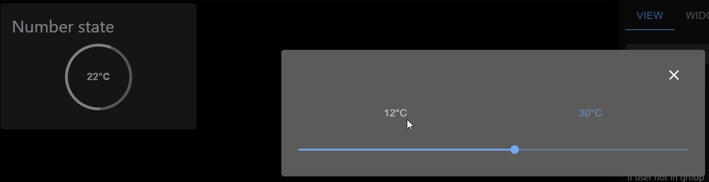

### Просмотреть в виджете

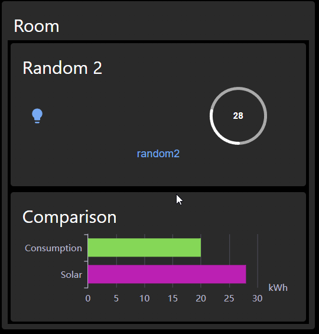

Не в виде кнопки: представление может отображаться в полном размере, и вы можете управлять элементами, находящимися в поле зрения.

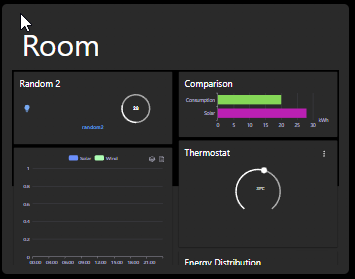

В качестве кнопки: вы можете отобразить небольшую миниатюру изображения, и при нажатии на нее оно отобразится в полном размере.

### Термостат

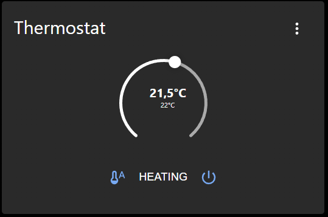

Кроме того, при активации этой функции можно просматривать историю просмотров.

### Фактическое значение с диаграммой

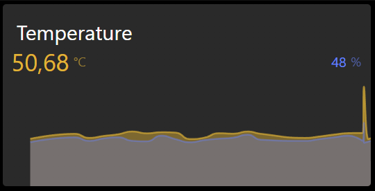

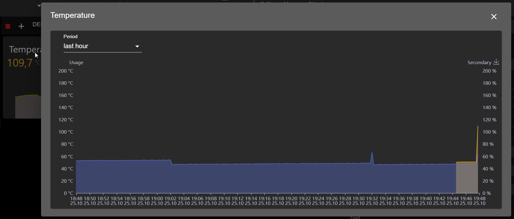

### Контроль безопасности

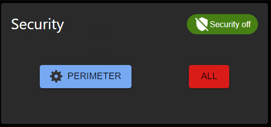

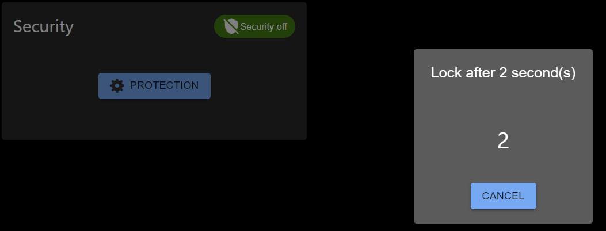

Вы можете задать задержку в секундах.

При активации заданный идентификатор будет записан вместе с числом секунд задержки, а по истечении задержки заданный идентификатор будет установлен на 0, и идентификатор тревоги будет установлен в значение true.

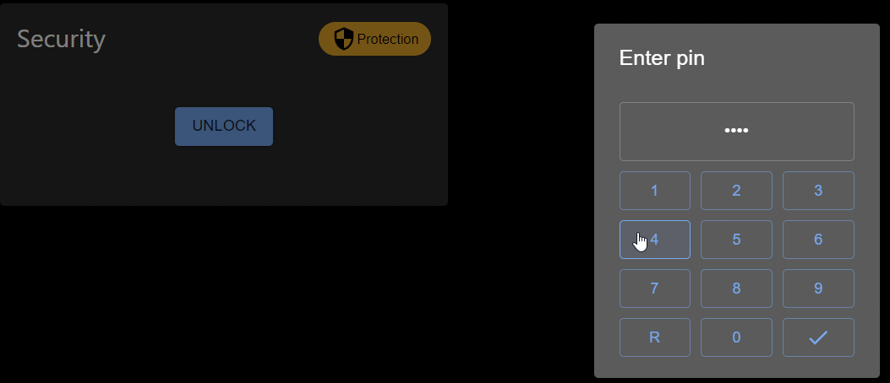

### Игрок

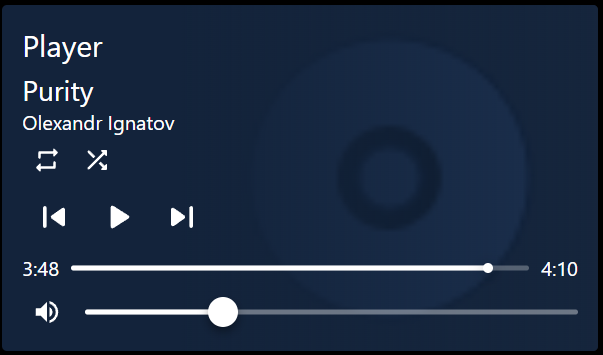

### Карта

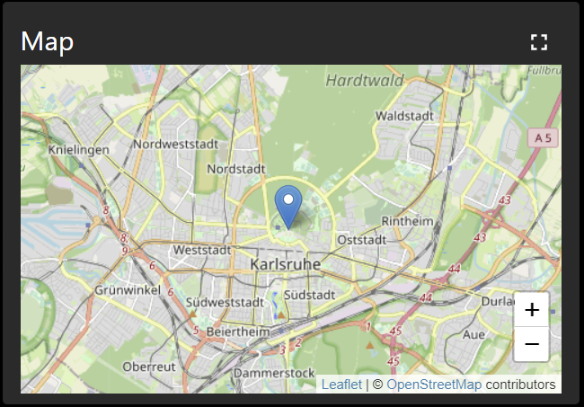

Позицию можно определить как комбинированное состояние, например: `9.2344;41.374652` -`longitude;latitude` или как два отдельных государства.

### Камера

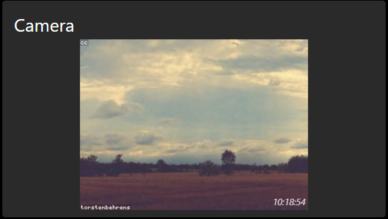

### HTML-шаблон

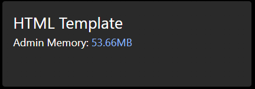

Шаблон HTML можно использовать для отображения любого HTML-кода. Кроме того, с помощью этого виджета можно отображать изображение или iframe.

### Жалюзи

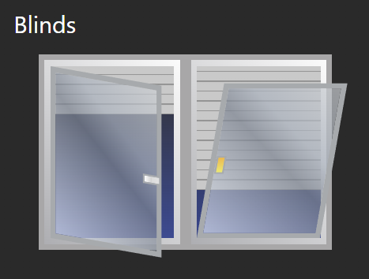

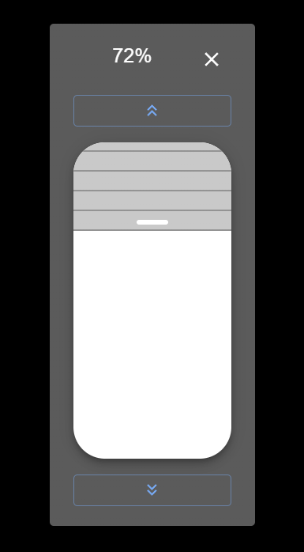

### Цветная лампа

С помощью виджета RGB-подсветки вы можете управлять различными типами RGB-светильников. Вот несколько примеров:

- Цвета RGB задаются в одном состоянии, например, '#RRGGBB'.
- Цвета R/G/B устанавливаются в различных состояниях от 0 до 255.
- RGBW как одна переменная, например, '#RRGGBBWW'
- Цвета R/G/B/W устанавливаются в различных состояниях от 0 до 255.
- оттенок/насыщенность/яркость как 3 различных состояния
- Цветовая температура может быть задана в одном из состояний от 2700 до 6500 или определяться минимальным/максимальным значением объекта.
- Режим белого цвета позволяет переключаться между режимами RGB и белого цвета с помощью специального параметра.

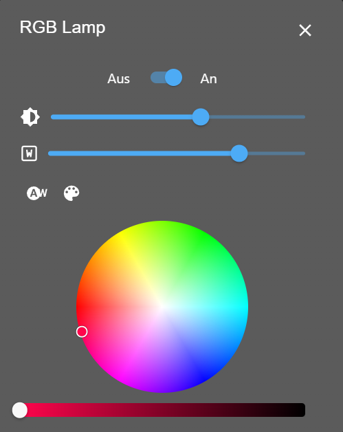

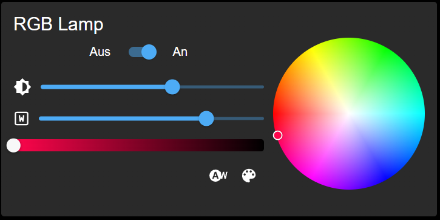

### Замок двери

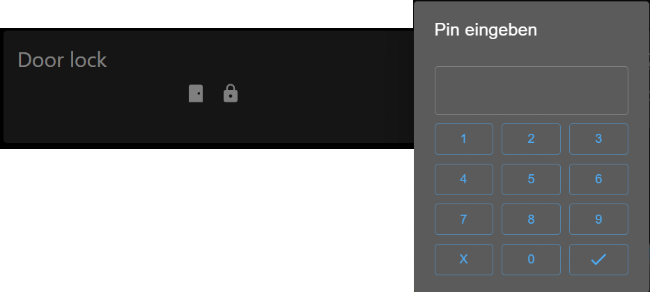

### Пылесос

Этот виджет предназначен в первую очередь для пылесосов Xiaomi. Но его можно использовать и для любых других пылесосов.

Единственное отличие заключается в том, что Xiaomi поддерживает функцию уборки помещения.

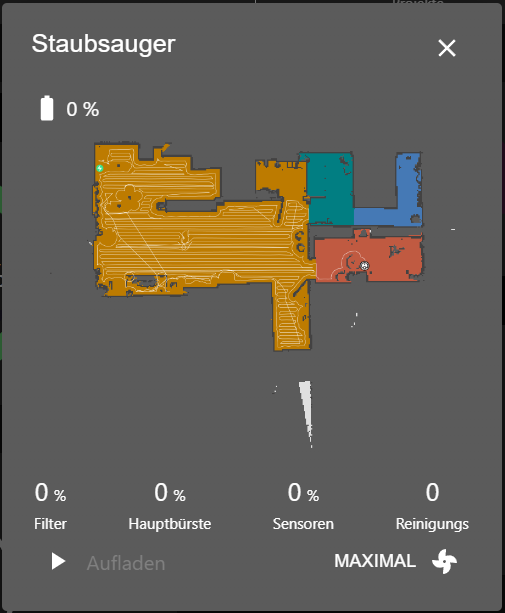

### ТВ

Пульт дистанционного управления для телевизора данного типа устройства. `tv` (например, от адаптера) `samsungtv` Выберите любое состояние телевизора, и будут обнаружены остальные состояния.

- **Плитка** : кнопки «Имя», «Состояние», «Питание» и «Приложение»; нажатие на них открывает диалоговое окно пульта дистанционного управления.
- **Пульт дистанционного управления** : полный пульт в виджете.

Все секции пульта дистанционного управления (входы, стрелки, громкость, цифровая клавиатура, приложения и т.д.) можно отключить, а отображаемые приложения и входы выбрать. Когда телевизор выключен, отображается только кнопка питания.

### Выбор времени

## Все

- Раздвижные жалюзи с ставнями

<!--
    Placeholder for the next version (at the beginning of the line):
    ### **WORK IN PROGRESS**
-->

## Changelog
### **WORK IN PROGRESS**

-   (@GermanBluefox) Added the TV widget, see [TV](#tv)
-   (@GermanBluefox) The icon of a device is shown again in "Actual", "Simple state", "Static", "Switches", "Security" and "Map", and in the widgets the wizard creates. An adapter writes `common.icon` relative to its own files (e.g. `icons/shellyplugsg3.png` of a Shelly plug), and the widgets looked for it next to the page of vis-2, so they showed a broken image
-   (@GermanBluefox) Switches: a click on the window of a line with type "blinds" opens the blinds dialog (#706)

### 2.0.4 (2026-10-19)

-   (@GermanBluefox) RGB light: the auto-detection does not overwrite the selected state anymore and takes the first matching state (#381)
-   (@GermanBluefox) Switches: brightness and white sliders use the maximum of the object, color temperature limits can be below 500 (#475)
-   (@GermanBluefox) Switches: the "switch" state is visible again for RGB and thermostat (#449)
-   (@GermanBluefox) Switches: boolean states with `read: false` or role `button` are detected as button, buttons work with touch and send only `true` (#614, #609)
-   (@GermanBluefox) Switches: `common.states` in the format "0:off;1:on" and numeric states are supported in the select (#607)
-   (@GermanBluefox) Charts read aggregated (min/max) values for periods over 30 minutes instead of raw data (#412)
-   (@GermanBluefox) Switches, Map and theme switcher unsubscribe correctly on unmount (#530)
-   (@GermanBluefox) Lock: added options to invert the lock state and the door sensor (#633)
-   (@GermanBluefox) Camera: the image is updated even if the cache refresh fails (#340)
-   (@GermanBluefox) Player: fixed the display conditions of "repeat" and "next"
-   (@GermanBluefox) Blinds: clear labels for the sash type, touch support for the slider (#627, #292)
-   (@GermanBluefox) Corrected German translations (#552)

### 2.0.3 (2026-10-19)

-   (@GermanBluefox) Fixed the crash of the charts (React error #130) in "Actual", "Switches" and the chart dialog (#694)
-   (@GermanBluefox) Fixed the endless re-rendering (React error #185) of the chart in "Actual" in the grid layout

### 2.0.2 (2026-10-16)

-   (@GermanBluefox) Added `tslib` and `esbuild` to the widget packages, because the build on GitHub could not resolve them

### 2.0.1 (2026-10-16)

-   (@GermanBluefox) Corrected the TypeScript configuration for TypeScript 7 and the widget test

### 2.0.0 (2026-10-15)

-   (@GermanBluefox) Migrated to React 19 and vis-2@2.20.x

## License

The MIT License (MIT)

Copyright (c) 2022-2026 Denis Haev <dogafox@gmail.com>

Permission is hereby granted, free of charge, to any person obtaining a copy
of this software and associated documentation files (the "Software"), to deal
in the Software without restriction, including without limitation the rights
to use, copy, modify, merge, publish, distribute, sublicense, and/or sell
copies of the Software, and to permit persons to whom the Software is
furnished to do so, subject to the following conditions:

The above copyright notice and this permission notice shall be included in
all copies or substantial portions of the Software.

THE SOFTWARE IS PROVIDED "AS IS", WITHOUT WARRANTY OF ANY KIND, EXPRESS OR
IMPLIED, INCLUDING BUT NOT LIMITED TO THE WARRANTIES OF MERCHANTABILITY,
FITNESS FOR A PARTICULAR PURPOSE AND NONINFRINGEMENT. IN NO EVENT SHALL THE
AUTHORS OR COPYRIGHT HOLDERS BE LIABLE FOR ANY CLAIM, DAMAGES OR OTHER
LIABILITY, WHETHER IN AN ACTION OF CONTRACT, TORT OR OTHERWISE, ARISING FROM,
OUT OF OR IN CONNECTION WITH THE SOFTWARE OR THE USE OR OTHER DEALINGS IN
THE SOFTWARE.