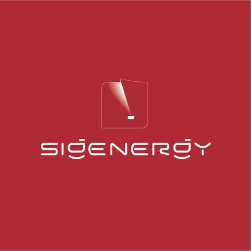

# ioBroker.vis-2-widgets-sigenergy

## vis-2-widgets-sigenergy адаптер для ioBroker

Набор виджетов VIS-2 для адаптера накопителя энергии Sigenergy (`ioBroker.sigenergy` Содержит 11 виджетов для визуализации и управления потоком энергии, энергопотреблением дома, состоянием батареи, мощностью в реальном времени, ежедневной статистикой, зарядным устройством переменного тока, зарядным устройством постоянного тока, инвертором, обзором микроинверторов SigenMicro, солнечными батареями и уровнем заряда автомобиля.

Начиная с версии 2.0.0, виджеты представляют собой нативный набор виджетов vis-2 React (React 19, MUI 9).

## Требования

- ioBroker с `sigenergy` адаптер установлен и настроен
- ioBroker VIS-2 адаптер (≥ 2.20.0) — vis-2 2.20 — первая версия, основанная на React 19 и MUI 9.
- Классический VIS (vis-1) не поддерживается.

## Обновление с версии 1.x

- Существующие виджеты продолжают работать без необходимости повторного размещения: идентификаторы виджетов и все настройки (идентификаторы объектов, заголовки, темный режим, имена) остаются прежними.
- Для начала необходимо обновить vis-2 до версии 2.20.0 или новее. Более старые версии vis-2 работают на React 18 и не могут загрузить этот набор виджетов.
- Все тексты соответствуют языку vis-2 (11 языков). Заголовки, введенные вами самостоятельно, сохраняются; пустой заголовок отображает заголовок по умолчанию на языке пользователя.
- Пояснения к состоянию (зарядное устройство переменного/постоянного тока) отображаются во всплывающей подсказке, которая больше не обрезается виджетом и остается читаемой при любом размере виджета.

## Виджеты

### Диаграмма потока энергии

Отображает текущий поток энергии между солнечными панелями, аккумулятором, сетью и домом в виде анимированной SVG-диаграммы. Анимированные стрелки визуализируют активные соединения в реальном времени.

**OID:** `pvPower`, `essPower`, `gridActivePower`, `housePower`, `essSoc`

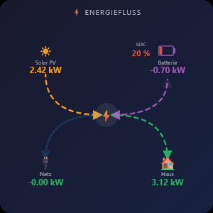

#### Направления потока

| Точка данных      | Значение > 0                                                                           | Значение < 0                                               |
| ----------------- | -------------------------------------------------------------------------------------- | ---------------------------------------------------------- |
| `essPower`        | Зарядка аккумулятора → стрелка от центра к аккумулятору                                | Разрядка батареи → стрелка от батареи к центру             |
| `gridActivePower` | Потребление электроэнергии из сети → стрелка от сети к центру                          | Подача электроэнергии по сетке → стрелка от центра к сетке |
| `pvPower`         | Фотоэлектрический элемент производит → стрелка от фотоэлектрического элемента к центру | —                                                          |
| `housePower`      | Потребление дома → стрелка от центра к дому                                            | —                                                          |

### Энергетический дом

Отображает поток энергии в виде изометрической модели дома с гаражом, автомобилем и устройствами Sigenergy: солнечные батареи на крыше, аккумулятор SigenStor и шлюз на стене дома, настенный блок переменного тока на гараже, зарядное устройство постоянного тока перед ним, балконная электростанция с SigenMicro на крыше гаража и подключение к сети. Анимированные штрихи движутся вдоль кабелей в направлении потока энергии, причем скорость увеличивается с ростом мощности. Смена дня и ночи происходит в соответствии с положением солнца в настройках системы ioBroker. Все элементы нарисованы в векторном формате, поэтому виджет сохраняет четкость изображения при любом размере и пропорциях.

**OID:** `pvPower`, `housePower`, `essPower`, `essSoc`, `gridActivePower`, `acCharger.chargingPower`, `acCharger.systemState`, `dcCharger.outputPower`, `dcCharger.runningState`, `sigenmicro.totalPower`; опционально: температура наружного воздуха (`oid_temp`) и текст состояния (`oid_status`)

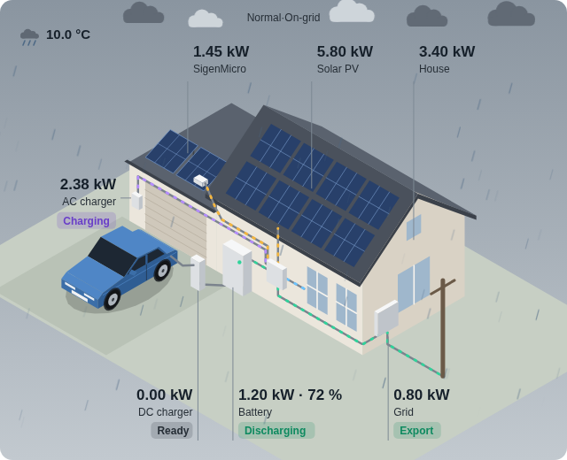

| Параметр                                                                          | По умолчанию   | Описание                                                                                                                                                                                                                                                                |
| --------------------------------------------------------------------------------- | -------------- | ----------------------------------------------------------------------------------------------------------------------------------------------------------------------------------------------------------------------------------------------------------------------- |
| sig\_daynight                                                                     | Автоматический | Автоматический режим (положение солнца), всегда день или всегда ночь                                                                                                                                                                                                    |
| sig\_animation                                                                    | на             | Анимированное движение вдоль кабелей                                                                                                                                                                                                                                    |
| `sig_show_garage`, `sig_show_car`, `sig_show_ac`, `sig_show_dc`, `sig_show_micro` | на             | Показать или скрыть гараж, автомобиль, зарядное устройство переменного тока, зарядное устройство постоянного тока и электростанцию на балконе. Для работы электростанции на балконе необходим гараж; без гаража настенная коробка переменного тока висит на стене дома. |

**Погода (необязательно):** при указании погодного состояния небо будет соответствовать реальной погоде — солнце, облака, дождь, снег, туман или гроза; без указания погоды — ясно. Используйте независимый от языка код адаптера погоды; тексты с погодными условиями на английском языке также считываются.

| Адаптер                           | Погодные условия                           | Облачность (%)                 | Осадки (мм/ч)                    | Числовой код погоды |
| --------------------------------- | ------------------------------------------ | ------------------------------ | -------------------------------- | ------------------- |
| открытая метеорологическая погода | `…weather.current.weather_code`            | `…weather.current.cloud_cover` | `…weather.current.precipitation` | Автоматический      |
| openweathermap                    | `forecast.current.icon`                    | `forecast.current.clouds`      | `forecast.current.precipitation` | Автоматический      |
| daswetter                         | `location_1.ForecastHourly.Current.symbol` | `…Current.clouds`              | `…Current.rain`                  | Символ DasWetter    |

daswetter пишет `Current` Используйте только канал с возможностью копирования текущего часа; в противном случае используйте `ForecastHourly.Hour_1`. `symbol_URL` Работает также и при настройке кода в режиме «Автоматический».

Облачность и осадки уточняют условия или заменяют их; осадки при температуре 1 °C или ниже изображаются как снег.

### Состояние батареи и прогнозы

Отображает уровень заряда батареи (SOC), состояние здоровья батареи (SOH), мощность зарядки, а также прогнозы времени до полной зарядки, оставшегося времени работы, собственного потребления и скорости автономной работы.

**OID:** `essSoc`, `essSoh`, `essPower`, `batteryTimeToFull`, `batteryTimeRemaining`, `selfConsumptionRate`, `autarkyRate`

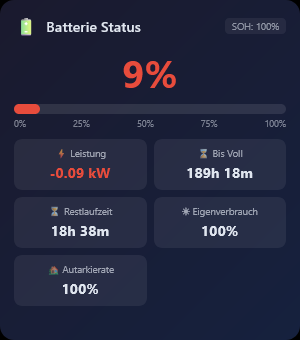

### Энергоснабжение в реальном времени

Компактный список всех текущих значений мощности с цветовой кодировкой направлений.

**OID:** `pvPower`, `essPower`, `gridActivePower`, `housePower`, `essSoc`

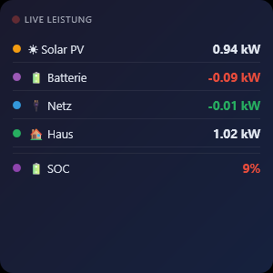

### Статистика энергетики

Ежедневный обзор с указанием скорости автономной работы, собственного потребления, истории уровня заряда батареи, энергии заряда/разряда и зоны покрытия батареи.

**OID:** `autarkyRate`, `selfConsumptionRate`, `dayMaxSoc`, `dayMinSoc`, `essDailyChargeEnergy`, `essDailyDischargeEnergy`, `batteryCoverageToday`, `batteryDailyChargeTime`

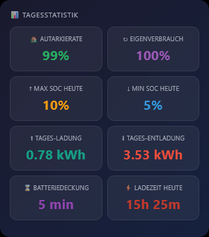

### Зарядное устройство переменного тока (Sigen EVAC)

Мониторинг и управление зарядным устройством переменного тока Sigenergy (EVAC). Отображает мощность зарядки, состояние системы, номинальную мощность, номинальный ток и общее потребление энергии. Сигналы тревоги выделяются цветом. Индикатор состояния отображает упрощенное состояние зарядки в соответствии с IEC 61851-1 (Инициализация, Свободно, Подключено, Зарядка, Ошибка); при наведении курсора отображается подробное описание текущего состояния. Ток зарядки можно установить непосредственно с помощью ползунка (от 6 А до номинального тока зарядного устройства); верхний предел можно дополнительно ограничить с помощью настроек виджета. `sig_maxCurrent` Во время зарядки кнопка «Старт» заблокирована, а кнопка «Стоп» выделена.

**OID:** `acCharger.systemState`, `acCharger.chargingPower`, `acCharger.totalEnergyConsumed`, `acCharger.ratedPower`, `acCharger.ratedCurrent`, `acCharger.alarm1/2/3`, `acCharger.control.startStop`, `acCharger.control.outputCurrent`

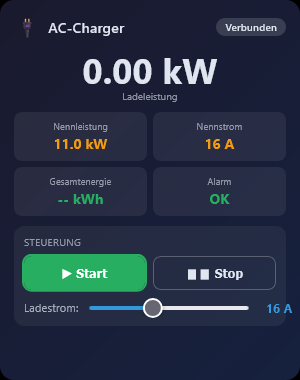

### Зарядное устройство постоянного тока

Мониторинг и управление зарядным устройством постоянного тока Sigenergy. Отображает выходную мощность, уровень заряда батареи автомобиля с индикатором выполнения, напряжение батареи автомобиля, зарядный ток, а также энергию и продолжительность текущей зарядки. Индикатор состояния показывает рабочее состояние зарядной станции. `dcCharger.runningState` (статус: свободен, подключен/подготавливается, запланирован, заряжается, разряжается, завершен, предупреждение, неисправность/недоступен); при наведении курсора отображается подробное объяснение. Во время зарядки или разрядки кнопка «Старт» заблокирована, а кнопка «Стоп» выделена. Если OID состояния не задан, он определяется на основе OID выходной мощности; без значения состояния значок возвращается к выходной мощности, и всплывающая подсказка объясняет причину в зависимости от версии протокола, обнаруженной адаптером.

**OID:** `dcCharger.runningState`, `dcCharger.outputPower`, `dcCharger.vehicleSoc`, `dcCharger.vehicleBatteryVoltage`, `dcCharger.chargingCurrent`, `dcCharger.currentChargingCapacity`, `dcCharger.currentChargingDuration`, `dcCharger.control.startStop`, `info.protocolVersion` (`oid_protocol`)

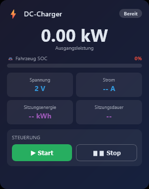

### Инвертор

Комплексный мониторинг и управление инвертором с навигацией по вкладкам. Отображает рабочее состояние, данные о питании, температуру батареи, фазные напряжения, все 5 регистров аварийных сигналов и информацию об устройстве (модель, серийный номер, микропрограмма).

| Вкладка          | Содержание                                                                                                                                     |
| ---------------- | ---------------------------------------------------------------------------------------------------------------------------------------------- |
| **Власть**       | Активная мощность, мощность фотоэлектрических панелей, мощность заряда/разряда батареи, ползунок распределения мощности (от -100 % до +100 %). |
| **Батарея**      | SOC и SOH с указанием значений в виде полос, средняя температура/напряжение ячейки, максимальная/минимальная температура.                      |
| **Сетка**        | Фазовые напряжения L1/L2/L3, частота сети, коэффициент мощности, внутренняя температура PCS.                                                   |
| **Сигнализация** | 5 регистров аварийных сигналов (PCS ×2, ESS, шлюз, зарядное устройство постоянного тока) с шестнадцатеричным кодом и цветовой маркировкой.     |
| **Информация**   | Тип модели, серийный номер, версия прошивки, переключатель Remote-EMS.                                                                         |

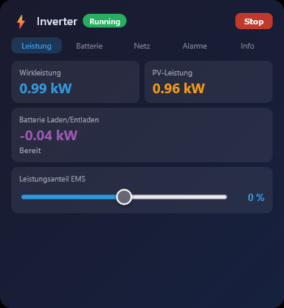

**OID:** `inverter.activePower`, `inverter.pvPower`, `inverter.essChargeDischargePower`, `inverter.runningState`, `inverter.essBatterySoc/Soh`, `inverter.essAvgCellTemperature/Voltage`, `inverter.phaseA/B/CVoltage`, `inverter.gridFrequency`, `inverter.pcsInternalTemp`, `inverter.alarm1–5`, `inverter.firmwareVersion`, `inverter.modelType`, `inverter.serialNumber`, `inverter.control.startStop`, `inverter.control.remoteEmsDispatchEnable`, `inverter.control.activePowerPercent`

### PV Power

Отображение до 3 солнечных батарей с текущими значениями мощности и анимированными стрелками, указывающими направление потока к гибридному инвертору. Цвет стрелок динамически меняется в зависимости от уровня мощности (оранжевый <1 кВт, желтый <2 кВт, зеленый >2 кВт).

#### Настройки виджета

| Параметр                | Тип    | По умолчанию                          | Описание                                                             |
| ----------------------- | ------ | ------------------------------------- | -------------------------------------------------------------------- |
| oid\_pv1 … oid\_pv3     | ОИД    | sigenergy.0.plant.pv1Power … pv3Power | Идентификаторы OID для управления питанием фотоэлектрической цепочки |
| oid\_pvtotal            | ОИД    | sigenergy.0.plant.pvPower             | Общая мощность фотоэлектрических систем OID                          |
| sig\_title              | текст  | PV Power                              | Заголовок виджета                                                    |
| sig\_name1 … sig\_name3 | текст  | Строка 1 … Строка 3                   | Настраиваемые имена для каждой строки                                |
| sig\_darkmode           | флажок | истинный                              | Темный/Светлый режим                                                 |

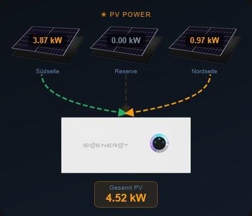

**OID:** `plant.pv1Power`, `plant.pv2Power`, `plant.pv3Power`, `plant.pvPower`

### Обзор SigenMicro

Обзор и подробное описание микроинверторов SigenMicro. `ioBroker.sigenergy` 3.5.0 Адаптер считывает их из облака Sigenergy (вкладка "SigenMicro (Cloud)" в настройках адаптера) и создает одно устройство для каждого микроинвертора в разделе `sigenergy.0.sigenmicro.<serial>`. **Требует `ioBroker.sigenergy` Версия ≥ 3.5.0 с включенным облачным сервисом.** Опрос облачного сервиса выполняется каждые 300 секунд (OpenAPI) или 60 секунд (интерфейс приложения), поэтому виджет не может обновляться быстрее.

| Вкладка                        | Содержание                                                                                                                                                                                                                                                                                                                                                                |
| ------------------------------ | ------------------------------------------------------------------------------------------------------------------------------------------------------------------------------------------------------------------------------------------------------------------------------------------------------------------------------------------------------------------------- |
| **Обзор**                      | Все устройства отображаются в виде анимированной шины переменного тока с указанием состояния каждого устройства; плитки для отображения питания от сети переменного тока (общее количество заряда адаптера). `sigenmicro.totalPower` (в противном случае — сумма показателей устройств), доходность сегодня, доходность за весь срок службы и количество устройств в сети. |
| **одна вкладка на устройство** | Изображение, название, номинальная мощность, серийный номер, прошивка, время последнего обновления в облаке, индикатор состояния, все текущие значения с указанием устройства и OID, а также входы PV1…PV4, которые сообщает адаптер.                                                                                                                                     |

#### Статус

| Статус       | Состояние                          | Отображать                     |
| ------------ | ---------------------------------- | ------------------------------ |
| Производство | `online` = true, `activePower` > 0  | зеленый, анимированный автобус |
| Онлайн       | `online` = true, `activePower` = 0  | синий                          |
| Офлайн       | `online` = ложно — нормально ночью | серый                          |
| Нет данных   | Значение пока не получено          | серый                          |

Если `info.cloudConnection` является `false` В этом случае виджет отображает предупреждение «Соединение с облаком потеряно», поскольку значения могут быть устаревшими.

#### Динамическая компоновка

| Устройства | Ряды   | размер изображения |
| ---------- | ------ | ------------------ |
| 1–5        | 1 ряд  | 80 × 90 пикселей   |
| 6–10       | 1 ряд  | 52 × 60 пикселей   |
| 11–15      | 2 ряда | 46 × 52 пикселей   |
| 16–20      | 2 ряда | 40 × 46 пикселей   |

#### Настройки виджета

| Параметр                         | Тип          | По умолчанию             | Описание                                                                                                                                                                                                          |
| -------------------------------- | ------------ | ------------------------ | ----------------------------------------------------------------------------------------------------------------------------------------------------------------------------------------------------------------- |
| микро\_счет                      | число (1–20) | 3                        | Количество микроинверторов для отображения                                                                                                                                                                        |
| sig\_title                       | текст        | Микроинвертор SigenMicro | Заголовок виджета                                                                                                                                                                                                 |
| sig\_darkmode                    | флажок       | истинный                 | Темный/светлый режим                                                                                                                                                                                              |
| micro\_device1 … micro\_device20 | выбор        | —                        | Микроинвертор из списка устройств SigenMicro в экземплярах sigenergy (серийный номер и название). Виджет считывает все состояния самого устройства. Виджеты из версии 1.x сохраняют свой прежний выбор состояния. |
| micro\_take\_all                 | кнопка       | —                        | Принимает под свой контроль все устройства SigenMicro, указанные в учетной записи (по количеству и выбору).                                                                                                       |
| micro\_name1 … micro\_name20     | текст        | —                        | Отображаемое имя устройства (по умолчанию: Micro 01, Micro 02, …)                                                                                                                                                 |

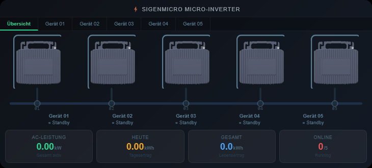

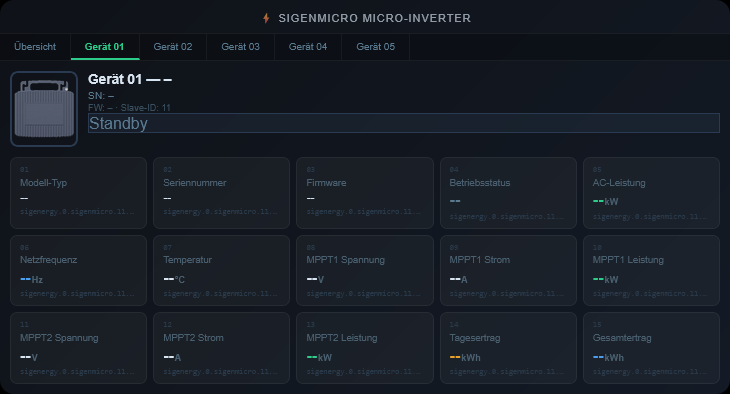

**Состояния на устройство (`sigenergy.0.sigenmicro.<serial>`):** онлайн, активная мощность, реактивная мощность, мощность pv, pv1…pv4.напряжение / ток / мощность, напряжение сети, ток сети, частота сети, коэффициент мощности, температура, сопротивление изоляции, ежедневный выходной уровень, общий выходной уровень, серийный номер, прошивка, номинальная мощность, последнее обновление

**Кроме того:** `sigenergy.0.sigenmicro.totalPower`, `sigenergy.0.info.cloudConnection` — экземпляр берется из выбранного OID

> **Обновление с версии 1.8.x:** прежние положения Modbus (`runningState`, `outputPower`, `mppt*`, `modelType` …) больше не существуют в адаптере. Выберите микроинверторы снова в настройках виджета — из списка или с помощью кнопки «Взять все SigenMicro».

### Уровень заряда аккумулятора (EV SOC)

В качестве центрального визуального элемента отображается настраиваемое изображение автомобиля (например, Fiat 500e). В правом верхнем углу расположен цветовой значок с изображением молнии, текущим уровнем заряда в процентах и надписью «ЗАРЯДКА» (перевод). Внизу находится индикатор выполнения, отображающий текущий уровень заряда батареи. При активации режима зарядки значок мигает зеленым светом.

#### Цветовая логика

| Уровень заряда | Цвет              |
| -------------- | ----------------- |
| ≤ 15 %         | Красный (#f87171) |
| ≤ 35 %         | Желтый (#fbbf24)  |
| > 35 %         | Зеленый (#4ade80) |

#### Настройки виджета

| Параметр        | Тип         | По умолчанию                                       | Описание                                                                      |
| --------------- | ----------- | -------------------------------------------------- | ----------------------------------------------------------------------------- |
| oid\_ev\_soc    | ОИД         | —                                                  | Уровень заряда 0–100                                                          |
| oid\_charging   | ОИД         | —                                                  | Состояние зарядки (опционально) — зеленое свечение при активации.             |
| sig\_title      | текст       | — (пусто: "Уровень заряда автомобиля", переведено) | Название транспортного средства указано под изображением.                     |
| sig\_car\_image | изображение | —                                                  | Изображение автомобиля из файлового браузера ioBroker (например, /vis-2/img/) |
| sig\_darkmode   | флажок      | истинный                                           | Темный/Светлый режим                                                          |

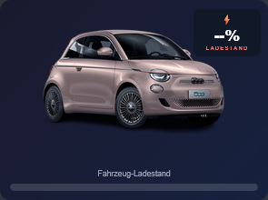

**OID:** `oid_ev_soc`, `oid_charging`

## Появление

Все виджеты поддерживают **светлый и темный режимы** , переключаемые в настройках виджета. `Dark mode` Виджеты масштабируются в зависимости от своего размера: ширина и высота следуют за виджетом независимо, в то время как текст сохраняет свои пропорции.

## Документация

- 🇬🇧 [Английский](/#/adapters/vis-2-widgets-sigenergy) — этот файл
- 🇩🇪 [Deutsch](https://github.com/ssbingo/ioBroker.vis-2-widgets-sigenergy/blob/main/doc/de/README.md)
- 🇷🇺 [Русский](https://github.com/ssbingo/ioBroker.vis-2-widgets-sigenergy/blob/main/doc/ru/README.md)
- 🇳🇱 [Nederlands](https://github.com/ssbingo/ioBroker.vis-2-widgets-sigenergy/blob/main/doc/nl/README.md)
- 🇫🇷 [Français](https://github.com/ssbingo/ioBroker.vis-2-widgets-sigenergy/blob/main/doc/fr/README.md)
- 🇮🇹 [Italiano](https://github.com/ssbingo/ioBroker.vis-2-widgets-sigenergy/blob/main/doc/it/README.md)
- 🇪🇸 [Español](https://github.com/ssbingo/ioBroker.vis-2-widgets-sigenergy/blob/main/doc/es/README.md)
- 🇵🇱 [Polski](https://github.com/ssbingo/ioBroker.vis-2-widgets-sigenergy/blob/main/doc/pl/README.md)
- 🇵🇹 [Português](https://github.com/ssbingo/ioBroker.vis-2-widgets-sigenergy/blob/main/doc/pt/README.md)

## Changelog
### 2.2.0 (2026-11-18)
* (ssbingo) **Energy house shows the real weather:** with a weather state (WMO code of open-meteo-weather, OpenWeatherMap icon or id, DasWetter symbol, AccuWeather icon or an English text), optionally cloud cover and precipitation, the sky shows sun, clouds, rain, snow, fog or thunderstorm instead of always the sun; the symbol next to the temperature follows the weather

### 2.1.0 (2026-11-18)
* (ssbingo) **New widget "Energy house":** the energy flow as an isometric house with garage, car, PV on the roof, SigenStor and gateway on the house wall, AC wallbox, DC charger, a balcony power plant with SigenMicro on the garage roof and the grid connection; animated cables in the direction of the flow, day and night after the position of the sun, optional outdoor temperature and status text, every part can be hidden

### 2.0.2 (2026-11-18)
* (ssbingo) SigenMicro: new tab bar — "Overview" keeps its width, the device tabs share the rest in equal columns and no longer run out of the widget; up to 3 devices the tabs show the names, with more devices compact numbers 01, 02 … (as on the nodes, name as tooltip); above 10 devices two rows like the nodes
* (ssbingo) SigenMicro: the labels sit exactly below their nodes, each label row directly below its node row; a click on a node or label opens the detail tab of the device; better contrast of the tile texts; if several selected devices report the same device name, the serial number is shown
* (ssbingo) Stretched widgets: texts are no longer squeezed twice, centred texts stay centred, and the titles of AC/DC charger, inverter and battery as well as the SigenMicro status badge and section header keep their proportions

### 2.0.1 (2026-11-17)
* (ssbingo) README screenshots renewed: all widgets as rendered by the React widget set in vis-2 2.20, with English texts
* (ssbingo) Dependencies updated (vite 7.3.8, `@iobroker/gui-components` 10.4.6, `@iobroker/testing` 6.3.2)

### 2.0.0 (2026-11-17)
* (ssbingo) **Breaking:** the widgets are now a native vis-2 React widget set (React 19, MUI 9) and require vis-2 2.20.0 or newer. The classic VIS (vis-1) is no longer supported
* (ssbingo) Existing widgets keep working without being placed again: the widget IDs and all settings are unchanged
* (ssbingo) All texts are translated into the 11 ioBroker languages (previously mostly German). Titles you entered are kept; an empty title shows the default title in the user's language
* (ssbingo) AC/DC charger: the status explanation is a MUI tooltip that is no longer cut off by the widget; the charging current and the EMS power share are MUI sliders that write when released
* (ssbingo) No commands are sent from the vis-2 editor anymore; a click there only selects the widget
* (ssbingo) Energy flow: the setting "Animated flow" now takes effect
* (ssbingo) SigenMicro: the detail tab shows the values in three columns, the object ID on one line
* (ssbingo) SigenMicro: the micro-inverters are chosen in the editor by device (serial number and name) from the SigenMicro devices of the sigenergy instances; the widget reads all states itself. New button "Take all SigenMicro" takes over all devices at once. Widgets from 1.x keep working with their former state selection
* (ssbingo) Build with Vite and module federation; the widgets were tested in vis-2 2.20.11

### 1.9.1 (2026-11-17)
* (ssbingo) vis-2 2.20.x: the widgets apply `box-sizing: border-box` to their own content again. vis-2 2.20 no longer loads MUI's `CssBaseline`, which used to switch the whole document to border-box, so padded cards, tiles and buttons could grow wider than designed. The rule is scoped to this widget set; the widget set itself contains no React/MUI code and runs as a classic vis widget set on vis-2 2.20 (React 19, MUI 9)

### 1.9.0 (2026-11-17)
* (ssbingo) **SigenMicro Overview reworked for the new cloud connection of `ioBroker.sigenergy` 3.5.0.** The widget now reads `sigenergy.0.sigenmicro.<serial>.*` (online, activePower, pvPower, PV inputs pv1…pv4, grid values, temperature, insulation resistance, yield, firmware, rated power, last update), the account total `sigenmicro.totalPower` and `info.cloudConnection`. The former Modbus register model (`runningState`, `outputPower`, `mppt*`, `modelType`) is gone
* (ssbingo) SigenMicro: status derived from `online` and the AC power (Producing / Online / Offline / No data), warning when the cloud connection is lost, time of the last cloud update and rated power in the detail tab, PV inputs shown only when reported, new optional display name per device (`micro_nameN`), all widget texts in English
* (ssbingo) SigenMicro: the anchor OID may be any state of the micro-inverter; derived states are now subscribed via `vis.conn.subscribe` (VIS only subscribes attribute OIDs) and released again when the widget is removed. **After updating, select a state under `sigenergy.0.sigenmicro.<serial>` again for each `oid_microN`**
* (ssbingo) CI: Dependabot auto-merge workflow updated from the ioBroker template — it uses `pull_request` instead of `pull_request_target` (#46, #47); `@iobroker/testing` updated from 6.2.1 to 6.3.1

### 1.8.11 (2026-09-12)
* (ssbingo) CI: the package tests now run on Node.js 22, 24 and 26 (new `adapter-tests` job, repository checker #41); `@iobroker/testing` updated from 5.3.0 to 6.2.1

### 1.8.10 (2026-09-07)
* (ssbingo) Removed the `admin` entry from `globalDependencies`: a widget set has no admin UI, so no admin version needs to be required (repository checker S1091)

### 1.8.9 (2026-09-07)
* (ssbingo) DC charger: a station that marks its running state register as not valid no longer shows up as a red "Unbekannt" badge. The Sigenergy protocol signals "register not valid" by setting all bits, and a SigenStor EC **with** a DC charger answers that way for register 31513 while its neighbouring registers (rated power, PV yield, meters) read normally. The badge is now derived from the output power in that case and the tooltip states that this is neither an adapter nor a configuration problem
* (ssbingo) DC charger: the raw sentinel 65535 is recognised as well, so the badge is also correct on adapter versions before 3.3.1, which pass the value through instead of reporting no value
* (ssbingo) DC charger: new OID setting `oid_protocol` (default `sigenergy.0.info.protocolVersion`). The protocol version was previously derived from the instance prefix only, and such an OID is never subscribed by VIS, so `vis.states` stayed empty and the tooltip claimed "Protokollversion noch nicht erkannt" even though the adapter had detected V2.9 at startup. Declared as a regular `/id` attribute it is subscribed like every other OID
* (ssbingo) DC charger: when the protocol version cannot be read, the tooltip no longer asserts that none was detected — it says the version is not readable here and points at the new setting
* (ssbingo) DC charger: reworded the tooltip shown when the adapter reports no state although the device announces protocol V2.8 or newer — it no longer claims an adapter update is needed, since the station itself may be marking the register as not valid

### 1.8.8 (2026-09-07)
* (ssbingo) DC charger: if the state OID is not set, it is derived from the output power OID (…dcCharger.outputPower → …dcCharger.runningState), so widgets placed before 1.8.7 show the operating state without editing them
* (ssbingo) DC charger: when no operating state is available, the tooltip explains why depending on the protocol version detected by the adapter (`info.protocolVersion` / `info.protocolLevel`): register 31513 requires Sigenergy protocol V2.8; with V2.8 or newer it points to the adapter log or an adapter update; negative output power is shown as discharging

### 1.8.7 (2026-09-07)
* (ssbingo) DC charger: new state OID `dcCharger.runningState` (default) – the state badge now shows the operating state of the charging station (free, connected/preparing, scheduled, charging, discharging, ended, warning, fault/unavailable) with a detailed explanation as tooltip; without the OID the badge is derived from the output power as before
* (ssbingo) DC charger: while charging or discharging is active, the Start button is locked and the Stop button is highlighted; negative output power (discharging) is shown in purple

### 1.8.6 (2026-09-07)
* (ssbingo) AC charger: the tooltip on the state badge is now rendered as a separate popup with a fixed font size and opaque background, so it is readable regardless of widget size and is no longer overlapped by widget content
* (ssbingo) AC charger: while charging is active, the Start button is locked and the Stop button is highlighted
* (ssbingo) Widget set now reports the correct version in the browser console

### 1.8.5 (2026-09-07)
* (ssbingo) AC charger: the charging current slider is now limited to the charger's rated current; new widget setting `sig_maxCurrent` for a manual upper limit (prevents Modbus errors when setting more than the rated current)
* (ssbingo) AC charger: system state now covers all IEC 61851-1 states (0–7: initialising, free, connected, charging, error); hovering over the state badge shows a detailed explanation

### 1.8.4 (2026-09-04)
* (ssbingo) Lowered minimum admin requirement to >=7.8.23 (admin 8 is no longer required)
* (ssbingo) CI: locked ioBroker/testing-action-deploy to major version v1; fixed Dependabot auto-merge workflow
* (ssbingo) Updated dependencies: @tsconfig/node22 22.0.6, @alcalzone/release-script-plugin-license 5.2.2

### 1.8.3 (2026-08-05)
* (ssbingo) Declared minimum requirements: js-controller >=6.0.11, admin >=8.0.0, Node.js >=22
* (ssbingo) Updated dependencies: actions/checkout 7.0.1, ioBroker/testing-action-deploy 1.5.2, @iobroker/testing 5.3.0

### 1.8.2 (2026-06-28)
* (ssbingo) Updated CI actions: actions/checkout to v7.0.0, ioBroker/testing-action-deploy to v1.5.0

### 1.8.1 (2026-06-08)
* (ssbingo) Fixed JSON syntax error in io-package.json; added widget screenshot to documentation

### 1.8.0 (2026-06-08)
* (ssbingo) New widget: "Fahrzeug-Ladestand" — shows a configurable EV image with animated SOC bar, color-coded charge level (red/yellow/green), and optional blinking charging badge

### 1.7.9 (2026-05-27)
* (ssbingo) Removed obsolete .eslintrc.json and .prettierignore

### 1.7.8 (2026-05-27)
* (ssbingo) Added ESLint linting, updated CI to Node.js 24; adapter requires node.js >= 22

### 1.7.7 (2026-04-20)
* (ssbingo) Text no longer distorts under non-uniform scaling — letters keep their proportions while containers continue to fill the widget area

### 1.7.6 (2026-04-20)
* (ssbingo) Scaling is now non-uniform: width and height react independently to container changes, keeping both axes individually adjustable

### 1.7.5 (2026-04-20)
* (ssbingo) Widget scaling now also reacts to height changes — content scales proportionally on both axes and is centered within the widget

### 1.7.4 (2026-04-20)
* (ssbingo) All 9 widgets now scale their content responsively with the widget size (fonts, padding, SVG, images)

### 1.7.3 (2026-04-20)
* (ssbingo) All 9 widgets now share a unified background based on the PV-Power widget design

Older changelog entries can be found in CHANGELOG_OLD.md

## License
MIT License

Copyright (c) 2026 ssbingo <s.sternitzke@online.de>

Permission is hereby granted, free of charge, to any person obtaining a copy
of this software and associated documentation files (the "Software"), to deal
in the Software without restriction, including without limitation the rights
to use, copy, modify, merge, publish, distribute, sublicense, and/or sell
copies of the Software, and to permit persons to whom the Software is
furnished to do so, subject to the following conditions:

The above copyright notice and this permission notice shall be included in all
copies or substantial portions of the Software.

THE SOFTWARE IS PROVIDED "AS IS", WITHOUT WARRANTY OF ANY KIND, EXPRESS OR
IMPLIED, INCLUDING BUT NOT LIMITED TO THE WARRANTIES OF MERCHANTABILITY,
FITNESS FOR A PARTICULAR PURPOSE AND NONINFRINGEMENT. IN NO EVENT SHALL THE
AUTHORS OR COPYRIGHT HOLDERS BE LIABLE FOR ANY CLAIM, DAMAGES OR OTHER
LIABILITY, WHETHER IN AN ACTION OF CONTRACT, TORT OR OTHERWISE, ARISING FROM,
OUT OF OR IN CONNECTION WITH THE SOFTWARE OR THE USE OR OTHER DEALINGS IN THE
SOFTWARE.