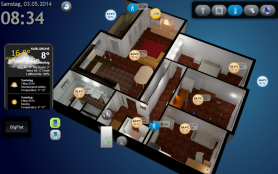
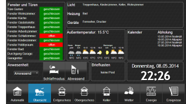
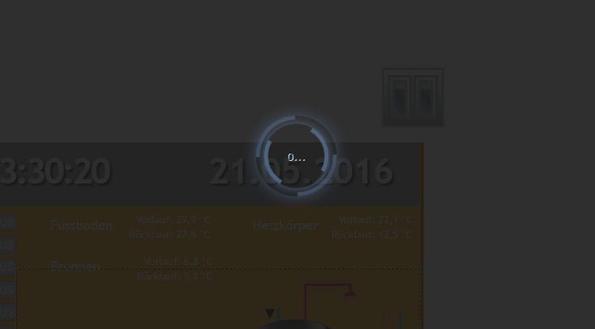

# Визуализация нового поколения для ioBroker: vis-2

Визуализация веб-контента для платформы ioBroker.

## Обзор

- [Требования к лицензированию](#license-requirements)
- [Установка и документация](#installation--documentation)
- [Связывание объектов](#bindings-of-objects)
- [Фильтры](#filters)
- [Интерфейс управления](#control-interface)
- [Вид по умолчанию](#default-view)
- [Навигация](#navigation)
- [Система разрешений](#permissions-system)
- [Настройки](#settings)
- [SVG и текущий цвет](#svg-and-currentcolor)

## Требования к лицензированию

Для использования этого адаптера в `ioBroker` Вам необходимо принять условия лицензии на исходный код адаптера. Исходный код этого адаптера распространяется под лицензией CC BY-NC.

Кроме того, для использования адаптера вам потребуется лицензия. Следующие варианты лицензий доступны по адресу <https://iobroker.net/www/pricing>

- **Лицензия сообщества: Бесплатно для частного использования!** : Получите бесплатную лицензию, зарегистрировав учетную запись на <https://iobroker.net> . Проверка лицензии выполняется онлайн на сервере лицензий ioBroker при запуске адаптера vis-2, поэтому в этот момент требуется подключение к интернету!
- **Автономная лицензия для частного использования** : За небольшую плату за поддержку вы можете избавиться от необходимости проверки лицензии онлайн при запуске адаптера. **Только для частного использования!**
- **Коммерческая лицензия** : Эта лицензия предназначена для использования Vis в коммерческих целях или продажи Vis в составе пакетов ioBroker вашим клиентам. Проверка лицензии также не требует подключения к интернету.

## Установка и документация



### Виджеты

- [Стандартные виджеты](/#/docs/adapterref/iobroker.vis-2/packages/iobroker.vis-2/docs/widgets-standard.md) — элементы оформления дома, например, карточки для страницы с разделами (`relative`) и в качестве маркеров для плана этажа (`absolute`), с фотографией каждого из них.
- [Виджеты jQui](/#/docs/adapterref/iobroker.vis-2/packages/iobroker.vis-2/docs/widgets-jQui.md) — виджеты, перешедшие из vis-1.

## Связывание объектов

Обычно большинство виджетов имеют атрибут ObjectID, и этот атрибут может быть связан с каким-либо значением идентификатора объекта. Но есть и другой способ привязать _любой_ атрибут виджета к определенному ObjectID.

Просто запишите в атрибут `{object.id}` например `{hm-rpc.0.OEQ1880105.4.ACTUAL_TEMPERATURE}` и оно будет привязано к значению этого объекта. При использовании специального формата можно даже выполнять с ним простые операции, например, умножение или форматирование.

Атрибуты CSS представления можно привязать аналогичным образом, например, цвет фона представления. `{a:javascript.0.alarm;a ? 'red' : 'green'}`.

Например, чтобы вычислить гипотенузу треугольника:

`{h:javascript.0.myCustom.height;w:javascript.0.myCustom.width;Math.max(20, Math.sqrt(h*h + w*w))}` будет интерпретировано как функция:

```js
value = await (async function () {
    var h = (await getState('javascript.0.myCustom.height')).val;
    var w = (await getState('javascript.0.myCustom.width')).val;
    return Math.max(20, Math.sqrt(h * h + w * w));
})();
```

или

`{h:javascript.0.myCustom.height;w:javascript.0.myCustom.width;h*w}` просто умножит высоту на ширину.

Вы можете использовать _любые_ функции JavaScript (браузера). Аргументы должны быть обозначены двоеточием (':'), в противном случае они будут интерпретированы как формула.

Будьте внимательны к типам. Все они определены как строки. Чтобы убедиться, что значение будет обрабатываться как число, используйте функцию parseFloat.

Таким образом, наш расчет гипотенузы будет выглядеть следующим образом:

```
{h:javascript.0.myCustom.height;w:javascript.0.myCustom.width;Math.max(20, Math.sqrt(Math.pow(parseFloat(h), 2) + Math.pow(parseFloat(w), 2)))}
```

### Устаревший формат

Паттен имеет следующий формат:

```
{objectID;operation1;operation2;...}
```

Поддерживаются следующие операции:

- `*` - умножение. Аргумент должен быть заключен в скобки, например, "\*(4)". В этом примере мы умножаем значение на 4.
- `+` - добавить. Аргумент должен быть заключен в скобки, например, "+(4.5)". В этом примере мы добавляем к значению 4.5.
- `-` - вычесть. Аргумент должен быть заключен в скобки, например, "-(-674.5)". В этом примере мы вычитаем из значения -674.5.
- `/` - деление. Аргумент должен быть заключен в скобки, например, "/(0.5)". В этом примере мы делим значение на 0.5.
- `%` - по модулю. Аргумент должен быть в скобках, например, "%(5)". В этом примере мы берем по модулю 5.
- `round` - округлить значение.
- `round(N)` - округлить значение на N знаков после запятой, например, 34.678;round(1) => 34.7
- `hex` - Преобразовать значение в шестнадцатеричное. Все буквы строчные.
- `hex2` - Преобразовать значение в шестнадцатеричное. Все буквы строчные. Если значение меньше 16, то будет добавлен ведущий ноль.
- `HEX` - то же самое, что и шестнадцатеричный код, но в верхнем регистре.
- `HEX2` - то же самое, что и hex2, но в верхнем регистре.
- `date` - Форматирует дату в соответствии с заданным форматом. Формат тот же, что и в [iobroker.javascript.](https://github.com/iobroker/iobroker.javascript/blob/master/README.md#formatdate)
- `min(N)` - Если значение меньше N, берём N, в противном случае значение
- `max(M)` - Если значение больше M, берём M, в противном случае — значение
- `sqrt` - квадратный корень
- `pow(n)` - степень Н.
- `pow` - степень двойки.
- `floor` - Math.floor
- `ceil` - Math.ceil
- `json` - операция для получения свойств JSON или объекта. Например, `{id;json(common.name.en)}`
- `random(R)` - Math.random() \* R, или просто Math.random(), если аргумента нет.
- `formatValue(decimals)` - отформатируйте значение в соответствии с системными настройками и используйте десятичные знаки.
- `date(format)` - Форматирование значения как даты. Формат: "ГГГГ-ММ-ДД чч:мм:сс.сс."
- `momentDate(format, useTodayOrYesterday)` — Форматирование значения как даты с использованием Moment.js. [Допустимые форматы должны быть введены в соответствии с библиотекой moment.js](https://momentjs.com/docs/#/displaying/format/) . `useTodayOrYesterday=true` тот `moment.js` формат `ddd` /`dddd` перезаписываются данными за сегодняшний день / вчерашний день
- `array(element1,element2[,element3,element4])`- возвращает элемент по индексу. Например: `{id.ack;array(ack is false,ack is true)}` Логическое значение принимает второй элемент, когда оно истинно, и первый, когда оно ложно, поэтому `{id;array(off,on)}` работает на выключателе
- `states` - текст значения в `common.states` объекта, например `{hm-rpc.0.ABC.STATE;states}` вместо этого отображается "Открыто". `1` Значение, отсутствующее в списке, остаётся без изменений; `states(unknown)` Вместо этого отображается текст в скобках. Текст на нескольких языках отображается на языке vis. Объект считывается один раз при первом отображении привязки, до этого момента привязка отображает простое значение. Только в этом формате: в формате с переменными (`{v:id;...}` Формула написана на JavaScript, который ничего не знает о... `common.states`

Этот шаблон можно использовать в любом тексте, например:

```
My calculations with {objectID1;operation1;operation2;...} are {objectID2;operation3;operation4;...}
```

или расчеты цвета:

```
#{objectRed;/(100);*(255);HEX2}{objectGreen;HEX2}{objectBlue;HEX2}
```

Чтобы отобразить метку времени объекта, напишите `.ts` или `.lc` (для последнего изменения) в конце идентификатора объекта, например:

```
Last change: {objectRed.lc;date(hh:mm)}
```

### Специальные переплеты

Существует ряд различных внутренних привязок для предоставления дополнительной информации в представлениях:

- `username` - отображает авторизованного пользователя
- `view` - название фактического вида
- `wname` - название виджета
- `widget` — это объект, содержащий все данные виджета. Может использоваться только в части JavaScript, например: `{a:a;widget.data.name}`
- `widgetOid` - Используйте OID виджета для присвоения значения виджету в разделе присвоения, например: `{t:widgetOid.val;t}`
- `wid` - название фактического виджета
- `language` - может быть `de`, `en` или `ru`.
- `instance` - экземпляр браузера
- `login` - требуется ли авторизация (например, чтобы показать/скрыть кнопку выхода).
- `local_*` - если название штата начинается с `local_` Это не будет передано в ioBroker, но все виджеты обновятся, в зависимости от этого состояния. (Локальная переменная для текущей сессии браузера)

Примечание: для использования символа ":" в вычислениях (например, в строковых формулах) используйте вместо него "::".

**Помните** , что определения стилей будут интерпретироваться как привязки, поэтому используйте `{{style: value}}` или просто

```
{
	style: value
}
```

для этого.

## Фильтры

Чтобы отобразить все виджеты на одном экране, можно использовать фильтры для уменьшения количества виджетов, одновременно отображаемых на экране.

Каждый виджет имеет поле `filter` Если вы зададите ему какое-либо значение, например... `light`, поэтому вы можете использовать другие виджеты. `(bars - filters, filter - dropdown)` для управления тем, какой фильтр фактически активен.

Записи `filter - dropdown` Виджеты (как кнопки, так и выпадающие списки) имеют CSS-класс. `vis-filter-item` а также текущие активные записи дополнительно. `vis-filter-item-active` Таким образом, их можно будет стилизовать в CSS проекта, например:

```css
/* buttons (horizontal / vertical) */
.vis-filter-item-active {
    background-color: #ff0000;
}

/* entries of the dropdown */
.vis-filter-item-active.Mui-selected {
    background-color: #ff0000;
}
```

Необходимо соблюдать два правила, поскольку активный элемент выпадающего списка дополнительно имеет класс. `Mui-selected`, и его собственный цвет фона более конкретен, чем `.vis-filter-item-active` один.

Пожалуйста, обрати внимание:

- Если для элемента в самом виджете задан цвет, он записывается как встроенный стиль и не может быть переопределен другим цветом. `color` Свойства из CSS проекта. Оставьте поле цвета пустым, если хотите задать цвет через CSS.
- Элементы выпадающего списка отображаются вне виджета (во всплывающем окне на уровне страницы), поэтому к ним можно обращаться только глобально, а не с помощью селектора для отдельного виджета, например, так: `#w00001 .vis-filter-item-active` Кнопки являются частью виджета и могут быть адресованы таким образом.

## Интерфейс управления

Vis создает 3 переменные:

- `control.instance` — Здесь следует указать экземпляр браузера или `FFFFFFFF` если каждый браузер должен контролироваться.
- `control.data` - Параметр для команды. См. описание конкретной команды.
- `control.command` - Название команды. Запишите в эту переменную имя команды, запускающей выполнение команды. Это означает, что перед выполнением команды необходимо подготовить "экземпляр" и "данные", содержащие необходимые данные.

Команды:

- `alert` - Отобразить всплывающее окно в vis-2. Файл "control.data" имеет следующий формат: "message;title;jquery-icon". Title и jquery-icon являются необязательными. Названия значков можно найти [здесь](http://jqueryui.com/themeroller/) . Чтобы отобразить значок "ui-icon-info", напишите `Message;;info`.
- `changeView` — Переключитесь на нужный режим просмотра. Файл "control.data" должен содержать имя режима просмотра. Вы также можете указать имя проекта. `project/view` Проект по умолчанию —`main`.
- `refresh` - Перезагрузить vis-2, например, после изменения проекта, чтобы он перезагружался во всех браузерах.
- `reload` — то же самое, что и обновление.
- `dialog` — Отобразить диалоговое окно. Диалоговое окно должно отображаться. Один из вариантов:

  - `static    - HTML    - Dialog`,
  - `static    - Icon    - Dialog`,
  - `container - HTML    - view in jqui Dialog`,
  - `container - ext cmd - view in jqui Dialog`,
  - `container - Icon    - view in jqui Dialog`,
  - `container - Button  - view in jqui Dialog`.

  `control.data` должен содержать идентификатор виджета диалога, например: `w00056`.
- `dialogClose`
- `popup`- открывает новое окно браузера. Ссылка должна быть указана в `control.data` например, <http://google.com>
- `playSound` - Воспроизвести звуковой файл. Ссылка на файл указана в `control.data` Например, <http://www.modular-planet.de/fx/marsians/Marsiansrev.mp3> . Вы можете загрузить свой собственный файл в Vis-2 и воспроизвести его, как, например, `/vis-2.0/main/img/myFile.mp3` **Важно** : браузер не сможет воспроизводить аудио, пока пользователь не кликнет хотя бы один раз на странице. Это политика безопасности браузера. Подробнее можно прочитать [здесь](https://github.com/Hugo22O/chrome-autoplay) .

Если пользователь изменит представление или в начале, переменные будут заполнены компонентом vis-2.

- `control.instance`: экземпляр браузера и `ack=true`
- `control.data`: название проекта и представления в форме `project/view` например `main/view` (и `ack=true`)
- `control.command`: `changedView` и `ack=true`

Вы можете записать строку JSON или объект в `control.command` как `{instance: 'AABBCCDD', command: 'cmd', data: 'ddd'}` В этом случае экземпляр и данные будут взяты из JSON-объекта.

Пример использования JavaScript-адаптера:

```js
setState('vis-2.0.control.command', JSON.stringify({ instance: '*', command: 'refresh', data: '' }));
```

Передайте объект в виде строки JSON: `setState()` JavaScript-адаптер принимает объект без `val` для самого государства, а не из-за его ценности, и приказ так и не поступает.

Если вы записываете JSON в виде строки, убедитесь, что она поддается разбору, например: `{"instance": "*", "command": "refresh", "data": ""}` обратите внимание на `"`.

Агент искусственного интеллекта (например, pi-agent или сервер MCP с `send_to`) узнает обо всем этом из самого vis-2: из сообщения `help` (`sendTo('vis-2.0', 'help', {}, answer => …)` ответы `{help, commands}` - этот интерфейс содержит данные каждой команды, проекты с их представлениями и диалогами, а также браузеры, которые сообщали о своих представлениях с момента запуска экземпляра, с указанием их идентификаторов.

## Вид по умолчанию

Для каждого элемента можно задать желаемое разрешение (Меню => Инструменты => Разрешение). В режиме редактирования это всего лишь визуальная рамка, показывающая размер экрана на конкретном устройстве. В режиме реального времени она не будет видна, и все виджеты за пределами рамки будут отображаться.

Кроме того, вы можете указать, должен ли этот вид использоваться по умолчанию для данного разрешения.

Поэтому каждый раз, когда `index.html` (без `#viewName` Если вызывается функция, будет открыт наиболее подходящий для данного разрешения вариант просмотра. Если флаг _"Default"_ установлен только для одного варианта просмотра, то этот вариант будет открыт независимо от разрешения или ориентации экрана.

Например, вы можете создать два режима просмотра: «Альбомная ориентация — Мобильная версия» и «Портативная ориентация — Мобильная версия», и эти два режима будут автоматически переключаться при изменении ориентации или размера экрана.

Вспомогательный виджет "Основные параметры - Разрешение экрана" отображает фактическое разрешение экрана и наиболее подходящий вариант отображения по умолчанию для этого разрешения.

## Навигация

Каждый виджет, ведущий к представлению — это `Go to view` опция виджетов jQui, `basic - HTML navigation` … - получает CSS-класс `vis-nav-active` при условии, что отображаемое представление совпадает с тем, на которое указывает указатель. Таким образом, элемент текущего представления может быть выделен в CSS проекта:

```css
.vis-nav-active button {
    border: 1px solid #0d72b8;
}
```

## Система разрешений

### Проект

В диалоговом окне управления проектом можно выполнить настройку. `read` и `write` права доступа для каждого пользователя ioBroker.

Он `read` Этот флаг означает, что проект доступен данному пользователю в среде выполнения. `write` Этот флаг означает, что проект доступен для данного пользователя в режиме редактирования.

При создании нового пользователя через адаптер ioBroker Admin по умолчанию ему будут предоставлены оба разрешения.

### Вид

Вы также можете указать, к каким представлениям пользователю разрешен доступ в режиме выполнения и в режиме редактирования. Если одно из прав доступа не предоставлено на уровне проекта, указание его на уровне представления не имеет никакого эффекта, поскольку проект в целом будет недоступен.

Обратите внимание, что при попытке доступа к представлению, к которому у текущего пользователя нет прав, он увидит панель выбора проекта.

### Виджет

Если у пользователя нет `read` Если у пользователя нет необходимых разрешений, виджет не будет отображаться во время выполнения. `write` Из-за ограничений по правам доступа виджет не будет отображаться в режиме редактирования.

## Настройки

### Перезагрузить, если сон длится дольше

Когда экран планшета выключается, браузер останавливает отображение страницы. После включения страница обрабатывает все пропущенные изменения состояния и работает медленно в течение многих секунд. При использовании параметра "Перезагрузить, если время ожидания превышает (секунд)" в настройках проекта среда выполнения перезагружается после истечения этого времени ожидания и считывает состояния только один раз. Страница, работающая в фоновом режиме, также считается спящей с момента её повторного отображения.

Время составляет не менее 30 секунд; пустое значение или 0 означает «никогда», что является значением по умолчанию. Программа ожидает ответа от сервера перед перезагрузкой, чтобы устройство, у которого еще не восстановилось Wi-Fi-соединение, не отображалось на странице с ошибкой. Редактор никогда не перезагружается самостоятельно.

### Вернуться к виду без ввода данных

В настройках проекта, в разделе «Возврат к виду без ввода», можно выбрать вид и количество секунд. Когда никто не использовал среду выполнения в течение этого времени, она снова открывается — например, панель на стене автоматически возвращается на свою начальную страницу. Каждое нажатие клавиши, щелчок, касание или поворот колесика мыши запускают отсчет времени заново; простое перемещение мыши этого не делает.

Это происходит только во время выполнения программы, а не в редакторе.

### Темный экран повторного подключения

Иногда (ночью) требуется темный экран загрузки. С помощью этой опции вы можете его настроить.

Обратите внимание, что эти настройки действительны только для повторного подключения, а не для первого подключения.



## SVG и текущий цвет

Ключевое слово currentColor в CSS позволяет элементам наследовать текущий цвет текста от родительского элемента. Это может быть особенно полезно в SVG (масштабируемой векторной графике), поскольку обеспечивает более динамичное оформление и упрощает интеграцию с HTML-контентом.

Вместо конкретного значения цвета для любого свойства внутри SVG, принимающего значение цвета, можно использовать ключевое слово currentColor. Вот простой пример с кругом в SVG:

```xml
<svg width="100" height="100" xmlns="http://www.w3.org/2000/svg">
    <circle cx="50" cy="50" r="40" fill="currentColor" />
</svg>
```

В этом случае, если цвет SVG-элемента совпадает с цветом родительского элемента. Например, если он используется в меню, и меню красное, то и круг будет красным.

## Фоновые службы наборов виджетов

В среде выполнения отображается только открытое представление и представления с параметром "Отображать всегда", поэтому виджет существует только до тех пор, пока отображается его представление. Набор виджетов может предоставлять **фоновые службы** для того, что не должно отключаться от его представления — например, телефон, который должен оставаться зарегистрированным для звонка и отображать диалог входящего вызова поверх любого открытого представления.

Сервис — это компонент React, предоставляемый федерацией модулей набора как виджет (экспорт по умолчанию) и имеющий своё имя. `io-package.json`:

```json
"visWidgets": {
    "vis2IntercomWidgets": {
        "url": "intercom/customWidgets.js",
        "components": ["Phone"],
        "services": ["PhoneService"]
    }
}
```

Среда выполнения отображает каждый сервис только один раз, рядом с представлениями, пока проект открыт — не в редакторе. За это ей отдельная похвала. `VisServiceProps` из `@iobroker/types-vis-2`:

- `widgets` - виджеты набора (их) `widgetSet` (одно из названий набора, см. ниже) во всех представлениях проекта, которые может видеть пользователь: с разрешением на чтение для проекта, представления и виджета, и не исключено `visibility-groups` Каждый из них `{ view, id, tpl, data }`, с `data` Как указано в проекте, привязки не разрешаются.
- `adapter`, `socket`, `user` (без `system.user.`), `lang` и `changeView(view)`.

Он `visSet` виджеты набора возвращают `getWidgetInfo()` Название набора указывается в процессе выполнения; среда выполнения загружает только те наборы, которые использует проект. Набор может быть назван в честь адаптера, ключа или чего-либо еще. `name` своей коллекции в `visWidgets` — таким образом, один адаптер может обеспечить подключение нескольких комплектов, каждый из которых имеет свои собственные характеристики. `visSet`.

Сервис загружается только с использованием его набора параметров, то есть, если проект использует виджет из этого набора. Сервис, вызвавший сбой, не загружается, а представления и другие сервисы продолжают работу.

Более старая версия vis-2 игнорирует `services` Таким образом, виджеты должны работать и без них, например, сами удерживать телефон. Независимо от того, предоставляет ли запущенный vis-2 сервисы, виджет запрашивает их с помощью `window.visRxWidget.FEATURES?.includes('services')` — Например, чтобы сообщить пользователю в редакторе, что представление необходимо отображать «Всегда», только если это не так.

## Разработка и отладка

Для внесения изменений в сам редактор vis-2, поиска ошибок и отладки необходимо выполнить следующие шаги.

1. Создайте форк репозитория iobroker/iobroker.vis-2 в своей учетной записи через пользовательский интерфейс GitHub.

2. Клонируйте репозиторий в директорию. Скопируйте URL-адрес из вашего репозитория GitHub. Команда выглядит так:

```shell
git clone https://github.com/<your profile name>/ioBroker.vis-2.git
```

3. Откройте загруженный репозиторий в вашей IDE.

4. Чтобы установить и загрузить все необходимые библиотеки, выполните следующую команду в терминале в корневом каталоге репозитория.

```shell
npm run install-monorepo
```

5. Чтобы запустить редактор в браузере, выполните следующую команду. Для этого необходимо, чтобы на порту 8082 был доступен уже запущенный отдельный экземпляр сервера iobroker.

```shell
npm run start
```

Сервер разработки прослушивает порт 3000 и запрашивает `http://localhost:8082` Во всём оно не служит само себе. Оба варианта можно изменить там, где это не подходит:

```shell
VIS_PORT=3005 npm run start                       # another port, if 3000 is taken
IOB_URL=http://192.168.178.45:8082 npm run start  # an ioBroker on another machine
```

- Отладка доступна в браузере, например, в Chrome (клавиша F12).
- При изменении файла поддерживается автоматическая перезагрузка редактора.

## Все

- ИИ-помощник
- Navigation verbessern
- Концепция резервного копирования (История проекта)

<!--
    Placeholder for the next version (at the beginning of the line):
    ### **WORK IN PROGRESS**
-->

## Changelog
### **WORK IN PROGRESS**
* (@GermanBluefox) Editor: the dialog "Import project" got a clearer drop zone - an icon, the allowed file type, the selected file as a card with its real size (base64 size before) and a long file name wrapped instead of running over the border. While the server unpacks the project, which can take a while, a spinner shows it in the dialog and in the button "Import"
* (@GermanBluefox) Editor: palette and attributes can be pinned as columns beside the view. Since 2.20.3 they float over the view with a fixed width as soon as its resolution does not fit between them - with a view as wide as the screen always, so the attributes had to be opened over the view for every widget. The pin in the head of both panels keeps them as columns, and the view scrolls between them; a window narrower than 1200 pixels still lets them float
* (@GermanBluefox) servConn._socket.emit forwards sendTo again and throws on unknown commands (#749)
* (@GermanBluefox) vis-2 answers the message `help` (`common.supportedMessages.help`): an AI agent such as pi-agent learns how to steer the browsers through `control.command` (the data of every command), the projects with their views and dialogs, and the IDs of the browsers that reported their view (to be written into `instance` exactly as listed)
* (@GermanBluefox) Fully Kiosk Browser and other Android WebViews no longer darken the views on their own in the dark mode. Since 2.20 the page declared no color scheme any more, so the WebView darkened it itself and the vis-1 widgets (hqwidgets, jqui-mfd) came out with swapped light and dark colors, while Chrome showed them right. The page declares `color-scheme: only light` now, which looks the same in every other browser; iframes stay transparent. The workaround `:root { color-scheme: only light !important; }` in the project CSS is no longer needed
* (@GermanBluefox) Standard widgets: a colour from the colour picker of the editor (`rgb(20, 123, 248)`) works for the faint fill of jump marks, buttons, lists, media players, locks and vacuum cleaners. The opacity was appended as two hex digits, which made `rgb(...)` invalid, and the buttons came out grey
* (@GermanBluefox) Standard widgets: a text that only begins with a number is shown as text - `07:24` was shown as 7, `17.11.2026, 09:46` as 17,11. A number with a unit behind it (`21,4 °C`, `45%`) is still a number
* (@GermanBluefox) Chart: the value axes are as wide as their labels, so the top label with the unit keeps its first digits (`5,0 km/h` instead of `35,0 km/h`)
* (@GermanBluefox) Window widget: the lines of the drawing stay fine at every size, like those of the blind beside it, instead of growing several pixels thick on a large card
* (@GermanBluefox) Editor: "Show all views" no longer crashes the editor with "Maximum update depth exceeded". It listed the views that were open already a second time and saved that in the project, so the editor crashed again on every load; such a project is repaired when it is loaded
* (@GermanBluefox) "Limit screen size": a page that is higher or wider than the window starts at the top left and can be scrolled; only a page that fits is centred. Before, what stuck out above and on the left could not be reached - a page of 1280 px in a window of 738 px lost its first 271 px

### 2.20.11 (2026-11-17)
* (@GermanBluefox) Safari 27 (macOS, iOS, iPadOS) and the ioBroker app no longer load the whole page again after every change of the view when vis-2 is opened over plain HTTP: the view changes without a navigation now. Links to a view (`<a href="#view">`) in HTML widgets and link buttons to `#view` do the same (#743)

### 2.20.10 (2026-11-17)
* (@GermanBluefox) Grid layout: a section can have its own background for the light and for the dark theme. While such a theme is active, it wins over the background of the section and over the colour of the panel, e.g. to set a section apart from its widgets in both themes
* (@GermanBluefox) The widgets whose ID contains "_" are shown again: since 2.20.2 the runtime took every such widget for a copy of a widget of another view ("multi-views") and dropped it, which left the views of generated projects empty and took out every widget whose ID contained a space. Saving in the editor dropped them too. A copy is now known by a mark, not by its ID, and the editor names the widget it comes from correctly even when its ID contains "_" (#744)
* (@GermanBluefox) The widgets of the vis-1 widget sets (e.g. hqwidgets, materialdesign, trashschedule) are rendered again after a view change in the editor: a new engine takes over `vis.binds` with the sets already registered instead of starting with empty binds (#741)
* (@GermanBluefox) Removed the unnecessary vertical scrollbar in runtime (4px overflow caused by inline-block body) (#734)
* (@GermanBluefox) Runtime: the widget sets without widgets, which bring only styles or fonts (e.g. google-fonts of vis-google-fonts), are loaded again, so the chosen font is shown in the runtime and not only in the editor (#735)
* (@GermanBluefox) The button of the AI assistant is in the tabs bar of the editor. As a floating button it covered controls in the attributes, e.g. the signal images (#739)
* (@GermanBluefox) Web components: the setting types `selectSendTo` and `autocompleteSendTo` (`@iobroker/web-components` 0.8) - the options of a select or the suggestions of a text field are asked from an instance of the adapter. Without an instance to ask or without an answer the field stays a text field and says why
* (@GermanBluefox) Fixed ticks in gauge widget and missing tooltip translation (#732)
* (@GermanBluefox) Navigation: the header of the menu can show an icon or an image - a logo - in front of its text. It belongs to the project and is the same on every page with a menu, wherever it is set: in the attributes of any view or in the project settings
* (@GermanBluefox) Grid layout: a section can be its header alone ("Only the header"). The runtime shows none of its widgets and keeps it even without any, so a heading over the page needs no invisible widget any more
* (@GermanBluefox) Grid layout: the space between the header of a section and its widgets can be set, and the subtitle can be written in italics
* (@GermanBluefox) Runtime: a theme switched in the runtime (theme widget) also switches the colour of the page under the views. A light theme stood on a black page wherever nothing covered it, e.g. under a menu without its own colour, and the page took the colour of the system on loading instead of the chosen theme
* (@GermanBluefox) Standard widgets: the clock has no symbol in its corner any more, unless one is set, and a long date like "Mittwoch, 11. November" is made smaller instead of being cut off at both ends
* (@GermanBluefox) Standard widgets: the theme switcher can leave out the word Light / Dark
* (@GermanBluefox) Editor: the projects dialog reads the list of projects from the server every time it opens, so a project added, renamed or deleted elsewhere shows up without reloading the editor. A list that cannot be read keeps the one shown before instead of offering to create a first project
* (@GermanBluefox) Standard widgets, set relative: the header of a card can be switched to "Only the name", "Only the icon" or "Nothing". What it leaves out makes room: without a name the icon moves in front of the value and that row moves up, so a tile one row high shows icon, value and switch; without both the content starts at the top edge
* (@GermanBluefox) Standard widgets: the size of the value can be set (set relative). A long name takes a second line instead of being cut off after a few letters, and shows in full as a tooltip. A word and a value that do not fit side by side are put under each other instead of breaking in the middle ("Noch 1:28" over a lonely "h" on a washing machine), and a long word as the value is broken at a syllable on a narrow tile instead of losing its end ("Unterw"). The size of the icon can also be a share ("60%"), and the photo of a person follows it; on a wide card the photo stands beside name and value over the whole height
* (@GermanBluefox) Standard widgets: new widget "Energy flow" - panels, grid, battery and house with moving dots on the lines between them, faster the more power flows. Three states are enough; the flows and the consumption of the house are worked out, a state in kW is read as kW, and grid and battery can count the other way round
* (@GermanBluefox) Standard widgets: new widget "Status count" - how many of a group of states are on and which ("3 windows open"), with a sentence for some and one for none, a colour, an alarm option and the names of those that are on
* (@GermanBluefox) Sensor widget: new kind "Person (presence)" with a large round photo that turns grey while the person is away. Without a photo the own symbol of the widget is shown, without that the initials of the name
* (@GermanBluefox) Alarm widget: the names of the zones get the whole width of their tile and two lines. A zone can say open / closed instead of on / off (yellow while open), and the texts for on and off can be set
* (@GermanBluefox) Table widget: a column that holds a time can be written as time, date, date and time, weekday and time, "Today 14:30 / Tomorrow 09:00" or with an own pattern like `W DD.MM. hh:mm`, and the rows can be filtered: not over yet, today, or the rest of today. The table checks again every minute
* (@GermanBluefox) Thermostat widget: the dial fills its card instead of keeping a margin around it, the knob follows the finger also in a card wider than the dial, and presets that do not fit into one row wrap instead of being cut to "1…"
* (@GermanBluefox) Weather widget: the large picture of OpenWeatherMap is loaded in its largest size and shown at most at its own size, so it stays sharp, and the picture behind the card stays inside the card
* (@GermanBluefox) Navigation: the menu at the bottom edge shows four pages and a "More" button for the rest when there are more than five; a hand-made page with links to the others is no longer needed. Without an app bar, the button that opens a hidden menu has a background and a shadow of its own and is found on a dark page too
* (@GermanBluefox) Editor: a setting of the menu changed in the project settings says how many pages still carry a value of their own, and "Use for all pages" makes them follow the project when it is saved. The attributes of a view show the value the page gets from the project instead of an empty field

### 2.20.9 (2026-11-10)
* (@GermanBluefox) Editor: a whole view can be exported and imported with the new buttons in the toolbar of the views, not only from the views dialog. The export saves the view as a file or copies it, the import takes a file, opened or dropped on the field, or pasted JSON. It also takes any view out of a whole project (`vis-views.json`), proposes a free name and warns before a view is replaced
* (@GermanBluefox) Editor, grid layout: a pasted widget goes into a section - into the selected one, after the selected widget, or next to the widget it is a copy of; a cut widget goes back to its place. Ctrl+V now also works while widgets are selected, and a duplicated widget follows its original
* (@GermanBluefox) Editor, grid layout: a whole section can be copied, cut and pasted (Ctrl+C / Ctrl+X / Ctrl+V on a selected section), duplicated with a button under it, and exported and imported in the attributes of the section. The import also offers the sections of an exported view or of a whole project
* (@GermanBluefox) Editor: a deleted widget leaves its section. A new widget that got the same ID turned up in that section
* (@GermanBluefox) Editor: a widget that shows another one in itself keeps showing its copy when the view is copied or imported, and the widgets the editor only shows because another view shares them are no longer copied along
* (@GermanBluefox) Editor: the buttons of the toolbar are as wide as their label, so "Einstellungen" no longer runs into "Projekte"
* (@GermanBluefox) Editor: a view that is copied or imported keeps the order of its widgets and their sections in the grid layout. The widgets get new IDs, but the sections still listed the old ones, so all widgets ended up in one section at the end. An invalid JSON in the import no longer breaks the dialog
* (@jkvarel) Attributes of type `widget` show the name given to a widget in the "General" group in the list of widgets instead of its type
* (@GermanBluefox) If the widgets of an adapter on another host cannot be fetched because the js-controller is too old, the log names the host vis-2 runs on, whose js-controller has to be updated
* (@GermanBluefox) A formula of a binding that fails is reported once in the console instead of in three lines every time the widget is rendered, and not at all while one of its values has not been received yet, e.g. `{v:id;v.toFixed(2)}` while the page loads
* (@GermanBluefox) A widget from the palette can be dropped on a view again when the view is taller than the editor and scrolled down: the section under the cursor was marked, but letting go did nothing. The palette no longer scrolls by itself while a widget is dragged out of it
* (@GermanBluefox) Standard widgets (relative and absolute): the size of the name and of the icon can be set, and the CSS settings of a widget now reach its content: font size, colour, font style and the other text settings apply to the value, also inside dials and gauges, and background, border, corner radius, shadow and padding apply to the card
* (@GermanBluefox) Thermostat and knob: the control can be round, horizontal or vertical. The sliders of the thermostat show the same scale from cold to warm as its dial
* (@GermanBluefox) The check of a license of a widget set asks iobroker.net at most every 5 minutes per license instead of once per page, and accepts only the name of an adapter
* (@GermanBluefox) Editor: dragging a color picker quickly no longer crashes the page with "Maximum update depth exceeded". The field handed a color back while the picker already showed the next one, and the two pushed each other back and forth
* (@GermanBluefox) jQui inputs for time and date: on a touch screen a touch on the value opens the picker again, as a touch on the symbol does, and no number stays marked after it is closed. The value is no longer typed there, so the keyboard of the device does not come up, and if the input can be emptied, the picker has a button for it
* (@GermanBluefox) Editor: on the Mac the delete key removes the selected widgets, because that key sends `Backspace`. On other keyboards `Backspace` now does the same as `Delete`
* (@GermanBluefox) Editor: on the Mac `Cmd` now works where `Ctrl` does: undo, redo, copy, cut, paste and select all, adding a widget to the selection with a click, and moving or resizing a widget by 10 pixels with the arrow keys
* (@GermanBluefox) Weather widget: the accent colour and the colour of the sun can be set. The pictures of OpenWeatherMap are now drawn by the widget, with a yellow sun that has rays and a glow, and the picture behind the card is larger. A new option keeps the pictures of the adapter
* (@GermanBluefox) Editor and widgets use the animated icons of `@iobroker/gui-components`: the lid of the trash can opens over delete buttons, what is copied to the clipboard is confirmed with a check mark, folders open and close, play and pause turn into each other, the sun and the moon of the theme widget too, and the bell of an alarm rings
* (@GermanBluefox) Standard widgets: colours that change run into each other instead of jumping, and the sun of the weather widget turns its rays, the rain falls and the lightning flickers. All of it stops when the system is set to reduce motion

### 2.20.8 (2026-11-07)
* (@GermanBluefox) The widgets of an adapter that is installed on another host than vis-2 are shown now: vis-2 fetches its `widgets` folder from that host (js-controller 8.0 or newer on both hosts) and keeps a copy in its data directory, which is fetched again only when the version of the adapter changes and is used while that host is not running

### 2.20.7 (2026-11-06)
* (@GermanBluefox) Added the binding operation `states`: `{hm-rpc.0.ABC.STATE;states}` shows the text of the value in `common.states` of the object instead of the value, e.g. "Open" instead of `1`; `states(unknown)` gives a text for a value that is not in the list
* (@GermanBluefox) Web components of adapters (`common.webComponents`, see [`@iobroker/web-components`](https://github.com/ioBroker/web-components)) are offered as widgets: their settings become the attributes of the widget, the module of a component is loaded when it is shown, and its dialogs open as dialogs of vis. See [packages/iobroker.vis-2/docs/web-components.md](/#/docs/adapterref/iobroker.vis-2/packages/iobroker.vis-2/docs/web-components.md)
* (@GermanBluefox) Web components are sorted into the palette set of their adapter, beside the widgets of the adapter if it has some, instead of all into one set "Web components". The runtime loads them when the project shows one, without the widgets of their adapter
* (@GermanBluefox) An object setting of a web component with `root` (e.g. `"types": "config", "root": "flow.0.diagrams"`) offers only the objects below it. Widget sets can give an `id` attribute a `root` too
* (@GermanBluefox) The dev server forwards `/lib/esm/` to ioBroker, where web components written with React import it from
* (@GermanBluefox) A section of the grid layout can show the values of up to two states at the right end of its header, each with a name, a unit and an icon - or only the icon, with the name as its tooltip. Picking a state fills in its name and unit; a value from `common.states` is shown as its text
* (@GermanBluefox) Under web the object dialog of a field with `root` lists the objects of the types `config`, `user` and `group` again (`@iobroker/gui-components` 10.4.0), e.g. the diagrams of flow
* (@GermanBluefox) If an adapter brings a vis-2 widget and a web component of the same name, like the "Flow diagram" of flow, the palette offers only the vis-2 widget; widgets of the component already placed stay
* (@GermanBluefox) Web components get the colors, the font and the corners of the theme of vis-2 (`@iobroker/web-components` 0.5.0), not only light or dark
* (@typhosj) vis-2 takes over a widget adapter that is installed or deleted while it runs again: the widgets of a deleted adapter disappear from the editor, and a new one shows up, without a restart of vis-2. Since 2.11.0 vis-2 noticed both only at its next start (#726)

## License
 Copyright (c) 2021-2026 Denis Haev, https://github.com/GermanBluefox <dogafox@gmail.com>,
  
 Creative Common Attribution-NonCommercial (CC BY-NC)

 http://creativecommons.org/licenses/by-nc/4.0/


Short content:
Licensees may copy, distribute, display and perform the work and make derivative works based on it only if they give the author or licensor the credits in the manner specified by these.
Licensees may copy, distribute, display, and perform the work and make derivative works based on it only for noncommercial purposes.
(Free for non-commercial use).