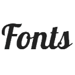
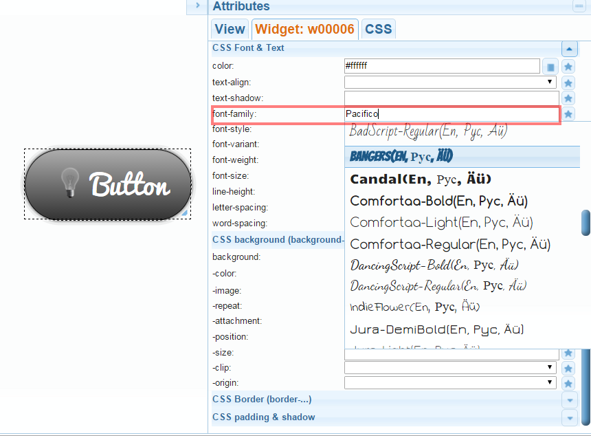
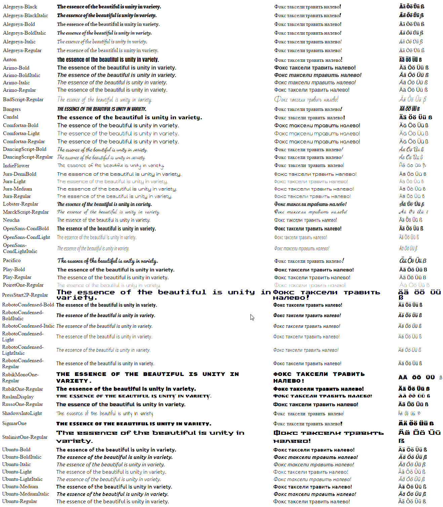

# ioBroker.vis-google-fonts

Дополнительные шрифты для ioBroker.vis и ioBroker.vis-2

## Использование

Установите шрифты и используйте поле **CSS->font-family** .

Шрифты:

Расширьте функциональность iobroker.vis с помощью шрифтов Google: <https://www.google.com/fonts>

В комплект будут включены следующие шрифты:

- Алегрейя — от Хуана Пабло дель Пераля ( <juan@huertatipografica.com.ar> )
- Антон - от Вернона Адамса ( <vern@newtypography.co.uk> )
- Аримо — из Apache 2.0
- BadScript - от Cyreal ( [www.cyreal.org](http://www.cyreal.org) )
- Баннеры - от Вернона Адамса ( <vern@newtypography.co.uk> )
- Candal - от Вернона Адамса ( <vern@newtypography.co.uk> )
- Comfortaa - от Йохана Аакерлунда ( <aajohan@gmail.com> )
- DancingScript — от Пабло Импаллари ( [www.impallari.com|impallari@gmail.com](http://www.impallari.com|impallari@gmail.com) ) и Иджино Марини. ( [www.ikern.com|mail@iginomarini.com](http://www.ikern.com|mail@iginomarini.com) )
- IndieFlower — от Кимберли Гесвейн (kimberlygeswein.com)
- Юра - от Даниэля Джонсона ( <il.basso.buffo@gmail.com> )
- Лобстер — от Пабло Импаллари ( [www.impallari.com|impallari@gmail.com](http://www.impallari.com|impallari@gmail.com) ) и Алексея Ваняшина ( [www.cyreal.org|a@cyreal.org](http://www.cyreal.org|a@cyreal.org) )
- MarckScript - от Дениса Машарова <denis.masharov@gmail.com> и Марка Фогеля
- Неуча — от Jovanny Lemonad ( <http://www.jovanny.ru> )
- OpenSans-Condensed - Apache 2.0
- Pacifico - от Вернона Адамса ( <vern@newtypography.co.uk> )
- Игра — от Йонаса Хекшера, Playtypes, e-types AS (e-types.com)
- PoiretOne - от Дениса Машарова ( <denis.masharov@gmail.com> )
- PressStart2P - от Коди "CodeMan38" Буасклера ( <cody@zone38.net> )
- RobotoCondensed - Apache 2.0
- RubikMonoOne - от Hubert and Fischer, Филипп Хуберт ( <philipp@hubertfischer.com> ), Себастьян Фишер ( <sebastian@hubertfischer.com> )
- RubikOne-Regular — от Хуберта и Фишера, Филиппа Хуберта ( <philipp@hubertfischer.com> ), Себастьяна Фишера ( <sebastian@hubertfischer.com> )
- RuslanDisplay - от Дениса Машарова <denis.masharov@gmail.com>
- RussoOne-Regular - от Jovanny Lemonad (jovanny.ru)
- ShadowsIntoLight - от Кимберли Гесвайн (kimberlygeswein.com)
- SigmarOne - от Вернона Адамса ( <vern@newtypography.co.uk> )
- СталинистОдин - от Алексея Маслова, Jovanny Lemonad ( <lemonad@jovanny.ru> )
- Ubuntu — ЛИЦЕНЗИЯ НА ШРИФТЫ UBUNTU, версия 1.0

<!--
	Placeholder for the next version (at the beginning of the line):
	### __WORK IN PROGRESS__
-->

## Changelog

### **WORK IN PROGRESS**
- (ioBroker-Bot) Adapter requires js-controller >= 6.0.11 now.
* (bluefox) Added vis-2 to restartAdapters and fixed the restart of vis instances after the fonts are updated (#47)

### 1.0.4 (2022-10-08)
* (Apollon77) prepare for future js-controller versions

### 1.0.3 (2021-11-11)
* (bluefox) Support of compact mode added

### 1.0.0 (2016-04-20)
* (bluefox) just set the version

### 0.1.0 (2015-11-05)
* (bluefox) always load google-fonts if installed

### 0.0.1 (2015-11-05)
* (bluefox) initial checkin

## License
 Apache 2.0 and SIL Open Font License 1.1
 Copyright bluefox<dogafox@gmail.com>
 
 Copyright (c) 2011, Juan Pablo del Peral (juan@huertatipografica.com.ar), 
 with Reserved Font Names "Alegreya" "Alegreya SC"
 
 Copyright (c) 2011, Vernon Adams (vern@newtypography.co.uk),
 with Reserved Font Name Anton.
 
 Copyright (c) 2011, Cyreal (www.cyreal.org),
 with Reserved Font Name "Bad Script".
 
 Copyright (c) 2010 by vernon adams (vern@newtypography.co.uk),
 with Reserved Font Name Bangers.
 
 Copyright (c) 2011, Vernon Adams (vern@newtypography.co.uk),
 with Reserved Font Name Candal.
 
 Copyright (c) 2010, 2011 Johan Aakerlund (aajohan@gmail.com),
 with Reserved Font Name "Comfortaa".
 
 Copyright (c) 2010, Pablo Impallari (www.impallari.com|impallari@gmail.com),
 Copyright (c) 2010, Igino Marini. (www.ikern.com|mail@iginomarini.com),
 with Reserved Font Name Dancing Script.
 
 Copyright (c) 2010, Kimberly Geswein (kimberlygeswein.com)
 
 Copyright (c) 2009, 2010, 2011 Daniel Johnson (<il.basso.buffo@gmail.com>).
 
 Copyright (c) 2010, Pablo Impallari (www.impallari.com|impallari@gmail.com),
 Copyright (c) 2010, 2011, Alexei Vanyashin (www.cyreal.org|a@cyreal.org),
 with Reserved Font Name Lobster.
 
 Copyright (c) 2011, Denis Masharov <denis.masharov@gmail.com> & Marck Fogel,
 with Reserved Font Name "Marck Script".
 
 Copyright (c) 2008-2010 by Jovanny Lemonad (http://www.jovanny.ru)
 
 Copyright (c) 2011, Vernon Adams (vern@newtypography.co.uk),
 with Reserved Font Name Pacifico.
 
 Copyright (c) 2011, Jonas Hecksher, Playtypes, e-types AS (e-types.com),
 with Reserved Font Name "Play", "Playtype", "Playtype Sans".
 
 Copyright (c) 2011, Denis Masharov (denis.masharov@gmail.com)
 
 Copyright (c) 2012, Cody "CodeMan38" Boisclair (cody@zone38.net), with Reserved Font Name "Press Start 2P"
 
 Copyright (c) 2013-2026, 2014, Hubert and Fischer, Philipp Hubert (philipp@hubertfischer.com), Sebastian Fischer (sebastian@hubertfischer.com)
 
 Copyright (c) 2013, 2014, Hubert and Fischer, Philipp Hubert (philipp@hubertfischer.com), Sebastian Fischer (sebastian@hubertfischer.com)
 
 Copyright (c) 2010, 2011, Denis Masharov <denis.masharov@gmail.com>,
 with Reserved Font Name "Ruslan", "Ruslan Display".
 
 Copyright (c) 2011-2012, Jovanny Lemonad (jovanny.ru), with Reserved Font Name "Russo"
 
 Copyright (c) 2010, Kimberly Geswein (kimberlygeswein.com)
 
 Copyright (c) 2011, Vernon Adams (vern@newtypography.co.uk),
 with Reserved Font Name Sigmar One.
 
 Copyright (c) 2009-2011, Alexey Maslov, Jovanny Lemonad (lemonad@jovanny.ru), with Reserved Font Name 'Stalinist'