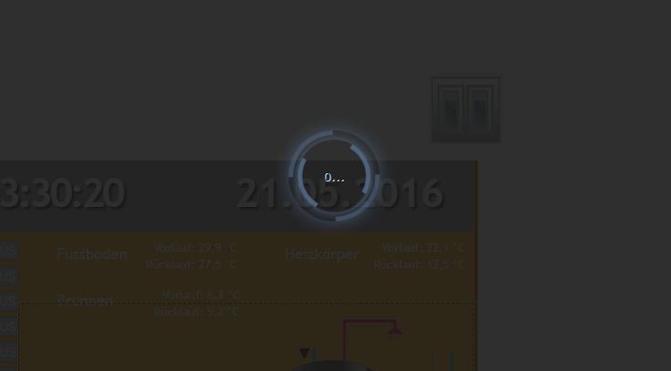

# Визуализация

Визуализация веб-контента для платформы ioBroker.

_**Разработка этой версии приостановлена. Пожалуйста, перенесите свои проекты в vis-2.**_

## Требования к лицензированию

Адаптер бесплатен для любых целей.

## Установка и документация


[Онлайн-демонстрации](https://iobroker.click/)

## Связывание объектов

Обычно большинство виджетов имеют атрибут ObjectID, и этот атрибут может быть связан с каким-либо значением идентификатора объекта. Но есть и другой способ привязать _любой_ атрибут виджета к определенному ObjectID.

Просто запишите в атрибут `{object.id}` и он будет привязан (не в режиме редактирования) к значению этого объекта. При использовании специального формата можно даже выполнять с ним простые операции, например, умножение или форматирование. Шаблон имеет следующий формат:

```
{objectID;operation1;operation2;...}
```

Поддерживаются следующие операции:

- `\*` - умножение. Аргумент должен быть заключен в скобки, например, "\*(4)". В этом примере мы умножаем значение на 4.
- `\+` - добавить. Аргумент должен быть заключен в скобки, например, "+(4.5)". В этом примере мы добавляем к значению 4.5.
- `\-` - вычесть. Аргумент должен быть заключен в скобки, например, "-(-674.5)". В этом примере мы вычитаем из значения -674.5.
- `/` - деление. Аргумент должен быть заключен в скобки, например, "/(0.5)". В этом примере мы делим значение на 0.5.
- `%` - по модулю. Аргумент должен быть в скобках, например, "%(5)". В этом примере мы берем по модулю 5.
- `round` - округлить значение.
- `round(N)` - округлить значение на N знаков после запятой, например, 34.678;round(1) => 34.7
- `hex` - Преобразовать значение в шестнадцатеричное. Все буквы строчные.
- `hex2` - Преобразовать значение в шестнадцатеричное. Все буквы строчные. Если значение меньше 16, то будет добавлен ведущий ноль.
- `HEX` - то же самое, что и шестнадцатеричный код, но в верхнем регистре.
- `HEX2` - то же самое, что и hex2, но в верхнем регистре.
- `date` - Форматирует дату в соответствии с заданным форматом. Формат тот же, что и в [iobroker.javascript.](https://github.com/iobroker/iobroker.javascript/blob/master/README.md#formatdate)
- `min(N)` - Если значение меньше N, берём N, в противном случае значение
- `max(M)` - Если значение больше M, берём M, в противном случае — значение
- `sqrt` - квадратный корень
- `pow(n)` - степень Н.
- `pow` - степень двойки.
- `floor` - Math.floor
- `ceil` - Math.ceil
- `json` - Операция для получения свойств JSON или объекта. Например, `{id;json(common.name.en)}`
- `random(R)` - Math.random() \* R, или просто Math.random(), если аргумента нет.
- `formatValue(decimals)` - отформатируйте значение в соответствии с системными настройками и используйте десятичные знаки.
- `date(format)` - Форматировать значение как дату. Формат выглядит следующим образом: `YYYY-MM-DD hh:mm:ss.sss`
- `momentDate(format, useTodayOrYesterday)` — Форматирование значения как даты с использованием Moment.js. [Допустимые форматы должны быть введены в соответствии с библиотекой moment.js](https://momentjs.com/docs/#/displaying/format/) . `useTodayOrYesterday=true` формат momentjs `ddd` /`dddd` перезаписываются данными за сегодняшний день / вчерашний день
- `array(element1,element2[,element3,element4])` - возвращает элемент по индексу. Например: `{id.ack;array(ack is false,ack is true)}`

Этот шаблон можно использовать в любом тексте, например:

```
My calculations with {objectID1;operation1;operation2;...} are {objectID2;operation3;operation4;...}
```

или расчеты цвета:

```
#{objectRed;/(100);*(255);HEX2}{objectGreen;HEX2}{objectBlue;HEX2}
```

Для отображения метки времени объекта выполните запись. `.ts` или `.lc` (для последнего изменения) в конце идентификатора объекта, например:

```
Last change: {objectRed.lc;date(hh:mm)}
```

Существует ещё один способ записать этот шаблон:

```
Hypotenuse of {height} and {width} = {h:height;w:width;Math.max(20, Math.sqrt(h*h + w*w))}
```

`{h:height;w:width;h*w}` будет интерпретировано как функция:

```
value = (function () {
    var h = "10";
    var w = "20";
    return Math.max(20, Math.sqrt(h*h + w*w));
})();
```

Вы можете использовать _любые_ функции JavaScript. Аргументы должны быть обозначены двоеточием (':'), в противном случае они будут интерпретированы как формула.

Будьте внимательны к типам. Все они определены как строки. Чтобы убедиться, что значение будет обрабатываться как число, используйте функцию parseFloat.

```
Hypotenuse of {height} and {width} = {h:height;w:width;Math.max(20, Math.sqrt(Math.pow(parseFloat(h), 2) + Math.pow(parseFloat(w), 2)))}
```

### Специальные переплеты

Существует ряд различных внутренних привязок для предоставления дополнительной информации в представлениях:

- `username` - отображает авторизованного пользователя
- `view` - название фактического вида
- `wname` - название виджета
- `widget` — это объект, содержащий все данные виджета. Может использоваться только в части JavaScript, например: `{a:a;widget.data.name}`
- `wid` - название фактического виджета
- `language` - может быть `de`, `en` или `ru`.
- `instance` - экземпляр браузера
- `login` - требуется ли авторизация (например, чтобы показать/скрыть кнопку выхода).
- `local_*` - если название штата начинается с `local_` Это не будет передано в ioBroker, но все виджеты обновятся, в зависимости от этого состояния. (Локальная переменная для текущей сессии браузера)

Примечание: для использования символа ":" в вычислениях (например, в строковых формулах) используйте вместо него "::".

**Помните** , что определения стилей будут интерпретироваться как привязки, поэтому используйте `{{style: value}}` или просто

```
{
	style: value
}
```

для этого.

## Фильтры

Чтобы отобразить все виджеты на одном экране, можно использовать фильтры для уменьшения количества виджетов, одновременно отображаемых на экране.

Каждый виджет имеет поле `filter` Если вы зададите ему какое-либо значение, например... `light`, поэтому вы можете использовать другие виджеты. `(bars - filters, filter - dropdown)` для управления тем, какой фильтр фактически активен.

## Интерфейс управления

Vis создает 3 переменные:

- `control.instance` — Здесь следует указать экземпляр браузера или `FFFFFFFF` если каждый браузер должен контролироваться.
- `control.data` — Параметр для команды. См. подробное описание конкретной команды.
- `control.command` - Название команды. Запись в эту переменную запускает команду. Это означает, что перед записью команды необходимо подготовить "экземпляр" и "данные", содержащие необходимые данные.

Команды:

- `alert` - Отобразить всплывающее окно в визуализации. Файл "control.data" имеет следующий формат: "message;title;jquery-icon". Title и jquery-icon являются необязательными. Названия значков можно найти [здесь](http://jqueryui.com/themeroller/) . Чтобы отобразить значок "ui-icon-info", напишите `Message;;info`.
- `changeView` - Переключитесь на нужный вид. Файл "control.data" должен содержать имя представления. Вы также можете указать имя проекта, например, "project/view". Проект по умолчанию — "main".
- `refresh` - Перезагрузить визуализацию, например, после изменения проекта, чтобы она перезагружалась во всех браузерах.
- `reload` — то же самое, что и обновление.
- `dialog` — Отобразить диалоговое окно. Диалоговое окно должно отображаться. Один из вариантов:

  - `static    - HTML    - Dialog`,
  - `static    - Icon    - Dialog`,
  - `container - HTML    - view in jqui Dialog`,
  - `container - ext cmd - view in jqui Dialog`,
  - `container - Icon    - view in jqui Dialog`,
  - `container - Button  - view in jqui Dialog`.

  `control.data` должен содержать идентификатор виджета диалога, например: `w00056`.
- `dialogClose`
- `popup` - открывает новое окно браузера. Ссылка должна быть указана в `control.data` например, <http://google.com>
- `playSound` - Воспроизвести звуковой файл. Ссылка на файл указана в `control.data` Например, <http://www.modular-planet.de/fx/marsians/Marsiansrev.mp3> . Вы можете загрузить свой собственный файл в Vis и воспроизвести его, как, скажем, в оригинале. `/vis.0/main/img/myFile.mp3`.

Если пользователь изменит ракурс или в начале работы, переменные будут заполнены элементом vis.

- `control.instance`: экземпляр браузера и `ack=true`
- `control.data`: название проекта и представления в форме `project/view` например `main/view` (и `ack=true`)
- `control.command`: `changedView` и `ack=true`

Вы можете записать строку или объект JSON в... `control.command` как `{instance: 'AABBCCDD', command: 'cmd', data: 'ddd'}` В этом случае экземпляр и данные будут взяты из JSON-объекта.

Пример использования JavaScript-адаптера:

```
setState('vis.0.control.command', {"instance": "*", "command": "refresh", "data": ""});
```

## Вид по умолчанию

Для каждого элемента можно задать желаемое разрешение (Меню => Инструменты => Разрешение). В режиме редактирования это всего лишь визуальная рамка, показывающая размер экрана на конкретном устройстве. В режиме реального времени она не будет видна, и все виджеты за пределами рамки будут отображаться.

Кроме того, вы можете указать, должен ли этот вид использоваться по умолчанию для данного разрешения.

Поэтому каждый раз, когда `index.html` (без `#viewName` Если вызывается функция, будет открыт наиболее подходящий для данного разрешения вариант просмотра. Если флаг _"Default"_ установлен только для одного варианта просмотра, то этот вариант будет открыт независимо от разрешения или ориентации экрана.

Например, вы можете создать два режима просмотра: «Альбомная ориентация — Мобильная версия» и «Портативная ориентация — Мобильная версия», и эти два режима будут автоматически переключаться при изменении ориентации или размера экрана.

Вспомогательный виджет "Основные параметры - Разрешение экрана" отображает фактическое разрешение экрана и наиболее подходящий вариант отображения по умолчанию для этого разрешения.

## Веб-компоненты

Адаптеры позволяют подключать [веб-компоненты ioBroker](https://github.com/ioBroker/web-components) : пользовательские элементы, которые отображаются на vis, vis-2, admin и других хостингах. Адаптер отображает их в списке. `common.webComponents` его `io-package.json`.

При запуске редактора или среды выполнения vis находит веб-компоненты всех установленных адаптеров и отображает их в виде виджетов из набора виджетов "webcomponents":

- Настройки компонента — это атрибуты виджета, включая их метки, значения по умолчанию, параметры и условия «скрыт» и «отключен».
- Группа «Веб-компонент» задает тему компонента: параметр «авто» выбирает темный цвет, если цвет текста виджета светлый. При желании можно задать основной цвет.
- Среда выполнения загружает компоненты только в том случае, если представление его отображает. Компонент, который редактирует значение (`editsValue`) не предлагается, поскольку vis не хранит никаких значений.
- Мероприятие `iob-navigate` При открытии компонента отображается его название.

В браузере без модулей ES и пользовательских элементов вместо компонента отображается подсказка. Представления и все остальные виджеты работают как и раньше.

## Настройки

### Перезагрузить, если сон длится дольше

Существует правило, согласно которому после некоторого периода отключения вся страница VIS будет перезагружена для синхронизации проекта. Вы можете настроить это в меню «Настройки...». Если вы установите интервал «никогда», страница никогда не будет перезагружаться.

### Интервал повторного подключения

Установите интервал между попытками подключения в случае разрыва соединения. Если вы установите 2 секунды, соединение будет устанавливаться каждые 2 секунды.

### Темный экран повторного подключения

Иногда (ночью) требуется темный экран загрузки. С помощью этой опции вы можете его настроить.

Обратите внимание, что эти настройки действительны только для повторного подключения, а не для первого.



<!--
    Placeholder for the next version (at the beginning of the line):
    ### **WORK IN PROGRESS**
-->

## Changelog
### 1.6.1 (2026-11-20)
* (bluefox) Added support of ioBroker web components (`@iobroker/web-components`): the components of the installed adapters are shown as widgets of the set "webcomponents"

### 1.6.0 (2026-11-19)
* (bluefox) Modern look of the editor for the themes "Light" and "Dark" (only the editor, the runtime and the views are not changed). "Dark-Hive" and "redmond" keep the classic look.
* (bluefox) Modern loading screen in the editor for the themes "Light" and "Dark"
* (bluefox) Fixed the error "Unexpected non-whitespace character after JSON" if the browser instance ID was stored as plain text
* (bluefox) Fixed changing of the browser instance ID in the editor
* (bluefox) The pages with the installed widget sets are generated only at the start of the instance and not by "npm install" anymore
* (bluefox) Backend migrated to TypeScript
* (bluefox) Fixed: the settings "always" and "dependencies" of widget sets found outside of the ioBroker "node_modules" directory were ignored

### 1.5.7 (2026-10-04)
* (bluefox) Global `let`/`const` variables of widget sets are visible again if the widget sets are loaded dynamically (e.g. via cloud).
* (ioBroker-Bot) Adapter requires js-controller >= 6.0.11 now.
* (bluefox) Removed usage of `storage` and uses localStorage instead.

### 1.5.5 (2024-04-12)
* (bluefox) Corrected small warning

### 1.5.4 (2023-11-29)
* (agav99) added the new binding operation for getting property of JSON or object
* (agav99) Checked the initialization of the `local_` variables
* (agav99) fixed subscribeOidAtRuntime
* (stephanritscher) Added dynamic web manifest
* (agav99) Optimization for basic-view in widget8
* (oweitman) Changed binding regex to accept umlauts
* (mcm1957) Corrected first installation of vis

## License
The MIT License (MIT)

Copyright (c) 2013-2026 Denis Haev <dogafox@gmail.com>,
Copyright (c) 2013      hobbyquaker

Permission is hereby granted, free of charge, to any person obtaining a copy
of this software and associated documentation files (the "Software"), to deal
in the Software without restriction, including without limitation the rights
to use, copy, modify, merge, publish, distribute, sublicense, and/or sell
copies of the Software, and to permit persons to whom the Software is
furnished to do so, subject to the following conditions:

The above copyright notice and this permission notice shall be included in
all copies or substantial portions of the Software.

THE SOFTWARE IS PROVIDED "AS IS", WITHOUT WARRANTY OF ANY KIND, EXPRESS OR
IMPLIED, INCLUDING BUT NOT LIMITED TO THE WARRANTIES OF MERCHANTABILITY,
FITNESS FOR A PARTICULAR PURPOSE AND NONINFRINGEMENT. IN NO EVENT SHALL THE
AUTHORS OR COPYRIGHT HOLDERS BE LIABLE FOR ANY CLAIM, DAMAGES OR OTHER
LIABILITY, WHETHER IN AN ACTION OF CONTRACT, TORT OR OTHERWISE, ARISING FROM,
OUT OF OR IN CONNECTION WITH THE SOFTWARE OR THE USE OR OTHER DEALINGS IN
THE SOFTWARE.