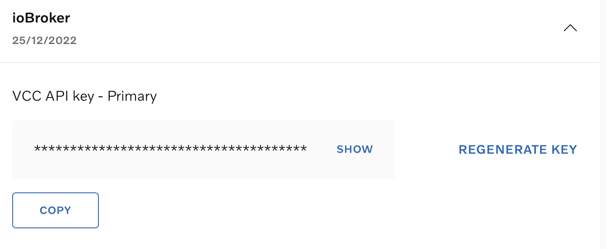

# ioBroker.volvo

## Адаптер Volvo Cars для ioBroker

Этот адаптер подключает ваш автомобиль Volvo к ioBroker, используя [API Volvo Connected Vehicle](https://developer.volvocars.com/apis/) и [Energy API v2](https://developer.volvocars.com/apis/energy/v2/overview/) .

### Поддерживаемые функции

- 🔋 Уровень заряда батареи, запас хода на электротяге, состояние зарядки (PHEV / BEV)
- ⛽ Уровень топлива, показания одометра, статистика поездки
- 🚪 Состояние двери, окна и замка
- 📍 Местоположение по GPS
- 🔧 Диагностика (предупреждения о необходимости технического обслуживания, тормозная жидкость, масло, шины, освещение)
- 🔑 Дистанционное управление (блокировка/разблокировка, звуковой сигнал, мигание фар, климат-контроль)
- 🔌 Настенный зарядный блок Volvo (API Energy Device): информация о зарядном блоке, сеансы зарядки, запуск/пауза зарядки, ограничение тока зарядки/разрядки
- 🔄 Автоматическое обновление данных с настраиваемыми интервалами
- 🔐 Сохранение токена — обеспечивает работу адаптера после перезагрузки без повторного входа в систему.

---

## Руководство по настройке

### 1. Получите ключ API VCC.

1. Перейдите на [сайт developer.volvocars.com](https://developer.volvocars.com/account/) и войдите в свою учетную запись (Google или GitHub).
2. Создайте новое **приложение** .
3. Скопируйте **ключ API VCC (основной)** .

### 2. Настройка адаптера

1. Откройте настройки адаптера в ioBroker.
2. Введите адрес электронной почты и **пароль** от вашей **учетной записи Volvo ID** (те же учетные данные, которые вы используете в приложении Volvo Cars).
3. Вставьте **ключ API VCC** .
4. Установите **интервал обновления** (по умолчанию: 5 минут).

### 3. Вход с помощью OTP (одноразового пароля)

API Volvo использует двухфакторную аутентификацию с одноразовым паролем (OTP):

1. В настройках адаптера нажмите **«Начать вход в систему (отправить OTP)»** .
2. Проверьте свою электронную почту — там будет код OTP от Volvo.
3. Введите код и нажмите **«Отправить OTP»** .
4. Адаптер сохраняет данные для входа и автоматически обновляет их. Повторный ввод одноразового пароля (OTP) требуется только в том случае, если адаптер был отключен примерно на 90 дней или компания Volvo завершает сессию (например, после смены пароля).

> **Примечание:** Если данные для входа больше недействительны, адаптер регистрирует одну ошибку и приостанавливает обновления. Просто повторите ввод одноразового пароля (OTP) в настройках адаптера.

---

## Точки данных

Адаптер создает следующую структуру точек данных в рамках `volvo.0.<VIN>`:

| Путь                               | Описание                                                                                          |
| ---------------------------------- | ------------------------------------------------------------------------------------------------- |
| `energy.batteryChargeLevel.*`      | Уровень заряда батареи (%), отметка времени обновления.                                           |
| `energy.electricRange.*`           | Запас хода на электротяге (км)                                                                    |
| `energy.chargingStatus.*`          | Состояние зарядки (в режиме ожидания, в процессе зарядки и т. д.)                                 |
| `energy.chargerConnectionStatus.*` | Подключение зарядного устройства (ПОДКЛЮЧЕНО, ОТКЛЮЧЕНО)                                          |
| `status.doors.*`                   | Состояние двери (открыта/закрыта), центральный замок                                              |
| `status.windows.*`                 | Состояние окон, включая люк в крыше.                                                              |
| `status.fuel.*`                    | Объем топлива (литры)                                                                             |
| `status.odometer.*`                | Показания одометра (км)                                                                           |
| `status.diagnostics.*`             | Предупреждения о необходимости технического обслуживания, расстояние/время до сервисного центра   |
| `status.statistics.*`              | Расход топлива/энергии, счетчики пробега                                                          |
| `status.engine-status.*`           | Состояние работы двигателя                                                                        |
| `status.warnings.*`                | Световые предупреждающие сигналы (стоп-сигналы, противотуманные фары, указатели поворота и т. д.) |
| `location.*`                       | GPS-координаты, направление, отметка времени                                                      |
| `remote.*`                         | Дистанционное управление (кнопки)                                                                 |

## Удаленные команды

Воспользуйтесь кнопками ниже `volvo.0.<VIN>.remote` для управления вашим транспортным средством:

- `lock` /`unlock` — Заблокировать или разблокировать автомобиль
- `climatization-start` /`climatization-stop` — Начать или остановить предварительную подготовку
- `honk` /`flash` /`honk-flash` — Подать звуковой сигнал, включить фонарики или и то, и другое.
- `lock-reduced-guard` — Замок с ослабленной защитой
- `refresh` — Обновить все данные вручную

## Настенный распределительный щит Volvo (опционально)

Поддерживаются только настенные зарядные устройства Volvo (API Energy Device). API Volvo не может отобразить список ваших зарядных устройств, поэтому в настройках адаптера введите **идентификатор EVSE** из документа, предоставленного Volvo вместе с зарядным устройством (несколько идентификаторов, разделенных запятыми). Оставьте поле пустым, если у вас нет зарядного устройства Volvo — в этом случае адаптер не будет отправлять запросы к нему.

Если вы добавили настенное устройство после последнего входа в систему, войдите в систему еще раз, используя одноразовый пароль (OTP), чтобы адаптер получил права доступа к настенному устройству.

Точки данных под `volvo.0.wallbox.<EVSE ID>` (персонажи, подобные `*` заменяются на `_`):

| Путь                                                    | Описание                            |
| ------------------------------------------------------- | ----------------------------------- |
| `info.*`                                                | Информация о настенном блоке из API |
| `chargingSessions.count` /`totalEnergy` /`json`         | Сеансы зарядки за последние 7 дней  |
| `chargingSessions.last.*`                               | Последняя сессия зарядки            |
| `remote.start` /`remote.pause`                          | Начать или приостановить зарядку    |
| `remote.chargingAmpLimit` /`remote.dischargingAmpLimit` | Запишите текущий лимит в A.         |
| `remote.refresh`                                        | Обновите данные настенного блока.   |
| `remote.lastCommandStatus`                              | Результат последней команды (JSON)  |

> **Примечание:** Поддержка настенных зарядных устройств была реализована на основе документации API Volvo без тестового устройства. Пожалуйста, сообщайте о проблемах в разделе Issues на GitHub.

---

## Changelog

### 4.0.1
- Fix: remote commands (lock, unlock, climatization, …) failed with error 415, Volvo now requires a JSON body for commands

### 4.0.0
- **Breaking:** Volvo ID moves to a new login system (Keycloak) and the old one stops working after January 2027. The adapter now logs in like the current Volvo Cars app. **Please log in again once:** click "Start Login (Send OTP)" in the adapter settings and submit the OTP from the email
- Change: the login stays valid as long as the adapter runs; a new OTP login is only needed after about 90 days without the adapter running
- New: Volvo wallbox support via the Energy Device API (wallbox info, charging sessions, start/pause, current limits); enter the EVSE ID in the settings. Built from the documentation without a test device
- Removed: the warning before the fixed 180-day login limit, Volvo no longer has such a limit
- Fix: when a car is removed from the Volvo ID (e.g. replaced by a new one), the adapter logs one warning and reloads the vehicle list instead of logging 403 errors every few minutes until a restart

### 3.1.0
- New: login method of the Volvo Cars app (Authorization Code with PKCE, DPoP-bound tokens). Volvo disabled the client the adapter used before, see [#155](https://github.com/TA2k/ioBroker.volvo/issues/155). **Please log in again once:** click "Start Login (Send OTP)" in the adapter settings and submit the OTP from the email
- Change: the OTP email is only sent when you click "Start Login (Send OTP)", no longer automatically on adapter start
- Change: the OTP is submitted with the "Submit OTP" button only; it is no longer saved in the settings

### 3.0.4
- Fix: Volvo disabled the login client used by this adapter on 2026-10-26 (`invalid_client`). The adapter now logs one clear error and pauses updates instead of repeating errors every few minutes. Login does not work until a new login method is implemented, see [#155](https://github.com/TA2k/ioBroker.volvo/issues/155)
- Chore: dependency updates
  - `json2iob` 2.6.26 → 2.6.28
  - `qs` 6.16.0 → 6.16.1
  - `@iobroker/testing` 6.2.2 → 6.3.1, `@types/node` 22.20.4 → 22.20.5

### 3.0.3
- Fix: no more log spam after the Volvo login (refresh token, ~180 days) expired; updates pause until you log in again
- New: warning 7 days before the login expires
- Chore: dependency updates

### 3.0.2
- Chore: dependency updates
  - `axios` 1.16.1 → 1.19.0
  - `qs` 6.15.2 → 6.16.0
  - `@iobroker/adapter-core` 3.3.2 → 3.4.3
  - `json2iob` 2.6.22 → 2.6.25
  - dev: `@iobroker/testing` 5.3.0, `@tsconfig/node22` 22.0.6, `@types/node` 22.20.1, `@alcalzone/release-script` 5.2.1, `@alcalzone/release-script-plugin-license` 5.2.2
  - transitive: `brace-expansion`, `adm-zip`, `deepl-node`, `browserslist`, `js-yaml`, `form-data`

### 3.0.1
- Fix: address ioBroker repo checker findings:
  - `eslint.config.mjs` now imports `@iobroker/eslint-config`
  - Added `prettier.config.mjs`
  - License copyright line updated to `(c)` format
  - All `setInterval`/`setTimeout` migrated to `this.setInterval`/`this.setTimeout`
  - i18n migrated to short format (`{lang}.json`)

Older changes: CHANGELOG_OLD.md

## License

MIT License

Copyright (c) 2020-2026 TA2k <tombox2020@gmail.com>

Permission is hereby granted, free of charge, to any person obtaining a copy
of this software and associated documentation files (the "Software"), to deal
in the Software without restriction, including without limitation the rights
to use, copy, modify, merge, publish, distribute, sublicense, and/or sell
copies of the Software, and to permit persons to whom the Software is
furnished to do so, subject to the following conditions:

The above copyright notice and this permission notice shall be included in all
copies or substantial portions of the Software.

THE SOFTWARE IS PROVIDED "AS IS", WITHOUT WARRANTY OF ANY KIND, EXPRESS OR
IMPLIED, INCLUDING BUT NOT LIMITED TO THE WARRANTIES OF MERCHANTABILITY,
FITNESS FOR A PARTICULAR PURPOSE AND NONINFRINGEMENT. IN NO EVENT SHALL THE
AUTHORS OR COPYRIGHT HOLDERS BE LIABLE FOR ANY CLAIM, DAMAGES OR OTHER
LIABILITY, WHETHER IN AN ACTION OF CONTRACT, TORT OR OTHERWISE, ARISING FROM,
OUT OF OR IN CONNECTION WITH THE SOFTWARE OR THE USE OR OTHER DEALINGS IN THE
SOFTWARE.