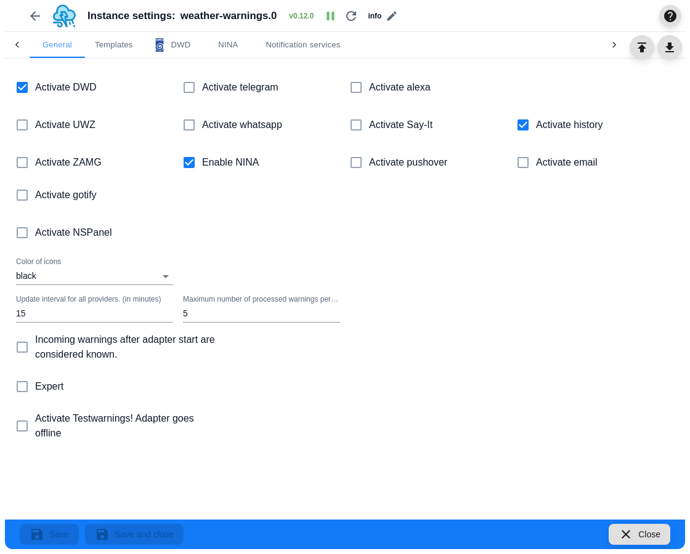
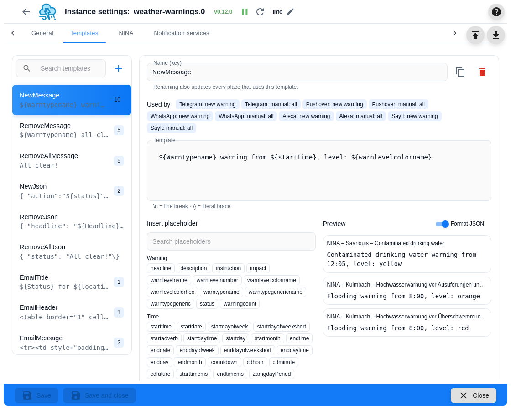
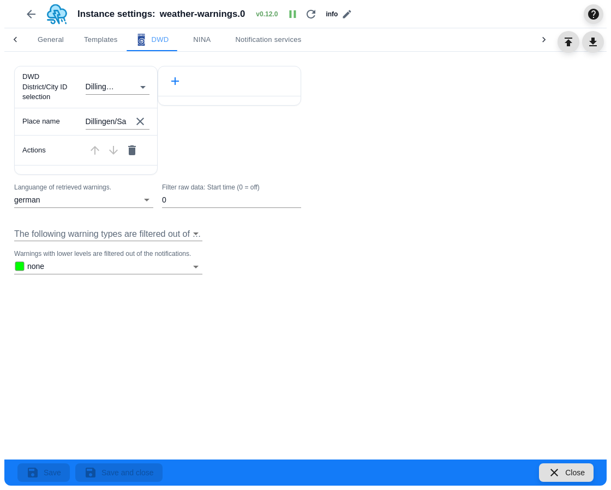
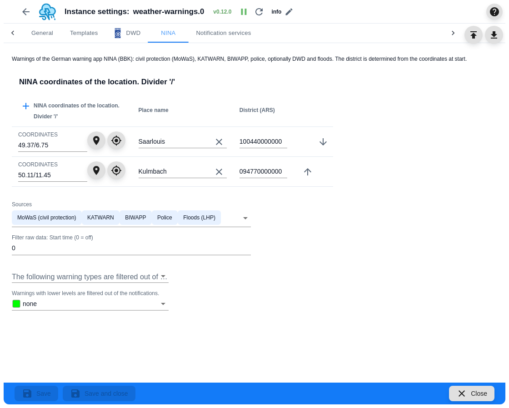
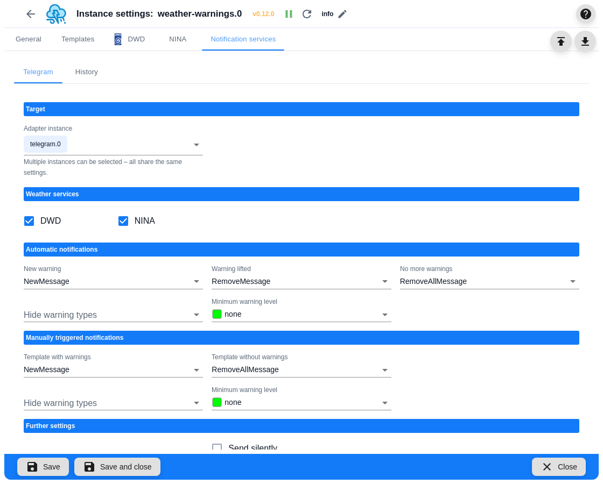

# ioBroker.weather-warnings

## адаптер предупреждений о погоде для ioBroker

[Deutsche Readme](/#/docs/adapterref/iobroker.weather-warnings/README_DE.md)

Этот адаптер собирает официальные предупреждения о погоде и данные гражданской защиты для ваших местоположений.

- отправляет их в виде текстовых или голосовых сообщений (Telegram, WhatsApp, Pushover, Gotify, email, NSPanel, Alexa, SayIt).
- Записывает их в состояния (исходные данные, отформатированные значения, предупреждения, сгруппированные по типу) для VIS и скриптов.

Все тексты созданы на основе шаблонов, которые можно редактировать в административной панели с предварительным просмотром в реальном времени.

### Поставщики

| Поставщик                                      | Область  | Расположение                      | Примечания                                                                             |
| ---------------------------------------------- | -------- | --------------------------------- | -------------------------------------------------------------------------------------- |
| **DWD** (Deutscher Wetterdienst)               | Германия | муниципалитет или район из списка | официальные предупреждения о погоде                                                    |
| **UWZ** (Unwetterzentrale)                     | Европа   | координаты                        | предупреждения о погоде                                                                |
| **ZAMG / GeoSphere**                           | Австрия  | координаты                        | предупреждения о погоде                                                                |
| **NINA** (приложение с предупреждениями о BBK) | Германия | координаты → район                | Гражданская защита: MoWaS, KATWARN, BIWAPP, полиция; по желанию DWD и наводнения (LHP) |

Возможно несколько местоположений от одного поставщика услуг. Каждое местоположение соответствует отдельному устройству, расположенному ниже. `provider.<provider>.<location>`.

### службы уведомлений

Telegram, WhatsApp, Pushover, Gotify, Email, NSPanel (nspanel-lovelace-ui), Alexa (alexa2), SayIt, а также два внутренних выхода адаптера:

- **История** : список последних предупреждений в штате.
- **JSON-массив** : текущие предупреждения в формате JSON для скриптов.

Telegram, WhatsApp, Pushover, Gotify и электронная почта могут отправлять сообщения сразу в несколько экземпляров адаптера.

## Требования

- Node.js 22 или новее
- js-controller 6.0.11 или новее
- Admin 8.1.0 или более поздняя версия

## Установка

Установите адаптер из административной панели ioBroker. После первого запуска экземпляр будет записывать шаблоны сообщений на языке системы. Если страница конфигурации уже была открыта, **перезагрузите её,** чтобы увидеть их.

## Конфигурация

### Общий

- **Активация DWD / UWZ / ZAMG / NINA** : включает получение данных от этого поставщика. Для каждого поставщика создается отдельная вкладка.
- **Активация Telegram / Pushover / …** : включает службу уведомлений. Ее настройки находятся на вкладке _«Службы уведомлений»_ .
- **Цвет значков** : набор цветов, используемый для `${iconurl}`.
- **Интервал обновления** : в минутах, для всех провайдеров (минимум 5).
- **Максимальное количество обработанных предупреждений на одного поставщика** : количество слотов состояний `00`, `01` … по местоположению.
- **Предупреждения, поступающие после запуска адаптера, считаются известными** : предупреждения, которые уже существуют на момент запуска адаптера, не вызывают отправки уведомления.
- **Эксперт** : отображает дополнительные настройки (время тишины для голосового вывода, альтернативные URL-адреса значков, папки, в которые записываются данные, параметры тестирования).
- **Включить предупреждения о тестировании** : используются встроенные тестовые данные вместо реальных поставщиков.

### Шаблоны

Сообщения создаются на основе шаблонов. Редактор показывает

- Список шаблонов (с возможностью поиска) с указанием количества мест, где используется каждый из них.
- там, где используется шаблон ( **Используется пользователем** ), переименование шаблона обновляет все эти места.
- Палитра всех заполнителей – нажмите для вставки,
- **Предварительный просмотр,** отображаемый адаптером в реальном времени, с текущими предупреждениями (или примерными данными, если таковых нет).

Синтаксис шаблона:

- `${token}` заменяется значением предупреждения, например: `${headline}`, `${starttime}`. Первая буква заглавная (`${Warntypename}`) капитализирует стоимость.
- `${_myTemplate}` Вставляет другой шаблон. Шаблоны, ключ которых начинается с `_` не предлагаются в рамках услуг.
- `${[a,b,c,d,e]warnlevelnumber}` выбирает запись по числовому токену, например `${[0,🟢,🟡,🟠,🔴]warnlevelnumber}`.
- `${(value=token)then#else}` или `${(value=token)then}` – сравнения `=`, `!=`, `<`, `>`.
- `\n` — это перенос строки; в шаблонах JSON закрывающая фигурная скобка должна быть написана как `\}`.

**Функция «Восстановить шаблоны»** возвращает все шаблоны к шаблонам по умолчанию на языке текущей системы (ваши шаблоны будут потеряны). **Функция «Добавить шаблоны по умолчанию»** добавляет только отсутствующие шаблоны.

All placeholders

| Заполнитель                                                                                 | Значение                                                                                          |
| ------------------------------------------------------------------------------------------- | ------------------------------------------------------------------------------------------------- |
| `headline`, `description`, `instruction`, `impact`                                          | тексты предупреждения (`impact` (Только для ZAMG)                                                 |
| `warnlevelname`, `warnlevelnumber`                                                          | уровень в виде текста / число 0–4                                                                 |
| `warnlevelcolorname`, `warnlevelcolorhex`                                                   | цвет уровня в виде текста / шестнадцатеричного значения                                           |
| `warntypename`                                                                              | Тип предупреждения, предоставленный поставщиком.                                                  |
| `warntypegenericname`, `warntypegeneric`                                                    | Единый тип предупреждения (см. ниже) в виде текста/числа                                          |
| `weatheremoji`, `iconurl`, `htmlicon`                                                       | эмодзи, URL значка, значок в формате base64 ``                                                |
| `location`, `locationcustom`, `provider`                                                    | регион от провайдера, название вашего места, провайдер                                            |
| `starttime`, `startdate`, `startday`, `startmonth`, `startdayofweek`, `startdayofweekshort` | начинать                                                                                          |
| `endtime`, `enddate`, `endday`, `endmonth`, `enddayofweek`, `enddayofweekshort`             | конец                                                                                             |
| `startdaytime`, `enddaytime`, `startadverb`                                                 | время суток, "сегодня/завтра/…"                                                                   |
| `countdown`, `cdhour`, `cdminute`, `cdfuture`                                                | время до начала                                                                                   |
| `starttimems`, `endtimems`                                                                  | метки времени в миллисекундах (`endtimems` (значение равно 0, если предупреждение не имеет конца) |
| `ceiling`, `altitude`                                                                       | Диапазон высот (DWD, UWZ)                                                                         |
| `status`, `warningcount`                                                                    | новый / блокировка / все чисто, количество предупреждений                                         |
| `zamgdayPeriod`                                                                             | ZAMG: предупреждение на весь день                                                                 |

### Поставщики

- **DWD** : выберите муниципалитет или район из списка (около 10 000 записей). После ввода населенного пункта переключитесь на другую вкладку и обратно — список слишком большой, чтобы обновить его сразу.
- **UWZ** : координаты `latitude/longitude` Адаптер один раз определяет область UWZ и сохраняет её.
- **ZAMG** : координирует действия в пределах Австрии.
- **Название места** : ваше собственное название для этого места, доступно в виде `${locationcustom}`.
- **Фильтрация исходных данных: время начала** : игнорирует предупреждения, которые начнутся более чем через X часов (0 = выключено).
- **Предупреждение** : выбранные типы отбрасываются.
- **Уровень** : предупреждения ниже этого уровня игнорируются. Цветной квадрат показывает цвет уровня.

#### НИНА

NINA — это официальное приложение для оповещения Федерального управления гражданской защиты (BBK). Оно содержит предупреждения, которых нет у метеорологических служб: опасные вещества, питьевая вода, неразорвавшиеся бомбы, отключения электроэнергии, полицейские операции, наводнения и т. д.

- **Координаты** : предварительно заполнены из настроек системы ioBroker. При запуске адаптер определяет район (Landkreis) по координатам и отображает его ключ (ARS) в таблице. NINA выдает предупреждение для каждого района, поэтому два места в одном районе запрашиваются только один раз.
- **Источники** : какие источники NINA используются. По умолчанию: MoWaS (гражданская защита), KATWARN, BIWAPP и полиция. **DWD** доступен как отдельный поставщик, а **наводнения (LHP)** носят локальный характер, поэтому оба источника по умолчанию отключены.
- Бесконечные предупреждения (характерные для MoWaS) отображаются как «до дальнейшего уведомления». `${endtime}` Они прекращаются, когда Нина их снимает.
- Все сообщения об отсутствии изменений завершают указанное предупреждение; обновления предупреждения заменяют его без нового уведомления (если только уровень не повышается).
- Тексты отображаются на языке системы, если он указан NINA (в противном случае — на английском или немецком, предупреждения о наводнениях — только на немецком языке).

### службы уведомлений

Для каждой активированной услуги существует своя собственная страница с теми же разделами:

- **Цель** : экземпляр(ы) адаптера, которому(ым) следует отправить данные. Без действительной цели служба не запускается (см. журнал).
- **Метеорологические службы** : какие поставщики услуг предоставляются в рамках этой услуги.
- **Автоматические уведомления** : шаблоны для _новых предупреждений_ , _снятых предупреждений_ (при наличии активных других предупреждений) и _отсутствия новых предупреждений_ , а также фильтр по типу и минимальный уровень. Выбор `none` В данном случае шаблон ничего не отправляет.
- **Уведомления, запускаемые вручную** : шаблоны, используемые при записи в `commands.send_message.<service>` – один знак «есть предупреждения», один знак «предупреждений нет».
- **Дополнительные настройки** : параметры, специфичные для конкретной услуги, например.
  - Telegram: имена пользователей, идентификатор чата, беззвучное сообщение, режим анализа
  - Pushover / Gotify: приоритет, звук, устройство, тип контента
  - NSPanel: всплывающее окно, заголовок заставки или и то, и другое, приоритет, постоянно включено
  - Alexa: устройства, громкость, аудиофайл перед сообщением, звук для каждого типа предупреждения (эксперт)
  - SayIt: экземпляры и объем
  - Электронная почта: получатели, заголовок, шаблоны верхнего и нижнего колонтитулов, перенос строки.
  - История: записать все отформатированные значения в историю.

Голосовой вывод (Alexa, SayIt) можно отключить с помощью **профилей тихого режима** (экспертный, вкладка _«Дополнительные настройки_ »), переключаемых с помощью `commands.silentTime.*`.

## Уровни и типы предупреждений

| Уровень | Значение       | Цвет                            |
| ------- | -------------- | ------------------------------- |
| 0       | никто          | зеленый                         |
| 1       | незначительный | желтый                          |
| 2       | умеренный      | апельсин                        |
| 3       | серьезный      | красный                         |
| 4       | экстремальный  | фиолетовый (DWD: темно-красный) |

Каждый поставщик использует свои собственные типы предупреждений. Адаптер сопоставляет их с унифицированными типами, которые используются для фильтров, значков и т. д. `alerts` штаты:

`storm`, `snowfall`, `rain`, `cold`, `forest_fire`, `thunderstorm`, `black_ice_slippery`, `heat`, `hail`, `fog`, `thaw`, `flood`, `civil_protection`, `unknown`

`flood` и `civil_protection` (Все не связанные с погодой события NINA) происходят от NINA.

## Штаты

| Состояние                                                                                            | Содержание                                                                                                                            |
| ---------------------------------------------------------------------------------------------------- | ------------------------------------------------------------------------------------------------------------------------------------- |
| `provider.<provider>.<location>.warning.NN`                                                          | Исходные данные предупреждения, предоставленные поставщиком (NINA: уже очищены).                                                      |
| `provider.<provider>.<location>.formatedKeys.NN`                                                     | все заполнители с их текущим значением, а также ваши шаблоны, начинающиеся с `_`                                                      |
| `provider.<provider>.<location>.alerts.<type>`                                                       | по типу предупреждения: `level`, `start`, `end`, `headline`, `active`, `type` – наивысший уровень активного предупреждения этого типа. |
| `provider.<provider>.<location>.history`, `.activeWarnings`, `.lastUpdate`                           | по местоположению                                                                                                                     |
| `alerts.<type>`                                                                                      | Как указано выше, это относится ко всем поставщикам услуг и местоположениям.                                                          |
| `provider.activeWarnings`, `provider.hasActiveWarning`, `provider.maxLevel`, `provider.maxLevelText` | сводка всех предупреждений                                                                                                            |
| `provider.history`                                                                                   | история ( _история_ службы)                                                                                                           |
| `commands.send_message.<service>`                                                                    | Отправлять текущие предупреждения с помощью этой службы (шаблоны, созданные вручную)                                                  |
| `commands.silentTime.*`                                                                              | Тихий временной профиль и автоматический режим                                                                                        |
| `commands.clearHistory`                                                                              | очищает историю                                                                                                                       |

Количество слотов `NN` Исправлено (установлено _максимальное количество обрабатываемых предупреждений_ ). Пустые слоты очищаются, а не удаляются, поэтому дерево объектов не изменяется с каждым предупреждением.

## Общее поведение

- Для одного и того же предупреждения нет дублирующихся сообщений: обновления предупреждения отправляются только в том случае, если это новое предупреждение для вас.
- `alerts.<type>` Отображает одно предупреждение каждого типа: то, которое активно **в данный момент,** имеет наивысший уровень, в противном случае — следующее предупреждение в будущем.
- Время отображается в часовом поясе хоста ioBroker — убедитесь, что хост использует реальный часовой пояс, например, такой: `Europe/Berlin` не фиксированное смещение.

## Иконки

Значок DWD: авторские права принадлежат Deutscher Wetterdienst

Значок ZAMG: Авторские права принадлежат GeoSphere Austria.

Значки погоды:

- Автор: [Адри Ансях](https://www.youtube.com/channel/UChLOv1L-ftAFc2ZizdEAKgw?view_as=subscriber)
- Страница с иконкой: <https://www.flaticon.com/packs/weather-613>
- Лицензия: [CC BY 4.0 ПРАВОВОЙ КОДЕКС](https://creativecommons.org/licenses/by/4.0/legalcode)
- Изменения: в оригинале они синие, остальные цвета — это изменения по сравнению с оригиналом.

Значок наводнения (`flood.png`): "Иконка наводнения от Adriansyah, Creative Commons, через ToSVG" - <https://tosvg.com/icon/flooding-1044958> (перекрашенная)

Значок опасности (`civil_protection.png`): "Иконка "Опасный треугольник" Павла Гленя, Creative Commons, через ToSVG" - <https://tosvg.com/icon/danger-triangle-1046822> (перекрашенная)

## Changelog
<!--
	Placeholder for the next version (at the beginning of the line):
	### **WORK IN PROGRESS**
-->
### 1.0.0 (2026-11-21)
- (ticaki) **BREAKING**: requires admin 8.1.0 or newer
- (ticaki) **NEW**: NINA, the official German warning app (BBK), is available as a new provider: civil protection warnings (MoWaS), KATWARN, BIWAPP and police, optionally DWD and flood warnings. The location is taken from coordinates, prefilled from the system settings
- (ticaki) **NEW**: new warning types "flood" and "hazard" (civil protection) with icons and alert states
- (ticaki) **NEW**: all notification services are configured on one tab "Notification services" with clearly arranged sections. Existing settings are taken over automatically; the adapter restarts once after the update
- (ticaki) **NEW**: new template editor: search, insert placeholders with a click, see which services use a template, rename it safely and check the result in a live preview with the current warnings
- (ticaki) **NEW**: the level filters show the colour of each warning level
- (ticaki) **NEW**: NSPanel: warnings can be shown as popup, as headline in the screensaver or both
- (ticaki) **FIXED**: NSPanel: the option "always on" is now applied to the popup
- (ticaki) **FIXED**: Telegram: the chat ID entered in the settings is now used
- (ticaki) **FIXED**: an error in one provider no longer stops the updates of all providers
- (ticaki) **FIXED**: times of warnings that start or end on the other side of a daylight saving change are no longer shown one hour off
- (ticaki) **FIXED**: the countdown of warnings that are active for more than a month shows the correct number of days
- (ticaki) **NEW**: documentation rewritten with current screenshots (English and German)

### 0.12.0 (2026-09-20)
- (ticaki) **NEW**: telegram, whatsapp, pushover, gotify and email can now target multiple adapter instances at once; all selected instances share the same settings (#319)

### 0.11.3 (2026-07-19)
- (ticaki) **FIXED**: adapter no longer crashes in a restart loop in compact mode; the trailing `export = WeatherWarnings` overwrote the compact-mode factory export, so js-controller tried to call the class without `new` ("Class constructor WeatherWarnings cannot be invoked without 'new'") (#317)
- (ticaki) **FIXED**: resolved UWZ warncell IDs are now persisted correctly; the wrong (unmodified) copy was written back to `uwzwarncellTable`, so every start re-ran the same lookup and config write, which in turn triggered another restart (#317)

### 0.11.2 (2026-06-18)
- (ticaki) **FIXED**: DWD spoken/written color names (`warnlevelcolorname`) now come from an exact lookup of the official DWD CAP color palette instead of a hue heuristic; light heat violet is now distinguished from dark heat violet, and the extreme-storm, UV and preliminary-information colors are named correctly (adds the color names light violet, dark red, magenta and pink) (#220)

### 0.11.1 (2026-06-18)
- (ticaki) **FIXED**: spoken/written color name for DWD heat warnings (`warnlevelcolorname`) is now correct: the light violet DWD heat color (`#cc99ff`) was misclassified as "green" and is now named "violet", matching email/vis (#220)

## License

MIT License

Copyright (c) 2024-2026 ticaki <github@renopoint.de>

Permission is hereby granted, free of charge, to any person obtaining a copy
of this software and associated documentation files (the "Software"), to deal
in the Software without restriction, including without limitation the rights
to use, copy, modify, merge, publish, distribute, sublicense, and/or sell
copies of the Software, and to permit persons to whom the Software is
furnished to do so, subject to the following conditions:

The above copyright notice and this permission notice shall be included in all
copies or substantial portions of the Software.

THE SOFTWARE IS PROVIDED "AS IS", WITHOUT WARRANTY OF ANY KIND, EXPRESS OR
IMPLIED, INCLUDING BUT NOT LIMITED TO THE WARRANTIES OF MERCHANTABILITY,
FITNESS FOR A PARTICULAR PURPOSE AND NONINFRINGEMENT. IN NO EVENT SHALL THE
AUTHORS OR COPYRIGHT HOLDERS BE LIABLE FOR ANY CLAIM, DAMAGES OR OTHER
LIABILITY, WHETHER IN AN ACTION OF CONTRACT, TORT OR OTHERWISE, ARISING FROM,
OUT OF OR IN CONNECTION WITH THE SOFTWARE OR THE USE OR OTHER DEALINGS IN THE
SOFTWARE.