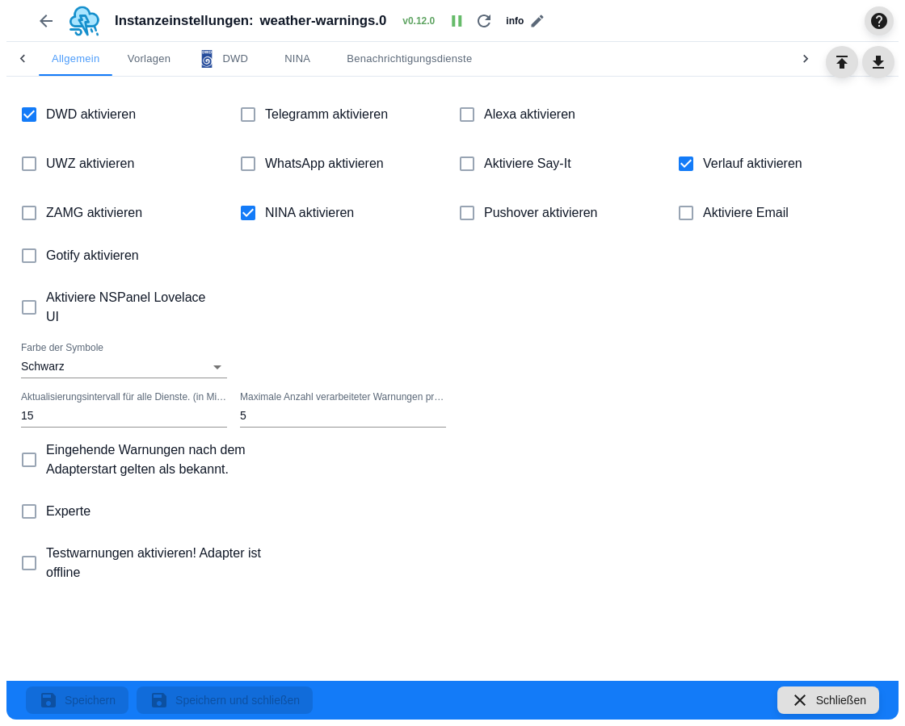
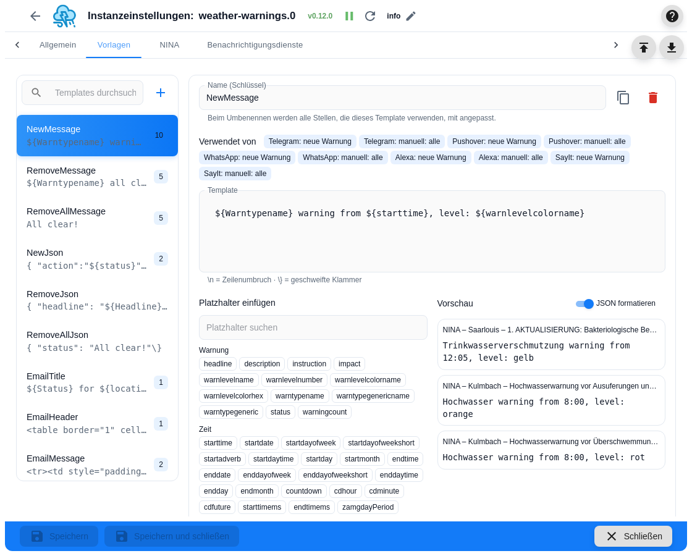
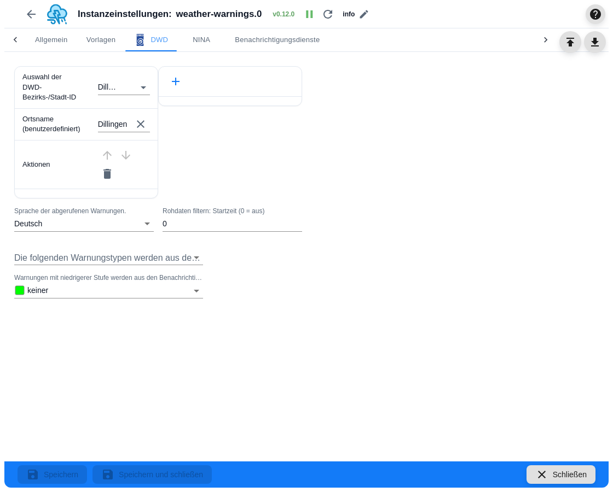
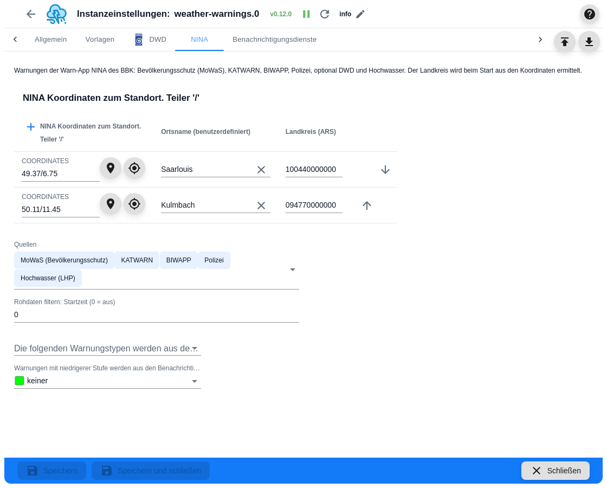
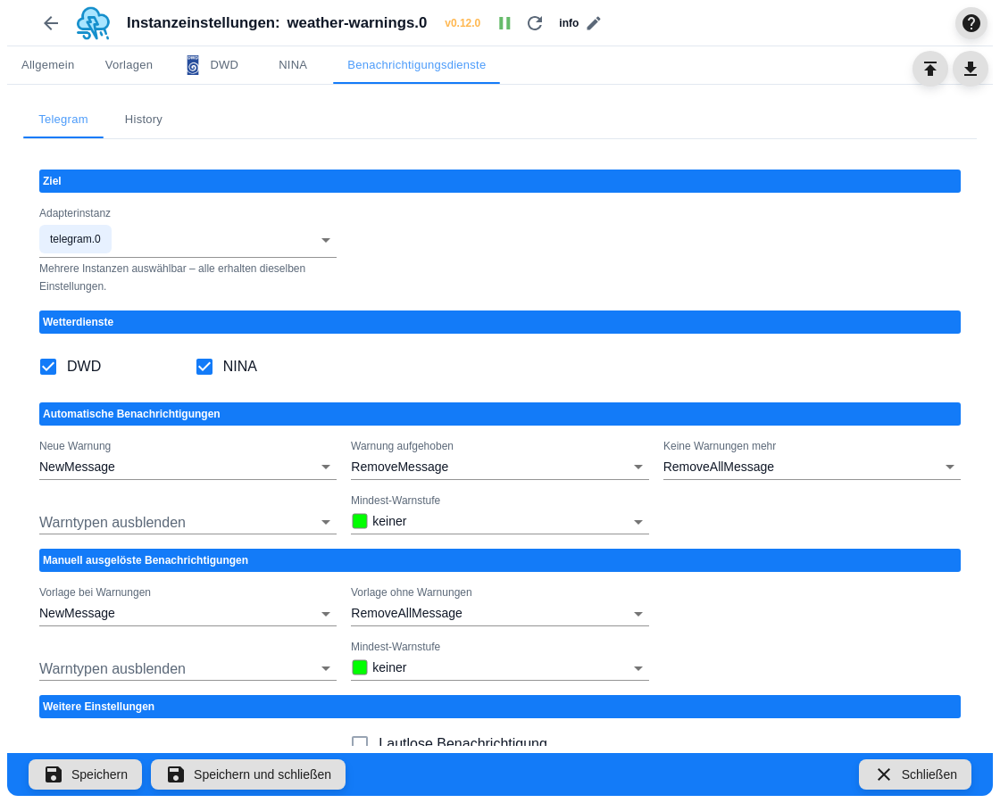

# ioBroker.weather-warnings

## Адаптер погодных предупреждений для ioBroker

[Файл Readme на английском языке](/#/adapters/weather-warnings) · Журнал изменений доступен на английском языке Readme.

Адаптер должен быть влажным и предупреждающим предупреждением для вашего рта и

- verschickt sie als Textoder Sprachnachricht (Telegram, WhatsApp, Pushover, Gotify, E-Mail, NSPanel, Alexa, SayIt),
- schreibt sie in Datenpunkte (Rohdaten, formatierte Werte, nach Warntyp gruppierte Warnungen) для VIS и скриптов.

Все текстовые сообщения находятся в Vorlagen, и вы должны быть администратором с Live-Vorschau.

### Анбитер

| Анбитер                                      | Гебит    | Орцангабе                           | Хинвейс                                                                                 |
| -------------------------------------------- | -------- | ----------------------------------- | --------------------------------------------------------------------------------------- |
| **DWD** (Deutscher Wetterdienst)             | Германия | Gemeinde oder Kreis aus einer Liste | amtliche Wetterwarnungen                                                                |
| **UWZ** (Unwetterzentrale)                   | Европа   | Координаты                          | Предупреждения о погоде                                                                 |
| **ZAMG / GeoSphere**                         | Австрия  | Координаты                          | Предупреждения о погоде                                                                 |
| **NINA** (Приложение-предупреждение для BBK) | Германия | Koordinaten → Landkreis             | Bevölkerungsschutz: MoWaS, KATWARN, BIWAPP, Polizei; опционально DWD и Hochwasser (LHP) |

Pro Anbieter sind mehrere Orte möglich. Jeder Ort ist ein eigenes Gerät unter `provider.<anbieter>.<ort>`.

### Benachrichtigungsdienste

Telegram, WhatsApp, Pushover, Gotify, E-Mail, NSPanel (nspanel-lovelace-ui), Alexa (alexa2), SayIt, как и другие внутренние адаптеры:

- **Верлауф (История)** : Liste der letzten Warnungen in einem Datenpunkt
- **JSON-Array** : актуальные предупреждения как JSON для скрипта

Telegram, WhatsApp, Pushover, Gotify и электронная почта могут быть легко отправлены и мгновенно отправлены с помощью адаптера.

## Voraussetzungen

- Node.js 22 или новый
- js-контроллер 6.0.11 или новый
- Администратор 8.1.0 или новый

## Установка

Адаптер для установки ioBroker-Admin. Beim ersten Start schreibt die Instanz die Nachrichtenvorlagen in der Systemsprache. War die Konfigurationsseite schon offen, **lade sie neu** , damit die Vorlagen erscheinen.

## Конфигурация

### Allgemein

- **Активация DWD / UWZ / ZAMG / NINA** : использование Datenabruf dieses Anbieters ein. Йедер Анбитер стал эйнен эйгенен Райтер.
- **Telegram / Pushover /… aktivieren** : schaltet einen Benachrichtigungsdienst ein. Seine Einstellungen stehen im Reiter _Benachrichtigungsdienste_ .
- **Farbe der Symbole** : Farbsatz für `${iconurl}`.
- **Актуальный интервал** : через минуту, для всех дней (мин. 5).
- **Максимальное предупреждение о тревоге** : Anzahl der Datenpunkt-Plätze `00`, `01` … pro Ort.
- **Предупреждение о начале запуска адаптера также необходимо** : Предупреждение о том, что при запуске лучше всего начать работу, затем необходимо выполнить следующие действия.
- **Экспертиза** : zeigt weitere Einstellungen (Ruhezeiten für Sprachausgabe, альтернативные URL-адреса Icon, некоторые дополнительные ссылки, Testoptionen).
- **Testwarnungen aktivieren** : nutzt eingebaute Testdaten statt der echten Anbieter.

### Предложения

Die Nachrichten entstehen aus Vorlagen. Время редактора

- die Liste der Vorlagen (durchuchbar) mit der Anzahl der Stellen, die sie verwenden,
- wo eine Vorlage verwendet wird ( **Verwendet von** ) – beim Umbenennen werden alle diese Stellen mit angepasst,
- eine Palette aller Platzhalter – Klick fügt ein,
- eine **Live-Vorschau** , адаптер с активированным предупреждением (или с Beispieldaten, когда он активен).

Syntax der Vorlagen:

- `${token}` wird durch einen Wert der Warnung ersetzt, z. Б. `${headline}`, `${starttime}`. Ein großer Anfangsbuchstabe (англ.) `${Warntypename}`) schreibt den Wert groß.
- `${_meineVorlage}` fügt eine andere Vorlage ein. Форлаген, deren Schlüssel mit `_` Начало, werden den Diensten nicht angeboten.
- `${[a,b,c,d,e]warnlevelnumber}` wählt einen Eintrag über einen Zahlen-Platzhalter, z. Б. `${[0,🟢,🟡,🟠,🔴]warnlevelnumber}`.
- `${(wert=token)dann#sonst}` Одер `${(wert=token)dann}` – Vergleiche `=`, `!=`, `<`, `>`.
- `\n` ist ein Zeilenumbruch; в формате JSON-Vorlagen нужно использовать схему Klammer als `\}` geschrieben werden.

**Vorlagen wiederherstellen** setzt alle Vorlagen auf die Standardvorlagen in der aktuellen Systemsprache zurück (eigene Vorlagen gehen verloren). **Fügt Standardvorlagen hinzu** ergänzt nur fehlende.

Alle Platzhalter

| Платцхальтер                                                                                | Bedeutung                                                            |
| ------------------------------------------------------------------------------------------- | -------------------------------------------------------------------- |
| `headline`, `description`, `instruction`, `impact`                                          | Текст предупреждения (`impact` нур ЗАМГ)                             |
| `warnlevelname`, `warnlevelnumber`                                                          | Stufe als Text / Zahl 0–4                                            |
| `warnlevelcolorname`, `warnlevelcolorhex`                                                   | Farbe der Stufe как Text / Hex                                       |
| `warntypename`                                                                              | Warntyp, wie ihn der Anbieter Liefert                                |
| `warntypegenericname`, `warntypegeneric`                                                    | vereinheitlichter Warntyp (siehe unten) как Text / Zahl              |
| `weatheremoji`, `iconurl`, `htmlicon`                                                       | Emoji, URL des Icons, Icon als Base64-``                        |
| `location`, `locationcustom`, `provider`                                                    | Gebiet laut Anbieter, dein Ortsname, Anbieter                        |
| `starttime`, `startdate`, `startday`, `startmonth`, `startdayofweek`, `startdayofweekshort` | Начало                                                               |
| `endtime`, `enddate`, `endday`, `endmonth`, `enddayofweek`, `enddayofweekshort`              | Конец                                                                |
| `startdaytime`, `enddaytime`, `startadverb`                                                 | Tageszeit, «heute/morgen/…»                                          |
| `countdown`, `cdhour`, `cdminute`, `cdfuture`                                               | Zeit bis zum Beginn                                                  |
| `starttimems`, `endtimems`                                                                  | Zeitstempel in ms (`endtimems` is 0, wenn die Warnung kein Ende Hat) |
| `ceiling`, `altitude`                                                                       | Höhenbereich (DWD, UWZ)                                              |
| `status`, `warningcount`                                                                    | neu / bestehend / Entwarnung, Anzahl der Warnungen                   |
| `zamgdayPeriod`                                                                             | ZAMG: ganztägige Warnung                                             |

### Анбитер

- **DWD** : Gemeinde oder Kreis aus der Liste wählen (около 10 000 Einträge). Nach der Eingabe kurz auf einen anderen Reiter und zurück wechseln – die Liste ist zu groß, um sofort actualisiert zu werden.
- **UWZ** : Koordinaten `Breite/Länge`. Адаптер предназначен для использования и использования UWZ.
- **ZAMG** : Координаты в Австрии.
- **Ortsname (benutzerdefiniert)** : собственное имя для Ort, verfügbar als `${locationcustom}`.
- **Родовой фильтр: Startzeit** : verwirft Warnungen, die mehr als X Stunden in der Zukunft Beginnen (0 = aus).
- **Предупреждение** : die gewählten Typen werden verworfen.
- **Stufe** : Предупреждение о том, что Stufe werden verworfen. Das Farbige Quadrat zeigt die Farbe der Stufe.

#### НИНА

NINA — это официальное приложение Warn-App des Bundesamts für Bevölkerungssschutz und Katastrophenhilfe (BBK). Sie enthält Warnungen, die Wetterdienste nicht haben: Gefahrstoffe, Trinkwasser, Bombenfunde, Stromausfälle, Polizeilagen, Hochwasser, …

- **Координация** : werden aus den ioBroker-Systemeinstellungen vorbelegt. Начать работу с адаптером по координатам земельного участка и по назначению Шлюсселя (ARS) в таблице. NINA предупредила о Landkreis, что zwei Orte im selben Landkreis werden deshalb nur einmal abgefragt.
- **Квеллен** : welche NINA-Quellen verwendet werden. Стандарт: MoWaS (Bevölkerungsschutz), KATWARN, BIWAPP и Polizei. **DWD** является собственным Anbieter und **Hochwasser (LHP)** в местном масштабе, и не соответствует стандарту в нашей стране.
- Warnungen ohne Ende (bei MoWaS häufig) Zeigen in `${endtime}` «бис на Видерруфе»; sie enden, wenn NINA sie entfernt.
- Entwarnungen beden die zugehörige Warnung; Aktualisierungen ersetzen die Warnung ohne neue Benachrichtigung (außer die Stufe steigt).
- Die Texte kommen in der Systemsprache, wenn NINA sie Liefert (sonst English oder Deutsch; Hochwasserwarnungen gibt es nur auf Deutsch).

### Benachrichtigungsdienste

Активируйте Dienst Hat Eine Eigene Seite mit Denslben Abschnitten:

- **Ziel** : die Adaptor-Instanz(en), стандартный адрес. Ohne gültiges Ziel startet der Dienst nicht (siehe Log).
- **Wetterdienste** : welche Anbieter mit diesem Dienst verschickt werden.
- **Автоматические настройки** : Предупреждения для _новых предупреждений_ , _дополнительных предупреждений_ (и других предупреждений, которые активны) и _другие предупреждения_ , типфильтр и предупреждение. Мит дер Ворлаге `none` wird für diesen Fall nichts gesendet.
- **Manuell ausgelöste Benachrichtigungen** : Vorlagen für das Schreiben auf `commands.send_message.<dienst>` – eine für «es gibt Warnungen», eine für «keine Warnungen».
- **Weitere Einstellungen** : dienstspezifisch, z. Б.
  - Telegram: Бенуцернамен, Chat-ID, Lautlos, Parse-Mode
  - Pushover / Gotify: Priorität, Ton, Gerät, Inhaltstyp
  - NSPanel: Popup, Screensaver-Überschrift или Beides, Priorität, погружение
  - Alexa: Geräte, Lautstärke, Audiodatei vor der Nachricht, Ton pro Warntyp (Experte)
  - SayIt: Instanzen und Lautstärke
  - Электронная почта: Empfänger, Titel-, Kopf- und Fußvorlage, Zeilenumbruch.
  - Верлауф: jeden formatierten Wert in den Verlauf schreiben

Sprachausgaben (Alexa, SayIt) lassen sich mit **Ruhezeit-Profilen** stummschalten (Experte, Reiter _Zusätzliche Einstellungen_ ), umschaltbar über `commands.silentTime.*`.

## Warnstufen und Warntypen

| Стуфе | Bedeutung     | Фарбе                    |
| ----- | ------------- | ------------------------ |
| 0     | кеине         | грюн                     |
| 1     | unerheblich   | гельб                    |
| 2     | мäßig         | апельсин                 |
| 3     | швер          | гниение                  |
| 4     | экстремальный | violett (DWD: dunkelrot) |

Джедер Анбитер и Эйджин Варнтипен. Der Adaptor ordnet sie vereinheitlichten Typen zu, die for Filter, Icons und die `alerts` -Datenpunkte verwendet werden:

`storm` (Штурм), `snowfall` (Шнеефалл), `rain` (Реген), `cold` (Кэлте), `forest_fire` (Вальдбранд), `thunderstorm` (Гевиттер), `black_ice_slippery` (Глетте), `heat` (Хитце), `hail` (Гагель), `fog` (Небель), `thaw` (Тауветтер), `flood` (Хохвассер), `civil_protection` (Gefahrenlage), `unknown` (неизвестный)

`flood` унд `civil_protection` (alle Nicht-Wetter-Ereignisse von NINA) kommen von NINA.

## Точки данных

| Пункт данных                                                                                         | Инхальт                                                                                                    |
| ---------------------------------------------------------------------------------------------------- | ---------------------------------------------------------------------------------------------------------- |
| `provider.<anbieter>.<ort>.warning.NN`                                                               | Rohdaten der Warnung, wie der Anbieter sie Liefert (НИНА: bereits bereinigt)                               |
| `provider.<anbieter>.<ort>.formatedKeys.NN`                                                          | alle Platzhalter mit aktuellem Wert, dazu deine Vorlagen mit `_` ам Анфанг                                  |
| `provider.<anbieter>.<ort>.alerts.<typ>`                                                             | pro Warntyp: `level`, `start`, `end`, `headline`, `active`, `type` – die höchste aktive Предупреждения Типы |
| `provider.<anbieter>.<ort>.history`, `.activeWarnings`, `.lastUpdate`                                | про Орт                                                                                                    |
| `alerts.<typ>`                                                                                       | wie oben, über alle Anbieter und Orte                                                                      |
| `provider.activeWarnings`, `provider.hasActiveWarning`, `provider.maxLevel`, `provider.maxLevelText` | Zusammenfassung aller Warnungen                                                                            |
| `provider.history`                                                                                   | Verlauf (Dienst _Verlauf_ )                                                                                |
| `commands.send_message.<dienst>`                                                                     | aktuelle Warnungen mit diesem Dienst senden (manuelle Vorlagen)                                            |
| `commands.silentTime.*`                                                                              | Ruhezeit-Profil und Automatik                                                                              |
| `commands.clearHistory`                                                                              | löscht den Verlauf                                                                                         |

Die Anzahl der Plätze `NN` Ist fest (Einstellung _Maximale Anzahl verarbeiteter Warnungen_ ). Leere Plätze werden geleert, nicht gelöscht – der Objektbaum ändert sich также nicht mit jeder Warnung.

## Общее поведение

- Дополнительные сведения о предупреждении о дизельном топливе: Aktualisierungen werden nur verschickt, wenn sie für dich eine neue Warnung sind.
- `alerts.<typ>` Zeigt eine Warnung pro Typ: die **jetzt** aktive mit der Höchsten Stufe, sonst die nächste in der Zukunft.
- Zeiten werden in der Zeitzone des ioBroker-Hosts angezeigt – der Host sollte eine echte Zone wie `Europe/Berlin` nutzen, keinen festen Versatz.

## Иконки

Значок DWD: Авторские права принадлежат Deutscher Wetterdienst

ZAMG-Icon: Авторские права принадлежат GeoSphere Austria.

Wetter-Icons:

- Автор: [Адри Ансях](https://www.youtube.com/channel/UChLOv1L-ftAFc2ZizdEAKgw?view_as=subscriber)
- Иконка сайта: <https://www.flaticon.com/packs/weather-613>
- Лицензия: [CC BY 4.0 ПРАВОВОЙ КОДЕКС](https://creativecommons.org/licenses/by/4.0/legalcode)
- Änderungen: Im Original sind sie blau, die anderen Farben sind Änderungen am Original.

Икона Хохвассера (`flood.png`): "Иконка наводнения от Adriansyah, Creative Commons, через ToSVG" - <https://tosvg.com/icon/flooding-1044958> (umgefärbt)

Иконка Гефарена (`civil_protection.png`): «Значок треугольника опасности, автор Павел Глен, Creative Commons, через ToSVG» — <https://tosvg.com/icon/danger-triangle-1046822> (umgefärbt)