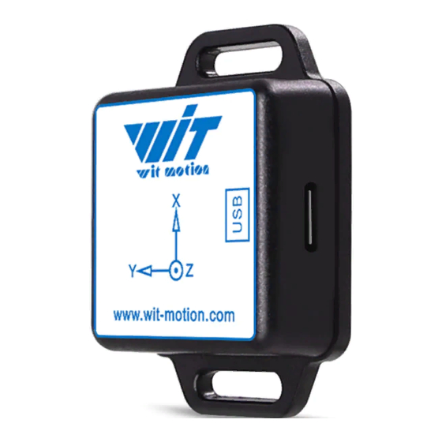

# ioBroker WitMotion

**Этот адаптер использует библиотеки Sentry для автоматического сообщения разработчикам об исключениях и ошибках в коде.** Более подробную информацию, а также сведения о том, как отключить отправку сообщений об ошибках, см. [в документации Sentry-Plugin](https://github.com/ioBroker/plugin-sentry#plugin-sentry) ! Система отчетности Sentry используется начиная с js-controller 3.0.

Считывает данные с 9-осевого инерциального измерительного датчика WT901blecl 5.0 Bluetooth 5.0 (MPU9250) через USB и записывает их в точки данных ioBroker.

В ioBroker считываются и записываются следующие данные:

- Ускорение X/Y/Z
- Гироскоп X/Y/Z
- Магнитометр X/Y/Z

При желании адаптер вычисляет высоту и период волны на основе вертикального перемещения датчика (см. раздел [«Волны»](#waves) ).

## Поддерживаемые устройства

- [WT901blecl 5.0](https://witmotion-sensor.com/products/bluetooth-5-0-accelerometer-inclinometer-wt901blecl-mpu9250-9-axis-imu-sensor)

## Волны

При включенной в настройках функции **«Волны** » адаптер измеряет состояние моря по вертикальному перемещению датчика, подобно волновому бую. Он использует каждый пакет данных датчика (независимо от интервалов обновления других состояний): ускорение преобразуется в вертикальное с учетом крена и тангажа датчика, дважды интегрируется в частотной области в пределах полосы периодов волн, и вычисляется результирующее вертикальное перемещение:

| Состояние          | Единица | Значение                                                                                                           |
| ------------------ | ------- | ------------------------------------------------------------------------------------------------------------------ |
| `waves.height`     | м       | Значительная высота волны Hs = 4·σ вертикального подъема (примерно среднее значение для самой высокой трети волн). |
| `waves.heightMax`  | м       | Самая высокая отдельная волна (от впадины до гребня) в анализируемом окне.                                         |
| `waves.period`     | с       | Средний период по пересечению нуля вверх                                                                           |
| `waves.periodPeak` | с       | Период спектрального пика, период с наибольшей энергией.                                                           |
| `waves.length`     | м       | Длина волн пикового периода в глубокой воде, L = g·Tp²/(2π)                                                        |
| `waves.frequency`  | Гц      | Частота спектрального пика, 1/Tp                                                                                   |

Настройки: **Интервал обновления** (как часто записываются состояния, по умолчанию 30 с), **Окно анализа** (длительность анализируемой записи, по умолчанию 300 с; первые значения появляются после половины этого интервала), **Самый короткий** и **самый длинный период волны** (диапазон, по умолчанию 2–20 с).

Что нужно знать:

- Установите датчик примерно посередине лодки. Вдали от него качка лодки добавляет вертикальные колебания, которые не связаны с движением по волнам.
- Указанные значения отражают движение лодки. Волны, короткие по сравнению с корпусом (на 13-метровой яхте примерно менее 3–4 секунд), поднимают лодку меньше, чем они высоки, поэтому кратковременная ветреная качка недооценивается.
- Во время движения лодки периоды и частота колебаний зависят от направления движения: они короче при движении навстречу волнам и длиннее при движении по ним. Высота волн от этого не зависит, а длина колебаний одинакова только в точке стоянки на якоре или при дрейфе.
- Длина волн соответствует глубине воды. Там, где глубина меньше половины глубины, волны короче.
- При высоте волн ниже 5 см вода считается спокойной: периоды, длина и частота равны 0, поскольку регистрируется только шум датчика.
- Одних только углов (крена и тангажа) недостаточно для определения высоты волн на лодке: они показывают, как лодка кренится в своем собственном ритме, а не уклон воды.
- Датчик должен передавать 10 значений в секунду (по умолчанию) или больше. При частоте ниже 1,5 значений в секунду (с минимальным периодом в 2 секунды) адаптер предупреждает о том, что короткие волны не регистрируются.
- В спокойной воде шум датчика составляет несколько сантиметров.

## Диспетчер устройств

Вкладка **«Диспетчер устройств»** в настройках экземпляра (или в диспетчере устройств администратора) отображает датчик в виде карточки с указанием его подключения и, по одной строке, углов (крен, тангаж, рыскание), а также высоты, длины и частоты волн. В подробностях перечислены все включенные значения и тип подключения. С помощью карточки можно проверить подключение и изменить последовательный порт и скорость передачи данных.

## Визуализация

### Приложение для устройств

Добавьте пользовательский виджет типа **Wit Motion** и выберите экземпляр. На плитке отобразится лодка, автомобиль или ваша собственная фотография, наклоненная на измеренный угол, либо компас для вида сверху.

- `1x1` – одна ось
- `2x½` – только значения
- `2x1` – одна ось со своим значением или две оси, расположенные рядом

Щелчок по плитке открывает увеличенное изображение.

Если компонент измеряет [волны](#waves) , то плитка, виджет vis-2 и веб-компонент отображают значительную высоту волн: в компактном режиме рядом с названием, в строке рядом со значениями. В широком и большом режимах суммируются длина (λ) и частота волн. Параметр **«Показать волны»** отключает их отображение.

### вис-2

Набор виджетов **WitMotion** содержит виджет **Orientation** с теми же представлениями. Макет следует за размером виджета (панель, компактный, широкий или большой) или может быть зафиксирован в настройках. Щелчок по меньшему макету открывает большой макет.

### Веб-компоненты

Ориентация также является веб-компонентом (`common.webComponents`,[`@iobroker/web-components`](https://github.com/ioBroker/web-components) ), чтобы Aura, административная панель и любой другой набор веб-компонентов могли его отображать:

- `<iob-witmotion-orientation>` ( **Wit Motion** ) – те же виды, что и в виджете vis-2: лодка, автомобиль или ваше собственное изображение, наклоненное на угол одной или двух осей, или компас для вида сверху, в компактном, сегментированном, широком или большом формате в зависимости от размера рамки. Щелчок по уменьшенному виду открывает большой вид в диалоговом окне хоста.

Настройки:

- **Экземпляр адаптера** , **Режим значения** (мгновенное или среднее), **Имя** , **Макет** (автоматический или фиксированный), **Открытие большого представления по клику** , **Отображение волн**
- **Тип значка** (лодка, автомобиль или нестандартный; нестандартное изображение определяется адресом)
- **Основная ось** , **основной вид** , **визуальный множитель** и, при необходимости, **дополнительная ось** с её видом и множителем.

В приложении для устройств вместо веб-компонента с тем же названием используется собственный блок **Wit Motion** .

<!--
	Placeholder for the next version (at the beginning of the line):
	### **WORK IN PROGRESS**
-->

## Changelog
### 2.3.0 (2026-11-17)
* (@GermanBluefox) Added wave height and period from the heave of the sensor (`waves.*`)
* (@GermanBluefox) Added the length and the frequency of the waves (`waves.length`, `waves.frequency`)
* (@GermanBluefox) The devices tile, the vis-2 widget and the web component show the height, length and frequency of the waves
* (@GermanBluefox) The card in the device manager shows each value in a line of its own
* (@GermanBluefox) Added the short form of the web component manifests (tag, name, icon, size) to `common.webComponents`, so that hosts like Aura can list the components before the adapter is installed; the build writes it with `iob-web-components sync-io-package`

### 2.2.0 (2026-11-09)
* (@GermanBluefox) Added the web component `<iob-witmotion-orientation>` for Aura and other hosts (`common.webComponents`)

### 2.1.2 (2026-10-28)
* (@GermanBluefox) Fixed the missing translations of the widget set, the widget name and the help in vis-2

### 2.1.1 (2026-10-14)
* (@GermanBluefox) Added device manager support
* (@GermanBluefox) Added an orientation widget for vis-2
* (@GermanBluefox) The used serial port (and in test mode the UDP port) is reported to js-controller 8 (`registerUsedResource`)
* (@GermanBluefox) Migrated to devices V3
* (@GermanBluefox) Added selection of the serial device by its stable USB ID (vendor/product/serial), so the connection keeps working even if the OS reassigns the port name
* (@GermanBluefox) Better widget
* (@GermanBluefox) Allowed the selection of USB port by path and UUID
* (@GermanBluefox) Added visualisation for "devices" adapter
* (@GermanBluefox) Added offset configuration for magnetometer
* (@GermanBluefox) Fixed the integration test, because of it the versions 0.1.0 - 2.1.0 were never published

### 0.0.4 (2026-03-26)
* (@GermanBluefox) Tests fixed

## License

The MIT License (MIT)

Copyright (c) 2026, Denis Haev <dogafox@gmail.com>

Permission is hereby granted, free of charge, to any person obtaining a copy
of this software and associated documentation files (the "Software"), to deal
in the Software without restriction, including without limitation the rights
to use, copy, modify, merge, publish, distribute, sublicense, and/or sell
copies of the Software, and to permit persons to whom the Software is
furnished to do so, subject to the following conditions:

The above copyright notice and this permission notice shall be included in
all copies or substantial portions of the Software.

THE SOFTWARE IS PROVIDED "AS IS", WITHOUT WARRANTY OF ANY KIND, EXPRESS OR
IMPLIED, INCLUDING BUT NOT LIMITED TO THE WARRANTIES OF MERCHANTABILITY,
FITNESS FOR A PARTICULAR PURPOSE AND NONINFRINGEMENT. IN NO EVENT SHALL THE
AUTHORS OR COPYRIGHT HOLDERS BE LIABLE FOR ANY CLAIM, DAMAGES OR OTHER
LIABILITY, WHETHER IN AN ACTION OF CONTRACT, TORT OR OTHERWISE, ARISING FROM,
OUT OF OR IN CONNECTION WITH THE SOFTWARE OR THE USE OR OTHER DEALINGS IN
THE SOFTWARE.