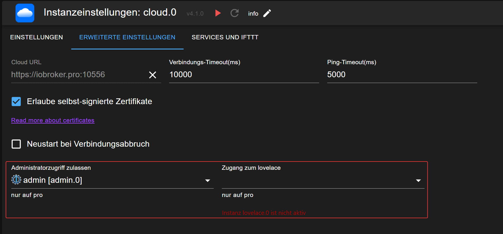
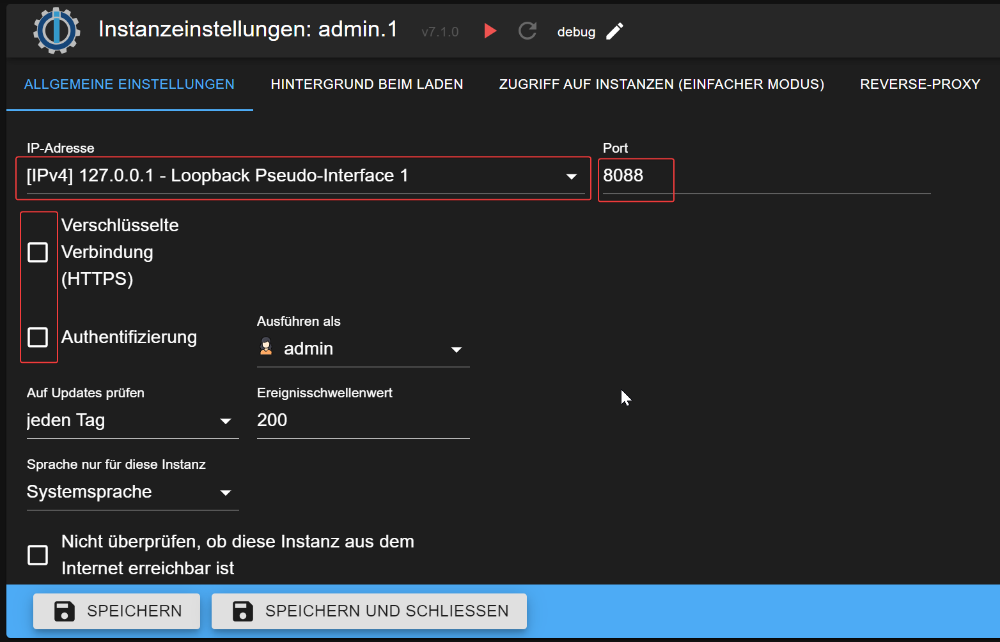

# Администрация и редакторы

Облачная платформа ioBroker.pro предоставляет больше возможностей по сравнению с бесплатной облачной платформой ioBroker.net.

Дополнительные функции включают в себя:

- Доступ к административному интерфейсу
- Возможность редактировать проекты vis-2 и vis, а не только просматривать их.
- доступ Лавлейс
- Больше ресурсов и меньше пользователей, что приводит к более быстрой и надежной работе.

## Администратор

Для предоставления доступа администратору необходимо активировать его в настройках облака на вкладке «Расширенные параметры».

В выбранном экземпляре административной панели не должна быть включена опция HTTPS, и он не должен быть защищен паролем. Это необходимо для доступа к административному интерфейсу из облака.

Если вам необходимо защитить свой административный интерфейс, вы можете создать отдельный экземпляр для облака без защиты паролем и без HTTPS и привязать этот экземпляр к localhost на другом порту.

В этой конфигурации доступ к административному интерфейсу возможен только с локального компьютера, но облако по-прежнему имеет к нему доступ.

Важно: выберите порт, отличный от 8081, поскольку порт 8081 используется вашим основным административным экземпляром.

После этого обязательно выберите только что созданный экземпляр в настройках облака.

## Вис и вис-2

Для включения редактирования в форматах vis и vis-2 не требуется никакой специальной настройки. Просто откройте проект vis или vis-2 в режиме редактирования.

## Лавлейс

Облачное хранилище Lovelace работает на порту 4463. Убедитесь, что настройки вашего брандмауэра разрешают доступ вашего мобильного телефона или планшета к облаку через порт 4463.