# Публикуйте адаптеры в npm (надежная платформа для публикаций).

Первая версия адаптера публикуется в npm вручную. После этого GitHub Actions обрабатывает каждый релиз через Trusted Publishing (OIDC), без необходимости сохранения токена npm.

Процесс в семь этапов:

1. Создайте учетную запись npm и включите двухфакторную аутентификацию.
2. Соберите адаптер локально и проверьте содержимое пакета.
3. Опубликовать первую версию вручную
4. Откройте настройки пакета на сайте npmjs.com.
5. Надежный издатель для `test-and-release.yml` регистрация
6. Проверьте раздел развертывания в рабочем процессе.
7. Запустите альфа-версию с помощью скрипта релиза.

**Требования**

- Адаптер с `@iobroker/create-adapter` создан (рабочий процесс) `.github/workflows/test-and-release.yml`, `@alcalzone/release-script` (в devDependencies)
- Общедоступный репозиторий GitHub `ioBroker.<adaptername>` название пакета в `package.json` =`iobroker.<adaptername>` (строчные буквы)
- Для работы требуется локально установленная версия Node.js 22 или 24. `git` меблированный
- Программа для запуска приложений, размещенная на GitHub (`ubuntu-latest`), саморазмещаемые средства запуска приложений не поддерживаются npm для Trusted Publishing.

Зачем всё это? npm аннулировал все классические токены 9 декабря 2025 года. `npm login` С тех пор предоставляется только двухчасовая сессия, а токены для записи истекают максимум через 90 дней ( [GitHub Changelog](https://github.blog/changelog/2025-12-09-npm-classic-tokens-revoked-session-based-auth-and-cli-token-management-now-available/) ). С января 2027 года токены, обходящие двухфакторную аутентификацию, также больше не будут допускаться для прямой публикации ( [GitHub Changelog](https://github.blog/changelog/2026-07-08-npm-install-time-security-and-gat-bypass2fa-deprecation/) ). Доверенная публикация настраивается один раз и не требует дальнейшего продления.

## Шаг 1: Создайте учетную запись npm и включите двухфакторную аутентификацию (2FA).

Без двухфакторной аутентификации npm больше не позволяет публиковать контент вручную.

1. Откройте [npmjs.com/signup](https://www.npmjs.com/signup) , введите свое имя пользователя, адрес электронной почты и пароль (не менее 10 символов), поставьте галочку, подтверждающую принятие условий обслуживания, нажмите **«Создать учетную запись** » и подтвердите свой адрес электронной почты. Ваш адрес электронной почты впоследствии будет общедоступным в метаданных пакета.
2. Нажмите на фотографию профиля в правом верхнем углу, затем откройте **аккаунт** .
3. В поле **«Двухфакторная аутентификация»** нажмите **«Включить 2FA»** (если 2FA уже включена, кнопка называется **«Изменить 2FA»** ).
4. Установите приложение-аутентификатор или ключ безопасности (Passkey, YubiKey) и надежно сохраните коды восстановления.

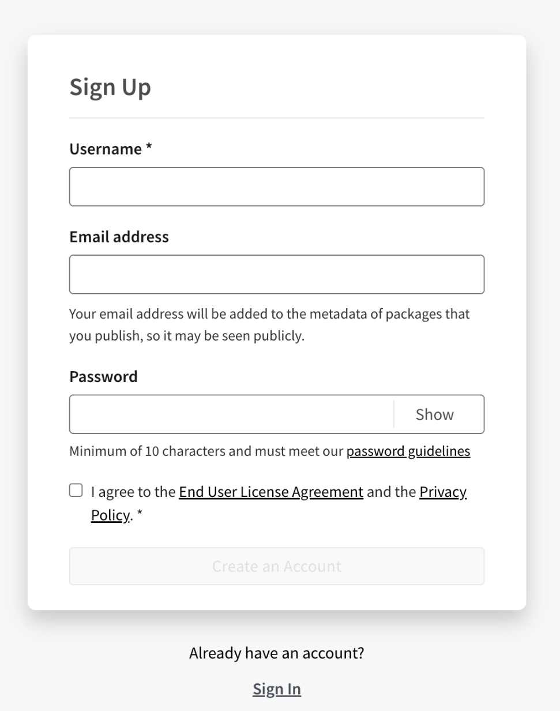

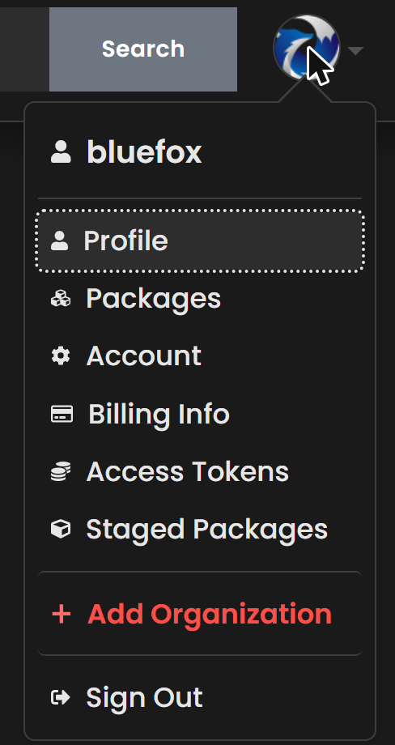

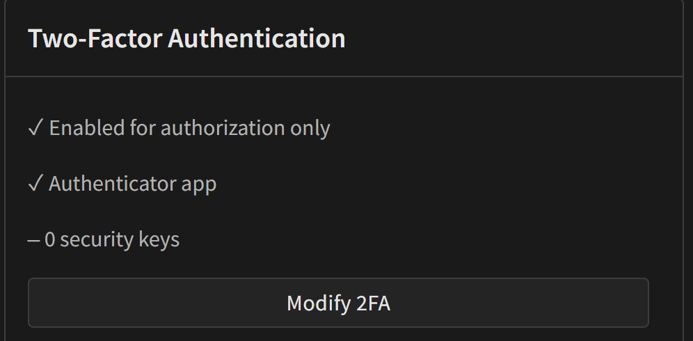

## Шаг 2: Соберите и протестируйте адаптер локально.

Перед первым релизом адаптер должен быть собран корректно и пройти тесты, иначе неисправный пакет навсегда окажется в npm.

```bash
git clone https://github.com/<user>/ioBroker.<adaptername>.git
cd ioBroker.<adaptername>
npm ci
npm run build        # nur bei TypeScript oder React-Admin
npm run lint
npm test
```

Затем просмотрите содержимое пакета, ничего не загружая:

```bash
npm pack --dry-run
```

Список должен `io-package.json`, `main.js` или `build/`, `admin/` и `LICENSE` содержать. `src/`, `test/` и `.github/` Им там не место, этим занимается поле. `files` в `package.json`.

Также проверьте:

- `name` в `package.json` является `iobroker.<adaptername>`
- `version` в `package.json` и `common.version` в `io-package.json` Они одинаковые (с новыми адаптерами). `0.0.1`)
- `repository.url` Укажите репозиторий GitHub; в противном случае проверка происхождения для Trusted Publishing завершится неудачей позже.

## Шаг 3: Опубликуйте первую версию вручную один раз.

Настроить функцию Trusted Publishing можно только для пакета, который уже существует в npm. Поэтому первая версия будет отправлена с вашего компьютера.

```bash
npm login            # öffnet den Browser, Anmeldung mit 2FA
npm whoami           # zeigt den eigenen npm-Benutzernamen
npm run build        # nur bei TypeScript oder React-Admin
npm publish          # fragt im Browser erneut nach 2FA
```

Вскоре после этого пакет находится под `https://www.npmjs.com/package/iobroker.<adaptername>` чтобы увидеть.

Затем добавьте bluefox в качестве второго владельца. Это необходимо для включения в репозиторий с помощью средства проверки репозитория ioBroker (см. [раздел «Публикация»](/docs/dev/adapterpublish.md) ):

```bash
npm owner add bluefox iobroker.<adaptername>
npm owner ls iobroker.<adaptername>
```

Или же в браузере: страница пакета, вкладка **«Настройки»** , раздел **«Пригласить сопровождающего»** , имя пользователя. `bluefox` зарегистрироваться.

Примечания:

- сессия `npm login` Действительна в течение двух часов, затем просто попробуйте снова. `npm login`.
- После публикации номер версии его нельзя использовать повторно, даже после... `npm unpublish`.
- npm отклоняет имя (`Package name too similar to existing package`), адаптер необходимо переименовать.

## Шаг 4: Откройте настройки пакета на сайте npmjs.com

1. Зарегистрируйтесь на [npmjs.com](https://www.npmjs.com/login) .
2. Фотография профиля в правом верхнем углу, затем **«Пакеты»** , затем `iobroker.<adaptername>` клик.
3. На странице пакета откройте вкладку **«Настройки»** . Она видна только сопровождающим проекта.

При открытии **настроек** npm снова запросит одноразовый код двухфакторной аутентификации от приложения-аутентификатора. После этого вверху появится раздел **«Доверенный издатель»** , за которым следуют **«Доступ к пакетам»** , **«Доступ к публикации»** и **«Пригласить сопровождающего»** .

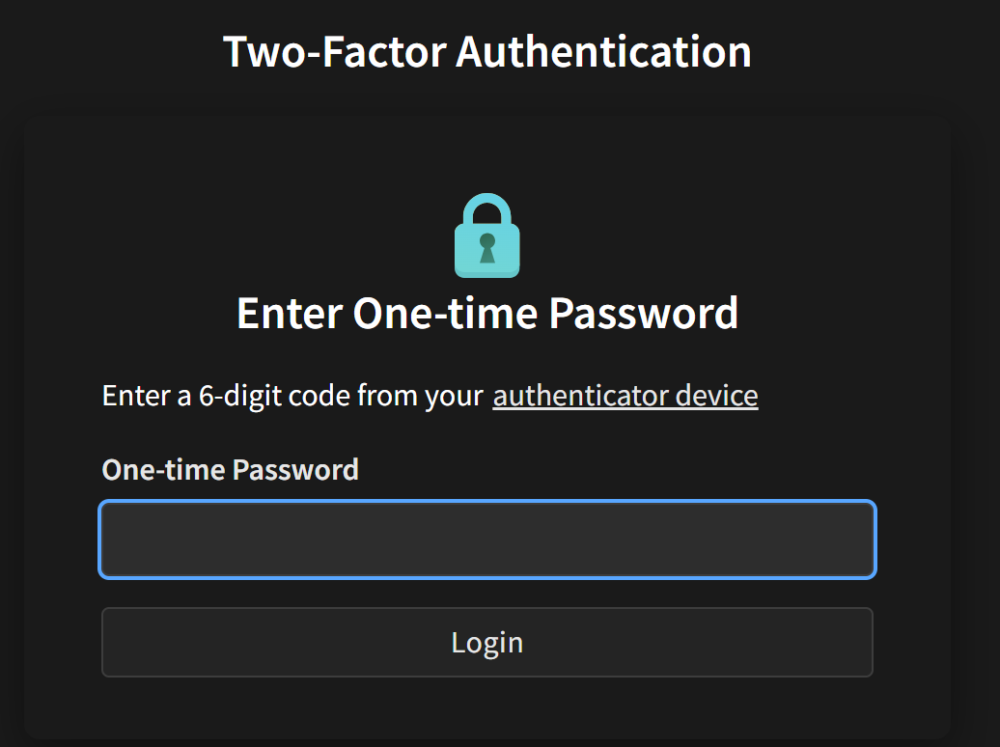

## Шаг 5: Зарегистрируйте доверенного издателя

Здесь оговорено, что только рабочий процесс `test-and-release.yml` Разрешено публиковать контент из собственного репозитория.

1. В разделе **«Доверенный издатель»** выберите **GitHub Actions** в качестве **издателя** . Если соединение уже существует, сначала нажмите **«Добавить доверенного издателя»** .
2. Заполните поля:

| Поле                         | вход                                                  | Пример                               |
| ---------------------------- | ----------------------------------------------------- | ------------------------------------ |
| Этикетка                     | необязательный, свободно выбираемый                   | Оставьте пустым                      |
| Организация или пользователь | Пользователь или организация GitHub                   | `ioBroker`                           |
| Репозиторий                  | Название репозитория без указания владельца.          | `ioBroker.openweathermap`            |
| имя файла рабочего процесса  | Только имя файла, без пути.                           | `test-and-release.yml`               |
| Название среды               | Оставьте пустым                                       |                                      |
| Разрешенные действия         | Поставьте галочку **, чтобы разрешить npm publish** . | `npm stage publish` всегда разрешено |

3. Сохраните, выбрав **«Настроить соединение»** .

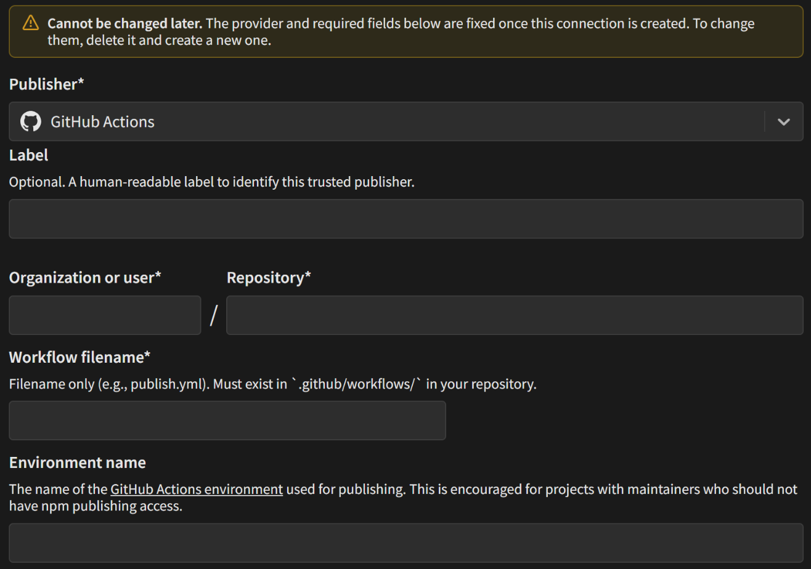

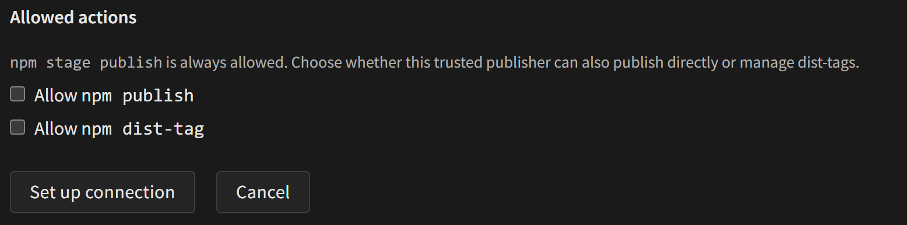

**Разрешите команду npm publish.** Начиная с 3 сентября 2026 года, новые конфигурации по умолчанию разрешают только команду npm publish. `npm stage publish` Однако действие развертывания ioBroker вызывает `npm publish` Без галочки релиз завершится неудачей ( [документация npm](https://docs.npmjs.com/trusted-publishers) ).

**Выпуск в течение 2 дней.** Новая конфигурация устареет, если она не будет успешно выпущена в течение двух дней. Затем удалите и создайте ее заново. Поэтому выполняйте шаг 5 только тогда, когда альфа-версия (шаг 7) может быть выпущена немедленно.

npm не проверяет введенные данные перед сохранением. Опечатка отобразится как ошибка только при выпуске продукта. `404` Обратите внимание на заглавные буквы.

При желании, после того как первый релиз через GitHub заработает: в разделе **«Доступ к публикации»** выберите параметр « **Требовать двухфакторную аутентификацию и запретить обход токенов 2FA (рекомендуется)»** и сохраните изменения, нажав **«Обновить настройки пакета** ». После этого токены будут заблокированы, но доверенная публикация продолжится. (Старый секрет) `NPM_TOKEN` Его можно удалить из репозитория GitHub.

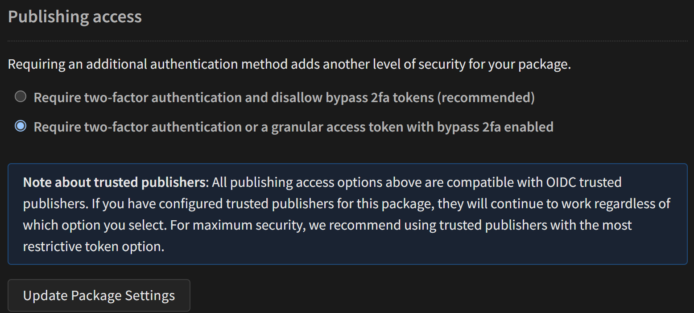

## Шаг 6: Проверьте раздел развертывания в рабочем процессе.

В `.github/workflows/test-and-release.yml` должна быть эта работа `deploy` Вот как это должно выглядеть. Два ключевых момента: `id-token: write` Установлено, и **нет** линии. `npm-token`.

```yaml
  # Deploys the final package to NPM
  deploy:
    needs: [check-and-lint, adapter-tests]

    # Trigger this step only when a commit on any branch is tagged with a version number
    if: |
      contains(github.event.head_commit.message, '[skip ci]') == false &&
      github.event_name == 'push' &&
      startsWith(github.ref, 'refs/tags/v')

    runs-on: ubuntu-latest

    # Write permissions are required to create Github releases
    permissions:
      id-token: write      # nötig für Trusted Publishing
      contents: write      # nötig für das GitHub-Release

    steps:
      - uses: ioBroker/testing-action-deploy@v1
        with:
          node-version: '24.x'
          # build: true      # bei TypeScript oder React-Admin einkommentieren
          github-token: ${{ secrets.GITHUB_TOKEN }}
          # KEIN npm-token: ${{ secrets.NPM_TOKEN }} mehr!
```

Вот как это выглядит в самом адаптере, здесь: ioBroker.openweathermap:

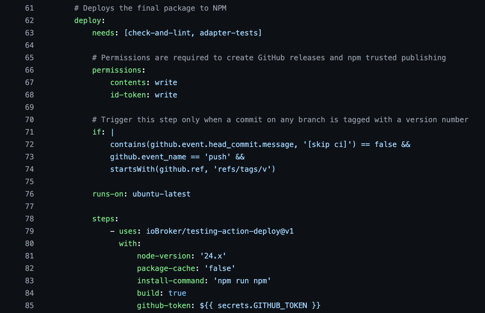

Вот как работает это действие ( [action.yml](https://github.com/ioBroker/testing-action-deploy/blob/master/action.yml) ):

- Без `npm-token` Он устанавливает npm 11 и выполняет вход через OIDC.
- Содержит ли данная версия дефис (`0.0.2-alpha.0`), она публикует свои работы с `--tag next` Пользователи с `latest` Поэтому они не получат Альфа-версию.
- Это автоматически создает релиз на GitHub, помечая предварительные версии соответствующим образом.

В верхней части того же файла, под `on: push: tags:` также узор `"v[0-9]+.[0-9]+.[0-9]+-**"` Процесс добавления альфа-тегов даже не запускается. Это уже реализовано в адаптерах, созданных с помощью \`create-adapter\`.

Перенесите старые адаптеры: `id-token: write` добавить строку `npm-token` удалить, зафиксировать ( [примечание о миграции из create-adapter](https://github.com/ioBroker/create-adapter/blob/master/docs/updates/20251013_trusted_deploy.md) ).

## Шаг 7: Выпуск альфа-версии с использованием скрипта выпуска.

Скрипт выпуска увеличивает номер версии в `package.json` и `io-package.json` Создан список изменений, внесены исправления, установлен Git-тег, и обновление отправлено. Тег запускает рабочий процесс; остальное происходит на GitHub.

**1. Подготовьте список изменений.** В `README.md` под `## Changelog` Заполните поле-заполнитель изменениями:

```markdown
### **WORK IN PROGRESS**
- (dein-name) Erste Testversion
```

**2. Зафиксируйте все изменения и переключитесь на основную ветку.** Выполнение скрипта будет прервано, если какие-либо изменения останутся незафиксированными.

**3. Тестовый запуск ничего не меняет:**

```bash
npm run release prepatch alpha -- --dry
```

**4. Настоящий альфа-релиз:**

```bash
npm run release prepatch alpha
```

Из `0.0.1` становится `0.0.2-alpha.0` Плагин `manual-review` Программа приостановит выполнение перед подтверждением изменений, чтобы вы могли их просмотреть. Нажмите Enter, чтобы продолжить.

**5. Проанализируйте рабочий процесс.** Перейдите в раздел **«Действия»** в репозитории. Выполните действия за день. `v0.0.2-alpha.0` Сначала запустите тесты, а затем задание. `deploy`.

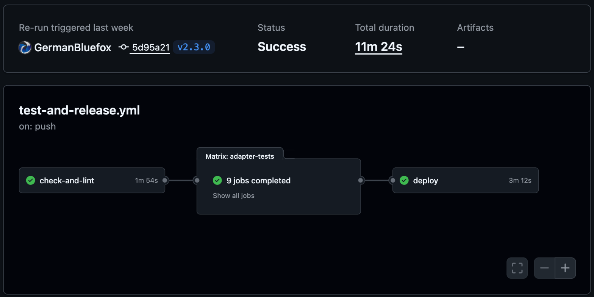

**6. Проверьте результат:**

```bash
npm view iobroker.<adaptername> dist-tags
# { latest: '0.0.1', next: '0.0.2-alpha.0' }
```

На сайте npmjs.com во вкладке **«Версии»** теперь отображается альфа-версия с соответствующим тегом. `next` На странице пакета отображается блок **«Происхождение»** . Предварительная версия указана в разделе **«Релизы»** на GitHub.

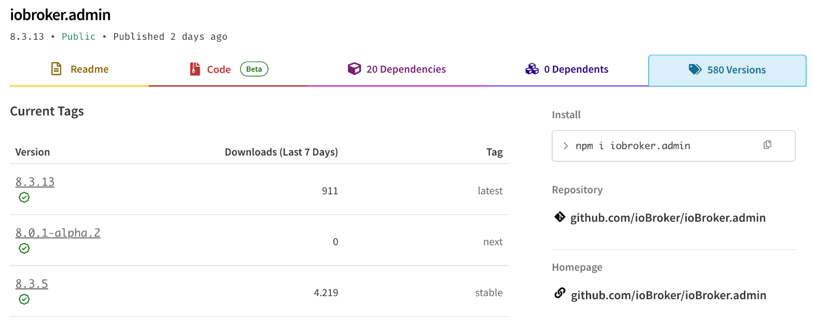

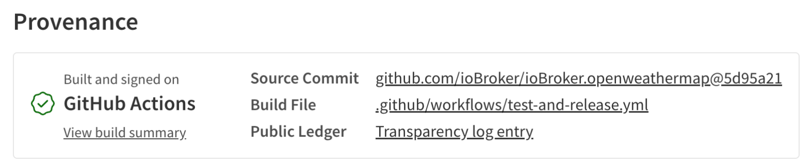

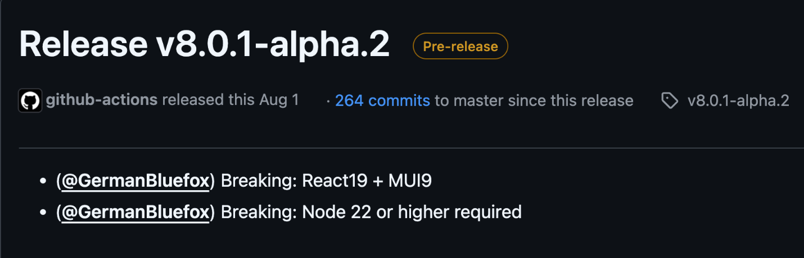

В настройках пакета после первого успешного выпуска Trusted Publisher отображает **статус «Действителен** ».

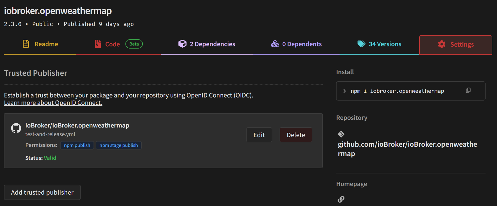

**Другие версии:**

| Цель                     | команда                         | Пример                        |
| ------------------------ | ------------------------------- | ----------------------------- |
| следующая Альфа          | `npm run release prerelease`    | 0.0.2-альфа.0 → 0.0.2-альфа.1 |
| Начало бета-тестирования | `npm run release prepatch beta` | 0.0.2 → 0.0.3-бета.0          |
| стабильная версия        | `npm run release patch`         | 0.0.2-альфа.1 → 0.0.2         |
| новая функция            | `npm run release minor`         | 0.0.2 → 0.1.0                 |

Источник команд: [AlCalzone/release-script](https://github.com/AlCalzone/release-script) .

## Шаблоны ошибок и решения

| Запись в журнале                                            | Вызванный                                                                                                 | Решение                                                                              |
| ----------------------------------------------------------- | --------------------------------------------------------------------------------------------------------- | ------------------------------------------------------------------------------------ |
| `E404 Not Found` в `npm publish` в рабочем процессе          | В Trusted Publisher допущена ошибка в написании имени файла владельца, репозитория или рабочего процесса. | Сравните записи из шага 5 с данными в репозитории, обращая внимание на регистр букв. |
| `ENEEDAUTH` в рабочем процессе                              | `id-token: write` отсутствует на работе `deploy`                                                           | Добавить разрешение (Шаг 6)                                                          |
| `E403` Публикация запрещена.                                | Отсутствует **параметр «Разрешить действия»** . **Разрешите npm publish.**                                | Поставьте галочку, сохраните и перезапустите выпуск.                                 |
| Редактировать Trusted Publisher больше нельзя.              | Конфигурация становится недействительной через 2 дня без обновления.                                      | Удалить, создать заново, немедленно освободить                                       |
| Рабочий процесс не начинается с альфа-тега.                 | Шаблон тегов для предварительных версий отсутствует в `on: push: tags:`                                    | `"v[0-9]+.[0-9]+.[0-9]+-**"` добавить в                                              |
| `EOTP` во время ручного управления `npm publish`             | Отсутствует подтверждение двухфакторной аутентификации.                                                   | Подтвердите в браузере или `npm publish --otp=<code>`                                |
| `You cannot publish over the previously published versions` | Эта версия уже доступна в npm.                                                                            | Создайте новую версию, используя скрипт выпуска.                                     |
| Скрипт сообщает о незафиксированных изменениях.             | Рабочая директория не чистая.                                                                             | `git status` подтвердить, перезапустить                                              |

Чтобы перезапустить без новой версии: в GitHub в разделе **«Действия** » откройте неудачно выполненное задание и нажмите **«Повторно запустить неудачно выполненные задания»** .