# Вебстор

На этой странице мы покажем, как установить и настроить среду разработки ioBroker. Для основной разработки используется WebStorm, в качестве альтернативы можно использовать Nodeclipse. Эта документация похожа на "справочник рецептов", но без объяснений по JavaScript, NodeJS, HTML5 и т. д.

Вы можете свободно дополнить приведенную ниже информацию.

## Загрузите и установите WebStorm на Ubuntu 14.04.

Перейдите на веб-страницу [jetBrains](https://www.jetbrains.com/webstorm/download/) и загрузите WebStorm для вашей ОС. Мы сосредоточимся на Ubuntu 14.04. Перейдите в каталог загрузок и переместите файл в каталог /opt с помощью команды "mv WebStorm-9.0.3.tar.gz /opt/". Распакуйте архив "tar xvzf WebStorm-9.0.3.tar.gz". Откройте папку "WebStorm-139.1112/bin" и введите "./webstorm.sh". Возможно, вам потребуется установить Java JDK...

### Установите Java JDK.

**Этот шаг не требуется в Windows.**

```
sudo apt-add-repository ppa:webupd8team/java
sudo apt-get update
sudo apt-get install oracle-java8-installer
```

### Установите NodeJS.

1. `sudo apt-get install nodejs` (не делайте) `sudo apt-get install node` (потому что Node — это не Node.js)
2. Создайте псевдоним «узел» с помощью `sudo ln -s /usr/bin/nodejs /usr/bin/node`

## Загрузите новейшие исходные коды ioBroker и импортируйте их в проект WebStorm.

1. Откройте терминал и перейдите в каталог /opt.
2. Создайте новую директорию с помощью команды "mkdir iobroker", а затем выполните команду "cd iobroker".
3. Установите iobroker с помощью команды "npm install iobroker".
4. Проверьте это с помощью команды "cd node\_modules/iobroker.js-controller/", затем введите "chmod +x iobroker", а позже "node controller.js".
5. Откройте браузер по адресу " <http://localhost:8081> ", и вы должны увидеть приветственный экран ioBroker.

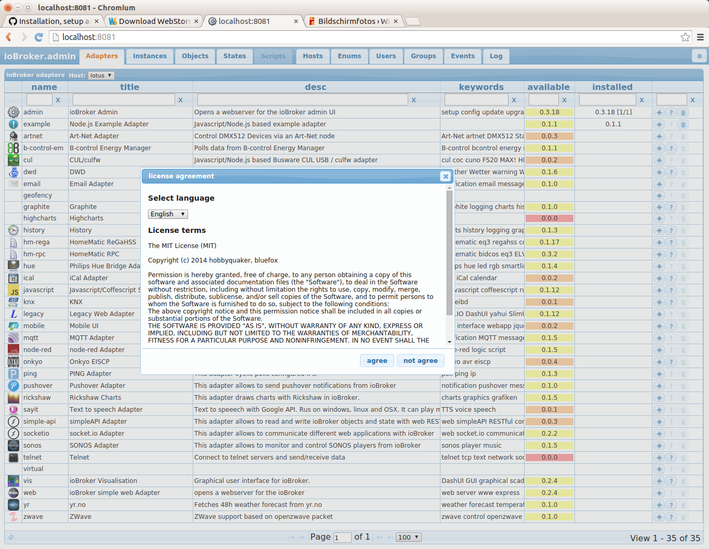

6. Откройте окно терминала и введите `ctrl + c` прервать работу ioBroker

## Настройте WebStorm для запуска и отладки ioBroker.

1. Откройте WebStorm с помощью `./webstorm.sh`
2. Нажмите `File->"New Project from existing files...`
3. Выберите следующее...

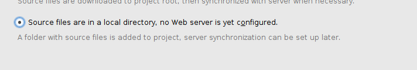

4. Выберите каталог вашего ioBroker... (щелкните правой кнопкой мыши по каталогу, чтобы установить корневую папку проекта)

   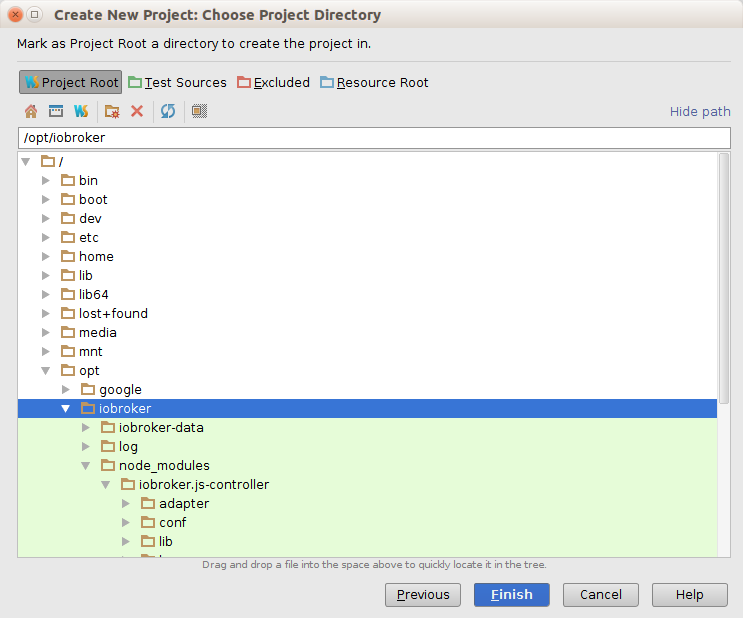

5. Ваш новый проект WebStorm должен выглядеть примерно так...

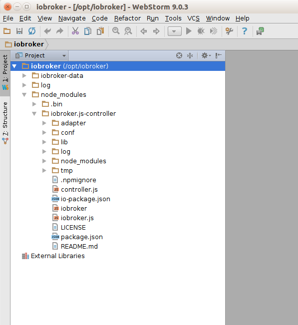

### Создайте конфигурацию запуска ioBroker.

1. Перейдите в меню «Выполнить» -> «Изменить конфигурацию...».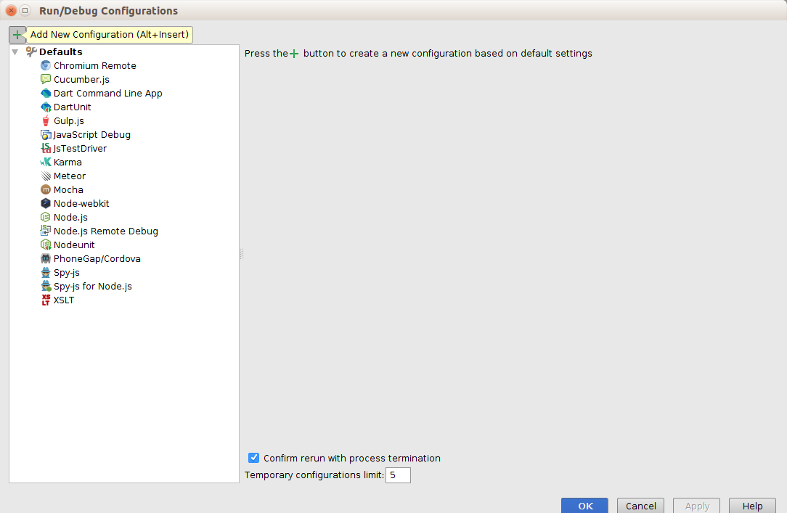

2. Выберите значок "+" и добавьте конфигурацию NodeJS, как показано на картинке ниже...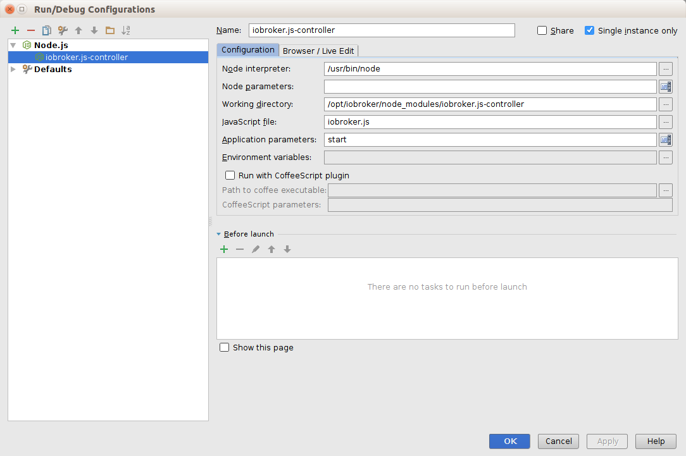

## Как запустить ioBroker из WebStorm

1. Запустите ioBroker, выбрав...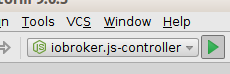

2. Возможно, вы задаетесь вопросом, как остановить ioBroker? Откройте терминал в WebStorm и введите...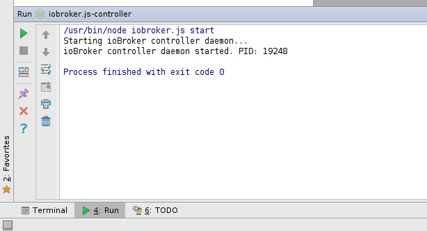

## Как отлаживать адаптер ioBroker

В этой главе мы рассмотрим, как отлаживать адаптер ioBroker, например, "iobroker.hmm". Сначала запустите ioBroker, как указано ранее, пожалуйста, не используйте "режим отладки". Используйте для ioBroker только "режим запуска". Установите адаптер, например, ioBroker.hmm, из командной строки следующим образом: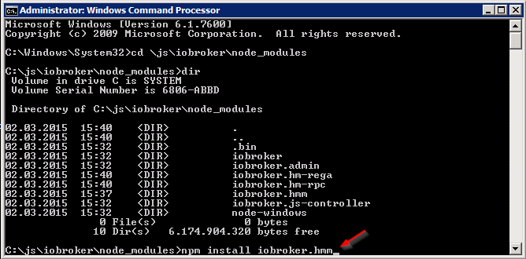

Настройте параметры отладки WebStorm...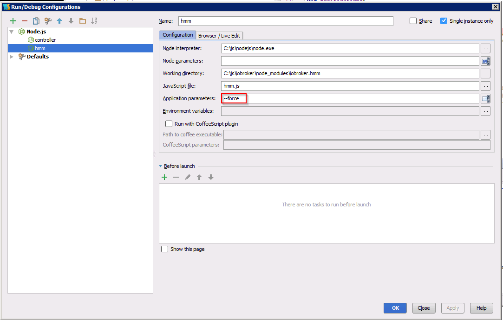

Перейдите на веб-страницу ioBroker [по адресу http://localhost:8081](http://localhost:8081) и установите адаптер iobroker.hmm: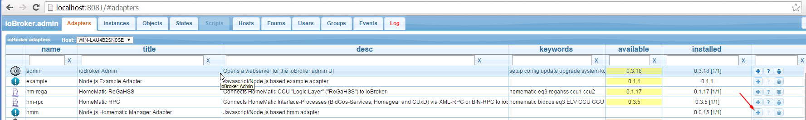

После установки адаптера необходимо отключить его экземпляр...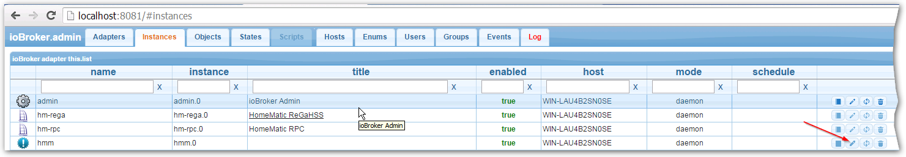

...следующий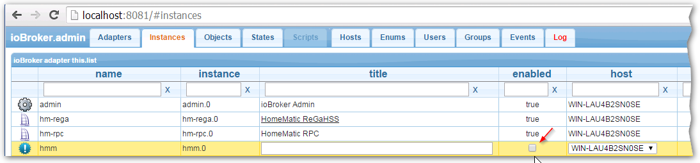

...в итоге вы должны увидеть такой результат: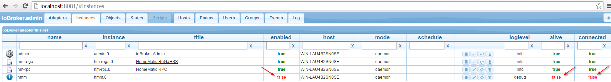

Теперь вернёмся к WebStorm. Откроем файл hmm.js и установим точку останова, как показано на этом примере: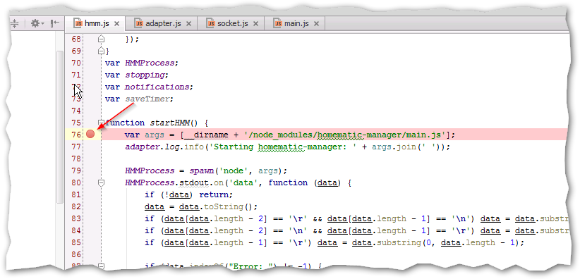

Начните отладку адаптера iobroker.hmm: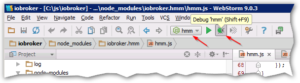

Остановившись на первой точке останова, вы можете управлять следующими шагами с помощью команд: 1) возобновить программу; 2) перейти к следующему шагу.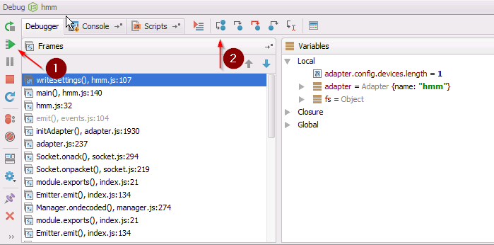