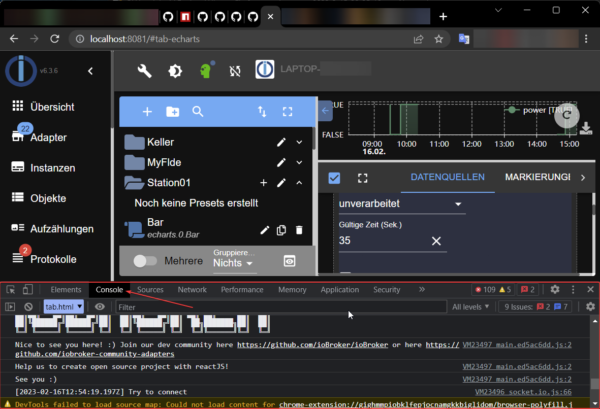
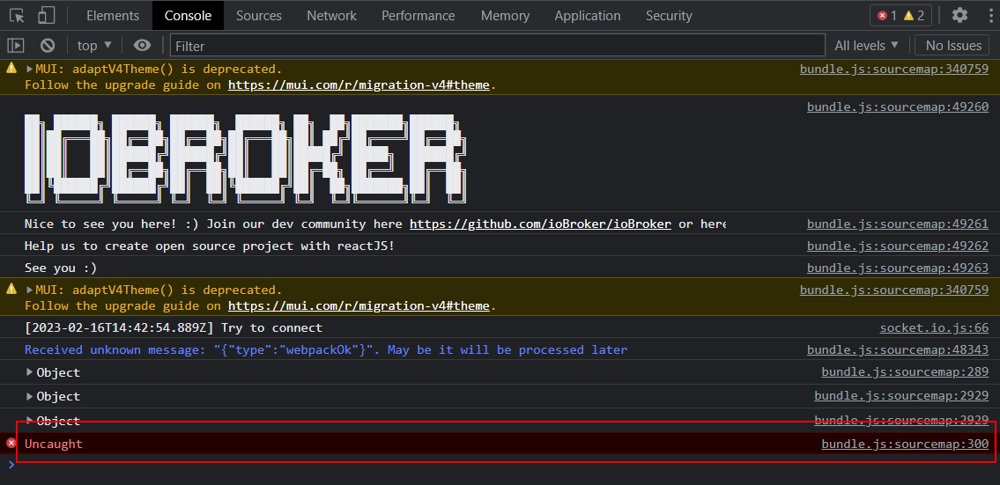
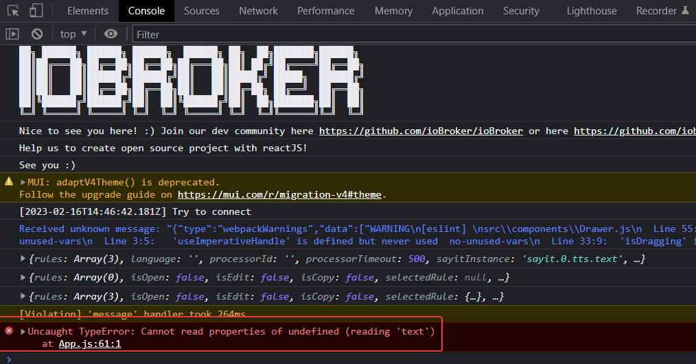

## Сообщайте об ошибках в графическом пользовательском интерфейсе.

ioBroker имеет множество графических пользовательских интерфейсов, написанных на JavaScript.

В настоящее время многие пользовательские интерфейсы разрабатываются с использованием ReactJS. Если в таком интерфейсе обнаруживается ошибка, или происходит зависание ответа, или страница ведет себя непредсказуемо, то вы можете и должны сообщить об этой ошибке.

Для этого необходимо открыть консоль браузера и найти там сообщения об ошибках. Консоль браузера выглядит по-разному в каждом браузере, но в большинстве браузеров она находится в режиме разработчика, который обычно доступен по клавише F12 (Chrome, Firefox, Edge).

Важно _сначала открыть консоль браузера, затем перезагрузить страницу (F5)_ , а затем выполнить действия, вызывающие ошибку.

Вот как выглядит консоль браузера в Chrome:

Вот как выглядит сообщение об ошибке, если консоль открывается только после загрузки страницы:

Таким образом, если консоль открыта до загрузки страницы:

Как видите, отображается имя файла и номер строки, где произошла ошибка.

Имея эту информацию (а также номер версии адаптера), мы можем воспроизвести или исправить ошибку.