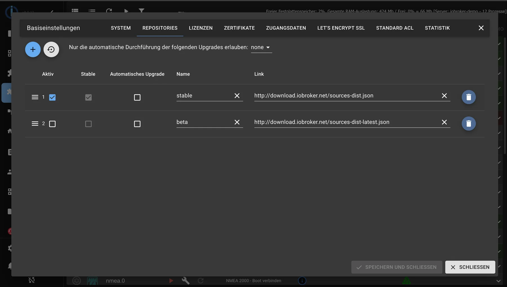

# Установите обновления

Обновления поддерживают работоспособность системы, но они также являются наиболее распространенной причиной ее внезапного выхода из строя. Обе эти проблемы можно решить, если следовать определенной последовательности и не пытаться сделать все сразу.

## Золотое правило

Перед каждым обновлением делайте [резервную копию](/docs/config/backup.md) . Не "с прошлой недели", а именно, сделанную сейчас. Это займет минуту, но может сэкономить вам целый вечер.

Вот ещё два правила, доказавшие свою эффективность на практике:

- **Не все сразу.** Если что-то зависло после пяти обновлений, вы не узнаете, какое именно.
- **Не прямо перед отъездом.** Неудачное обновление требует времени.



_В настройках системы в разделе «Репозитории» отображается источник адаптеров. В повседневном использовании здесь остается активным параметр «стабильная версия»._

## Хронологический порядок

1. **Адаптер** .
2. **js-controller** .
3. **Node.js** , последний и единственный, выбранный намеренно.

Для нового контроллера JavaScript иногда требуются более новые адаптеры, поэтому адаптеры перечислены первыми. Изменение основной версии Node.js — наиболее значительное изменение, и ему посвящена отдельная страница: [Обновление Node.js.](/docs/install/updatenode.md) Более подробную информацию можно найти в разделе [«Обновление»](/docs/install/update.md) .

## Если адаптеру требуется более новая версия Node.js

Для некоторых версий адаптера требуется более новая версия Node.js или js-controller. Это указано в журнале изменений или файле README в разделе «Требования». В этом случае есть два варианта:

- **Предпочтительнее использовать Node.js** — сначала сделайте резервную копию, а затем обновите его, как описано в разделе [«Обновление Node.js»](/docs/install/updatenode.md) .
- **Либо пока оставайтесь на текущей версии адаптера** , либо установите более старую, совместимую версию: в режиме администратора, в экспертном режиме через _«Установить определенную версию»_ (см. [«Адаптеры»](/docs/tutorial/adapter.md) ) или в консоли:

```bash
iobroker upgrade <adaptername>@<version>
```

Начиная с js-controller 6, неподходящую версию можно скрыть, чтобы она не предлагалась постоянно в качестве обновления, а затем не отображалась снова:

```bash
iobroker version <adaptername> --ignore <version>
iobroker version <adaptername> --recognize
```

## Обновить адаптер

На вкладке [«Адаптеры»](/docs/admin/adapter.md) выделены адаптеры с более новыми версиями. Перед тем как нажать на них, стоит проверить список изменений адаптера: это покажет, исправлена ли ошибка или требуется дальнейшая доработка дизайна.

После обновления: проверьте, запущен ли экземпляр, и просмотрите [журнал](/docs/admin/log.md) .

Оставайтесь в **стабильном** репозитории. Версии там протестированы. _Бета-версия_ предназначена для тестирования, а не для полноценной работы системы. См. [раздел «Репозитории»](/docs/basics/repositories.md) .

## Обновите js-контроллер

Обновление происходит **не** во вкладке «Адаптер», а во вкладке [«Хосты»](/docs/admin/hosts.md) . Там появляется уведомление о наличии более новой версии. В командной строке:

```bash
iobroker upgrade self
```

Во время обновления пользовательский интерфейс будет временно недоступен. Это нормально.

## Обновите Node.js

Это шаг с наиболее значительными последствиями и единственный, который выполняется вне ioBroker. Для этого ioBroker предоставляет собственную команду:

```bash
iobroker nodejs-update
```

Используйте только **четные** номера версий, т.е. версии с долгосрочной поддержкой (LTS). Нечетные версии не поддерживаются. Подробнее [см. в разделе «Обновление Node.js»](/docs/install/updatenode.md) .

**В Docker** (образ от buanet) Node.js поставляется в комплекте с образом. `iobroker nodejs-update` Это не так; вместо этого создаётся новый образ и пересоздаётся контейнер. `docker pull` и воссоздать контейнеры или `docker compose pull && docker compose up -d` Данные остаются в объеме ниже `/opt/iobroker` — В любом случае, сделайте резервную копию заранее. См. [Docker](/docs/install/docker.md) и [документацию buanet](https://docs.buanet.de/de/iobroker-docker-image/) .

## операционная система

В Linux базовая система также нуждается в обслуживании:

```bash
sudo apt update
sudo apt upgrade
```

Система, которая годами не получала обновлений безопасности, представляет больший риск, чем адаптер, отстающий на одну версию.

**В Docker** операционная система также поставляется вместе с образом. Вместо этого `apt` Создается новый образ, и контейнер перестраивается, как описано выше для Node.js. Адаптеры и js-контроллеры будут по-прежнему обновляться как обычно в панели администратора или в консоли внутри контейнера.

## Если обновление пойдёт не так

1. Проверьте [протокол заседания](/docs/admin/log.md) . В нем обычно простым языком указано, чего не хватает.
2. Остановите затронутый экземпляр и перезапустите его отдельно.
3. Если это не поможет, восстановите резервную копию. Инструкции по этому поводу можно найти в разделе [«Восстановление конфигурации»](/docs/trouble/restore.md) , а подробные сведения — в разделе [«Восстановление»](/docs/tutorial/restore.md) .

А потом спросите на [форуме](/docs/trouble/forum.md) . Если обновление не удалось нескольким людям, вы, как правило, не одиноки.