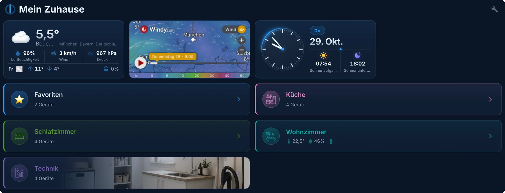
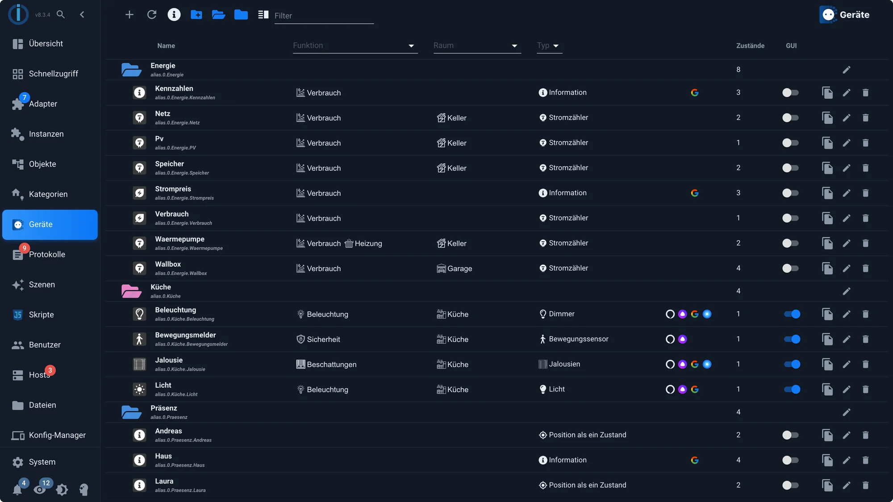
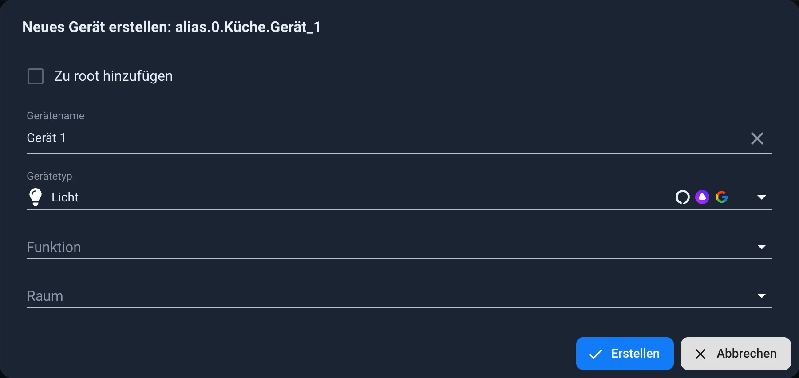
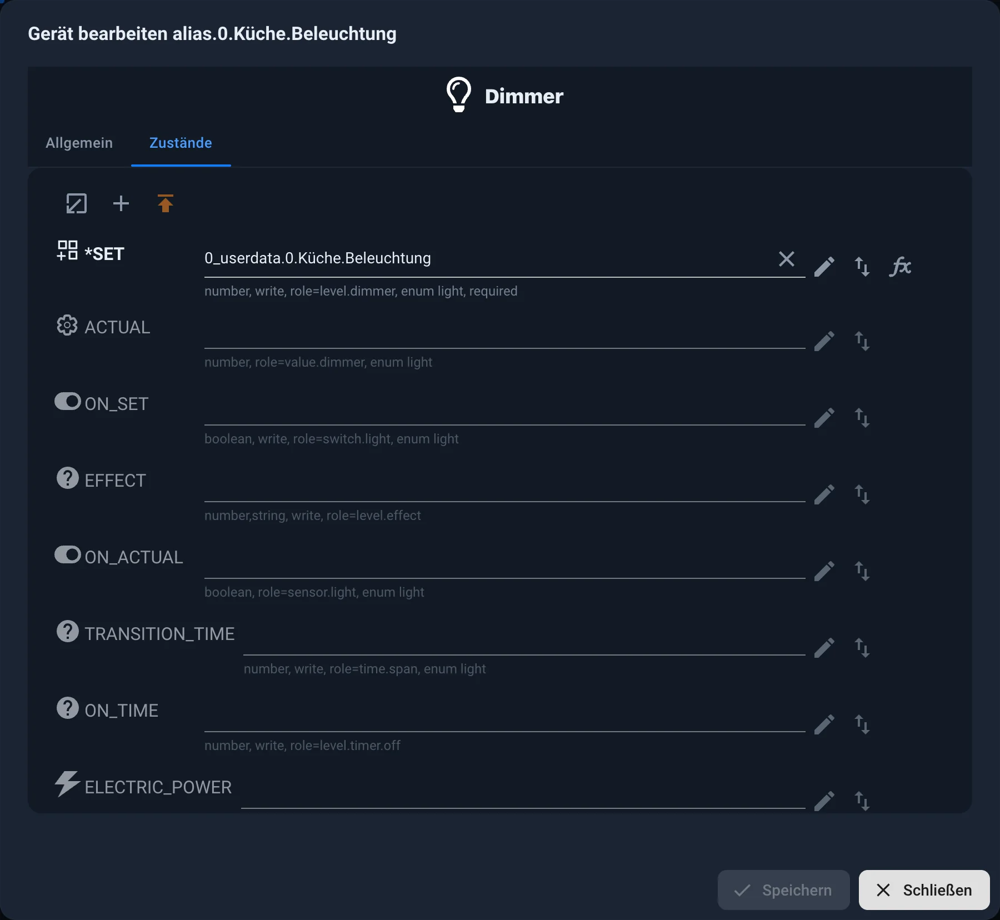
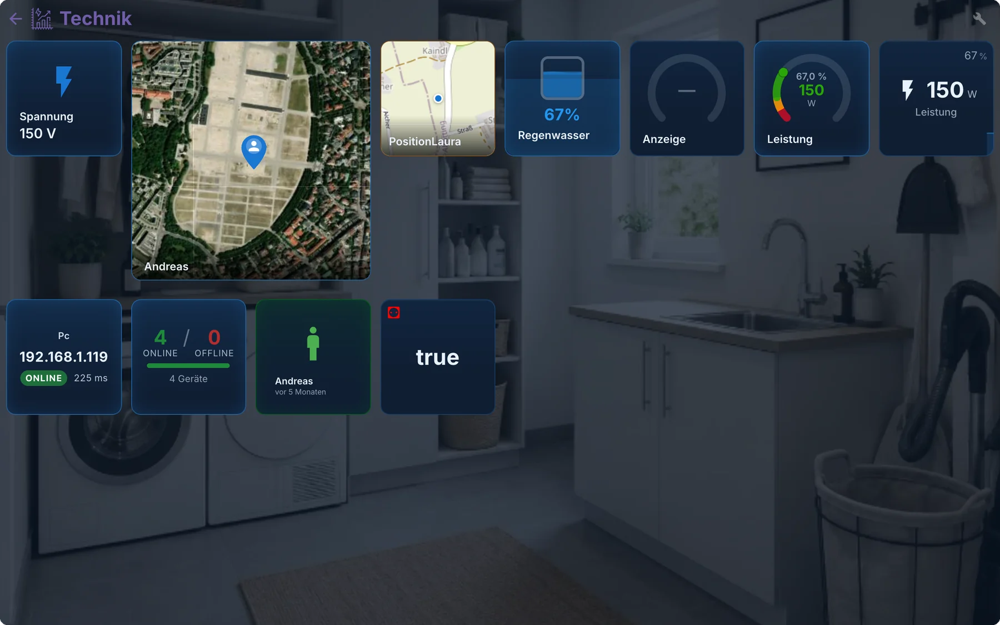
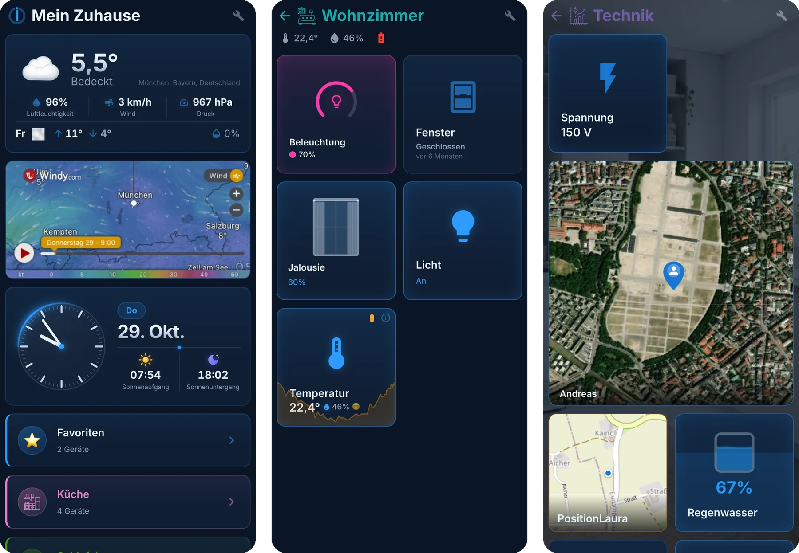
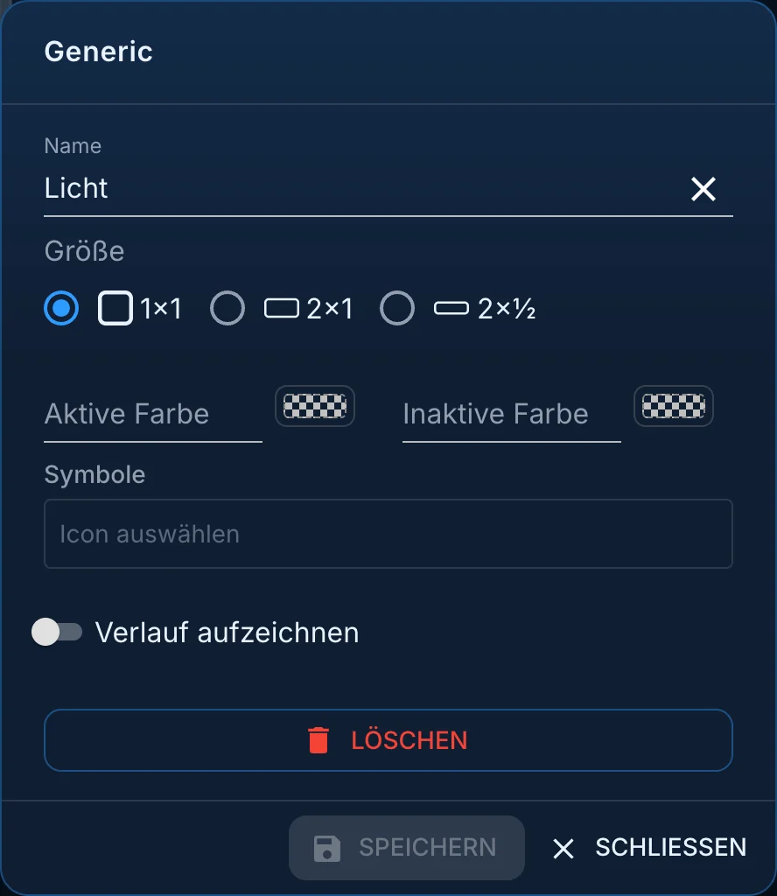
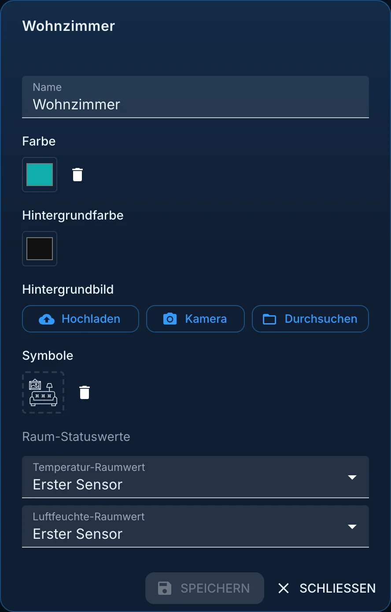
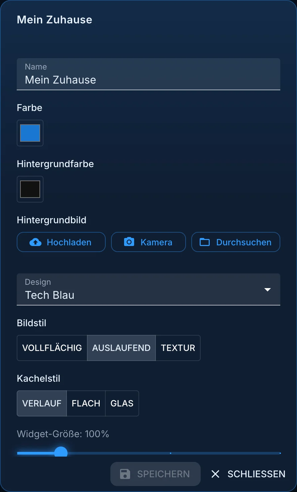
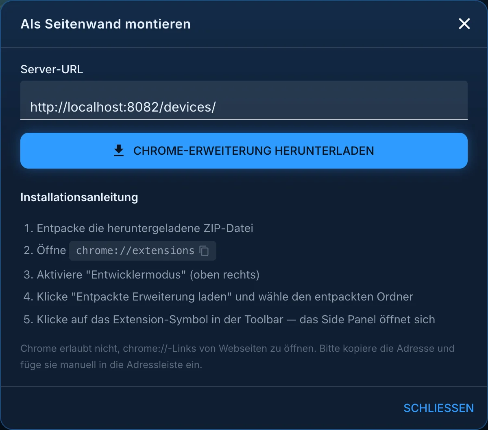

# Surface через адаптер устройств

Адаптер [\`devices\`](/adapters/devices) на самом деле не является адаптером визуализации. Он присваивает точки данных **устройствам** : переключатель, сигнал обратной связи и счетчик становятся лампой; четыре значения становятся термостатом. Начиная с версии 4, он также может генерировать полный пользовательский интерфейс непосредственно из этих устройств, и именно об этом эта страница.

Адаптер работает только как вкладка в панели администратора. Он не запрашивает данные ни с каких устройств и практически не требует вычислительной мощности. На изображениях на этой странице показана версия 4.2.7 с дизайном **Tech Blue** и панель администратора с темой **Modern Dark** .

## Почему стоит сделать этот крюк

Один-единственный показатель мало что нам говорит. `hm-rpc.1.00085A49A3F98C.4.STATE` является `boolean` Система ничего больше не знает. Только когда в результате получается устройство соответствующего типа. `light` Остальные адаптеры будут знать, что делать:

- При создании виджета **vis-2** предлагает подходящие точки данных.
- **[Ловелейс](/docs/viz/lovelace.md)** строит свои поверхности из этого материала.
- Устройства **IoT** сообщают Alexa или Google, что это лампа, а не выключатель.
- **Материя** может лишь передать это дальше.
- Скрипт определяет местоположение устройства по его типу, а не по непонятному идентификатору.

Есть и второе преимущество, которое проявится лишь позже: устройства расположены ниже. `alias.0.<Name>` Если устройство впоследствии будет заменено, изменение назначения произойдет в одном месте. Визуализация, скрипты и запись этого не заметят.

## Список устройств

В панели администратора эта вкладка называется **«Устройства»** . Как и скрипты и журналы, её необходимо включить в настройках экземпляра администратора. Она отображает либо пользовательский интерфейс, либо список устройств; кнопка **«Устройства»** в правом верхнем углу и стрелка « **Назад к устройствам»** в пользовательском интерфейсе позволяют переключаться между ними.

Устройства хранятся в папках, обычно по одной на комнату или зону. Для каждого устройства отображается следующий список:

- **Функциональность** и **пространство** из указанных [категорий](/docs/basics/enums.md) .
- **тип** , например, диммер, датчик движения или датчик освещенности.
- символы **голосовых помощников и систем «умного дома»,** к которым может быть привязано устройство данного типа,
- количество назначенных **штатов** ,
- Переключатель **графического интерфейса** определяет, будет ли устройство отображаться в интерфейсе.
- Справа расположены кнопки для копирования, редактирования и удаления.

## Создать устройство

1. Выберите папку, куда вы хотите поместить устройство, и нажмите **+** . Присвойте ему имя и выберите **тип устройства** , например, освещение, жалюзи, термостат или датчик температуры. Вы также можете одновременно назначить функцию и комнату.

2. На вкладке **«Штаты»** укажите значения точек данных. Обязательные поля отмечены звездочкой. `*` Поля, помеченные как необязательные, например, влажность для датчика температуры, можно опустить. Каждое поле указывает, что ожидает тип данных: тип данных, будет ли производиться запись в данные и его роль.

3. Сохраните. Устройство появится в разделе `alias.0.<Name>` в дереве объектов.

На вкладке **«Общие»** отображаются название, функция, номер комнаты и цвет, а также **«умное» имя,** используемое Alexa и другими приложениями. **Отключение «умной» функциональности** полностью исключит устройство из этого списка.

Практически каждая модель также отображает **состояние** батареи, подключения и ошибок. Эти данные являются необязательными, но их оценивают Lovelace и Matter.

Псевдоним может не только указывать на точку данных: операции чтения и записи могут быть направлены на **разные** точки данных (символ стрелки за полем), и для обоих направлений может быть определено преобразование (символ). `fx` Это превращает рольставни, которые сообщают 0 при открытии, в устройство, которое ведет себя как все остальные.

## Откуда берутся эти устройства

| Источник                     | Описание                                                                                                                                                                                                                |
| ---------------------------- | ----------------------------------------------------------------------------------------------------------------------------------------------------------------------------------------------------------------------- |
| **Автоматически обнаружено** | Адаптеры, такие как `zigbee` или `hm-rpc` Они уже обеспечивают удобную структуру. Адаптер устройств распознает их автоматически, **но только если назначено помещение или функция.** Без назначения ничего не происходит. |
| **Псевдоним**                | Рекомендуемый метод для любых изделий, изготовленных вручную. Оборудование находится ниже. `alias.0`.                                                                                                                   |
| **Связанные устройства**     | Предшественник через адаптер `linkeddevices` Больше не предназначено для новых установок.                                                                                                                                |

В [детекторе типов](https://github.com/ioBroker/ioBroker.type-detector/blob/master/DEVICES.md) перечислены существующие типы и ожидаемые ими значения данных.

## Встроенная поверхность

После настройки устройств при желании можно создать пользовательский интерфейс. Он доступен по соответствующей ссылке \[link/path]. `web` -Доступный экземпляр, обычно в пределах `http://<adresse>:8082/devices/` а также отображается на вкладке **«Устройства»** в административной панели.

На главной странице комнаты отображаются в виде полос, над которыми, при желании, отображаются плитки с погодой, часами или другими данными. Нажатие на комнату открывает доступ к её устройствам. Каждая плитка показывает свой статус и может управляться напрямую; если записывается история событий, рядом с ней отображается график.

На телефоне те же страницы автоматически располагаются в два столбца без каких-либо настроек:

### Меблировать

Значок гаечного ключа в правом верхнем углу переключает в **режим конфигурации** . Каждый элемент теперь имеет ручку для перемещения, звездочку для **избранных элементов** и значок шестеренки для их настроек. В заголовке отображается:

| Кнопка                                  | Эффект                                                                                                                          |
| --------------------------------------- | ------------------------------------------------------------------------------------------------------------------------------- |
| **Добавить виджет**                     | Дополнительный элемент, не являющийся устройством: часы, погода, веб-сайт, перенос строки, даже встроенное представление Vis 2. |
| **Группировать по типу**                | Расположите приборы в комнате по категориям, таким как освещение, жалюзи, климат-контроль.                                      |
| **Настройки категории**                 | Название, цвета, фоновое изображение и иконка комнаты или главной страницы.                                                     |
| **Крепление в качестве боковой стенки** | Настраивает интерфейс в виде боковой панели в Chrome (см. ниже).                                                                |
| **Режим воспроизведения**               | возвращение к нормальной работе                                                                                                 |

Что можно отрегулировать:

- **Какие устройства будут отображаться,** определяется столбцом **графического интерфейса пользователя** в списке устройств. Все, что не отмечено галочкой, исключается из списка.
- **Плитки.** Название, размер (1x1, 2x1 или 2x½), цвет активного и неактивного состояния, а также символ можно изменить для каждого устройства. При **включенной функции «История отслеживания»** плитка отображается в виде кривой.
- **Комнаты.** Они выбираются из категорий и могут быть названы, раскрашены и снабжены фоновым изображением с помощью **загрузки** , **камеры** или **просмотра** . Датчик, предоставляющий показания температуры и влажности в помещении, можно выбрать.
- **Избранное** для устройств, которыми вы постоянно пользуетесь.
- В настройках главной страницы **можно выбрать внешний вид** : **дизайн** (автоматический в соответствии с системным дизайном, темный, светлый, темно-оранжевый, темно-синий, технологичный синий, светлый или серый стиль), **стиль** фоновых изображений (полное покрытие, градиент или текстура), **стиль плитки** (градиент, плоский или стеклянный) и **размер виджета** от 80 до 200%.
- **Настройки для нескольких пользователей** : права доступа для каждой группы пользователей, при условии, что соответствующий переключатель включен.

### В качестве боковой панели в Chrome

**Нажатие кнопки «Подключить как боковую панель»** на главной странице загружает расширение Chrome, которое открывает интерфейс в боковой панели браузера. В диалоговом окне отображается адрес сервера и пошаговая инструкция по установке: распакуйте ZIP-файл, `chrome://extensions` Откройте браузер, включите режим разработчика и загрузите извлеченное расширение. После этого, нажав на значок расширения, вы откроете параметры устройства рядом с любым веб-сайтом.

Пользовательский интерфейс можно перенести с телефона в приложение [ioBroker VisuApp](/docs/cloud/app.md) .

Этот интерфейс **не заменяет vis-2** . Он предназначен для быстрого и автоматического создания представлений помещений. Всем, кто хочет создать панель мониторинга точно по своим собственным спецификациям, следует использовать [vis-2](/docs/viz/vis-2.md) .

## Видео об этом

На канале ioBroker весь процесс, от создания псевдонимов и отображения комнаты до работы приложения, показан всего за двадцать минут: [ioBroker Devices/Device Adapters: Automatic Visualization for Smart Home](https://www.youtube.com/watch?v=C-e8j8NHdi0) (May 2026).

## Дополнительная информация

- [Категории](/docs/basics/enums.md) и вкладка [«Категории»](/docs/admin/enums.md) : основа для пространств и функций.
- [Роль точек данных](/docs/basics/roles.md) : как адаптер распознает, что такое точка данных.
- [Псевдоним](/docs/basics/alias.md) : что скрывается за чем-либо `alias.0` является
- [Обзор](/docs/viz/README.md) : другие способы добраться до поверхности