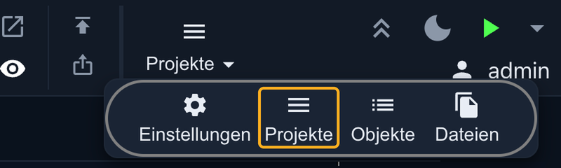
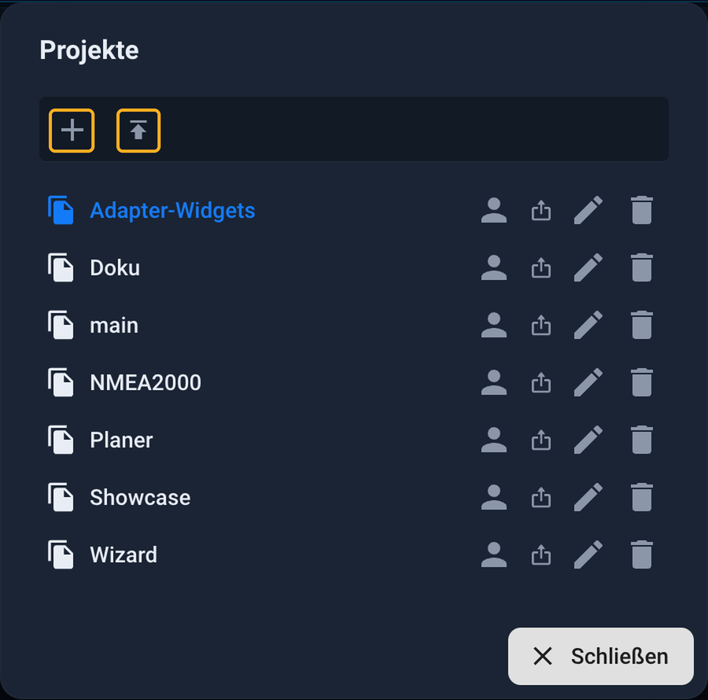
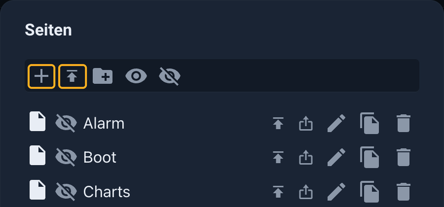

# Импорт демонстрационного проекта

Реальная система ioBroker работает по адресу <https://iobroker.click> . Там вы можете просматривать и взаимодействовать с готовыми пользовательскими интерфейсами в режиме реального времени. Если вам понравится какой-либо из них, вы можете импортировать его в свою систему **vis-2** и затем настроить его по своему усмотрению, вместо того чтобы начинать с пустой страницы.

На этой странице показан путь от загрузки до запуска интерфейса.

## Что вы скачиваете

Каждый интерфейс включает до двух файлов. Оба доступны в диалоговом окне **«Скачать и настроить проект»** , которое открывается нажатием кнопки **«Скачать проект»** рядом с демонстрационной версией.

| файл                           | Содержание                                                           | Необходимый?   |
| ------------------------------ | -------------------------------------------------------------------- | -------------- |
| **Проект для vis-2** (`.zip`) | Страницы проекта, виджеты, изображения и настройки                   | Да             |
| **Точки данных** (`.json`)    | Данные, использованные в проекте, включая демонстрационные значения. | необязательный |

Решение простое:

- **Просто примите этот дизайн** : `.zip` Этого достаточно. Опустите точки данных. В этом случае виджеты изначально будут пустыми и будут подключаться напрямую к вашим устройствам.
- **Для начала попробуйте поэкспериментировать** : загрузите также точки данных. Тогда интерфейс сразу отобразит значения, и вы сможете использовать его полностью без собственных устройств.

Не все интерфейсы на iobroker.click пока доступны для скачивания. Такие записи помечены как **«Скоро появятся»** .

## Шаг 1: Установите адаптер

В административном интерфейсе, в разделе **«Адаптеры»** **, установлены web** и **vis-2** . Кроме того, необходимы адаптеры, относящиеся к соответствующему интерфейсу. Их можно скачать в диалоговом окне загрузки. Например, для демонстрационной версии с дизайном Jäger требуется... `vis-2-widgets-jaeger-design` виджеты которых требуют собственной лицензии, и `mihome-vacuum` для карты робота-пылесоса. Если такой адаптер отсутствует, соответствующие виджеты останутся пустыми.

## Шаг 2: Импорт точек данных (необязательно)

Необходимо только в том случае, если требуются демонстрационные значения:

1. Открывайте **объекты** в административном интерфейсе.
2. Включите **экспертный режим** .
3. Нажмите на значок загрузки, чтобы `.json` — Выберите файл, содержащий точки данных.

В папке будет создана папка. `0_userdata.0` в примере `0_userdata.0.Demo`, со всеми данными, использованными в проекте.

## Шаг 3: Импортируйте проект

Редактор vis-2 можно открыть в административном интерфейсе через экземпляр vis-2. Также к нему можно получить доступ напрямую в браузере по адресу веб-адаптера, используя следующий путь: `/vis-2/edit.html`.

Меню **«Проекты»** расположено в правом верхнем углу панели инструментов. При нажатии на него разворачиваются четыре пункта. **Выбор пункта «Проекты»** открывает диалоговое окно, отображающее все проекты в системе.

В самом верху диалогового окна расположены две кнопки рядом. **Кнопка «плюс»** создает новый пустой проект. Кнопка справа от нее, со стрелкой, указывающей вверх, — это **кнопка импорта** . Она открывает окно выбора файла; там выберите загруженный файл. `.zip` Выберите. Файл останется сжатым; он не будет распакован.

**Не меняйте название проекта** . Демонстрационные изображения и файлы будут искаться под этим именем, например: `jaeger-design-widgets` Если проект импортирован под другим именем, изображения будут отсутствовать.

Проект затем появляется в списке. Щелчок по названию открывает его в редакторе.

## Принимайте участие только

Вам не обязательно использовать весь проект целиком. Отдельные **страницы** или **виджеты** из загруженной демо-версии также можно импортировать в существующий проект. Это правильный подход, если вам нужна только конкретная страница или отдельный элемент.

**Отдельные страницы** можно импортировать в диалоговом окне **«Страницы»** (кнопка **«Страницы»** на панели инструментов). Параметр импорта находится рядом со знаком плюса.

**Отдельные виджеты** можно импортировать с помощью кнопки **«Импорт виджетов»** на панели инструментов. Аналогичная кнопка **«Экспорт виджетов»** сохраняет виджеты, выбранные на текущей открытой странице.

Изображения, необходимые для виджета, находятся в файловом хранилище под именем демонстрационного проекта. Любой, кто копирует отдельные части, должен убедиться, что эти файлы попадают в его собственный проект.

## Шаг 4: Подключите свои устройства.

Демонстрационная версия отображает значения из демонстрационных точек данных. Для отображения значений вашей собственной системы каждый виджет должен указывать на свои собственные точки данных. Это можно сделать двумя способами:

- В редакторе щелкните по виджету и замените демонстрационную точку данных на свою собственную в поле **ID объекта** .
- В качестве альтернативы, скрипт может записывать значения ваших собственных устройств в демонстрационные точки данных. При этом виджеты остаются неизменными. Это полезно, когда многие виджеты используют одни и те же точки данных.

Пока к устройству не подключено, значения останутся пустыми. Чтобы проверить это, значения можно установить вручную в административном интерфейсе в **разделе «Объекты»** .

## Если что-то не так

| наблюдение                                | Вызванный                                                                                                                |
| ----------------------------------------- | ------------------------------------------------------------------------------------------------------------------------ |
| Виджеты пусты или отображают заполнители. | Демонстрационный адаптер отсутствует, или набор виджетов не загружен. Установите адаптер и перезагрузите страницу.       |
| Виджеты не отображают никаких значений.   | Данные не были импортированы, или же виджеты по-прежнему ссылаются на демонстрационные данные, а не на свои собственные. |
| Изображения отсутствуют                   | Проект был импортирован под другим именем. Удалите его и импортируйте снова под исходным именем.                         |

Более подробную информацию об управлении проектами, экспорте и резервном копировании данных можно найти на сайте [vis-2](/docs/viz/vis-2.md#wo-das-projekt-liegt) .