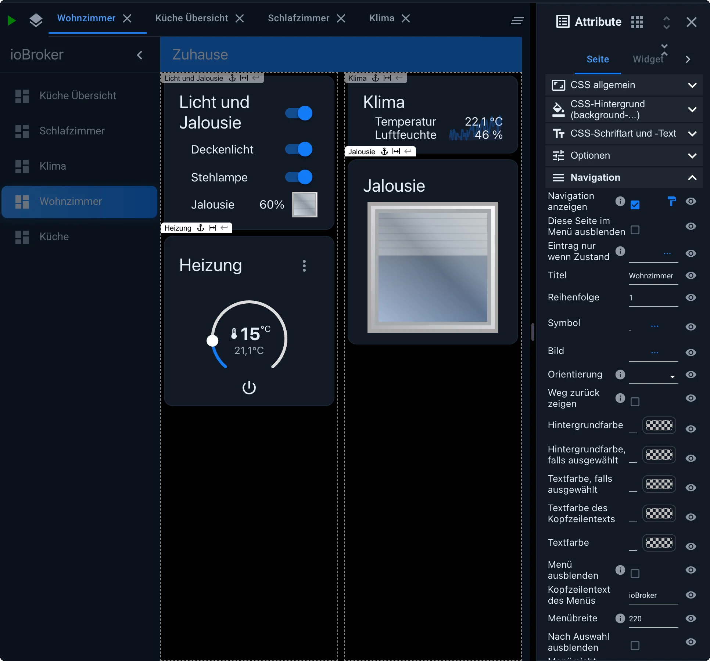
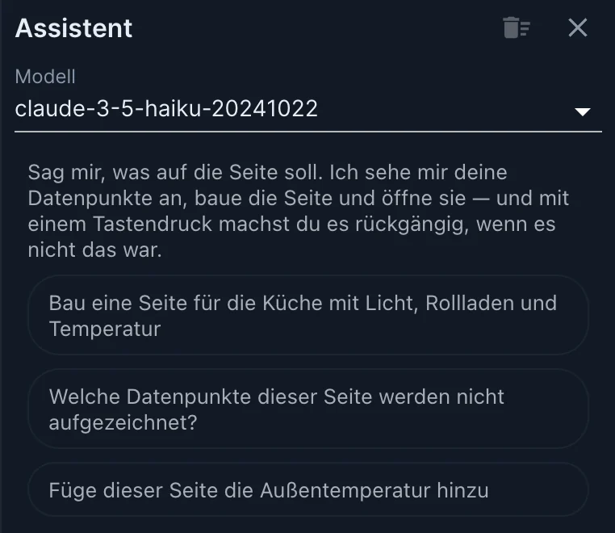
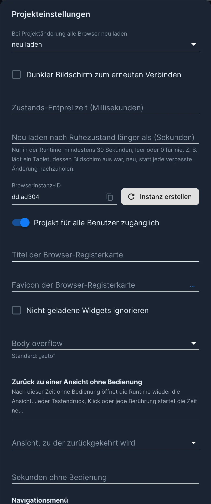

# вис-2

**vis-2** — это инструмент визуализации для ioBroker: пользовательский интерфейс, который можно собрать из отдельных блоков без программирования. Это преемник [vis](/docs/viz/vis.md) и правильный выбор для любого нового проекта.


Что отличает его от других интерфейсов: vis-2 ничего не создает автоматически. [Адаптер Devices](/docs/viz/devices.md) и [Lovelace](/docs/viz/lovelace.md) генерируют свои страницы на основе устройств и категорий; здесь же вы определяете каждый элемент интерфейса самостоятельно. Это занимает некоторое время, и это единственный способ, если вы хотите, чтобы интерфейс выглядел именно так, как вы себе представляете. Настенный планшет в коридоре, план помещения с данными в реальном времени, обзор с камер или страница для вашего телефона: используя одни и те же строительные блоки, каждый раз создается нечто совершенно иное.


Готовые примеры для тестирования доступны по адресу <https://iobroker.click> .

Все изображения на этой странице взяты из vis-2 2.20.5 в теме **Modern Dark** , с использованием наборов виджетов, предоставляемых самим vis-2, и некоторых распространенных адаптеров виджетов.

## Лицензия

vis-2 — единственная часть ioBroker, требующая лицензии. Исходный код распространяется под лицензией CC BY-NC, что необходимо подтвердить во время установки, и адаптер также требует лицензии. Доступны три версии:

| Лицензия        | Для кого                                                                                              |
| --------------- | ----------------------------------------------------------------------------------------------------- |
| **Сообщество**  | Конфиденциально, бесплатно. Все, что вам нужно, это аккаунт на [iobroker.net](https://iobroker.net) . |
| **Офлайн**      | В частном порядке, за небольшую плату.                                                                |
| **Коммерчески** | Коммерческое использование и распространение среди клиентов.                                          |

**Проверка лицензии сообщества выполняется в режиме онлайн при запуске адаптера** . В этот момент устройство должно быть подключено к интернету. Те, кто не хочет или не может этого сделать, должны использовать офлайн-лицензию, которая не требует проверки. Подробную информацию и цены можно найти в разделе [«Лицензии адаптера»](/docs/licenses/adapter.md) и в [обзоре продукта](/productoverview) .

## установка

Адаптер называется[`vis-2`](/adapters/vis-2) Для его работы требуется [веб-адаптер](/adapters/web) , и он функционирует как **синглтон** : может существовать только один экземпляр.

После этого остаются два адреса:

|                                          | адрес                                   |
| ---------------------------------------- | --------------------------------------- |
| Отображение (в режиме реального времени) | `http://<server>:8082/vis-2/index.html` |
| редактор                                 | `http://<server>:8082/vis-2/edit.html`  |

Вы можете получить доступ к конкретному проекту и конкретной странице с помощью `index.html?Projekt#Seitenname` Оба адреса также указаны в качестве ссылок на вкладке **«Экземпляры»** .

На телефоне или планшете изображение можно добавить на главный экран в качестве ярлыка через меню браузера. При этом открывается именно тот проект и страница, из которых оно было создано, и выглядит оно почти как отдельное приложение.

## Редактор


Редакторская работа разделена на пять направлений:

|       | Область                 | Содержание                                                                                                                                                                                                              |
| ----- | ----------------------- | ----------------------------------------------------------------------------------------------------------------------------------------------------------------------------------------------------------------------- |
| **1** | **Панель инструментов** | Новая страница, **Устройства** , Список страниц, Вырезать и вставить, Отменить и повторить, Выровнять несколько виджетов, Предварительный просмотр, а также **настройки** справа, **Проекты** , **Объекты** и **файлы** |
| **2** | **диапазон**            | Все доступные виджеты, сгруппированные по наборам виджетов, с полем поиска.                                                                                                                                             |
| **3** | **рабочая поверхность** | открытые страницы в виде вкладок                                                                                                                                                                                        |
| **4** | **Атрибут**             | Настройки выбранного элемента с вкладками **«Страница»** , **«Раздел»** , **«Виджет»** , **«CSS»** и **«Скрипты».**                                                                                                     |
| **5** | **помощник**            | [Искусственный интеллект-помощник](#der-ki-assistent) , который создает и изменяет страницы по команде.                                                                                                                 |

Доступ к палитре и атрибутам осуществляется с помощью двух значков слева и справа от вкладок боковой панели. Если окно узкое или разрешение страницы не помещается между боковыми панелями, они открываются как плавающая панель над рабочим пространством, только по одной за раз. На широком экране или на странице с нефиксированным разрешением они отображаются рядом.

Значок **«Изменить цветовую тему»** в правом верхнем углу переключает темы, включая **«Современная темная»** и **«Современная светлая»** . Этот выбор применяется к данному браузеру, и виджеты из тем «Относительная» и «Абсолютная» наследуют свои цвета от этой темы.

**В Vis-2 представление называется «страницей».** В Vis-1 то же самое называлось «представлением», и многие онлайн-уроки до сих пор используют этот термин. Все они означают одно и то же: экран, заполненный виджетами.

## страницы

Проект состоит из нескольких страниц. Каждая страница имеет свои собственные настройки в разделе **«Атрибуты» → «Страница»** , сгруппированные по назначению:

- **CSS в целом** , **CSS для фона** , а также **CSS для шрифтов и текста** для оформления.
- **Варианты** поведения,
- Панель **навигации** и **панель приложений** для меню.
- **Адаптивные настройки** поведения для узких экранов.

### навигация

Вместо того чтобы вручную связывать каждую страницу, вы можете включить их в **навигацию** . Затем vis-2 создаст боковую панель с заголовком, значком и порядком, при желании с панелью приложений вверху. Это самый быстрый способ создать интерфейс, который можно использовать на телефоне.



Некоторые настройки, о которых вам следует знать:

- Пункт меню отображается **только при выполнении условия** : пункт меню отображается только в том случае, если выполняется определенное условие, например, страница «Гости» отображается только в гостевом режиме.
- **Показать обратный путь** : на панели приложения появляется стрелка «Назад».
- **Высота панели приложения** : от 24 до 120 пикселей, для каждой страницы или для всего проекта.

Внешний вид меню можно настроить для всех страниц одновременно в разделе **«Настройки» → «Навигационное меню»** . Отдельные страницы могут отображать различное содержимое; всё, что остаётся пустым на странице, определяется настройками проекта.

Те, кто создает собственные кнопки вместо использования меню, могут выделить запись на текущей открытой странице: каждый виджет, ведущий на страницу, имеет CSS-класс. `vis-nav-active` до тех пор, пока отображается эта страница.

```css
.vis-nav-active button {
    border: 1px solid #0d72b8;
}
```

### Какая сторона появляется первой?

Каждой странице можно присвоить **разрешение** , а также установить флажок **по умолчанию** . `index.html` Если страница открывается без имени, vis-2 открывает страницу, которая лучше всего подходит для экрана. Это позволяет создать две страницы, одну в портретной, а другую в альбомной ориентации, между которыми происходит переключение при повороте телефона. Если выбрана только одна страница, она будет открываться всегда.

Разрешение является лишь рекомендацией в редакторе. Оно невидимо в текущем окне просмотра, а виджеты за его пределами остаются видимыми.

Виджет " **Основные → Разрешение экрана"** отображает фактический размер экрана и соответствующую страницу по умолчанию. Он очень полезен во время настройки; после этого его можно удалить со страницы.

## Виджеты

Виджет перетаскивается с палитры на страницу, и его точки данных назначаются в разделе **«Атрибуты» → «Виджет»** . Доступные наборы виджетов зависят от того, какие наборы виджетов установлены. vis-2 включает пять таких наборов; все остальные являются пользовательскими адаптерами (см. [«Наборы виджетов»](/docs/viz/widgetsets.md) ).


Для устройств в доме vis-2 включает два отдельных набора: **Relative** и **Absolute** . Оба содержат одни и те же 27 устройств, от выключателей и диммеров до термостатов, рольставней, замков и камер, все в одном стиле и с цветовой гаммой темы.

- Термин **«относительный»** относится к плитке, которая заполняет собой пространство внутри раздела. Этот термин используется для страниц, которые разработаны таким образом, чтобы адаптироваться к любому размеру экрана.
- **Абсолютное значение** зависит от масштаба. На плане помещения оно превращается в небольшой круглый маркер с символом и значением, который светится цветом, соответствующим его текущему состоянию.

При выборе точки данных устройства виджет автоматически заполняет данные объекта: имя, единицу измерения, границы и символ канала. Вам не нужно ничего вводить вручную.

Классические предложения из раздела 1 также можно использовать. Однако там они выглядят так же, как и в разделе 1, и не соответствуют тематике раздела 2.

### Добавляйте устройства одновременно.

На странице с разделами кнопка **«Устройства»** на панели инструментов открывает мастер: **«Добавить устройства на страницу»** . В четыре шага (Область применения, Проверка устройств, Настройка, Сводка) вы выбираете устройства по комнате или роду занятий, и vis-2 создает соответствующие плитки. Для этого необходимо, чтобы устройства были уже известны, проще всего это сделать с помощью [адаптера «Устройства»](/docs/viz/devices.md) .

### Положение: фиксированное или подвижное

По умолчанию виджет располагается в фиксированных координатах. Это подходит для плана помещения или настенного планшета, экран которого никогда не меняется.

Для интерфейса, разработанного для работы как на планшетах, так и на телефонах, страница разделена на **секции** . Виджеты внутри этих секций автоматически располагаются, и на узком экране секции отображаются вертикально расположенными друг над другом. Это проще, чем использовать две страницы с фиксированными координатами. Установка **относительного** положения отдельного виджета позволяет добиться того же эффекта.


## Облигации

Практически у каждого виджета есть поле для идентификатора объекта. Кроме того, **каждый** атрибут может быть привязан к точке данных: всё просто. `{objekt.id}` например, написать в поле `{hm-rpc.0.OEQ1880105.4.ACTUAL_TEMPERATURE}` Небольшой символ цепочки перед атрибутом указывает на то, что его можно связать.

При наличии множества значений и формулы возможности становятся еще шире:

```
{h:javascript.0.myCustom.height;w:javascript.0.myCustom.width;h*w}
```

Имя, под которым значение отображается в формуле, ставится перед двоеточием. Последний раздел — это сама формула, которая позволяет использовать любые функции JavaScript в браузере.

**Все значения поступают в виде строки.** Любой, кто выполняет вычисления, затем помещает их в... `parseFloat()` В противном случае vis-2 объединяет числа, а не складывает их.

```
{h:javascript.0.myCustom.height;w:javascript.0.myCustom.width;Math.max(20, Math.sqrt(Math.pow(parseFloat(h), 2) + Math.pow(parseFloat(w), 2)))}
```

Значение в кавычках, например, JSON из iCal или MQTT. `{"connected":true}`, появляется в формуле как тот объект, которым она является.

Два нюанса: двоеточие **в** формуле называется `::` Так написано, потому что простой символ разделяет имена. И правило CSS, например: `{style: value}` Это будет воспринято как ссылка; следовательно, это следует заключить в двойные скобки. `{{style: value}}`.

Помимо точек данных, существуют встроенные имена:

| имя            | Ценить                                                                                  |
| -------------- | --------------------------------------------------------------------------------------- |
| `username`     | авторизованный пользователь                                                             |
| `view`         | Название текущей страницы                                                               |
| `wid`, `wname` | Идентификатор и имя виджета                                                             |
| `widget`       | Все данные из виджета, только в разделе формул, например. `{a:a;widget.data.name}`      |
| `widgetOid`    | идентификатор объекта виджета, например. `{t:widgetOid.val;t}`                          |
| `language`     | выбранный язык                                                                          |
| `instance`     | идентификатор этого браузера                                                            |
| `login`        | требуется ли регистрация                                                                |
| `local_*`      | Переменная, действительная только в этом браузере и не записываемая обратно в ioBroker. |

## фильтр

У каждого виджета есть поле **фильтра** . Если вы введете туда, например, какой-либо термин... `licht` Страницу можно настроить с помощью виджета. `filter - dropdown` Ограничьте выборку этой группой. Таким образом, на одной странице поместится множество виджетов, и все они не будут видны одновременно.


Эти записи содержат CSS-класс. `vis-filter-item` дополнительно активный `vis-filter-item-active`:

```css
/* Knöpfe, waagerecht oder senkrecht */
.vis-filter-item-active {
    background-color: #ff0000;
}

/* Einträge des Klappfelds */
.vis-filter-item-active.Mui-selected {
    background-color: #ff0000;
}
```

Важно знать две вещи: цвет, заданный внутри самого виджета, является встроенным стилем и не может быть переопределен CSS проекта; если вы хотите изменить цвет с помощью CSS, оставьте это поле пустым. Кроме того, элементы выпадающего меню отображаются вне виджета и, следовательно, доступны только в общем виде, а не через идентификатор конкретного виджета. Кнопки, с другой стороны, являются частью виджета и могут быть доступны напрямую.

## Искусственный интеллект-помощник

Начиная с версии 2.20, в редакторе появился мастер, позволяющий вам словами описать, что вы хотите разместить на странице. Он анализирует данные, создает страницу и открывает ее. Если результат вас не устраивает, одно нажатие клавиши отменяет все изменения.



Типичные заказы:

- «Создайте страницу, посвященную кухне, с учетом освещения, жалюзи и температуры».
- "Добавьте температуру наружного воздуха на эту страницу."
- «Какие данные на этой странице не записаны?»

Для корректной работы vis-2 необходим доступ к языковой модели. Это настраивается в параметрах экземпляра на вкладке **AI Assistant** : ключ для OpenAI, Anthropic, Gemini или DeepSeek, или адрес пользовательской, совместимой с OpenAI службы, например, локальной модели. Там же указывается **максимальная длина ответа** ; она может быть достаточно большой для обработки всей страницы за один раз.

То, что видит ассистент — страница, а также имена и значения точек данных — отправляется выбранному поставщику. Если вы этого не хотите, вы можете ввести локальную модель в качестве собственного сервиса. В зависимости от модели, эти запросы будут стоить поставщику денег.

## Внешний контроль

vis-2 создает три точки данных, позволяющие дистанционно управлять работающим дисплеем:

| Точка данных               | Содержание                                                  |
| -------------------------- | ----------------------------------------------------------- |
| `vis-2.0.control.instance` | идентификатор браузера или `FFFFFFFF` для всех               |
| `vis-2.0.control.data`     | параметры команды                                           |
| `vis-2.0.control.command`  | Команда. **Напишите её последней** ; это запустит действие. |

Команды: `changeView` (При желании можно перейти на другую страницу) `projekt/seite`), `refresh` или `reload`, `alert` (`Meldung;Titel;Symbol`), `dialog` и `dialogClose`, `popup` (открывает адрес в новом окне) и `playSound`.

Это можно сделать более лаконично, в формате JSON, за одну операцию записи:

```js
setState('vis-2.0.control.command', JSON.stringify({ instance: '*', command: 'refresh', data: '' }));
```

Объект должен быть записан в виде **строки** , т.е. с помощью `JSON.stringify()` Объект без `val` удерживает `setState()` Адаптер JavaScript использует всё состояние целиком, а не его значение, и команда так и не доходит до адресата.

Напротив, vis-2 сообщает об изменении страницы: `control.command` затем встает `changedView` и `control.data` на `projekt/seite`, каждый с `ack=true` Эту проблему можно решить с помощью скрипта.

?>`playSound` Это работает только после того, как пользователь хотя бы раз коснется страницы. Это правило браузера, а не ошибка в vis-2. Поэтому на настенном планшете, отображающем только информацию, звук воспроизводиться не будет.

## верно

Для каждого пользователя ioBroker права **на чтение** и **запись** могут быть назначены отдельно на трех уровнях:

- **Проект** : Чтение означает, что пользователю разрешено открыть окно; Письмо означает, что ему разрешено использовать редактор.
- **Страница** : то же самое относится и к отдельным страницам.
- **Виджет** : Без разрешения на чтение виджет не будет отображаться на экране; без разрешения на запись он не будет отображаться в редакторе.


Этот параметр задается в диалоговом окне проекта с помощью значка пользователя рядом с проектом. Изменить его может только пользователь. `admin` Вновь созданный пользователь обладает обоими разрешениями. Если разрешение уже отсутствует на уровне проекта, предоставлять его на странице бессмысленно. Любой, кто попытается получить доступ к странице без необходимых разрешений, будет перенаправлен на экран выбора проекта.

## Настройки для работы



Настройки проекта находятся в разделе **«Настройки»** . Для планшетов, крепящихся на стену, они особенно важны:

- **Перезагрузка после сна в течение более (секунд)** : Когда экран планшета выключается, браузер приостанавливает загрузку страницы. В противном случае, после пробуждения ему пришлось бы обрабатывать пропущенные изменения и работать медленно в течение многих секунд. При этой настройке дисплей перезагружается и считывает значения один раз. Минимальное время — 30 секунд; пустое значение или 0 означает «никогда», что является значением по умолчанию. vis-2 ожидает ответа от сервера перед перезагрузкой, чтобы предотвратить появление страницы с ошибкой на устройстве без Wi-Fi.
- **Возвращение к режиму ожидания** : одна страница и несколько секунд. Если в течение этого времени никто не взаимодействует с дисплеем, он автоматически возвращается на эту страницу. Таким образом, настенная панель автоматически возвращается на главный экран. Каждое нажатие клавиши, щелчок или касание перезапускают таймер; простое движение мыши этого не делает.
- **Темный экран для повторного подключения** : предотвращает внезапное яркое включение планшета в спальне ночью. Применяется только к повторному подключению, а не к первоначальной настройке.
- **При внесении изменений в проект обновите все браузеры** : после сохранения в редакторе на всех экранах отобразится новая версия.

Все настройки влияют только на отображение. Редактор никогда не перезагружается автоматически.

## Местоположение проекта

Проект представляет собой отдельный файл в файловом хранилище ioBroker: `vis-2.0/<Projekt>/vis-views.json` Кроме того, доступны загруженные изображения и пользовательская таблица стилей. Проекты можно создавать, переименовывать, экспортировать в ZIP-файл и повторно импортировать через **меню «Проекты»** . Экспорт — это самый простой способ перенести пользовательский интерфейс в другую систему.


Экспорт данных должен осуществляться через резервную копию. Хотя резервная копия ioBroker включает в себя и хранилище файлов, восстановление отдельного проекта из неё более трудоёмко, чем импорт ZIP-файла.

## Переключиться с vis 1

Оба адаптера можно использовать параллельно, не мешая друг другу. Это также наиболее удобный подход: оставьте старый проект в Vis, начните новый в Vis-2 рядом с ним и переключайтесь между ними только после завершения работы над новым интерфейсом.

В Vis-2 доступны классические наборы виджетов, так что недостатка в знакомых строительных блоках нет. Экспортированный проект можно импортировать в диалоговом окне проекта; объем фактически импортируемого контента зависит от используемых виджетов. Поэтому сначала попробуйте это на копии проекта, а не на работающем проекте.